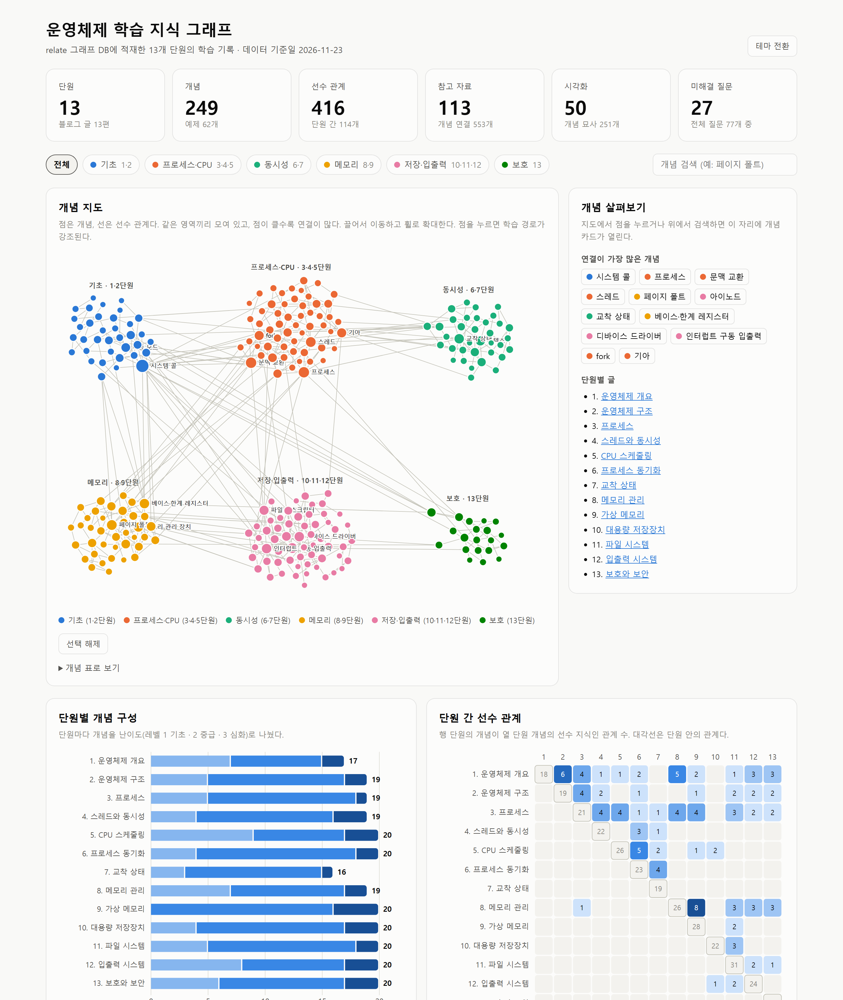
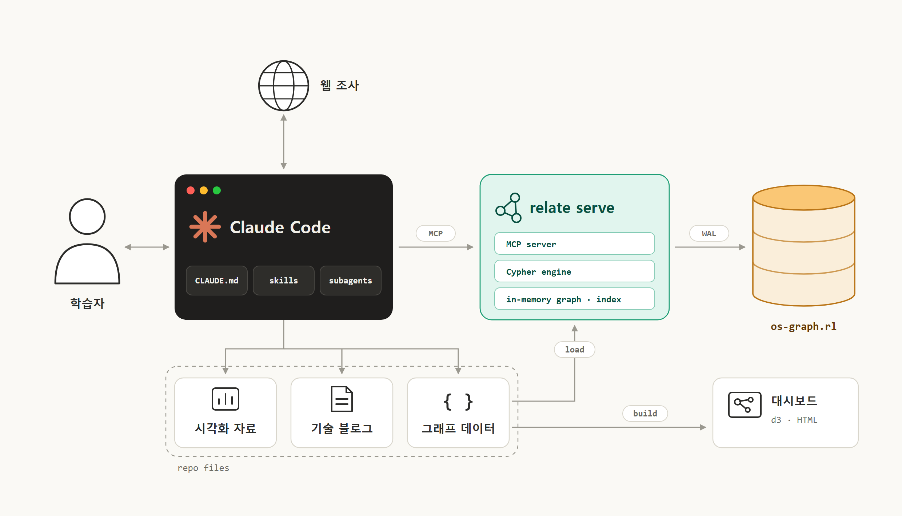
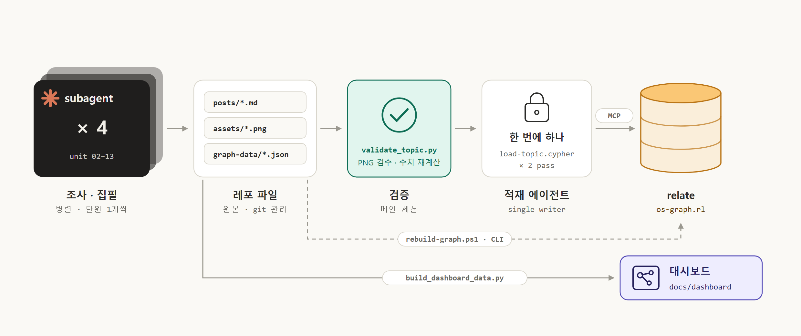
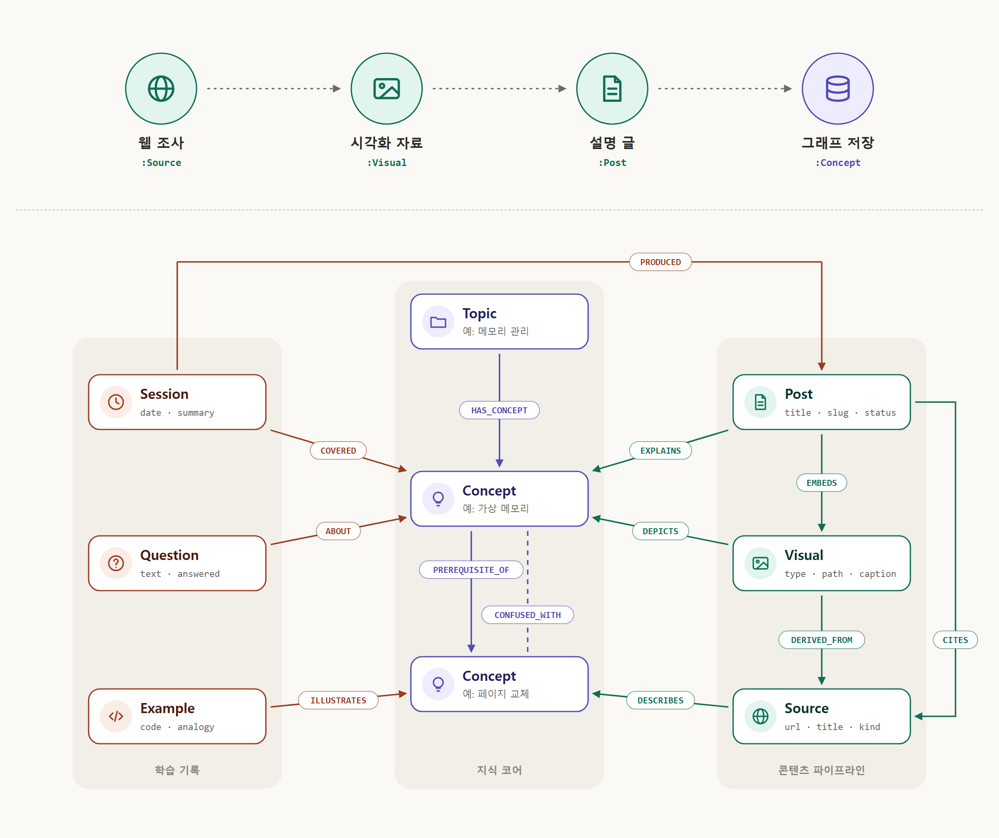

# OS Knowledge Graph · Claude Code × relate

**Claude Code로 운영체제를 공부하고, 그 학습 결과물의 관계를 relate 임베디드 그래프 DB에 쌓아 Claude Code가 직접 관리하게 만든 프로젝트.**
쌓인 그래프를 바탕으로 대화형 대시보드까지 만들었다.

**▶ 대시보드 바로 보기: https://jomin4.github.io/p-nayeonpark-1/**

   



---

## 한눈에 보기

| 학습 | 지식 그래프 | 결과물 |
|---|---|---|
| 운영체제 **13개 단원** | 개념 **249** · 노드 **590** | 기술 블로그 **13편** |
| 참고 자료 **113개** (OSTEP, 커널 문서, man7 등) | 관계 **2,575** (선수 관계 **416**, 그중 단원 간 **114**) | 시각화 **50장** (HTML 원본 + PNG) |
| 질문 **77개** (미해결 **27**) · 예제 **62개** | 제약조건 17 · 인덱스 4 | [대화형 대시보드](https://jomin4.github.io/p-nayeonpark-1/) (GitHub Pages) |

- **재현 가능**: 그래프 DB 파일은 git에 두지 않는다. 레포의 파일만으로 [`rebuild-graph.ps1`](scripts/rebuild-graph.ps1)이 **4초** 만에 같은 그래프(노드 8종·관계 13종 수치 일치)를 다시 만든다.
- **검증된 내용**: 글 속 계산(은행원 알고리즘, SRTF, 디스크 스케줄링, 주소 변환, inode 최대 크기 등)은 모두 다시 계산해 확인했고, 자료끼리 어긋나는 부분은 양쪽을 함께 적었다.

## 무엇을 만들었나

| | 하는 일 | 핵심 |
|---|---|---|
| **1. 학습** | Claude Code가 웹 조사 → 시각화 자료 → 설명 글 순서로 단원을 정리한다 | 그림을 먼저 보여 주고 설명하는 기술 블로그 형식 |
| **2. 지식 관리** | 개념·선수 관계·질문·예제·자료·시각화를 relate 그래프에 기록하고 조회한다 | Claude Code가 **MCP**로 직접 `MERGE`·조회, 규칙은 [`CLAUDE.md`](CLAUDE.md) |
| **3. 시각화** | 그래프를 대시보드로 탐색한다 | 개념 지도, 학습 경로, 단원 간 의존 히트맵, 미해결 질문 |

## 아키텍처



| 구성 요소 | 역할 |
|---|---|
| **Claude Code** | 학습 진행자. [`CLAUDE.md`](CLAUDE.md)의 그래프 규칙을 따르고, 레포 전용 [relate 스킬](.claude/skills/)로 Cypher 문법을 확인하며, 단원 작업을 서브에이전트에 나눠 맡긴다 |
| **relate serve** | [`.mcp.json`](.mcp.json)이 띄우는 MCP 서버. `write_cypher` · `read_cypher` · `get_schema` 도구를 Claude Code에 제공한다 |
| **os-graph.rl** | relate의 단일 파일 저장소(WAL + 스냅샷). 임베디드라 서버 설치가 필요 없다 |
| **레포 파일** | 블로그 글, 시각화, `graph-data/*.json`. 그래프의 **원본**이며 git으로 관리한다 |
| **대시보드** | `graph-data`로 만든 d3 기반 HTML 페이지 |

## 제작 파이프라인

2단원부터는 서브에이전트 4개가 단원을 하나씩 맡아 **병렬**로 만들었다. relate는 writer가 하나뿐이므로 쓰기는 한 곳으로 모은다.



| 단계 | 누가 | 무엇을 |
|---|---|---|
| 조사·집필 | 단원별 서브에이전트 (병렬) | [작업 지침](docs/topic-agent-brief.md)대로 글·시각화·그래프 데이터 작성. DB와 git은 건드리지 않는다 |
| 검증 | 메인 세션 | [`validate_topic.py`](scripts/validate_topic.py)(필수 키·참조·중복 개념·파일 존재), PNG 검수, 수치 재계산 |
| 적재 | 적재 에이전트 1개 | [`load-topic.cypher`](scripts/load-topic.cypher) 한 문장으로 단원 JSON을 `MERGE`. 두 번 돌려 앞쪽 참조를 채운다 |
| 재구축·빌드 | 스크립트 | [`rebuild-graph.ps1`](scripts/rebuild-graph.ps1)(CLI로 DB 재구축), [`build_dashboard_data.py`](scripts/build_dashboard_data.py)(대시보드 데이터) |

## 그래프 모델



- **지식 코어**: `Topic -HAS_CONCEPT-> Concept`, `Concept -PREREQUISITE_OF-> Concept`, `Concept -CONFUSED_WITH- Concept`
- **학습 기록**: `Session -COVERED-> Concept`, `Question -ABOUT-> Concept`, `Example -ILLUSTRATES-> Concept`
- **콘텐츠 파이프라인**: `Source -DESCRIBES->`, `Visual -DEPICTS->`, `Post -EXPLAINS->` `Concept` 와 `Post -EMBEDS-> Visual`, `Post -CITES-> Source`
- 키마다 유일성 제약조건을 두어 모든 쓰기를 `MERGE`로 한다. 같은 데이터를 몇 번 넣어도 결과가 같다([`init.cypher`](schema/init.cypher)).

## Claude Code가 지식을 다루는 방식

Claude Code는 MCP 도구로 그래프를 직접 쓰고 읽는다. 예를 들어 "스래싱을 이해하려면 무엇부터 봐야 하나?"는 선수 관계를 끝까지 따라가는 한 줄의 Cypher 25 쿼리다.

```cypher
MATCH path = (:Concept {slug: 'operating-system'})-[:PREREQUISITE_OF]->{1,12}(:Concept {slug: 'thrashing'})
WITH path ORDER BY length(path) DESC LIMIT 1
RETURN [n IN nodes(path) | n.name] AS longestPath
```

```
운영체제 → 가상화 → 논리 주소 → MMU → 베이스·한계 레지스터 → 세그멘테이션
→ 외부 단편화 → 페이징 → 가상 메모리 → 스왑 공간 → 요구 페이징 → 페이지 폴트 → 스래싱
```

복습 목록(미해결 질문), 헷갈리는 개념 쌍, 단원별 진도, 전문 검색 같은 조회는 [`queries.cypher`](scripts/queries.cypher)에 모아 두었다.

## 학습 결과물

| # | 단원 | # | 단원 |
|---|---|---|---|
| 1 | [운영체제 개요](posts/2026-11-23-os-overview.md) | 8 | [메모리 관리](posts/2026-11-23-memory-management.md) |
| 2 | [운영체제 구조](posts/2026-11-23-os-structure.md) | 9 | [가상 메모리](posts/2026-11-23-virtual-memory.md) |
| 3 | [프로세스](posts/2026-11-23-process.md) | 10 | [대용량 저장장치](posts/2026-11-23-storage.md) |
| 4 | [스레드와 동시성](posts/2026-11-23-thread.md) | 11 | [파일 시스템](posts/2026-11-23-file-system.md) |
| 5 | [CPU 스케줄링](posts/2026-11-23-cpu-scheduling.md) | 12 | [입출력 시스템](posts/2026-11-23-io-system.md) |
| 6 | [프로세스 동기화](posts/2026-11-23-synchronization.md) | 13 | [보호와 보안](posts/2026-11-23-protection-security.md) |
| 7 | [교착 상태](posts/2026-11-23-deadlock.md) | | |

단원별 개념·자료·미해결 질문 수와 그래프 현황은 [docs/TECHNICAL.md](docs/TECHNICAL.md)에 있다.

## 시작하기

Windows 10/11 · PowerShell 7 · Python 3 · [Claude Code](https://claude.com/claude-code) 기준.

```powershell
# 1. relate 설치 (사용자 PATH에 추가된다. 새 터미널에서 relate --version)
irm https://relatedb.ai/install.ps1 | iex

# 2. 레포의 파일로 그래프 재구축 → data/os-graph.rl
pwsh -File scripts/rebuild-graph.ps1

# 3. 레포 루트에서 Claude Code 실행 → 프로젝트 MCP 서버 'relate' 승인
claude
```

- **대시보드**: 온라인은 [GitHub Pages](https://jomin4.github.io/p-nayeonpark-1/), 로컬은 [`docs/dashboard/index.html`](docs/dashboard/index.html)을 브라우저로 연다(d3를 CDN에서 받으므로 인터넷 필요).
- **새 단원·수정 후**: `python -I scripts/validate_topic.py --all` → 그래프 적재 → `python -I scripts/build_dashboard_data.py`
- Claude Code가 MCP 서버로 그래프 파일을 열고 있는 동안에는 CLI로 쓸 수 없다(단일 writer). 재구축은 Claude Code를 닫고 하거나 `-Database`로 다른 경로를 준다.

## 레포 구조

```
.
├── CLAUDE.md          # Claude Code 작업 규칙: 그래프 쓰기 규칙, 세션 흐름, 병렬 역할 분담
├── .mcp.json          # relate MCP 서버 (relate serve --mcp stdio)
├── .claude/
│   ├── skills/        # relate 공식 스킬 (레포 전용, SHA-256 검증)
│   └── launch.json    # 대시보드 미리보기 서버
├── index.html         # GitHub Pages 진입점 → docs/dashboard/
├── posts/             # 기술 블로그 13편 + assets/<단원>/ 시각화 50장
├── graph-data/        # 단원별 그래프 데이터 (그래프의 원본)
├── schema/            # init.cypher(제약조건·인덱스), seed-topics.cypher(단원 13개)
├── scripts/           # 검증 · 적재 · 재구축 · 렌더링 · 대시보드 빌드 · 조회 쿼리
├── docs/              # 다이어그램, 대시보드, 기술 문서(TECHNICAL.md), 서브에이전트 지침
└── data/              # os-graph.rl (git 제외)
```

## 부딪힌 문제와 해결

| 문제 | 해결 |
|---|---|
| relate는 **writer가 하나**뿐이라 서브에이전트들이 동시에 쓰면 충돌한다 | 서브에이전트는 **파일만** 만들고, 검증 후 **적재 에이전트 하나**가 순서대로 쓴다 |
| 단원끼리 서로의 개념을 참조해 먼저 넣은 단원에서 관계가 빠진다 | 모든 쓰기를 `MERGE`로 만든 멱등 로더를 **두 번** 돌린다. 재적재 시 새 노드·관계 0개로 멱등성 확인 |
| 파일을 파라미터로 읽는 `--fetch-params`는 CLI 전용이고, MCP 서버가 파일을 잠그고 있다 | 세션 중에는 MCP `write_cypher`로, 재구축은 CLI 스크립트로 경로를 나눴다 |
| relate와 Neo4j의 문법 차이 | `db.index.fulltext.queryNodes`(deprecated) → Cypher 25 `SEARCH` 절, `read_cypher`는 MATCH 기반만 허용 등을 스킬 문서로 확인해 반영 |
| 병렬 렌더링 시 Edge headless 프로필 충돌 | 호출마다 임시 프로필을 쓰도록 [`render.ps1`](scripts/render.ps1) 수정 |
| 13개 단원은 범주형 색 8개를 넘는다 | 6개 영역으로 묶고, 팔레트를 색각 이상 검증 스크립트로 확인(라이트·다크 모두 통과) |
| AI가 쓴 학습 자료의 정확성 | 모든 수치 재계산, PDF 원문 대조, 자료 간 충돌은 병기, 확인 못 한 내용은 미해결 질문으로 남김 |

## 한계와 다음 단계

- **미해결 질문 27개**가 그래프에 남아 있다. 일부는 다른 단원 조사에서 답이 나왔다(예: 리눅스 4.14부터 PCID로 문맥 교환 시 TLB 전체 비우기를 피함).
- 이 환경에 C 컴파일러가 없어 일부 C 예제는 실행하지 못했다. 해당 글에 "실행하지 않음" 또는 "예상 결과"로 표시했다.
- 다음 후보: 질문 노드를 이용한 간격 반복 복습, relate 벡터 인덱스로 개념 의미 검색, `relate serve --bolt`로 Neo4j Browser 연결.

## 출처

- [relate](https://relatedb.ai/) (Apache-2.0) · 레포의 `.claude/skills/`는 relatedb.ai가 배포한 스킬 파일이다.
- 학습 자료: [OSTEP](https://pages.cs.wisc.edu/~remzi/OSTEP/), [Linux kernel docs](https://docs.kernel.org/), [man7.org](https://man7.org/linux/man-pages/), Wikipedia 등 113개. 각 글의 "참고 자료"에 있다.
- 글·시각화·그래프 데이터는 Claude Code(메인 세션과 서브에이전트)로 만들고 검증했다.
