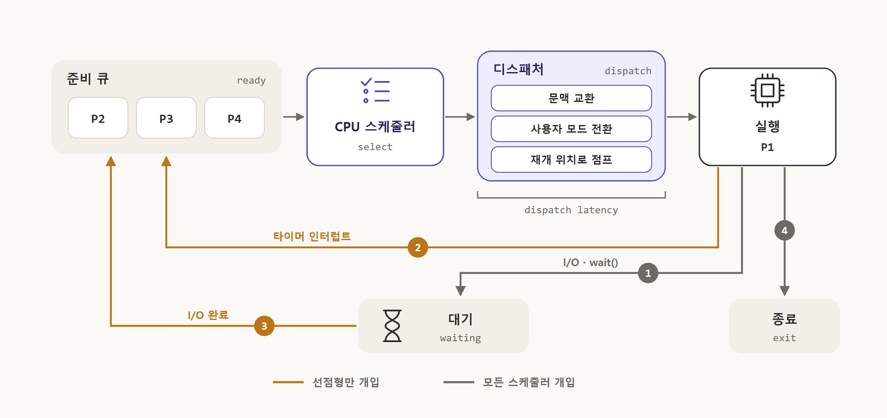
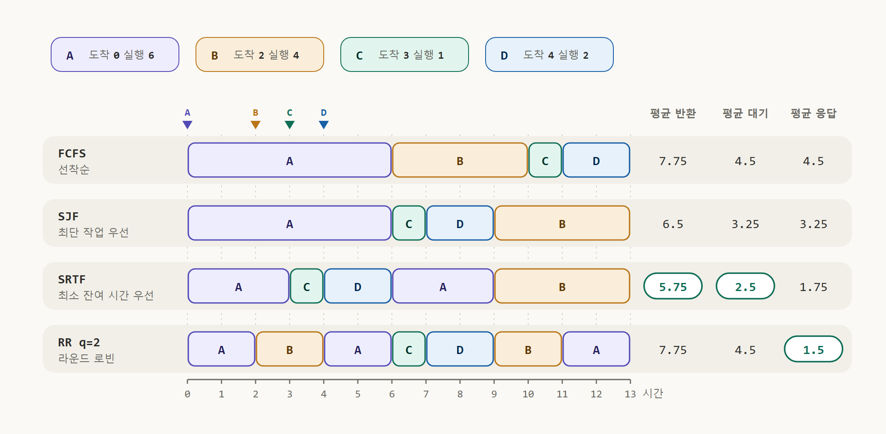
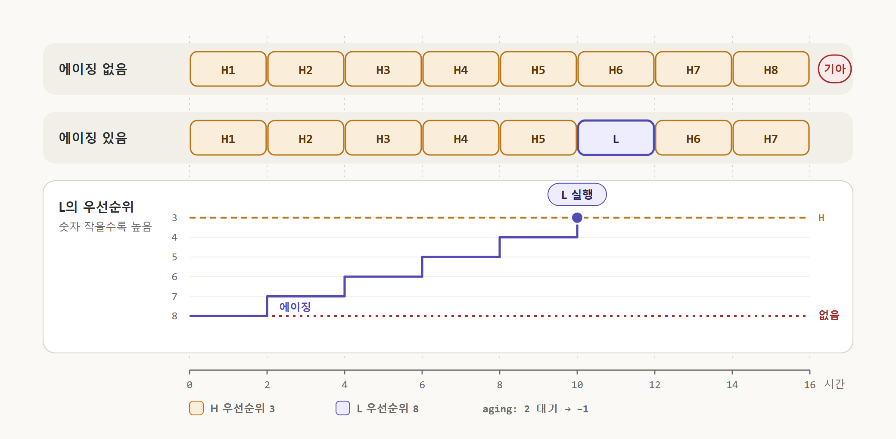
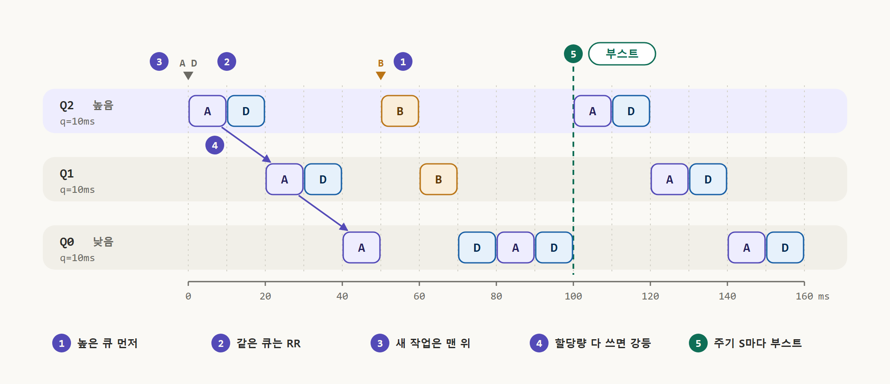

# CPU 스케줄링: 누구에게, 언제, 얼마나 CPU를 줄까

> OS 학습 5단원. CPU를 기다리는 프로세스가 여럿일 때 운영체제가 다음 차례를 고르는 방법을 정리한다. 같은 작업 네 개를 네 가지 알고리즘으로 직접 계산해 보고, 기아를 막는 에이징과 MLFQ의 다섯 규칙, 리눅스 CFS까지 이어 간다.

---

## 1. 스케줄러와 디스패처



그림의 윗줄이 CPU를 넘겨주는 흐름이다. 3단원에서 본 **준비(ready) 상태**의 프로세스들이 준비 큐에 줄 서 있다.

1. **CPU 스케줄러**가 준비 큐에서 다음에 실행할 프로세스를 *고른다*. 자주 실행되므로 단기 스케줄러(short-term scheduler)라고도 한다.
2. **디스패처**가 고른 프로세스에 CPU를 *넘긴다*. 하는 일은 세 가지다.
   - **문맥 교환**: 지금 프로세스의 상태를 저장하고 새 프로세스의 상태를 불러온다(3단원).
   - **사용자 모드로 전환**한다(1단원의 이중 모드).
   - 새 프로세스가 **멈췄던 위치로 점프**한다.
3. 디스패처가 한 프로세스를 멈추고 다른 프로세스를 시작하는 데 걸리는 시간을 **디스패치 지연**(dispatch latency)이라 한다. 문맥 교환마다 생기므로 짧을수록 좋다.

> 헷갈리기 쉬운 점: **스케줄러 ≠ 디스패처**. 스케줄러는 "누구를"을 정하는 정책이고, 디스패처는 그 결정을 실제로 실행하는 장치다.

### 스케줄링은 언제 일어나나

그림 아랫부분의 ①~④가 스케줄링 결정이 일어나는 네 지점이다.

| 지점 | 상태 변화 | 선택의 여지 | 개입하는 스케줄러 |
|---|---|---|---|
| ① I/O 요청, `wait()` | 실행 → 대기 | 없음. 누군가 새로 골라야 함 | 모든 스케줄러 |
| ② 타이머 인터럽트 | 실행 → 준비 | 있음 | 선점형만 |
| ③ I/O 완료 | 대기 → 준비 | 있음 | 선점형만 |
| ④ 종료 | 실행 → 종료 | 없음 | 모든 스케줄러 |

①과 ④에서만 스케줄링하면 **비선점형**(협력적) 스케줄링이다. 프로세스가 스스로 CPU를 내놓을 때까지 빼앗지 않는다. ②와 ③에서도 끼어들면 **선점형** 스케줄링이다. 선점형은 1단원의 **타이머 인터럽트**가 있어야 가능하다. 타이머가 울려야 운영체제가 CPU를 되찾아 "계속 돌릴지, 바꿀지"를 정할 수 있기 때문이다.

옛 일괄 처리(batch) 시스템에는 비선점형 스케줄러가 많았다. 지금의 범용 운영체제 스케줄러는 거의 모두 선점형이다.

---

## 2. 같은 작업, 네 가지 알고리즘



그림 맨 위의 네 작업을 네 알고리즘으로 돌렸다. 시간 단위는 임의의 단위다. 오른쪽 숫자가 평균값이고, 초록 테두리가 그 열의 최솟값이다.

### 평가 기준

| 기준 | 정의 | 좋은 방향 |
|---|---|---|
| 반환 시간 (turnaround) | 완료 시각 − 도착 시각 | 짧을수록 |
| 대기 시간 (waiting) | 준비 큐에서 기다린 시간의 합. CPU만 쓰면 반환 − 실행 시간 | 짧을수록 |
| 응답 시간 (response) | 처음 실행된 시각 − 도착 시각 | 짧을수록 |
| 처리량 (throughput) | 단위 시간당 끝낸 작업 수 | 많을수록 |
| CPU 이용률 | CPU가 일한 시간의 비율 | 높을수록 |
| 공정성 (fairness) | 작업들이 CPU를 고르게 나눠 받는 정도 | 고를수록 |

성능과 공정성은 자주 부딪친다. 짧은 작업만 먼저 돌리면 평균 성능은 좋아지지만 긴 작업은 손해를 본다.

> 헷갈리기 쉬운 점: **대기 시간 ≠ 응답 시간**. 대기 시간은 준비 큐에 있던 시간을 *모두* 더한 값이고, 응답 시간은 *처음* CPU를 받을 때까지의 시간이다. 다만 자료마다 정의가 조금씩 다르다. OSTEP은 응답 시간을 "첫 실행까지"로 정의하고, 위키백과는 wait time을 "첫 실행까지"로 정의한다. 이 글은 위 표의 정의를 쓴다.

### 계산 결과

| 알고리즘 | 실행 순서 | A·B·C·D 반환 시간 | 평균 반환 | 평균 대기 | 평균 응답 |
|---|---|---|---|---|---|
| FCFS | A B C D | 6 · 8 · 8 · 9 | 7.75 | 4.5 | 4.5 |
| SJF | A C D B | 6 · 11 · 4 · 5 | 6.5 | 3.25 | 3.25 |
| SRTF | A C D A B | 9 · 11 · 1 · 2 | **5.75** | **2.5** | 1.75 |
| RR (q=2) | A B A C D B A | 13 · 9 · 4 · 5 | 7.75 | 4.5 | **1.5** |

손으로 계산한 값을 작은 시뮬레이터로 한 번 더 확인했다. 동점일 때의 규칙은 두 가지로 정했다.

- SRTF에서 남은 시간이 같으면 먼저 온 작업을 고른다(시각 2에 A와 B가 둘 다 4 남음 → A).
- RR에서 같은 시각에 새 작업 도착과 퀀텀 만료가 겹치면, 새 작업을 먼저 큐에 넣고 쫓겨난 작업을 그 뒤에 넣는다.

### FCFS와 호위 효과

**FCFS**(First-Come First-Served, FIFO)는 도착한 순서대로 끝까지 실행한다. 단순하고, 언젠가는 모두 실행되므로 기아가 없다. 하지만 긴 작업 A(6)가 먼저 오면 C(1)와 D(2)는 짧은데도 7씩 기다린다.

이렇게 오래 쓰는 작업 하나 뒤에 짧은 작업들이 줄줄이 묶이는 현상을 **호위 효과**(convoy effect)라 한다. OSTEP의 예에서는 100초짜리 A 뒤에 10초짜리 B, C가 서면 평균 반환 시간이 110초다. 순서만 B, C, A로 바꿔도 50초가 된다.

> 비유: 우유 하나 든 손님 셋이 카트 세 대를 채운 손님 뒤에 서면 셋 다 한참 기다린다. 마트의 "소량 계산대"가 바로 다음에 볼 SJF의 발상이다.

### SJF와 SRTF

**SJF**(Shortest Job First)는 다음 CPU 버스트가 가장 짧은 작업을 먼저 끝까지 실행한다. 모든 작업이 동시에 도착한다면 SJF가 평균 반환 시간을 가장 작게 만든다. 예제에서는 시각 6에 C, D, B가 모두 기다리고 있으므로 C → D → B 순서로 간다.

그런데 SJF는 **비선점형**이다. A가 시각 0에 혼자 와서 먼저 잡으면, 바로 뒤에 짧은 작업이 와도 A가 끝날 때까지 기다린다. 여기에 선점을 더한 것이 **SRTF**(Shortest Remaining Time First)다. OSTEP은 같은 알고리즘을 STCF(Shortest Time-to-Completion First) 또는 선점형 SJF라고 부른다.

SRTF는 새 작업이 도착할 때마다 남은 시간이 가장 짧은 작업으로 바꾼다.

1. 시각 0: A만 있으니 A 실행.
2. 시각 3: C(1) 도착. A는 3 남음 → C가 더 짧으므로 A를 선점.
3. 시각 4: D(2) 도착. A 3, B 4, D 2 → D 실행.
4. 시각 6: A 3, B 4 → A가 마저 실행되고, 마지막에 B.

그 결과 평균 반환 시간이 5.75로 가장 작다.

> 헷갈리기 쉬운 점: **SJF ≠ SRTF**. SJF는 한번 시작하면 끝까지 가고(비선점형), SRTF는 더 짧은 작업이 오면 빼앗는다(선점형).

**문제는 길이를 미리 알 수 없다는 것이다.** 범용 운영체제는 작업이 얼마나 오래 걸릴지 거의 모른다. 그래서 교과서들은 지난 버스트들로 다음 버스트를 예측하는 **지수 평균**을 소개한다.

```
예측[n+1] = α × 실제[n] + (1 − α) × 예측[n]     (보통 α = 0.5)
```

α가 1이면 직전 버스트만 믿고, 0이면 측정값을 무시한다.

### 라운드 로빈과 타임 퀀텀

**라운드 로빈**(RR)은 각 작업을 **타임 퀀텀**(time slice)만큼만 실행하고 준비 큐 맨 뒤로 보낸다. 표의 마지막 줄이 q=2인 경우다. 모든 작업이 금방 한 번씩 CPU를 받으므로 **평균 응답 시간이 1.5로 가장 짧다**. 대신 각 작업의 완료가 늦춰져 평균 반환 시간은 FCFS와 같은 7.75다. OSTEP은 공정하게 잘게 나누는 정책일수록 반환 시간이 나빠지는 것이 본질적인 맞교환이라고 설명한다.

같은 계산을 C로 짜면 이렇다. 실제로 컴파일해서 돌려 본 결과가 위 표와 같았다.

```c
#include <stdio.h>

#define N 4
#define Q 2   /* 타임 퀀텀 */

int main(void) {
    const char name[N] = {'A', 'B', 'C', 'D'};
    int arrive[N] = {0, 2, 3, 4};
    int burst[N]  = {6, 4, 1, 2};
    int left[N], first[N], done[N];
    int queue[64], head = 0, tail = 0, next = 0, t = 0;

    for (int i = 0; i < N; i++) { left[i] = burst[i]; first[i] = -1; }
    while (next < N && arrive[next] <= t) queue[tail++] = next++;

    while (head < tail || next < N) {
        if (head == tail) { t = arrive[next]; queue[tail++] = next++; continue; }
        int p = queue[head++];
        if (first[p] < 0) first[p] = t;
        int run = left[p] < Q ? left[p] : Q;
        t += run;
        left[p] -= run;
        /* 이번 퀀텀 동안 도착한 작업을 먼저 넣고, 쫓겨난 작업은 그 뒤에 */
        while (next < N && arrive[next] <= t) queue[tail++] = next++;
        if (left[p] > 0) queue[tail++] = p;
        else done[p] = t;
    }
    for (int i = 0; i < N; i++)
        printf("%c 반환 %2d  대기 %2d  응답 %d\n", name[i],
               done[i] - arrive[i], done[i] - arrive[i] - burst[i],
               first[i] - arrive[i]);
    return 0;
}
// 출력: A 반환 13 대기 7 응답 0 / B 9 5 0 / C 4 3 3 / D 5 3 3
```

**퀀텀은 얼마나 길어야 할까?** 맞교환이 있다.

| 퀀텀 | 장점 | 단점 |
|---|---|---|
| 짧게 | 응답 시간이 좋아진다 | 문맥 교환 비용이 커진다 |
| 길게 | 교환 비용이 분산된다 | 응답성이 떨어지고, 아주 길면 FCFS와 같아진다 |

- OSTEP의 계산: 퀀텀 10ms에 문맥 교환 1ms면 시간의 약 10%가 낭비된다. 퀀텀을 100ms로 늘리면 1% 아래로 줄어든다. 비용에는 레지스터 저장뿐 아니라 캐시·TLB 같은 하드웨어 상태를 다시 데우는 비용도 들어간다.
- 퀀텀은 타이머 인터럽트 주기의 배수여야 한다. 타이머가 10ms마다 울리면 퀀텀은 10, 20ms처럼 잡는다.
- UIC 강의 노트의 경험 법칙: CPU 버스트의 약 80%가 퀀텀보다 짧게 잡는다. 현대 시스템의 퀀텀은 대략 10~100ms라고 한다.

> 비유: 토론 사회자가 발언 시간을 너무 짧게 주면 마이크를 넘기는 시간이 더 걸리고, 너무 길게 주면 한 사람이 말을 마칠 때까지 아무도 끼어들지 못한다.

---

## 3. 우선순위 스케줄링과 기아, 에이징



**우선순위 스케줄링**은 각 프로세스에 우선순위를 매기고 가장 높은 것부터 실행한다. 이 글은 UIC 노트를 따라 **숫자가 작을수록 우선순위가 높다**고 둔다(0이 가장 높음). 우선순위는 운영체제가 버스트 기록 같은 내부 정보로 정하기도 하고, 사용자나 관리자가 밖에서 정하기도 한다. 선점형으로도, 비선점형으로도 만들 수 있다. 사실 SJF는 "예측 버스트가 짧을수록 우선순위가 높은" 우선순위 스케줄링의 특수한 경우다.

그림의 상황은 이렇다(비선점형, 동점이면 먼저 온 작업).

- 우선순위 3인 작업 H가 2단위마다 하나씩 도착하고, 각각 2단위씩 실행한다.
- 우선순위 8인 작업 L은 시각 0에 도착했다.

**에이징이 없으면**(윗줄) CPU는 항상 H 차지다. L은 영원히 기다린다. 이것이 **기아**(starvation)다. UIC 노트는 몇 년씩 실행되지 못한 작업이 있었다는 "소문"까지 언급한다.

**에이징**(aging)은 기다린 시간만큼 우선순위를 올려 준다. 그림에서는 L이 2단위 기다릴 때마다 우선순위 숫자를 1씩 줄였다.

1. 시각 0~10: L의 우선순위가 8 → 7 → 6 → 5 → 4 → 3으로 올라간다(아래 그래프의 계단).
2. 시각 10: L이 H와 같은 3이 되고, 먼저 온 L이 선택된다.
3. L이 10~12에 실행된 뒤 H들이 이어서 실행된다.

> 비유: 응급실에 위급한 환자가 계속 들어오면 가벼운 환자는 끝없이 밀린다. 기다린 시간만큼 순번을 올려 주면 결국 진료를 받는다.

FCFS와 RR은 모든 작업이 언젠가 차례를 받으므로 기아가 없다. 기아는 우선순위 스케줄링과 SRTF처럼 "더 좋은 작업이 계속 오면 계속 밀리는" 방식에서 생긴다. 위키백과는 짧은 작업이 많은 바쁜 시스템에서 SRTF도 기아를 일으킬 수 있다고 적는다.

---

## 4. MLFQ: 과거로 미래를 예측한다



지금까지의 결론을 모으면 딜레마가 남는다. SJF/SRTF는 반환 시간에 좋지만 작업 길이를 알아야 한다. RR은 응답 시간에 좋지만 반환 시간이 나쁘다. **다단계 피드백 큐**(MLFQ)는 작업을 *관찰*해서 이 둘을 함께 노린다. 1962년 Corbató 등이 CTSS에서 처음 설명했고, 이 연구와 Multics 작업으로 Corbató는 튜링상을 받았다.

MLFQ는 우선순위가 다른 큐 여러 개를 둔다. OSTEP이 정리한 최종 규칙은 다섯 개다.

| 규칙 | 내용 |
|---|---|
| 1 | 우선순위(A) > 우선순위(B)이면 A가 실행된다 |
| 2 | 우선순위가 같으면 둘은 RR로 번갈아 실행된다 |
| 3 | 새 작업은 맨 위(가장 높은) 큐에 들어간다 |
| 4 | 한 큐에서 할당량을 다 쓰면, CPU를 몇 번 내놓았든 한 단계 내려간다 |
| 5 | 일정 주기 S마다 모든 작업을 맨 위 큐로 올린다 (부스트) |

그림은 큐 3개, 모든 큐의 퀀텀과 할당량이 10ms인 경우를 직접 시뮬레이션한 결과다.

1. 시각 0: 긴 작업 A와 D가 들어와 Q2에서 시작한다(규칙 3). 같은 큐이므로 번갈아 실행된다(규칙 2).
2. 할당량 10ms를 다 쓸 때마다 한 단계씩 내려간다(규칙 4). 40ms쯤에는 둘 다 Q0에 있다.
3. 시각 50: 짧은 작업 B(20ms)가 도착해 Q2에 들어간다. Q0의 A, D보다 높으므로 먼저 실행된다(규칙 1). B는 Q2와 Q1에서 10ms씩 쓰고 70ms에 끝난다.
4. 시각 100: 부스트(규칙 5). A와 D가 다시 Q2로 올라가 같은 과정을 되풀이한다.

**MLFQ가 SJF를 흉내 내는 방법**은 3단계다. 새 작업을 일단 짧은 작업이라고 가정해 맨 위에 넣는다. 정말 짧으면 B처럼 위쪽에서 금방 끝난다. 길면 A, D처럼 차례로 내려가며 긴 작업임이 드러난다.

### 왜 규칙 4와 5가 필요한가

OSTEP은 처음에 "할당량 전에 CPU를 내놓으면 같은 큐에 남는다"는 규칙으로 시작했다가 문제 세 가지를 찾는다.

- **기아**: 대화형 작업이 너무 많으면 위쪽 큐가 CPU를 다 써서, 아래로 내려간 긴 작업은 영영 실행되지 못한다.
- **스케줄러 속이기**(gaming): 할당량의 99%쯤 쓰고 일부러 I/O를 일으켜 CPU를 내놓으면 계속 높은 큐에 머물며 CPU를 거의 독차지할 수 있다.
- **성격 변화**: CPU를 많이 쓰던 작업이 대화형으로 바뀌어도 이미 아래로 내려가 있으면 제대로 대우받지 못한다.

**규칙 5(부스트)**는 기아와 성격 변화를 한 번에 해결한다. 모두를 맨 위로 올리면 긴 작업도 RR로 차례를 받고, 성격이 바뀐 작업도 다시 평가받는다. **규칙 4**는 큐마다 쓴 시간을 누적해서 세어 속이기를 막는다. 한 번에 몰아 쓰든 잘게 나눠 쓰든 할당량을 다 쓰면 내려간다.

> 헷갈리기 쉬운 점: **에이징 ≠ 부스트**. 에이징은 기다린 프로세스의 우선순위를 *조금씩* 올리고, MLFQ의 부스트는 주기 S마다 *모든* 작업을 한꺼번에 맨 위로 올린다. 목적(기아 방지)은 같다.

### 조정하기 어려운 값들

큐는 몇 개인지, 큐마다 퀀텀은 얼마인지, S는 얼마인지에 정답이 없다. S가 너무 크면 긴 작업이 굶고, 너무 작으면 대화형 작업이 제 몫을 못 받는다. OSTEP은 이런 값을 Ousterhout의 표현을 빌려 "부두(voo-doo) 상수"라고 부른다.

실제 구현은 보통 아래 큐일수록 퀀텀을 길게 준다. 위쪽 큐에는 대화형 작업이 많아 빨리 번갈아 주는 편이 좋고, 아래쪽 긴 작업은 길게 돌리는 편이 효율적이기 때문이다. OSTEP에 따르면 Solaris의 시분할(TS) 클래스는 기본값으로 큐 60개, 위쪽 20ms에서 아래쪽 수백 ms까지 늘어나는 퀀텀, 약 1초마다의 부스트를 쓴다. 위키백과에 따르면 Windows NT 계열도 우선순위 32단계(0~31)의 다단계 피드백 큐를 쓴다.

### 덧붙임: 리눅스 CFS

리눅스는 2.6.23부터 **CFS**(Completely Fair Scheduler)를 썼다. CFS는 고정 퀀텀 대신 "공정한 몫"을 기준으로 한다. 커널 문서는 이것을 N개 태스크를 각각 1/N 속도로 동시에 돌리는 "이상적인 멀티태스킹 CPU"를 흉내 내는 것이라고 설명한다.

- 태스크마다 **가상 실행 시간**(vruntime)을 쌓는다. 스케줄러는 vruntime이 가장 작은, 즉 가장 덜 실행된 태스크를 고른다.
- 실행 가능한 태스크는 vruntime 순서의 **레드-블랙 트리**에 들어 있고, 맨 왼쪽 노드를 꺼낸다. 삽입·삭제가 O(log n)이다.
- OSTEP의 설명: 목표 지연 `sched_latency`(대표값 48ms)를 태스크 수로 나눠 각자의 시간 조각을 정한다. 태스크가 너무 많아 조각이 지나치게 작아지지 않도록 `min_granularity`(대표값 6ms)가 하한이 된다.
- **nice** 값(−20~+19, 기본 0)은 가중치로 바뀐다. nice 0은 1024, nice −5는 3121이다. 그래서 nice −5인 A와 nice 0인 B가 경쟁하면 A가 약 3/4, B가 약 1/4을 받는다. vruntime은 `1024 / 가중치` 비율로 쌓이므로, 가중치가 큰 태스크일수록 vruntime이 천천히 늘어난다.

```c
// vruntime 갱신 (OSTEP 식 9.2를 옮긴 의사 코드)
vruntime_i += runtime_i * 1024 / weight_i;
```

커널 문서는 지금 CFS가 **EEVDF**에 자리를 내주는 중이라고 적고 있다. 위키백과에 따르면 리눅스 6.6부터 EEVDF로 옮겨 가기 시작했다. 또 현재 커널 문서는 중심 조정값으로 `base_slice_ns` 하나를 든다. 그러니 OSTEP의 `sched_latency`·`min_granularity` 값은 CFS의 동작 원리를 설명하는 대표값으로 읽는 것이 맞다.

---

## 정리

- **스케줄러**는 다음 프로세스를 고르고, **디스패처**는 문맥 교환·모드 전환·점프로 CPU를 넘긴다.
- 프로세스가 스스로 CPU를 내놓을 때만 고르면 **비선점형**, 타이머 인터럽트와 I/O 완료 때도 끼어들면 **선점형**이다.
- 같은 작업에서 **SRTF**는 평균 반환·대기 시간이, **RR**은 평균 응답 시간이 가장 짧았다. **FCFS**는 **호위 효과**에 약하다.
- **타임 퀀텀**은 응답성과 문맥 교환 비용 사이의 맞교환이다.
- **우선순위 스케줄링**은 **기아**를 부를 수 있고, **에이징**으로 막는다.
- **MLFQ**는 작업을 관찰해 큐를 옮기며 SJF와 RR의 장점을 함께 노린다. 규칙 4(누적 계산)는 속이기를, 규칙 5(부스트)는 기아를 막는다.
- **리눅스 CFS**는 vruntime이 가장 작은 태스크를 레드-블랙 트리에서 고르고, 6.6부터 EEVDF로 옮겨 가고 있다.

## 아직 답을 못 찾은 질문

- 리눅스 6.6 이후 EEVDF에서 nice 값과 `sched_setattr()`로 요청한 time slice는 실제 선택 순서에 어떻게 함께 반영되나?
- SJF의 다음 CPU 버스트 예측(지수 평균)은 오늘날 실제 운영체제 스케줄러에서도 쓰이나?

## 참고 자료

- Remzi & Andrea Arpaci-Dusseau, *Operating Systems: Three Easy Pieces*, [Ch.7 Scheduling: Introduction](https://pages.cs.wisc.edu/~remzi/OSTEP/cpu-sched.pdf)
- 같은 책, [Ch.8 Scheduling: The Multi-Level Feedback Queue](https://pages.cs.wisc.edu/~remzi/OSTEP/cpu-sched-mlfq.pdf)
- 같은 책, [Ch.9 Scheduling: Proportional Share](https://pages.cs.wisc.edu/~remzi/OSTEP/cpu-sched-lottery.pdf) (9.7절 Linux CFS)
- The Linux Kernel documentation, [CFS Scheduler](https://docs.kernel.org/scheduler/sched-design-CFS.html)
- University of Illinois Chicago 운영체제 강의 노트, [CPU Scheduling](https://www.cs.uic.edu/~jbell/CourseNotes/OperatingSystems/6_CPU_Scheduling.html)
- Wikipedia, [Scheduling (computing)](https://en.wikipedia.org/wiki/Scheduling_(computing))
