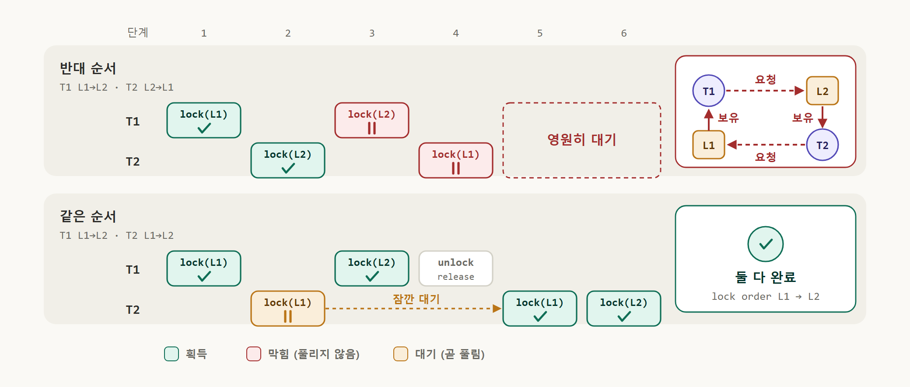
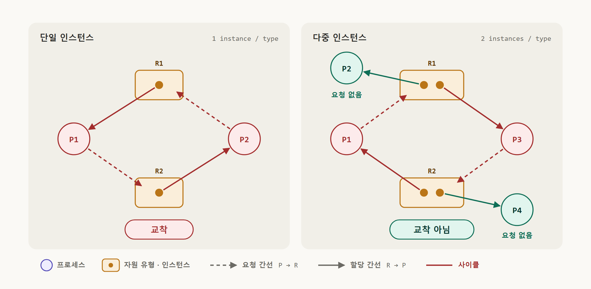
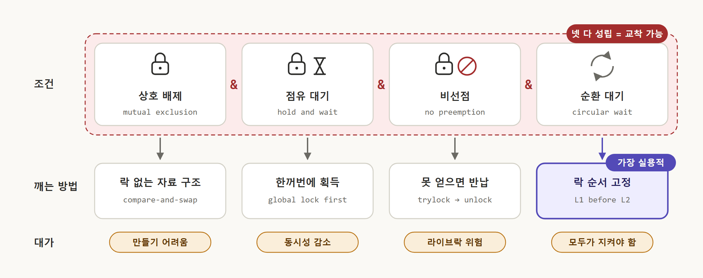
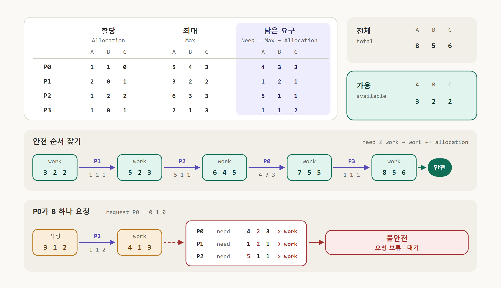

# 교착 상태: 서로를 기다리다 모두 멈출 때

> OS 학습 7단원. 락을 두 개 이상 쓰기 시작하면 만나는 교착 상태를 정리한다. 락 두 개를 반대 순서로 잡는 스레드에서 출발해 네 가지 필요 조건과 자원 할당 그래프를 보고, 예방·회피·탐지와 회복·무시라는 네 가지 대응을 비교한다. 은행원 알고리즘은 작은 예제를 직접 계산해 확인한다.

---

## 1. 교착 상태란: 락 두 개, 반대 순서



그림 윗줄이 교착 상태가 생기는 과정이다. 6단원의 **뮤텍스** 두 개(L1, L2)를 4단원의 **스레드** 두 개가 쓴다. T1은 L1 → L2 순서로, T2는 L2 → L1 순서로 잡는다.

1. 단계 1: T1이 L1을 잡는다.
2. 단계 2: 여기서 문맥 교환이 일어나 T2가 L2를 잡는다.
3. 단계 3: T1이 L2를 요청한다. T2가 쥐고 있으니 막힌다.
4. 단계 4: T2가 L1을 요청한다. T1이 쥐고 있으니 막힌다.
5. 이후: 둘 다 상대가 락을 놓기를 기다린다. 그런데 상대도 기다리는 중이라 아무도 놓지 않는다.

오른쪽 작은 그림이 이 상황을 "누가 무엇을 쥐고, 무엇을 기다리는가"로 그린 것이다. 보유와 요청 화살표가 **원을 이룬다**. OSTEP은 이 그래프에 사이클이 있다는 것이 교착의 표시라고 설명한다.

이렇게 **집합 안의 모든 구성원이 다른 구성원이 쥔 자원을 기다리느라 아무도 진행하지 못하는 상태**를 **교착 상태**(deadlock)라 한다. 대상은 스레드든 3단원의 **프로세스**든 상관없다. Dijkstra가 이 문제를 처음 글로 남겼을 때는 "죽음의 포옹(deadly embrace)"이라고 불렀다.

같은 코드를 C로 쓰면 이렇다.

```c
#include <pthread.h>
#include <stdio.h>
#include <unistd.h>

pthread_mutex_t L1 = PTHREAD_MUTEX_INITIALIZER;
pthread_mutex_t L2 = PTHREAD_MUTEX_INITIALIZER;

void *t1(void *arg) {
    pthread_mutex_lock(&L1);
    usleep(100000);              /* 여기서 문맥 교환이 일어났다고 치자 */
    pthread_mutex_lock(&L2);     /* T2가 L2를 쥐고 있어 영원히 대기 */
    puts("T1 done");
    pthread_mutex_unlock(&L2);
    pthread_mutex_unlock(&L1);
    return NULL;
}

void *t2(void *arg) {
    pthread_mutex_lock(&L2);     /* T1과 반대 순서 */
    usleep(100000);
    pthread_mutex_lock(&L1);     /* T1이 L1을 쥐고 있어 영원히 대기 */
    puts("T2 done");
    pthread_mutex_unlock(&L1);
    pthread_mutex_unlock(&L2);
    return NULL;
}

int main(void) {
    pthread_t a, b;
    pthread_create(&a, NULL, t1, NULL);
    pthread_create(&b, NULL, t2, NULL);
    pthread_join(a, NULL);       /* 돌아오지 않는다 */
    pthread_join(b, NULL);
    return 0;
}
```

이 환경에는 C 컴파일러가 없어서, 같은 구조를 파이썬 `threading.Lock`으로 짜서 돌려 봤다. 두 번째 락을 1초 타임아웃으로 기다리게 하자 반대 순서에서는 두 스레드가 모두 시간 초과로 실패했고, 같은 순서로 바꾸자 둘 다 끝났다.

`usleep`이 없으면 교착은 *가끔만* 생긴다. T1이 L1과 L2를 둘 다 잡은 뒤에 T2가 실행되면 아무 일도 없다. 문맥 교환이 공교롭게 단계 1과 3 사이에 끼어야 생긴다. 그래서 교착 버그는 재현이 어렵다.

그림 아랫줄은 **두 스레드가 같은 순서(L1 → L2)로 잡는** 경우다. T2는 단계 2에서 L1을 기다리지만, T1은 L2까지 잡고 일을 마친 뒤 둘 다 놓는다. T2는 잠깐 기다린 뒤 진행한다. 기다림은 있어도 사이클이 없으니 풀린다. 이것이 3절에서 볼 **락 순서 정하기**다.

> 비유: 네거리 꼬리물기. 네 방향 차가 모두 교차로에 머리를 들이밀면, 각 차는 앞차가 빠져야 움직일 수 있고 그 앞차는 또 다음 차를 기다린다. 아무도 후진하지 않으면 원을 이룬 줄이 영원히 멈춘다.

뮤텍스만의 문제가 아니다. UIC 노트는 응용 프로그램이 관리하는 자원을 뮤텍스나 **세마포어**의 `wait()`/`signal()`로 보호한다고 설명한다. 세마포어 두 개를 두 스레드가 반대 순서로 `wait()`해도 똑같은 사이클이 생긴다.

자기 자신과 교착에 빠질 수도 있다. POSIX 매뉴얼에 따르면 보통(`PTHREAD_MUTEX_NORMAL`) 뮤텍스를 이미 쥔 스레드가 같은 뮤텍스를 다시 잠그면 교착에 빠진다. 오류 검사형(`PTHREAD_MUTEX_ERRORCHECK`)은 이때 `EDEADLK`를 돌려준다.

### 왜 실제 코드에서 생기나

두 락이면 순서를 맞추면 그만이다. OSTEP은 큰 시스템에서 교착이 생기는 이유를 두 가지로 든다.

- **구성 요소 사이의 순환 의존.** 가상 메모리는 페이지를 읽으려고 파일 시스템을 부르고, 파일 시스템은 블록을 담을 페이지가 필요해 다시 가상 메모리를 부른다.
- **캡슐화.** Java의 `v1.addAll(v2)`는 안에서 v1과 v2의 락을 둘 다 잡는다. 다른 스레드가 동시에 `v2.addAll(v1)`을 부르면 호출한 쪽은 모르는 사이에 반대 순서가 된다.

OSTEP이 인용한 Lu 등의 연구는 MySQL, Apache, Mozilla, OpenOffice에서 실제로 발견되고 고쳐진 동시성 버그 105개를 분석했는데, 그중 31개가 교착 버그였다.

### 네 가지 필요 조건

1971년 Coffman 등은 교착이 생기려면 네 조건이 **동시에** 성립해야 한다고 정리했다. 그래서 **Coffman 조건**이라고도 부른다. 위 예에 대어 보면 이렇다.

| 조건 | 뜻 | 위 예에서 |
|---|---|---|
| 상호 배제 (mutual exclusion) | 자원을 한 번에 하나만 쓸 수 있다 | 뮤텍스는 한 스레드만 쥔다(6단원 **임계 구역**) |
| 점유 대기 (hold and wait) | 자원을 쥔 채로 다른 자원을 기다린다 | T1은 L1을 쥔 채 L2를 기다린다 |
| 비선점 (no preemption) | 쥔 자원을 강제로 빼앗을 수 없다 | T2에게서 L2를 뺏을 방법이 없다 |
| 순환 대기 (circular wait) | 기다림이 원형 사슬을 이룬다 | T1 → L2 → T2 → L1 → T1 |

네 조건은 **필요 조건**이다. 하나라도 성립하지 않으면 교착은 생기지 않는다. 3절의 예방 기법은 모두 이 성질을 이용한다.

> 헷갈리기 쉬운 점: 교착 조건의 **비선점**은 "*락*을 빼앗을 수 없다"는 뜻이다. 5단원의 **선점형 스케줄링**은 "*CPU*를 빼앗을 수 있다"는 뜻이다. CPU가 선점형이어도 락은 보통 비선점이다. 위 예에서도 타이머 인터럽트가 T1에게서 CPU는 뺏었지만 L1은 그대로 T1 것이다.

---

## 2. 자원 할당 그래프: 사이클은 언제 교착인가



1절의 작은 그림을 일반화한 것이 **자원 할당 그래프**(resource-allocation graph)다. UIC 강의 노트(Silberschatz 교재 기반)의 표기를 따랐다.

| 요소 | 그림 | 뜻 |
|---|---|---|
| 프로세스 | 원 | P1, P2, … |
| 자원 유형 | 사각형 | R1, R2, … 같은 유형의 자원은 서로 바꿔 써도 된다 |
| 인스턴스 | 사각형 안의 점 | 그 유형의 자원이 몇 개 있는지 |
| 요청 간선 | P → R (점선) | P가 R을 기다린다 |
| 할당 간선 | R의 점 → P (실선) | P가 그 인스턴스를 쥐고 있다 |

요청이 승인되면 요청 간선이 할당 간선으로 뒤집힌다. 규칙은 세 줄이다.

- 사이클이 **없으면** 교착이 없다.
- 자원 유형마다 인스턴스가 **하나씩**이면, 사이클이 있으면 **교착이다**.
- 인스턴스가 **여럿**이면, 사이클이 있어도 교착일 **수도, 아닐 수도** 있다.

**왼쪽 그림**은 인스턴스가 하나씩이다. P1은 R1을 쥐고 R2를 기다리고, P2는 R2를 쥐고 R1을 기다린다. 사이클 P1 → R2 → P2 → R1 → P1이 그대로 교착이다.

**오른쪽 그림**은 R1, R2에 인스턴스가 둘씩 있다. 사이클 P1 → R1 → P3 → R2 → P1이 있다. 그런데 R1의 다른 인스턴스는 P2가, R2의 다른 인스턴스는 P4가 쥐고 있고, 둘 다 아무것도 요청하지 않는다. 그래서 이렇게 풀린다.

1. P2와 P4는 기다릴 것이 없으니 일을 마치고 R1, R2를 하나씩 반납한다.
2. 남은 R1 인스턴스를 P1이 받아 끝내고, R2를 반납한다.
3. P3가 R2를 받아 끝난다.

사이클 밖에 탈출구가 있으면 교착이 아니다. 아래 4절의 탐지 알고리즘을 이 그래프에 돌려도 P2 → P4 → P1 → P3 순서로 모두 끝나는 것을 확인했다.

> 헷갈리기 쉬운 점: "사이클 = 교착"은 인스턴스가 하나씩일 때만 맞다. 인스턴스가 여럿이면 사이클은 교착의 *필요조건*일 뿐이다.

### 대기 그래프

인스턴스가 하나씩일 때는 자원 노드를 지워 더 단순하게 볼 수 있다. "Pi가 Pj가 쥔 자원을 기다린다"를 Pi → Pj 화살표 하나로 접는다. 이것이 **대기 그래프**(wait-for graph)다. 왼쪽 그림은 P1 ⇄ P2라는 두 노드 사이클이 된다. 4절의 교착 탐지가 이 그래프를 쓴다.

---

## 3. 다루는 네 가지 방법과 예방



교착에 대응하는 방법은 크게 넷이다.

| 방법 | 언제 개입하나 | 핵심 | 대가 |
|---|---|---|---|
| 예방 (prevention) | 설계할 때 | 네 조건 중 하나를 아예 못 생기게 한다 | 조건마다 다름(그림 아랫줄) |
| 회피 (avoidance) | 요청이 올 때마다 | 승인해도 안전한지 검사해 위험하면 기다리게 한다 | 최대 요구를 미리 알아야 하고, 보수적이다 |
| 탐지와 회복 (detection & recovery) | 교착이 생긴 뒤 | 주기적으로 사이클을 찾고, 프로세스를 죽이거나 자원을 뺏는다 | 탐지 비용, 잃는 작업 |
| 무시 (ostrich) | 개입하지 않음 | 드물다고 보고 생기면 재시작한다 | 생기면 사람이 처리해야 한다 |

이 절은 예방을 다루고, 회피와 탐지는 4절에서 다룬다.

### 예방: 네 조건 중 하나를 깬다

그림 윗줄의 네 조건이 *모두* 있어야 교착이 생긴다. 그러니 하나만 없애도 된다. OSTEP의 순서를 따라 가장 실용적인 것부터 본다.

**① 순환 대기 깨기: 락 순서 정하기.** 모든 락에 순서를 매기고 그 순서대로만 잡게 한다. 1절 아랫줄처럼 모두가 L1 → L2로 잡으면 원이 생길 수 없다. OSTEP은 이것을 가장 실용적이고 자주 쓰이는 예방 기법으로 꼽는다. UIC 노트는 같은 발상을 "모든 자원에 번호를 매기고 번호가 커지는 순서로만 요청하게 한다"로 설명한다.

락이 많으면 전체 순서를 정하기 어려워 **부분 순서**를 쓴다. OSTEP에 따르면 리눅스 메모리 매핑 코드 맨 위의 주석에 "`i_mutex`를 `i_mmap_rwsem`보다 먼저" 같은 락 순서 규칙이 열 묶음쯤 적혀 있다.

인자로 락 두 개를 받는 함수는 호출자가 순서를 뒤집어 넘길 수 있다. 이때는 **락 주소**로 순서를 정하면 된다.

```c
/* 인자 순서와 상관없이 항상 주소가 큰 락부터 잡는다 (m1 != m2 가정) */
void lock_both(pthread_mutex_t *m1, pthread_mutex_t *m2) {
    if (m1 > m2) {
        pthread_mutex_lock(m1);
        pthread_mutex_lock(m2);
    } else {
        pthread_mutex_lock(m2);
        pthread_mutex_lock(m1);
    }
}
```

대가는 **모두가 규칙을 지켜야 한다**는 것이다. 순서는 관례일 뿐이라 누군가 한 곳에서 어기면 깨진다. 리눅스 커널은 이 문제를 **lockdep**이라는 실행 중 검증기로 다룬다. 커널 문서에 따르면 lockdep은 같은 규칙을 따르는 락들을 "락 클래스"로 묶고, 두 클래스가 서로 반대 순서로 잡히는 일을 찾아낸다. 관련된 락이 몇 개든 사이클을 잡아낸다. 실제로 교착이 일어나지 않아도, 한 번이라도 관찰된 락 순서들을 조합했을 때 교착이 가능하면 알린다.

**② 점유 대기 깨기: 한꺼번에 획득.** 필요한 락을 처음에 모두 원자적으로 잡는다. OSTEP의 방법은 전역 락 하나를 먼저 잡고 그 안에서 나머지를 잡는 것이다.

```c
pthread_mutex_lock(&prevention);   /* 획득 시작 */
pthread_mutex_lock(&L1);
pthread_mutex_lock(&L2);
pthread_mutex_unlock(&prevention); /* 획득 끝 */
```

다른 스레드가 L2 → L1 순서로 잡아도 `prevention`을 쥔 채로 잡으므로 섞이지 않는다. 대가는 두 가지다. 필요한 락을 *미리 다* 알아야 하는데 캡슐화된 코드에서는 어렵다. 실제로 필요한 시점보다 일찍 잡으니 **동시성이 줄어든다**. UIC 노트는 인기 있는 자원을 기다리는 프로세스가 **기아**에 빠질 수 있다는 점도 덧붙인다.

**③ 비선점 깨기: 못 얻으면 반납.** `pthread_mutex_trylock()`은 락이 이미 잡혀 있으면 기다리지 않고 바로 `EBUSY`를 돌려준다. 이걸로 "두 번째 락을 못 얻으면 첫 번째도 놓고 처음부터 다시"를 만든다.

```c
top:
    pthread_mutex_lock(&L1);
    if (pthread_mutex_trylock(&L2) != 0) {  /* L2를 못 얻으면 */
        pthread_mutex_unlock(&L1);          /* 쥔 것도 놓고 */
        goto top;                           /* 다시 시도 */
    }
```

다른 스레드가 반대 순서(L2 → L1)로 같은 짓을 해도 교착은 없다. OSTEP은 이것이 남의 락을 빼앗는 진짜 선점은 아니고, 자기 소유를 스스로 깔끔하게 내려놓는 방식이라고 짚는다. 대가는 **라이브락**이다(아래). 중간에 메모리를 할당하는 등 다른 일을 했다면 되돌리는 코드도 직접 짜야 한다.

**④ 상호 배제 깨기: 락 없는 자료 구조.** compare-and-swap 같은 원자적 하드웨어 명령으로 락 없이 자료 구조를 고친다. 락이 없으니 교착도 없다. Herlihy가 이런 lock-free·wait-free 방식의 기초를 놓았다. 대가는 **만들기 어렵다**는 것이다. OSTEP은 범용성이 떨어지고 새 자료 구조를 설계하기 복잡해 쓰임이 제한될 것이라고 본다. 반복 재시도라 라이브락 가능성도 남는다.

### 라이브락

③의 코드를 두 스레드가 똑같은 박자로 돌린다고 해 보자. T1은 L1, T2는 L2를 잡는다. 서로 두 번째 락에 실패한다. 둘 다 놓는다. 다시 둘 다 첫 락을 잡는다. 이 과정이 끝없이 되풀이될 수 있다. 둘 다 *실행 중*이라 교착은 아니지만 아무도 진행하지 못한다. 이것이 **라이브락**(livelock)이다.

해결책은 박자를 어긋나게 하는 것이다. OSTEP은 다시 시도하기 전에 **무작위 지연**을 넣으라고 한다. 위키백과는 라이브락이라는 말이 1975년 Ashcroft의 논문에서 나왔다고 적고, 라이브락을 **기아의 특수한 경우**로 분류한다. 탐지·회복에서 여러 프로세스가 동시에 회복 동작을 하면 라이브락이 생길 수 있어, 한 프로세스만 행동하게 하라는 조언도 있다.

> 비유: 좁은 복도에서 마주친 두 사람이 서로 비켜 주려고 같은 쪽으로 옮기고, 다시 동시에 반대쪽으로 옮기기를 되풀이한다. 한 사람이 잠깐 멈춰 서면 풀린다.

> 헷갈리기 쉬운 점: **교착 vs 라이브락 vs 기아**.
>
> | | 상태 | 누가 못 가나 | 저절로 풀리나 |
> |---|---|---|---|
> | 교착 | 모두 막혀(blocked) 멈춤 | 사이클 안의 전원 | 안 풀린다 |
> | 라이브락 | 모두 실행 중, 진행 없음 | 서로 양보하는 무리 | 박자가 어긋나면 풀릴 수 있다 |
> | 기아 (5단원) | 다른 프로세스는 잘 진행 | 특정 프로세스 하나 | 경쟁자가 줄면 풀릴 수 있다 |

### 무시: 타조 알고리즘

마지막 선택은 아무것도 하지 않는 것이다. 모래에 머리를 묻는 타조에 빗대 **타조 알고리즘**(ostrich algorithm)이라 한다. 교착이 드물고 한 번 생겼을 때의 피해가 작다면, 예방이나 탐지의 비용을 늘 치르는 것보다 가끔 재시작하는 편이 싸다. OSTEP은 OS가 일 년에 한 번 멈춘다면 재부팅하고 하던 일을 계속하면 된다는 예를 든다. 같은 장의 팁에서는 Tom West의 격언을 빌려, 드물고 피해가 작은 나쁜 일에 큰 노력을 들일 필요는 없다고 말한다.

자료끼리 서술이 조금 다르다. UIC 노트는 UNIX와 Windows가 이 방식을 쓴다고 적고, 위키백과는 MINIX와 UNIX가 *초기에* 이 방식을 썼다고 적는다. 리눅스 커널은 자기 안의 락 순서를 lockdep으로 검사하므로, 여기서 "무시"는 응용 프로그램이 만든 교착을 운영체제가 따로 찾아 풀지 않는다는 뜻으로 읽었다. 이 부분은 자료로 확인한 것이 아니라 내 해석이다.

---

## 4. 회피: 안전 상태와 은행원 알고리즘



**회피**는 조건을 깨지 않는다. 대신 각 프로세스가 앞으로 필요로 할 **최대** 자원을 미리 알려 주고, 운영체제는 요청이 올 때마다 "이걸 주고 나서도 모두가 끝날 수 있나?"를 검사한다.

### 안전 상태

모든 프로세스가 남은 요구를 채우고 끝날 수 있는 순서가 하나라도 있으면 그 상태를 **안전 상태**(safe state)라 하고, 그 순서를 **안전 순서**라 한다. 순서 안의 각 프로세스는 *지금 가용한 자원 + 앞 순서 프로세스들이 끝나며 돌려준 자원*으로 남은 요구를 채울 수 있어야 한다.

- 안전 상태는 교착이 아니다.
- 불안전 상태라고 반드시 교착이 되는 것은 아니다. 다만 교착이 없다고 *보장할 수 없다*.

> 헷갈리기 쉬운 점: **불안전 ≠ 교착**. 불안전은 "모두가 최대치를 한꺼번에 요구하면 막힐 수 있다"는 뜻이다. 실제로는 최대치보다 덜 쓰고 끝나는 프로세스도 많다. 회피는 그 가능성까지 막는 보수적인 전략이다.

### 은행원 알고리즘

자원 유형마다 인스턴스가 여럿일 때 쓰는 회피 알고리즘이 **은행원 알고리즘**(banker's algorithm)이다. Dijkstra가 THE 운영체제를 설계하면서 만들었고, EWD108이라는 네덜란드어 원고로 처음 발표했다. 프로세스 n개, 자원 유형 m개일 때 네 가지 자료를 쓴다.

| 이름 | 크기 | 뜻 |
|---|---|---|
| Available | m | 유형별로 지금 남아 있는 개수 |
| Max | n × m | 각 프로세스가 선언한 최대 요구 |
| Allocation | n × m | 각 프로세스가 지금 쥔 개수 |
| Need | n × m | 앞으로 더 필요한 개수 = Max − Allocation |

**안전성 검사**는 이렇게 한다.

1. Work = Available, 모든 프로세스의 Finish = false로 둔다.
2. 아직 안 끝났고 Need ≤ Work인 프로세스를 하나 찾는다. 벡터 비교는 모든 성분이 이하여야 한다.
3. 찾으면 그 프로세스가 끝나서 쥔 것을 돌려준다고 보고 Work += Allocation, Finish = true로 둔다. 2로 돌아간다.
4. 더 찾을 수 없을 때 모두 Finish면 안전, 하나라도 남으면 불안전이다.

**요청 처리**는 이 검사를 감싼다.

1. 요청이 자기 Need보다 크면 오류다(선언을 어겼다).
2. 요청이 Available보다 크면 기다린다.
3. 아니면 *준 셈 치고* Available −= 요청, Allocation += 요청, Need −= 요청으로 바꾼 뒤 안전성 검사를 한다. 안전하면 실제로 주고, 불안전하면 원래대로 되돌리고 기다리게 한다.

### 예제를 직접 계산하기

그림의 예제는 직접 만든 숫자다. 자원 A·B·C가 전체 8·5·6개 있고, 프로세스 넷이 그림 표만큼 쥐고 있다. 할당 합계가 5·3·4이므로 가용은 **3·2·2**다. 계산은 작은 파이썬 스크립트로도 한 번 더 확인했다. 아래에서는 매번 P0부터 차례로 훑어 처음 조건에 맞는 프로세스를 고른다.

| 단계 | 고른 프로세스 | Need | Work (전) | 돌려받는 Allocation | Work (후) |
|---|---|---|---|---|---|
| 1 | P1 | 1 2 1 | 3 2 2 | 2 0 1 | 5 2 3 |
| 2 | P2 | 5 1 1 | 5 2 3 | 1 2 2 | 6 4 5 |
| 3 | P0 | 4 3 3 | 6 4 5 | 1 1 0 | 7 5 5 |
| 4 | P3 | 1 1 2 | 7 5 5 | 1 0 1 | 8 5 6 |

단계 1에서 P0(4 3 3)와 P2(5 1 1)는 A가 3개뿐이라 못 끝난다. P1만 된다. 마지막 Work 8 5 6이 전체와 같으니 모두 끝났다. 안전 순서 **P1 → P2 → P0 → P3**가 있으므로 **안전 상태**다. 안전 순서는 하나만 있는 게 아니다. 예를 들어 단계 1 다음에 P3를 먼저 골라도 된다.

이제 **P0가 B를 하나 요청**한다(그림 아랫줄).

1. 요청 0 1 0 ≤ Need 4 3 3이고, ≤ Available 3 2 2다. 자원은 *충분히 남아 있다*.
2. 준 셈 치면 Available은 3 1 2, P0의 Need는 4 2 3이 된다.
3. 안전성 검사: P3(1 1 2)만 채울 수 있다. P3가 끝나면 Work는 4 1 3이 된다.
4. 남은 P0(4 2 3), P1(1 2 1)은 B가 2개 필요한데 1개뿐이다. P2(5 1 1)는 A가 5개 필요한데 4개뿐이다. 아무도 못 끝난다.
5. **불안전**이므로 요청을 보류하고 P0를 기다리게 한다.

B가 2개나 남아 있는데도 1개를 거절한다는 점이 핵심이다. 반대로 P1이 A를 하나(1 0 0) 요청하면 같은 순서 P1 → P2 → P0 → P3가 그대로 남아 승인된다.

> 비유: 신용 한도를 정해 둔 은행. 고객마다 한도(Max)가 있고, 은행은 금고의 현금(Available)으로 누군가 한 명은 한도까지 채워 사업을 끝내고 갚을 수 있는 순서가 남아 있을 때만 새 대출을 내준다.

### 왜 범용 OS는 안 쓰나

| 가정 | 현실 |
|---|---|
| 프로세스가 최대 요구를 미리 안다 | 대부분의 프로그램은 모른다 |
| 프로세스 수가 고정이다 | 프로세스는 계속 생기고 사라진다 |
| 언젠가는 반납한다 | 위키백과의 지적대로 몇 시간, 며칠 기다리는 것은 받아들일 수 없다 |

OSTEP은 회피가 동시 실행을 보수적으로 막아 성능을 잃는다는 점도 보여 준다. 그래서 작업과 락을 모두 미리 아는 임베디드 시스템 같은 제한된 환경에서나 쓸모가 있고, 범용 해법은 아니라고 결론짓는다.

### 탐지와 회복

교착이 생기는 것을 허용하고, 생기면 찾아서 푸는 방법이다. OSTEP에 따르면 데이터베이스 시스템이 이 방식을 많이 쓴다. 탐지기가 주기적으로 자원 그래프를 만들어 사이클을 찾는다.

**탐지.** 인스턴스가 하나씩이면 2절의 **대기 그래프**를 유지하고 주기적으로 사이클을 찾는다. 여럿이면 은행원 알고리즘의 안전성 검사와 거의 같은 알고리즘을 쓴다. UIC 노트가 정리한 차이는 둘이다.

- Need 대신 **지금 실제로 요청 중인 양**(Request)으로 검사한다. 최대 요구를 미리 알 필요가 없다.
- 아무것도 쥐지 않은 프로세스는 교착에 낄 수 없으니 처음부터 Finish = true로 둔다. 끝까지 Finish = false로 남은 프로세스가 **교착에 빠진 프로세스**다.

2절 오른쪽 그림을 이 방법으로 계산하면 Available = 0 0, 요청 중인 것은 P1이 R1 하나, P3가 R2 하나다. P2와 P4는 요청이 없어 먼저 끝나고, Work가 1 1이 되면서 P1, 이어서 P3도 끝난다. 남는 프로세스가 없으니 교착이 아니다.

얼마나 자주 돌릴지도 맞교환이다. 바로 승인되지 못한 요청마다 돌리면 빨리 찾지만 비싸다. UIC 노트는 CPU 사용률이 일정 수준(예: 40%) 아래로 떨어질 때처럼 신호가 있을 때만 돌리는 방법도 소개한다. 대신 처음 교착을 일으킨 프로세스를 가려내기 어려워진다.

**회복.** 찾은 교착을 푸는 길은 세 가지다.

1. **운영자에게 알린다.** 사람이 처리한다.
2. **프로세스를 종료한다.** 관련 프로세스를 *모두* 죽이면 확실하지만 잃는 작업이 많다. *하나씩* 죽이면 덜 잃지만 죽일 때마다 탐지를 다시 돌려야 한다. 희생자는 우선순위, 실행한 시간과 남은 시간, 쥔 자원, 대화형인지 일괄 처리인지 같은 기준으로 고른다.
3. **자원을 선점한다.** 희생자에게서 자원을 빼앗아 다른 프로세스에 준다. 이때 세 문제가 따른다. 누구를 희생시킬지, 희생자를 어디까지 **롤백**할지(대개 처음부터 다시 시작하는 것이 유일하게 확실하다), 그리고 같은 프로세스만 계속 희생되는 **기아**다. UIC 노트는 선점당할 때마다 우선순위를 올려 주라고 제안한다. 5단원의 에이징과 같은 발상이다.

---

## 정리

- **교착 상태**는 구성원 모두가 서로가 쥔 자원을 기다려 아무도 진행하지 못하는 상태다. 락 두 개를 반대 순서로 잡는 스레드가 대표적인 예다.
- 교착에는 **상호 배제, 점유 대기, 비선점, 순환 대기**가 모두 필요하다(Coffman 조건). 하나만 깨도 교착은 없다.
- **자원 할당 그래프**에서 사이클이 없으면 교착도 없다. 인스턴스가 하나씩이면 사이클이 곧 교착이고, 여럿이면 가능성일 뿐이다. 인스턴스가 하나씩이면 **대기 그래프**로 접어 볼 수 있다.
- 대응은 **예방, 회피, 탐지와 회복, 무시** 넷이다.
- 예방에서 가장 실용적인 것은 **락 순서 정하기**다. trylock 후 반납은 **라이브락**을 부를 수 있고, 무작위 지연으로 줄인다.
- **은행원 알고리즘**은 요청을 가정해 승인한 상태가 **안전 상태**일 때만 준다. 예제에서 B가 2개 남아도 P0의 B 1개 요청은 불안전해서 보류됐다. 최대 요구를 미리 알아야 해서 범용 OS에서는 거의 쓰지 않는다.
- **탐지**는 대기 그래프 사이클이나 Request 기반 검사로 교착 프로세스를 찾고, **회복**은 종료나 선점·롤백으로 푼다.

## 아직 답을 못 찾은 질문

- lockdep은 개발 중 커널 락 순서를 검사한다. 운영 중인 리눅스 커널이 교착에 빠진 태스크를 찾아 알리는 장치(예: hung task 감지)는 어떤 기준으로 동작하나?
- 실제 데이터베이스 시스템은 교착 탐지를 얼마나 자주, 어떤 기준으로 돌리고, 희생자 트랜잭션은 어떻게 고르나?

## 참고 자료

- Remzi & Andrea Arpaci-Dusseau, *Operating Systems: Three Easy Pieces*, [Ch.32 Common Concurrency Problems](https://pages.cs.wisc.edu/~remzi/OSTEP/threads-bugs.pdf)
- University of Illinois Chicago 운영체제 강의 노트, [Deadlocks](https://www.cs.uic.edu/~jbell/CourseNotes/OperatingSystems/7_Deadlocks.html)
- Wikipedia, [Deadlock (computer science)](https://en.wikipedia.org/wiki/Deadlock_(computer_science))
- Wikipedia, [Banker's algorithm](https://en.wikipedia.org/wiki/Banker%27s_algorithm)
- The Linux Kernel documentation, [Runtime locking correctness validator (lockdep)](https://docs.kernel.org/locking/lockdep-design.html)
- POSIX Programmer's Manual, [pthread_mutex_lock(3p)](https://man7.org/linux/man-pages/man3/pthread_mutex_lock.3p.html)
