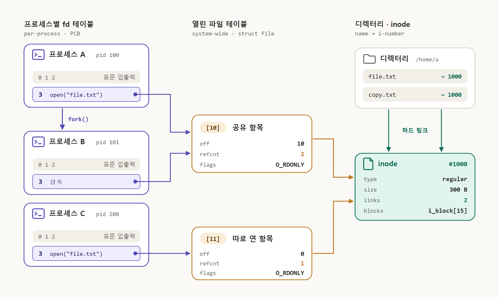
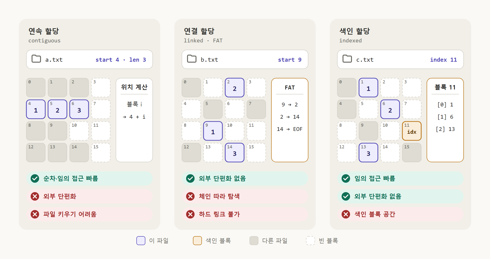
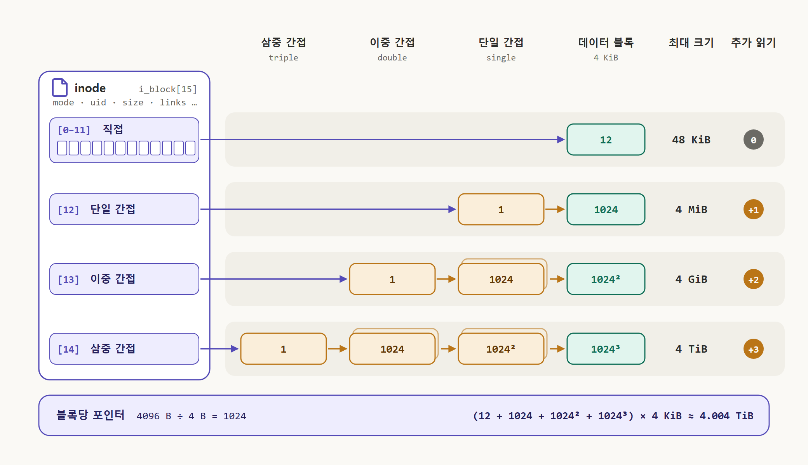
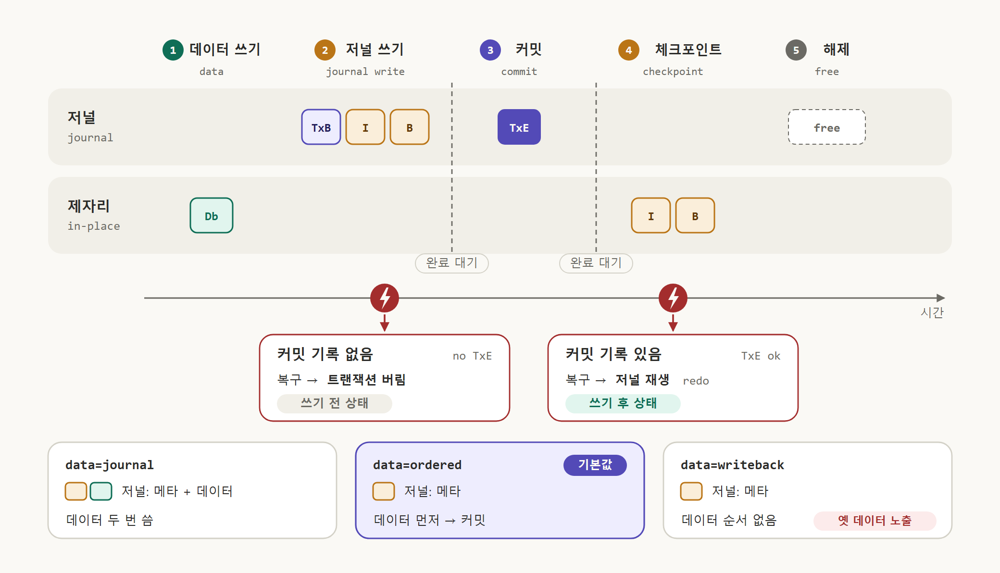

# 파일 시스템: 파일 디스크립터, inode, 할당 방식, 그리고 저널링

> OS 학습 11단원. 운영체제는 디스크의 번호 붙은 블록들을 "이름 있는 파일"로 바꿔 보여 준다. `open()`이 돌려주는 숫자 3이 커널 안에서 무엇을 가리키는지에서 시작해, 파일 블록을 디스크 어디에 두는지(할당 방식), inode의 포인터로 최대 파일 크기를 직접 계산해 보고, 전원이 꺼져도 파일 시스템이 망가지지 않게 하는 저널링까지 간다.

---

## 1. 파일, 디렉터리, 그리고 열린 파일



그림은 왼쪽에서 오른쪽으로 세 단계다. 프로세스마다 있는 **fd 테이블**, 시스템 전체에 하나 있는 **열린 파일 테이블**, 그리고 파일 자체를 나타내는 **inode**다. 이 절은 이 세 칸이 왜 따로 있는지를 설명한다.

### 파일과 inode 번호

1단원에서 운영체제는 디스크를 **파일**로 가상화한다고 했다. 파일은 만들고, 읽고, 쓰고, 지울 수 있는 **바이트 배열**이다. 사람은 `notes.txt` 같은 이름으로 부르지만, 파일 시스템 안에서 파일의 진짜 이름은 숫자다. 이것을 **inode 번호**(i-number)라고 한다.

**inode**는 파일 하나의 메타데이터를 담는 디스크 위 구조체다. 종류(일반 파일·디렉터리·심볼릭 링크), 크기, 소유자, 권한, 시간, **링크 수**, 그리고 데이터 블록이 어디 있는지가 들어 있다. 파일 **이름은 inode에 없다**. 이름은 디렉터리에 있다.

```c
#include <sys/stat.h>
struct stat st;
stat("notes.txt", &st);
printf("inode %lu, links %lu, size %ld\n",
       (unsigned long)st.st_ino, (unsigned long)st.st_nlink, (long)st.st_size);
```

inode는 디스크의 **inode 테이블**에 배열로 놓인다. 그래서 번호만 알면 위치를 바로 계산할 수 있다. OSTEP의 예제 파일 시스템(vsfs)은 inode 테이블이 12KB에서 시작하고 inode 하나가 256바이트다. 32번 inode는 `12KB + 32 × 256B = 20KB` 위치에 있다. ext4도 기본 inode 레코드가 256바이트다.

### open → read → write → close

`cat foo`를 `strace`로 보면 시스템 콜 흐름이 그대로 보인다(OSTEP의 예).

```text
open("foo", O_RDONLY|O_LARGEFILE) = 3
read(3, "hello\n", 4096)          = 6
write(1, "hello\n", 6)            = 6
read(3, "", 4096)                 = 0
close(3)                          = 0
```

1. `open()`이 경로를 따라가 inode를 찾고 권한을 검사한 뒤 **파일 디스크립터** 3을 돌려준다.
2. `read(3, ...)`는 fd 3이 가리키는 파일의 **현재 오프셋**부터 읽고, 읽은 만큼 오프셋을 올린다.
3. 0을 돌려받으면 파일 끝이다.
4. `close(3)`으로 fd를 반납한다.

왜 첫 fd가 3일까? 모든 프로세스는 이미 0(표준 입력), 1(표준 출력), 2(표준 오류)를 열어 두고 시작하기 때문이다. 위 출력에서 `write(1, ...)`가 화면 출력이다.

### 세 단계 표: fd 테이블 → 열린 파일 테이블 → inode

**파일 디스크립터**는 그냥 정수다. 커널은 프로세스마다(PCB 안에) 배열을 하나 두고, fd는 그 배열의 인덱스다. xv6 커널에서는 `struct proc` 안의 `struct file *ofile[NOFILE]`이다. 배열의 각 칸은 **열린 파일 테이블**의 항목을 가리킨다.

열린 파일 테이블의 항목(POSIX 용어로 *open file description*, 리눅스 커널에서는 `struct file`)에는 이런 것이 있다.

| 필드 | 뜻 |
|---|---|
| 현재 오프셋 | 다음 `read`/`write`가 시작할 위치 |
| 상태 플래그 | 읽기 전용인지, 쓰기 가능한지, `O_APPEND`인지 등 |
| 참조 수(refcnt) | 이 항목을 가리키는 fd 개수 |
| inode 포인터 | 어떤 파일인지 |

오프셋이 inode가 아니라 열린 파일 항목에 있다는 점이 중요하다. 같은 파일을 두 번 `open()`하면 항목이 두 개 생기고 오프셋도 따로 움직인다(그림의 [10]과 [11]). 반대로 `fork()`와 `dup()`은 **항목 자체를 공유**한다. 그래서 오프셋도 공유한다.

```c
int fd = open("file.txt", O_RDONLY);
if (fork() == 0) {                 /* 자식 */
    lseek(fd, 10, SEEK_SET);
    return 0;
}
wait(NULL);                        /* 부모 */
printf("%ld\n", (long)lseek(fd, 0, SEEK_CUR));   /* 10: 자식이 옮긴 오프셋이 보인다 */
```

그림에서 프로세스 A와 자식 B의 fd 3이 같은 [10]을 가리키고 refcnt가 2인 것이 이 상황이다. 참조 수는 두 프로세스가 모두 닫아야 0이 되고, 그때 항목이 사라진다. OSTEP은 이 공유 덕분에 여러 프로세스가 따로 조율하지 않고 같은 출력 파일에 이어 쓸 수 있다고 설명한다. 셸의 출력 리다이렉션(`>`)은 `dup2()`로 fd 1을 파일 항목에 붙이는 방식이다.

> 헷갈리기 쉬운 점: `lseek()`은 디스크 헤드를 움직이지 않는다. 메모리에 있는 열린 파일 항목의 오프셋 변수 하나를 바꿀 뿐이다. 그 뒤의 `read`가 디스크의 먼 곳을 읽게 되어 탐색(seek)이 생길 수는 있다.

> 비유: 도서관 책(inode) 한 권을 두 사람이 각자 대출증(열린 파일 항목)으로 빌리면 책갈피(오프셋)도 각자 갖는다. `fork()`는 대출증을 복사하는 게 아니라 **같은 대출증을 둘이 함께 쓰는 것**이라 책갈피도 하나다.

### 디렉터리와 경로 탐색

**디렉터리**도 파일이다. 내용이 `(이름, inode 번호)` 쌍의 목록일 뿐이다. OSTEP의 예에서 디렉터리 `dir`(inode 5)의 데이터 블록은 이렇게 생겼다.

```text
inum | reclen | strlen | name
   5 |     12 |      2 | .
   2 |     12 |      3 | ..
  12 |     12 |      4 | foo
  13 |     12 |      4 | bar
```

`.`은 자기 자신, `..`은 부모다. 디렉터리는 파일 시스템의 메타데이터라 사용자가 `write()`로 직접 고칠 수 없다. 파일을 만들거나 지우는 시스템 콜로만 바뀐다.

`open("/foo/bar")`의 **경로 탐색**은 이렇게 진행된다.

1. `/`로 시작하니 루트에서 출발한다. 루트에는 부모가 없으므로 번호가 미리 정해져 있다. 대부분의 UNIX 파일 시스템에서 **루트 inode는 2번**이다.
2. 루트 inode를 읽고, 그 데이터 블록(디렉터리 내용)에서 `foo`를 찾는다. `foo`의 inode 번호(예: 44)를 얻는다.
3. `foo`의 inode와 데이터를 읽어 `bar`의 inode 번호를 얻는다.
4. `bar`의 inode를 읽고 권한을 검사한 뒤 fd를 만든다.

캐시가 없다면 `open` 하나에 디스크 읽기가 5번(루트 inode, 루트 데이터, foo inode, foo 데이터, bar inode)이다. 경로가 한 단계 길어질 때마다 2번 이상 늘어난다. `/`로 시작하지 않는 상대 경로는 프로세스의 **현재 작업 디렉터리**에서 출발한다. 중간에 심볼릭 링크가 나오면 그것을 먼저 풀고 계속 간다. 리눅스는 경로 하나를 풀 때 심볼릭 링크를 **최대 40번**까지 따라가고, 넘으면 `ELOOP`를 낸다.

### 하드 링크와 심볼릭 링크

그림 오른쪽 위를 보면 디렉터리의 `file.txt`와 `copy.txt`가 둘 다 inode 1000을 가리킨다. 이것이 **하드 링크**다. `link()`(명령어 `ln`)는 파일을 복사하지 않는다. 같은 inode 번호를 가리키는 이름을 디렉터리에 하나 더 넣고 inode의 **링크 수**를 1 올릴 뿐이다.

```text
$ echo hello > file
$ ln file file2          # 하드 링크
$ ln -s file file3       # 심볼릭 링크
$ stat -c '%i %h %F %n' file file2 file3
67158084 2 regular file file
67158084 2 regular file file2
67158090 1 symbolic link file3
$ rm file
$ cat file2              # 내용 그대로: 링크 수 2 → 1
hello
$ cat file3              # 끊어진 링크
cat: file3: No such file or directory
```

(inode 번호는 출력 예다.) 그래서 파일을 지우는 시스템 콜 이름이 `delete`가 아니라 **`unlink()`**다. 이름 하나를 떼고 링크 수를 1 내린다. 링크 수가 **0이 될 때** 비로소 inode와 데이터 블록을 해제한다. ext4 문서는 디렉터리에서는 떨어졌지만 아직 열려 있는 inode를 *orphan inode*라 부르고 따로 목록으로 관리한다고 설명한다.

| | 하드 링크 | 심볼릭 링크 |
|---|---|---|
| 만드는 법 | `ln a b`, `link()` | `ln -s a b`, `symlink()` |
| 정체 | 디렉터리 항목 하나 (같은 inode 번호) | 별도의 파일 (종류: symbolic link) |
| 자기 inode | 없음 (대상과 같은 inode) | 있음 |
| 내용 | — | 대상의 **경로 문자열** |
| 대상의 링크 수 | 1 늘린다 | 그대로 |
| 디렉터리를 가리키기 | 불가 (트리에 사이클이 생길 수 있다) | 가능 |
| 다른 파일 시스템 | 불가 (inode 번호는 파일 시스템 안에서만 유일) | 가능 |
| 대상을 지우면 | 남은 이름으로 계속 접근 | **끊어진 링크** (dangling) |

심볼릭 링크의 크기는 경로 문자열 길이다. `file`을 가리키면 4바이트다. ext4는 대상 경로가 60바이트보다 짧으면 데이터 블록을 따로 쓰지 않고 inode 안의 블록 포인터 자리(`i_block`, 60바이트)에 바로 넣는다.

> 헷갈리기 쉬운 점: 디렉터리의 링크 수는 보통 2보다 크다. 부모의 항목 하나, 자기 안의 `.` 하나, 그리고 하위 디렉터리마다 그 안의 `..`가 하나씩 링크로 센다. ext4는 이 때문에 링크 수 상한(65,000)에 걸려 하위 디렉터리를 64,998개까지만 만들 수 있었고, `DIR_NLINK` 기능으로 이 제한을 푼다.

---

## 2. 파일 블록을 어디에 둘까: 할당 방식



디스크는 같은 크기 블록(보통 4KB)의 배열이다. **파일 할당 방식**은 파일의 0번, 1번, 2번 블록을 디스크의 몇 번 블록에 두고, 그 위치를 어디에 기록할지 정한다. 그림은 16칸짜리 디스크에 같은 3블록 파일을 세 방식으로 놓은 모습이다.

| | 연속 할당 | 연결 할당 (FAT) | 색인 할당 |
|---|---|---|---|
| 디렉터리에 적는 것 | 시작 블록 + 길이 | 시작 블록 | 색인 블록 번호 |
| i번째 블록 찾기 | `시작 + i` 계산 한 번 | 체인을 i번 따라감 | 색인 블록의 i번 칸 |
| 순차 접근 | 매우 빠름 | 괜찮음 | 괜찮음 |
| 임의 접근 | 빠름 | 느림 (FAT를 메모리에 두면 나아짐) | 빠름 |
| 외부 단편화 | **있음** | 없음 | 없음 |
| 파일 키우기 | 어려움 | 쉬움 | 쉬움 (색인 블록이 찰 때까지) |
| 공간 낭비 | 단편화 | 블록마다 포인터 | 파일마다 색인 블록 |

**연속 할당**은 8단원의 연속 메모리 할당과 같은 문제를 겪는다. 최초·최적 적합 중 무엇을 고를지 정해야 하고, **외부 단편화**가 생긴다. 그림 왼쪽에서 빈 블록은 3·7·10·11·15로 다섯 개지만 연속 세 칸이 없다. 3블록짜리 파일을 하나 더 넣을 수 없다. 처음에 크기를 크게 잡으면 공간이 남고, 작게 잡으면 파일이 커질 때 옮겨야 한다. 장점은 HDD에서 헤드를 거의 움직이지 않고 읽을 수 있다는 것이다.

**연결 할당**은 블록마다 "다음 블록 번호"를 달아 연결 리스트로 만든다. 단편화는 없지만 마지막 블록을 읽으려면 앞 블록을 전부 거쳐야 한다. 포인터 하나가 깨지면 그 뒤가 통째로 사라진다는 신뢰성 문제도 있다. **FAT**(File Allocation Table)는 다음 블록 포인터를 데이터 블록에서 빼내 디스크 앞쪽의 표 하나로 모은 변형이다. 표를 메모리에 캐시하면 임의 접근도 메모리 안에서 체인을 훑고 바로 디스크에 갈 수 있다. 그림 가운데처럼 `FAT[9] = 2`, `FAT[2] = 14`, `FAT[14] = EOF`로 체인을 기록한다.

```c
/* FAT 체인에서 파일의 n번째 클러스터 찾기 (개념 코드) */
uint32_t nth_cluster(const uint32_t *fat, uint32_t start, unsigned n) {
    uint32_t c = start;
    while (n-- > 0) {
        c = fat[c] & 0x0FFFFFFF;   /* FAT32는 32비트 중 28비트만 클러스터 번호 */
        if (c >= 0x0FFFFFF8) return 0;   /* 체인 끝(EOF) */
    }
    return c;
}
```

FAT에는 inode가 없다. 메타데이터와 첫 클러스터 번호를 디렉터리 항목에 직접 적는다. 그래서 같은 파일을 두 이름이 가리키는 **하드 링크를 만들 수 없다**. FAT32의 최대 파일 크기는 4GB − 1바이트다.

**색인 할당**은 파일의 블록 번호를 **색인 블록** 하나에 모은다. i번째 블록은 색인 블록의 i번 칸을 보면 된다. 대신 1바이트짜리 파일도 색인 블록 한 개를 차지한다. 색인 블록이 꽉 차면 어떻게 할까? 색인 블록을 연결하거나(연결형), 색인의 색인을 두거나(다단계), 둘을 섞는다(결합형). 결합형이 UNIX inode이고, 다음 절의 주제다.

> 비유: 연속 할당은 한 줄로 붙어 앉은 단체석, 연결 할당은 쪽지마다 다음 장소가 적힌 보물찾기, 색인 할당은 목차가 있는 책이다.

### 빈 공간 관리: 비트맵

새 블록을 주려면 어느 블록이 비었는지 알아야 한다. OSTEP의 vsfs와 ext2는 **비트맵**을 쓴다. 블록 하나에 비트 하나를 대응시키고, inode용 비트맵과 데이터 블록용 비트맵을 따로 둔다. vsfs의 디스크 배치는 이렇다.

```text
블록 0      1          2           3–7          8–63
[슈퍼블록] [inode 비트맵] [데이터 비트맵] [inode 테이블] [데이터 영역]
```

- 연속된 빈 블록을 찾기 쉽다. ext2·ext3는 새 파일에 연속 8블록쯤을 한꺼번에 잡는 사전 할당을 한다.
- 크기는 디스크에 비례한다. 4KB 블록을 쓰는 1TiB 디스크라면 블록이 2²⁸개이므로 비트맵은 2²⁸비트 = 32MiB다.
- **읽기에는 비트맵이 필요 없다.** 이미 inode가 블록을 가리키고 있기 때문이다. 비트맵은 할당하거나 해제할 때만 읽고 고친다.

다른 방법으로는 빈 블록끼리 연결 리스트로 잇기, 빈 블록 주소를 블록에 모아 두는 그룹화, "시작 블록 + 연속 개수"를 적는 카운팅이 있다. XFS는 빈 공간도 B-트리로 관리한다.

> 헷갈리기 쉬운 점: 비트 값의 뜻은 자료마다 반대다. OSTEP은 1을 "사용 중"으로, UIC 강의 노트는 1을 "비어 있음"으로 설명한다. 어느 쪽이든 원리는 같다.

---

## 3. inode 안의 블록 포인터와 최대 파일 크기



ext2·ext3의 inode에는 블록 위치를 담는 칸이 15개 있다(`i_block[15]`, 4바이트씩 60바이트). 그림 왼쪽이 그 15칸이다.

| `i_block` 칸 | 가리키는 것 | 파일 블록 번호 (4KiB 블록) |
|---|---|---|
| 0 ~ 11 | **직접 포인터**: 데이터 블록 | 0 ~ 11 |
| 12 | **단일 간접**: 포인터 1024개가 든 블록 | 12 ~ 1035 |
| 13 | **이중 간접**: 단일 간접 블록 1024개를 가리키는 블록 | 1036 ~ 1,049,611 |
| 14 | **삼중 간접**: 이중 간접 블록 1024개를 가리키는 블록 | 1,049,612 ~ 1,074,791,435 |

**간접 블록**은 데이터 대신 블록 번호를 담은 블록이다. 4KiB 블록에 4바이트 포인터를 넣으면 한 블록에 `4096 ÷ 4 = 1024`개가 들어간다. 이 숫자 하나로 최대 파일 크기를 계산할 수 있다.

### 최대 파일 크기 계산

| 칸 | 데이터 블록 수 | 크기 |
|---|---|---|
| 직접 12개 | 12 | 12 × 4KiB = **48 KiB** |
| 단일 간접 | 1024 | 1024 × 4KiB = **4 MiB** |
| 이중 간접 | 1024² = 1,048,576 | **4 GiB** |
| 삼중 간접 | 1024³ = 1,073,741,824 | **4 TiB** |
| 합계 | **1,074,791,436** | 4,402,345,721,856 B ≈ **4.004 TiB** |

```c
/* 블록 크기 B, 포인터 4바이트일 때 직접 12 + 단일·이중·삼중 간접의 최대 크기 */
unsigned long long max_file_size(unsigned long long B) {
    unsigned long long p = B / 4;                   /* 블록당 포인터 수 */
    unsigned long long blocks = 12 + p + p*p + p*p*p;
    return blocks * B;
}
/* max_file_size(4096) == 4402345721856  (≈ 4.004 TiB)
   max_file_size(1024) == 17247252480    (≈ 16.06 GiB) */
```

OSTEP은 직접 12개와 단일 간접 하나면 `(12 + 1024) × 4KB = 4144KB`, 이중 간접까지면 "4GB를 조금 넘는다"고 계산한다. 위 표의 앞 두 줄과 셋째 줄 합과 같다. ext4 문서의 블록 번호 범위도 같은 계산이다.

> 헷갈리기 쉬운 점: 약 4TiB는 **포인터 트리가 가리킬 수 있는 한계**다. 실제 파일 크기 한계는 다른 필드에도 묶인다. ext4 문서에 따르면 `huge_file` 기능이 없을 때 `i_blocks_lo`는 파일이 차지한 **512바이트 단위 블록 수**를 32비트로 센다. 그러면 2³² × 512B = 2TiB를 넘게 디스크를 쓸 수 없다. 그래서 ext3의 실제 한계는 트리 계산보다 작다(아래 질문으로 남긴다).

### 왜 이렇게 한쪽으로 기운 트리인가

간접 단계가 하나 늘 때마다 데이터에 닿기 전에 디스크를 한 번 더 읽어야 한다(그림 오른쪽 "추가 읽기"). 그런데도 이 구조를 쓰는 이유는 **대부분의 파일이 작기** 때문이다. OSTEP이 요약한 측정 결과로는 가장 흔한 파일 크기가 약 2KB이고, 평균은 약 200KB다. 48KiB까지는 inode만 읽으면 되니 작은 파일은 빠르고, 큰 파일은 간접 블록으로 감당한다.

8단원의 다단계 페이지 테이블과 생김새가 같다. 둘 다 "필요할 때만 만드는 포인터 블록의 트리"다. 차이는 페이지 테이블은 모든 단계가 같은 깊이인 균형 트리이고, inode는 앞쪽 블록일수록 얕은 불균형 트리라는 점이다.

**익스텐트**는 다른 길이다. 블록마다 포인터를 두지 않고 `(시작 블록, 길이)` 쌍으로 연속 구간을 통째로 적는다. 연속으로 놓인 큰 파일이면 메타데이터가 훨씬 작다. ext4와 XFS는 익스텐트를 쓰고, ext4 inode의 같은 60바이트 자리에는 블록 맵 대신 익스텐트 트리가 들어간다.

---

## 4. 크래시 일관성과 저널링



### 문제: 세 블록 중 일부만 쓰였을 때

파일 끝에 블록 하나를 덧붙이는 간단한 일도 디스크의 세 곳을 고친다. **inode**(새 포인터와 커진 크기, I), **데이터 비트맵**(새 블록 사용 중, B), 그리고 **데이터 블록**(Db)이다. 디스크는 한 번에 한 쓰기만 끝내므로, 중간에 전원이 나가면 일부만 남는다. OSTEP은 경우를 이렇게 나눈다.

| 디스크에 남은 것 | 결과 |
|---|---|
| Db만 | 아무도 가리키지 않음. 쓰기가 없던 것과 같음 (사용자는 데이터를 잃음) |
| I만 | inode가 아직 쓰이지 않은 블록을 가리킴 → **쓰레기 데이터**. 비트맵과 **불일치** |
| B만 | 블록이 사용 중인데 아무도 안 가리킴 → **공간 누수** |
| I + B | 메타데이터는 일관됨. 그러나 블록 내용은 쓰레기 |
| I + Db | 데이터는 맞지만 비트맵과 불일치 |
| B + Db | 비트맵과 inode 불일치. 누구의 블록인지 모름 |

여러 블록을 한꺼번에(원자적으로) 바꾸고 싶지만 디스크는 그렇게 해 주지 않는다. 이것이 **크래시 일관성** 문제다. 쓰기는 보통 바로 디스크로 가지 않고 메모리(페이지 캐시)에 5~30초쯤 머문다는 점도 기억하자. 그 사이의 크래시는 흔하게 일어날 수 있다.

### 해법 1: fsck

옛 파일 시스템은 불일치를 일단 허용하고 부팅 때 고쳤다. **fsck**는 마운트하기 전에 디스크 전체를 훑는다.

1. **슈퍼블록**이 그럴듯한지 검사한다.
2. 모든 inode와 간접 블록을 따라가 실제로 쓰이는 블록 목록을 만들고, **비트맵을 inode 쪽에 맞춰** 다시 쓴다.
3. inode의 종류 필드 등이 망가졌는지 본다.
4. 루트부터 디렉터리 트리를 다 돌며 **링크 수**를 다시 세어 고친다. 어디서도 가리키지 않는 inode는 `lost+found`로 옮긴다.
5. 두 inode가 같은 블록을 가리키는 **중복**, 범위를 벗어난 **잘못된 포인터**를 처리한다.
6. 디렉터리의 첫 두 항목이 `.`과 `..`인지 등을 확인한다.

두 가지 한계가 있다. 첫째, 메타데이터가 일관되지만 내용이 쓰레기인 경우(I + B)는 못 고친다. 둘째, **너무 느리다**. 블록 세 개가 어긋났는데 디스크 전체를 읽는다. OSTEP은 이를 침실에서 떨어뜨린 열쇠를 찾으려고 지하실부터 집 전체를 뒤지는 일에 빗댄다.

### 해법 2: 저널링 (미리 쓰기 로깅)

**저널링**은 데이터베이스의 **미리 쓰기 로깅**(write-ahead logging)을 가져온 것이다. 디스크 구조를 제자리에서 고치기 전에, 무엇을 할지 **저널**(로그)이라는 정해진 곳에 먼저 적는다. 크래시가 나면 저널만 보고 다시 하면 된다. ext3·ext4(jbd2), XFS, NTFS, JFS가 이 방식을 쓴다.

데이터까지 저널에 쓰는 기본 프로토콜은 네 단계다.

1. **저널 쓰기**: 트랜잭션 시작 블록(TxB, 최종 주소와 트랜잭션 ID), 바꿀 블록들(I, B, Db)을 저널에 쓰고 끝나기를 기다린다.
2. **커밋**: 트랜잭션 끝 블록(TxE)을 쓰고 기다린다. 이 쓰기가 끝나는 순간 트랜잭션은 **커밋**된다.
3. **체크포인트**: 같은 블록들을 원래 자리(제자리)에 쓴다.
4. **해제**: 나중에 저널 슈퍼블록을 고쳐 그 트랜잭션 자리를 재사용할 수 있게 한다. 저널은 원형 로그로 계속 돌려 쓴다.

왜 TxE만 따로 쓸까? 다섯 블록을 한 번에 보내면 디스크가 내부에서 순서를 바꿔 TxB·I·B·TxE를 먼저 쓰고 Db를 나중에 쓸 수 있다. 그 사이에 크래시가 나면 저널에는 시작과 끝이 다 있는 "멀쩡해 보이는" 트랜잭션이 남고, 복구가 쓰레기 블록을 제자리에 복사해 버린다. 그래서 나머지가 다 끝난 뒤에 TxE를 쓰고, TxE는 **512바이트 한 섹터**로 만든다. 디스크는 512바이트 쓰기를 원자적으로(전부 아니면 전무) 처리하기 때문이다. ext4는 트랜잭션에 체크섬을 넣어, 기다리지 않고 한 번에 쓴 뒤 복구할 때 체크섬으로 검사하는 방식도 쓴다.

### 복구: 커밋이 기준선이다

그림 아래의 두 크래시 지점이 복구 규칙을 보여 준다.

- **크래시 1 (커밋 전)**: 저널에 TxE가 없다. 복구는 이 트랜잭션을 **버린다**. 제자리는 아직 손대지 않았으니 파일 시스템은 쓰기 **전** 상태로 일관된다.
- **크래시 2 (커밋 후, 체크포인트 중)**: 저널에 커밋된 트랜잭션이 있다. 복구는 저널의 블록을 제자리에 **다시 쓴다**(redo). 이미 쓴 블록을 한 번 더 쓰게 되지만 상관없다. 결과는 쓰기 **후** 상태다.

전체를 훑지 않고 저널의 커밋된 트랜잭션만 재생하므로 복구가 빠르다. ext4 문서도 커밋 레코드가 없거나 체크섬이 맞지 않는 트랜잭션은 재생할 때 버린다고 설명한다.

> 비유: 이삿짐센터가 짐을 옮기기 전에 "무엇을 어디로" 목록을 쓰고 마지막에 서명한다. 서명 전에 정전이 나면 목록을 버리고 처음부터 다시 한다. 서명 뒤라면 목록을 보고 덜 옮긴 짐을 마저 옮긴다.

### 메타데이터 저널링과 ext4의 세 모드

데이터까지 저널링하면 모든 데이터를 **두 번** 쓴다. 순차 쓰기 대역폭이 반으로 준다. 그래서 대부분은 **메타데이터만** 저널링한다. 이때 데이터 블록을 언제 쓰느냐가 문제다. 커밋 뒤에 데이터를 쓰다 크래시가 나면, 복구된 inode가 쓰레기 블록을 가리킨다. 해결책은 **"가리켜지는 것을 가리키는 것보다 먼저 쓴다"**는 규칙이다. 그림 위쪽이 이 순서(ordered 모드)다.

1. **데이터 쓰기**: Db를 제자리에 쓴다.
2. **저널 쓰기**: TxB와 메타데이터(I, B)를 저널에 쓴다. 1과 동시에 내보내도 된다.
3. **커밋**: 1과 2가 **모두 끝난 뒤** TxE를 쓴다(그림의 점선 "완료 대기").
4. **체크포인트**: I와 B를 제자리에 쓴다.
5. **해제**.

크래시 1의 경우 Db는 제자리에 있지만 아무도 가리키지 않으니 "쓰기가 없던 것"과 같다. 표의 첫 줄과 같은 상황이다.

| 모드 (`mount -o data=`) | 저널에 쓰는 것 | 데이터 쓰기 순서 | 특징 |
|---|---|---|---|
| `journal` | 메타데이터 + 데이터 | 저널 먼저, 그다음 제자리 | 가장 안전, 대체로 가장 느림. 지연 할당·`O_DIRECT` 꺼짐 |
| `ordered` (기본값) | 메타데이터 | 데이터를 **커밋 전에** 제자리에 | inode가 쓰레기를 가리키지 않음 |
| `writeback` | 메타데이터 | 순서 보장 없음 | 대체로 가장 빠름. 크래시 뒤 최근 파일에 **옛 데이터**가 보일 수 있음 |

세 모드 모두 **메타데이터의 일관성**은 지킨다. 다른 것은 데이터에 대한 약속이다. ext4는 기본적으로 진행 중인 트랜잭션을 최대 5초(`commit=5`)마다 커밋한다. 그래서 정전 때 최근 몇 초의 메타데이터 변경은 잃을 수 있지만 파일 시스템이 망가지지는 않는다. 리눅스 커널 문서(7.4-rc4 기준)는 `data=journal`을 폐기 예정으로 표시하고 2028년 1월에 지원을 없앤다고 적고 있다.

> 헷갈리기 쉬운 점: 저널링은 **데이터 손실을 막는 장치가 아니다**. 막는 것은 파일 시스템 구조의 **불일치**다. 커밋되지 않은 쓰기는 사라진다. 응용이 "여기까지는 확실히 디스크에 있다"를 원하면 `fsync()`를 불러야 한다.

삭제와 재사용은 까다롭다. 메타데이터 저널링에서 디렉터리 블록 1000을 저널에 적은 뒤 디렉터리를 지우고, 그 블록을 새 파일 데이터로 재사용했다고 하자. 복구가 저널을 재생하면 옛 디렉터리 내용으로 새 파일 데이터를 덮어쓴다. ext3는 삭제 때 저널에 **revoke 레코드**를 남겨, 재생할 때 그 블록은 건너뛰게 한다.

---

## 5. VFS와 페이지 캐시

### VFS: 파일 시스템 위의 공통 계층

리눅스 한 대에 ext4, tmpfs, proc, 네트워크 파일 시스템이 함께 마운트된다. `read()` 하나로 이들을 다 읽을 수 있는 것은 **VFS**(Virtual File System, 가상 파일 시스템 스위치) 덕분이다. VFS는 사용자 프로그램에 파일 시스템 인터페이스를 주고, 커널 안에서는 서로 다른 구현이 함께 있게 하는 계층이다.

```text
open / read / write / stat   (2단원의 시스템 콜)
            │
           VFS  ── dentry 캐시, inode 캐시, struct file
            │      (함수 포인터 표로 분기)
   ┌────────┼────────┐
  ext4    tmpfs    proc  ...
   │
 블록 계층 → 장치 드라이버 → 디스크
```

리눅스 VFS의 네 가지 객체는 이렇다.

| 객체 | 나타내는 것 | 메모 |
|---|---|---|
| superblock | 마운트된 파일 시스템 하나 | 마운트할 때 디스크의 슈퍼블록을 읽어 만든다 |
| inode | 파일 하나 | 디스크 inode를 필요할 때 메모리로 복사, 바뀌면 다시 쓴다 |
| dentry | 디렉터리 항목 (이름 → inode) | **메모리에만 있다.** 경로 탐색을 빠르게 하는 캐시 |
| file | 열린 파일 | 1절의 열린 파일 항목. fd 테이블에 들어간다 |

`open()`을 부르면 VFS는 먼저 **dentry 캐시**에서 경로를 찾는다. 없는 단계만 부모 디렉터리 inode의 `lookup()` 메서드로 실제 파일 시스템에 묻는다. 찾으면 `struct file`을 만들어 inode가 가진 파일 연산 함수 표를 붙이고 fd 테이블에 넣는다. 이후 `read(fd)`는 fd로 `struct file`을 찾아 그 표의 `read`를 부른다. 같은 `read()`가 ext4에서는 ext4의 함수로, proc에서는 proc의 함수로 간다. 객체 지향의 가상 함수 호출과 같은 구조다.

### 페이지 캐시: 디스크 I/O를 줄이는 메모리

1절에서 `open` 하나에 디스크 읽기가 5번 든다고 했다. 실제로 이렇게 느리지 않은 이유는 캐시다. 옛 시스템은 부팅 때 메모리의 10% 정도를 고정 크기 **버퍼 캐시**로 떼어 두었다. 많은 현대 운영체제는 가상 메모리 페이지와 파일 페이지를 **하나의 페이지 캐시**로 합쳐, 그때그때 더 필요한 쪽이 메모리를 쓰게 한다(정적 분할 → 동적 분할). UIC 강의 노트는 통합 캐시가 같은 데이터를 두 번 저장하지 않고, 두 캐시 사이의 불일치도 피한다고 설명한다. 9단원의 메모리 매핑 파일(`mmap`)도 이 페이지 캐시 위에서 동작한다.

- **읽기**: 캐시에 있으면 디스크 I/O가 아예 없다. 같은 디렉터리의 파일을 다시 열면 대부분 캐시에서 끝난다.
- **쓰기**: 캐시는 쓰기를 없애지 못한다. 결국 디스크에 가야 영속적이기 때문이다. 대신 5~30초 미뤄 두면 여러 갱신을 하나로 **묶고**, 순서를 **스케줄링**하고, 금방 지워질 임시 파일은 아예 **쓰지 않을** 수 있다.

미뤄 둔 만큼 크래시 때 잃는다. 내구성과 성능을 맞바꾸는 것이다. 그래서 반드시 디스크에 있어야 하는 데이터는 `fsync()`로 강제한다. 원자적으로 파일 내용을 바꾸는 전형적인 방법은 이렇다.

```c
int fd = open("foo.txt.tmp", O_WRONLY | O_CREAT | O_TRUNC, 0644);
write(fd, buf, size);    /* 새 내용 전체 */
fsync(fd);               /* 데이터와 메타데이터를 디스크로 */
close(fd);
rename("foo.txt.tmp", "foo.txt");   /* 크래시에도 옛 이름 아니면 새 이름: 원자적 교체 */
```

`rename()`은 보통 크래시에 대해 원자적으로 구현된다. 새로 만든 파일이 디렉터리에 확실히 들어갔는지까지 보장하려면 그 **디렉터리도** `fsync()`해야 한다는 점은 자주 놓친다.

> 헷갈리기 쉬운 점: 페이지 캐시와 디스크 안의 캐시(디스크 버퍼)는 다르다. 페이지 캐시는 운영체제가 주 메모리에 두는 것이고, 디스크 버퍼는 장치 컨트롤러에 붙은 메모리다. 디스크가 쓰기 캐시에 넣자마자 "완료"라고 알리면 저널의 쓰기 순서가 깨질 수 있어, 파일 시스템은 쓰기 배리어로 순서를 강제한다. ext4는 배리어를 기본으로 켠다.

---

## 정리

- **파일**은 이름 붙은 바이트 배열이고, 파일 시스템 안의 진짜 이름은 **inode 번호**다. **inode**는 메타데이터와 블록 위치를 담지만 이름은 담지 않는다. 이름은 **디렉터리**의 `(이름, inode 번호)` 항목에 있다.
- `open()`은 **경로 탐색**으로 inode를 찾아 **파일 디스크립터**를 돌려준다. fd → **열린 파일 테이블**(오프셋·플래그·참조 수) → inode의 세 단계이고, `fork()`·`dup()`은 열린 파일 항목을 공유해 오프셋도 공유한다.
- **하드 링크**는 같은 inode를 가리키는 이름을 하나 더 만들고 링크 수를 올린다. **심볼릭 링크**는 경로 문자열을 담은 별도 파일이라 끊어질 수 있다.
- **할당 방식**: 연속(빠르지만 외부 단편화), 연결·FAT(단편화 없지만 체인 탐색), 색인(임의 접근 빠름). 빈 블록은 **비트맵**으로 관리한다.
- ext2·ext3 inode는 직접 12개 + 단일·이중·삼중 **간접 블록**으로, 4KiB 블록에서 `(12 + 1024 + 1024² + 1024³) × 4KiB ≈ 4.004 TiB`까지 가리킨다. 작은 파일이 대부분이라 한쪽으로 기운 트리를 쓴다.
- 여러 블록을 고치다 크래시가 나면 불일치가 생긴다(**크래시 일관성**). **fsck**는 전체를 훑어 느리고, **저널링**은 저널 쓰기 → 커밋 → 체크포인트 순서로 커밋된 것만 재생한다. ext4 기본값은 **메타데이터 저널링**의 ordered 모드다.
- **VFS**는 여러 파일 시스템을 같은 시스템 콜 뒤에 숨기고, **페이지 캐시**는 읽기를 없애고 쓰기를 미뤄 묶는다. 내구성이 필요하면 `fsync()`다.

## 아직 답을 못 찾은 질문

- ext3에서 4KiB 블록일 때 실제 최대 파일 크기는 정확히 얼마이고, 포인터 트리 계산(약 4TiB)보다 작아지는 이유는 `i_blocks`의 512바이트 단위 32비트 카운터뿐인가?
- 리눅스 커널 문서는 ext4 `data=journal`을 폐기 예정(2028년 1월 제거)으로 적고 있다. 왜 없애기로 했고, 이 모드에 기대던 용도(데이터까지 원자적으로 기록)는 무엇으로 대신하나?
- ext4의 fast commit은 일반 커밋에 비해 크래시 복구 때 정확히 무엇을 재생하고, 어떤 연산은 fast commit을 쓸 수 없나?

## 참고 자료

- Remzi & Andrea Arpaci-Dusseau, *Operating Systems: Three Easy Pieces*, [Ch.39 Interlude: Files and Directories](https://pages.cs.wisc.edu/~remzi/OSTEP/file-intro.pdf)
- 같은 책, [Ch.40 File System Implementation](https://pages.cs.wisc.edu/~remzi/OSTEP/file-implementation.pdf)
- 같은 책, [Ch.42 Crash Consistency: FSCK and Journaling](https://pages.cs.wisc.edu/~remzi/OSTEP/file-journaling.pdf)
- UIC CS 385 Course Notes, [File-System Implementation](https://www.cs.uic.edu/~jbell/CourseNotes/OperatingSystems/12_FileSystemImplementation.html)
- The Linux Kernel documentation, [Overview of the Linux Virtual File System](https://docs.kernel.org/filesystems/vfs.html)
- The Linux Kernel documentation, [ext4: The Contents of inode.i_block](https://docs.kernel.org/filesystems/ext4/ifork.html)
- The Linux Kernel documentation, [ext4: Index Nodes](https://docs.kernel.org/filesystems/ext4/inodes.html)
- The Linux Kernel documentation, [ext4: Journal (jbd2)](https://docs.kernel.org/filesystems/ext4/journal.html)
- The Linux Kernel documentation, [ext4 General Information (mount options, data modes)](https://docs.kernel.org/admin-guide/ext4.html)
- Linux man-pages, [open(2)](https://man7.org/linux/man-pages/man2/open.2.html)
- Linux man-pages, [path_resolution(7)](https://man7.org/linux/man-pages/man7/path_resolution.7.html)
- Wikipedia, [File Allocation Table](https://en.wikipedia.org/wiki/File_Allocation_Table)
