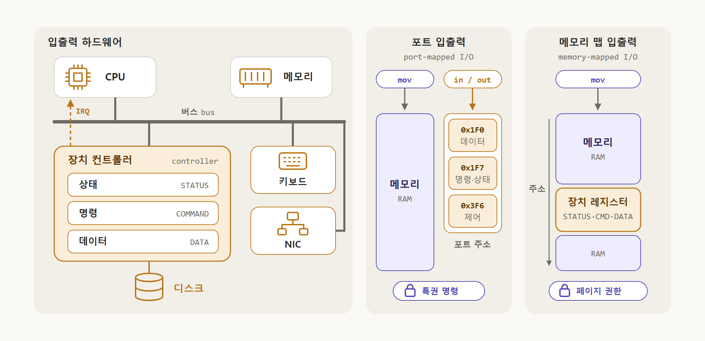
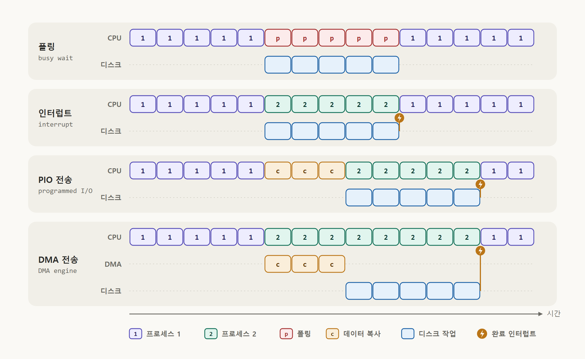
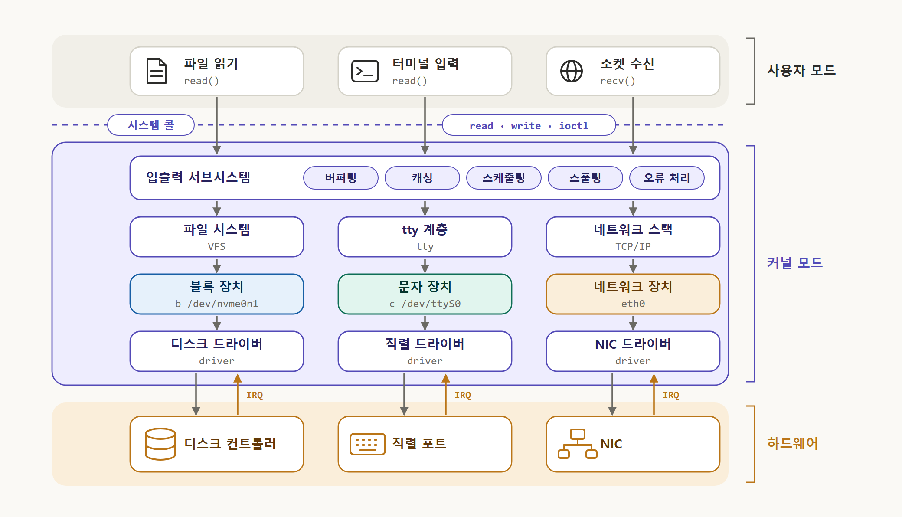
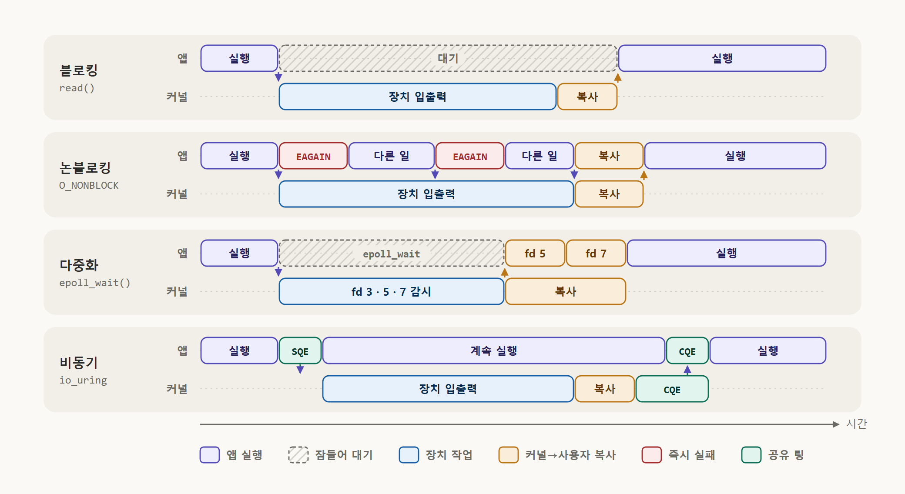

# 입출력 시스템: 장치 컨트롤러, 폴링과 인터럽트, DMA, 그리고 블로킹·비동기 입출력

> OS 학습 12단원. 운영체제가 디스크·키보드·네트워크 카드와 어떻게 말을 주고받는지 정리한다. 장치 레지스터와 두 가지 접근 방법에서 시작한다. 그다음 폴링·인터럽트·DMA로 CPU 시간을 아끼는 법을 본다. 디바이스 드라이버와 커널 입출력 계층을 거쳐, 프로그램 쪽에서 보는 블로킹·논블로킹·비동기 입출력으로 마무리한다.

---

## 1. 입출력 하드웨어: 컨트롤러와 레지스터



그림 왼쪽처럼 CPU와 메모리, 장치들은 **버스**로 이어져 있다. OSTEP에 따르면 빠른 장치(그래픽 카드, NVMe 저장 장치, 네트워크 카드)는 PCIe처럼 CPU에 가까운 버스에, 느린 장치(키보드, 마우스)는 USB 같은 주변 버스에 붙는다. 빠른 버스일수록 짧아야 하고 비싸기 때문이다.

### 장치 컨트롤러와 세 가지 레지스터

장치마다 **장치 컨트롤러**가 있다. 컨트롤러는 장치를 실제로 움직이는 하드웨어다. 간단한 장치는 칩 몇 개뿐이지만, 복잡한 장치는 작은 CPU와 메모리, 펌웨어까지 갖고 있다. OSTEP은 RAID 컨트롤러의 펌웨어가 수십만 줄에 이른다고 쓴다.

운영체제가 보는 것은 컨트롤러 내부가 아니라 **인터페이스**다. OSTEP의 표준 장치(canonical device)는 레지스터 세 개로 이 인터페이스를 단순화한다. 그림 가운데의 주황색 상자다.

| 레지스터 | 하는 일 | 방향 |
|---|---|---|
| 상태 (status) | 장치가 바쁜지, 준비됐는지, 오류가 났는지 알려 준다 | 장치 → CPU |
| 명령 (command) | 장치에게 할 일을 지시한다 | CPU → 장치 |
| 데이터 (data) | 장치에 보낼 데이터, 장치에서 받은 데이터를 담는다 | 양쪽 |

UIC 강의 노트는 실제 컨트롤러가 보통 1~4바이트짜리 레지스터 네 개(data-in, data-out, status, control) 중 일부를 갖는다고 정리한다. 데이터 레지스터를 입력용과 출력용으로 나눈 것뿐, 생각은 같다.

장치는 일이 끝나면 **IRQ** 선(그림의 주황 점선)으로 CPU에 하드웨어 인터럽트를 보낸다. 1단원의 `hardware-interrupt`다. 2절에서 이것을 쓴다.

### 레지스터에 닿는 두 가지 방법

CPU가 장치 레지스터를 읽고 쓰는 방법은 두 가지다. 그림 오른쪽의 두 칸이다.

| | 포트 입출력 (port-mapped I/O) | 메모리 맵 입출력 (memory-mapped I/O) |
|---|---|---|
| 주소 공간 | 메모리와 **별도인** 입출력 포트 주소 | 메모리와 **같은** 주소 공간의 일부 |
| 명령어 | 전용 명령어 (x86의 `in`, `out`) | 일반 load/store (`mov`) |
| 보호 | 입출력 명령어가 **특권 명령어** | 그 주소를 페이지 테이블로 커널만 접근하게 매핑 |
| 장점 | 메모리 버스와 경쟁하지 않는 전용 입출력 버스를 쓸 수 있다 | 새 명령어가 필요 없고, 모든 주소 지정 방식과 연산을 그대로 쓴다 |
| 단점 | 명령어가 제한적이다 | 주소 공간 일부를 장치에 내준다. 캐시가 쓰기 순서를 바꿀 수 있어 장벽이 필요하다 |
| 예 | 옛 IDE 디스크 (`0x1F0`~`0x1F7`, `0x3F6`), IBM 메인프레임 | 그래픽 카드, PDP-11 |

포트 입출력을 쓰는 명령어는 특권 명령어다(1단원 `privileged-instruction`). OSTEP은 이유를 이렇게 설명한다. 아무 프로그램이나 디스크를 직접 읽고 쓸 수 있다면 그 구멍으로 기계 전체를 장악할 수 있다.

메모리 맵 입출력에서는 하드웨어가 특정 **물리 주소** 범위로 가는 load/store를 메모리 대신 장치로 보낸다(8단원 `physical-address`). 커널은 이 물리 주소를 페이지 테이블로 자기 주소 공간에 매핑해서 쓴다. 리눅스 커널 문서는 드라이버가 장치의 물리 주소 영역을 `ioremap()`으로 매핑한다고 설명한다. 위키백과는 x86에서도 포트 입출력은 쓸 수 있는 레지스터가 EAX 계열로 제한돼 메모리 맵 방식이 선호된다고 쓴다. OSTEP의 결론은 담담하다. 둘 중 하나가 크게 낫지 않고, 오늘날에도 둘 다 쓰인다.

> 헷갈리기 쉬운 점: **메모리 맵 입출력 ≠ 메모리 맵 파일**. 메모리 맵 입출력은 *장치 레지스터*를 주소로 접근하는 하드웨어 방식이다. 9단원의 `memory-mapped-file`(`mmap`)은 *파일 내용*을 페이지 단위로 주소 공간에 올리는 운영체제 기법이다. 이름만 비슷하다.

---

## 2. 폴링, 인터럽트, DMA



### 표준 프로토콜과 폴링

OSTEP은 운영체제가 장치에 일을 시키는 가장 단순한 순서를 이렇게 쓴다.

1. 상태 레지스터를 계속 읽으며 장치가 바쁘지 않을 때까지 기다린다.
2. 데이터 레지스터에 데이터를 쓴다.
3. 명령 레지스터에 명령을 쓴다. 이 순간 장치가 일을 시작한다.
4. 다시 상태 레지스터를 계속 읽으며 장치가 끝날 때까지 기다린다.

1과 4처럼 상태 레지스터를 반복해서 읽으며 기다리는 것이 **폴링**(polling)이다. 다른 일을 하지 않고 확인만 반복하므로 **바쁜 대기**(busy waiting)라고도 한다. 2처럼 CPU가 데이터를 한 워드씩 직접 옮기는 방식은 **PIO**(programmed I/O)라고 한다.

xv6 운영체제의 IDE 디스크 드라이버에 이 폴링 루프가 그대로 있다. OSTEP이 줄여 실은 코드를 조금 다듬었다.

```c
/* xv6 IDE 드라이버의 폴링 루프 (커널 코드) */
static int ide_wait_ready(void) {
    int r;
    while (((r = inb(0x1F7)) & IDE_BSY) || !(r & IDE_DRDY))
        ;   /* 상태 레지스터(0x1F7)를 계속 읽는다 = 폴링 */
    return 0;
}
```

`inb(0x1F7)`이 x86 `in` 명령으로 포트 `0x1F7`(상태 레지스터)을 읽는다. 1절의 포트 입출력이다.

그림 맨 위 줄이 폴링이다. 디스크가 일하는 다섯 칸 동안 CPU는 `p`만 찍는다. 그 시간은 통째로 버려진다.

### 인터럽트 구동 입출력

두 번째 줄이 **인터럽트 구동 입출력**(interrupt-driven I/O)이다. 순서는 이렇다.

1. 프로세스 1이 입출력을 요청한다. 운영체제는 장치에 명령을 보낸다.
2. 운영체제는 프로세스 1을 **잠재우고**(3단원 `process-state`의 대기 상태) 문맥 교환으로 프로세스 2를 실행한다.
3. 장치가 일을 끝내면 **하드웨어 인터럽트**를 보낸다(그림의 번개).
4. CPU가 커널의 **인터럽트 핸들러**(1단원 `interrupt-handler`)로 뛴다. 핸들러는 장치에서 데이터와 오류 코드를 읽고 프로세스 1을 깨운다.

CPU 계산과 장치 입출력이 **겹친다**. 그림에서 디스크가 일하는 동안 CPU는 프로세스 2를 돌린다. 이것이 인터럽트의 핵심 이득이다.

UIC 노트는 디스크 읽기 완료를 인터럽트 두 단계로 나누는 설계를 소개한다. 우선순위 높은 인터럽트는 완료를 확인하고 다음 요청을 바로 장치에 보낸다. 장치를 쉬지 않게 하려는 것이다. 우선순위 낮은 인터럽트는 데이터를 커널에서 사용자 공간으로 복사하고 프로세스를 준비 큐로 옮긴다.

> 비유: 택배를 기다리며 1분마다 현관문을 열어 보는 것이 폴링이다. 초인종이 울릴 때까지 다른 일을 하는 것이 인터럽트다.

### 인터럽트가 늘 나은 것은 아니다

OSTEP은 "인터럽트가 폴링보다 항상 낫지는 않다"고 따로 강조한다.

| 상황 | 나은 쪽 | 이유 |
|---|---|---|
| 장치가 느리다 (예: 10단원 `hdd`) | 인터럽트 | 기다리는 동안 다른 프로세스를 돌릴 수 있다 |
| 장치가 아주 빠르다. 첫 확인에서 대개 끝나 있다 | 폴링 | 문맥 교환 + 인터럽트 처리 + 되돌아오기 비용이 기다리는 시간보다 크다 |
| 속도를 모르거나 들쭉날쭉하다 | 혼합 | 잠깐 폴링하고, 그래도 안 끝났으면 인터럽트로 바꾼다(2단계 방식) |
| 패킷이 쏟아지는 네트워크 | 폴링 섞기 | 패킷마다 인터럽트가 오면 **라이브락**에 빠질 수 있다 |

라이브락(7단원 `livelock`)은 시스템이 인터럽트 처리만 하느라 정작 요청을 처리할 사용자 프로세스를 못 돌리는 상태다. OSTEP의 예는 갑자기 유명해진 웹 서버다. 이럴 때는 가끔 폴링으로 바꿔서 운영체제가 언제 장치를 볼지 직접 정하는 편이 낫다.

UIC 노트도 같은 결론이다. 인터럽트는 비교적 비싸므로, 바쁜 대기가 짧다면 PIO+폴링이 인터럽트보다 빠를 수 있다.

> 헷갈리기 쉬운 점: **폴링과 스핀락**은 둘 다 바쁜 대기지만 기다리는 대상이 다르다. 폴링은 *장치 상태 레지스터*를, 6단원의 `spinlock`은 *다른 CPU가 쥔 락 변수*를 반복해서 확인한다.

### 인터럽트 병합과 NAPI

인터럽트 수를 줄이는 방법도 있다. **인터럽트 병합**(interrupt coalescing)에서는 장치가 인터럽트를 바로 보내지 않고 잠깐 기다린다. 그사이 다른 요청도 끝나면 여러 완료를 인터럽트 하나로 묶어 보낸다. 대신 너무 오래 기다리면 요청 하나하나의 지연이 늘어난다. OSTEP은 이것을 시스템에서 흔한 맞교환이라고 부른다.

리눅스 네트워크 스택의 **NAPI**는 인터럽트와 폴링을 섞는다. 커널 문서에 따르면 이렇게 동작한다.

1. 패킷이 오면 NIC가 인터럽트를 보낸다.
2. 드라이버의 인터럽트 핸들러는 그 장치의 IRQ를 **가리고**(mask) `napi_schedule()`로 NAPI 인스턴스를 예약만 한다.
3. 커널(보통 softirq 문맥)이 드라이버의 **poll 메서드**를 부른다. poll은 **budget**만큼 수신 패킷을 꺼내 처리한다.
4. budget을 다 썼다면 아직 일이 남은 것이므로 다시 폴링된다. 인터럽트는 계속 꺼져 있다.
5. 일이 다 끝나면 `napi_complete_done()`으로 소유권을 놓고 IRQ를 다시 켠다.

즉 트래픽이 몰릴 때는 인터럽트 없이 폴링으로 몰아서 처리하고, 한가할 때는 인터럽트로 돌아간다. budget이 있어서 한 장치가 CPU를 독차지하지도 못한다. 커널 문서는 NAPI 자체는 기본적으로 소프트웨어 병합을 하지 않으며, 묶어 주는 효과는 주로 장치의 IRQ 병합에서 온다고 쓴다. `gro_flush_timeout`과 `napi_defer_hard_irqs` 설정으로 소프트웨어 쪽 병합을 켤 수 있다. 응답 시간이 아주 중요하면 `SO_BUSY_POLL` 소켓 옵션 등으로 인터럽트를 기다리지 않고 계속 폴링하는 **busy polling**도 고를 수 있다. CPU를 더 쓰는 대신 지연을 줄인다.

### DMA: 복사도 CPU에게서 덜어 낸다

인터럽트로 *기다리는* 시간은 아꼈다. 그러나 PIO에서는 데이터를 *옮기는* 일이 여전히 CPU 몫이다. 그림 셋째 줄의 `c c c`가 그것이다. 4KB 블록을 옮기려면 CPU가 데이터 레지스터에 몇 번이고 써야 한다.

**DMA**(direct memory access)는 이 복사를 전용 하드웨어(DMA 엔진, DMA 컨트롤러)에 맡긴다. OSTEP과 UIC 노트를 합치면 순서는 이렇다.

1. 운영체제가 DMA 엔진에 **메모리의 어디에 데이터가 있는지, 얼마나 옮길지, 어느 장치로 보낼지** 알려 준다.
2. 운영체제는 할 일이 끝났다. 다른 프로세스를 돌린다.
3. DMA 엔진이 메모리와 장치 사이에서 데이터를 옮긴다. 장치와는 DMA-request / DMA-acknowledge 선으로 신호를 주고받는다.
4. 다 옮기면 DMA 컨트롤러가 **인터럽트**를 보낸다. 운영체제는 전송이 끝났음을 안다.

그림 마지막 줄에서 `c c c`가 CPU 줄에서 DMA 줄로 옮겨 갔다. 그만큼 프로세스 2가 CPU를 더 쓴다.

DMA에 관해 더 알아 둘 점들이다.

- **버스를 나눠 쓴다.** UIC 노트에 따르면 DMA가 전송하는 동안 CPU는 메모리 버스를 못 쓰지만, 레지스터와 캐시는 계속 쓸 수 있다. 위키백과는 전송 방식을 셋으로 나눈다. 블록을 한 번에 옮기는 **버스트**(그동안 CPU는 버스를 못 씀), 한 단위씩 옮기고 버스를 돌려주는 **사이클 스틸링**, CPU가 버스를 안 쓸 때만 옮기는 **투명** 방식이다.
- **버스 마스터링.** 별도 DMA 컨트롤러 대신 장치 자신이 버스를 잡고 메모리에 직접 쓰기도 한다(first-party DMA). 위키백과에 따르면 PCI에는 중앙 DMA 컨트롤러가 없고, 장치가 버스 소유권을 요청한다.
- **scatter-gather.** 흩어진 여러 메모리 조각을 DMA 한 번으로 옮긴다.
- **장치는 가상 주소를 모른다.** 리눅스 커널 문서는 주소를 셋으로 구분한다. CPU가 쓰는 가상 주소, 물리 주소, 그리고 장치가 쓰는 **버스(DMA) 주소**다. 장치는 CPU의 가상 메모리 시스템을 거치지 않는다. 그래서 드라이버는 `dma_map_single()` 같은 DMA API로 버퍼를 매핑하고, 돌려받은 DMA 주소를 장치에 준다. IOMMU가 있으면 버스 주소와 물리 주소가 다를 수 있다. 8단원의 `mmu`가 CPU 쪽에서 하던 변환을 장치 쪽에서 하는 셈이다.
- **캐시 일관성.** CPU 캐시에만 있는 최신 값을 DMA가 못 볼 수 있다. 하드웨어가 버스 스누핑으로 맞춰 주지 않는 시스템에서는 운영체제가 보내기 전에 캐시를 비우고(flush) 받은 뒤에 무효화(invalidate)해야 한다. 리눅스는 이것을 `dma_sync_*` 함수로 감싼다.

> 헷갈리기 쉬운 점: **메모리 맵 입출력 ≠ DMA**. UIC 노트도 둘을 구분한다. 메모리 맵 입출력은 *CPU가* 장치 레지스터를 주소로 접근하는 방식이다. DMA는 *장치(DMA 엔진)가* CPU 없이 메모리를 읽고 쓰는 방식이다. 실제 드라이버는 둘을 같이 쓴다. 메모리 맵 레지스터에 DMA 주소와 길이를 써 넣고 전송을 시작시킨다.

> 비유: PIO는 이삿짐을 내가 하나씩 나르는 것이다. DMA는 이삿짐센터에 주소와 물량만 알려 주고 내 일을 하다가, 끝났다는 전화(완료 인터럽트)를 받는 것이다.

---

## 3. 입출력 소프트웨어 계층: 드라이버와 서브시스템



### 디바이스 드라이버

장치마다 인터페이스가 제각각이다. 그런데 파일 시스템은 SCSI 디스크든 USB 메모리든 똑같이 동작하길 바란다. OSTEP은 이 문제를 **추상화**로 푼다. 맨 아래에서 장치를 자세히 아는 소프트웨어 한 조각만 장치의 세부를 감싼다. 이것이 **디바이스 드라이버**다. 그림의 맨 아래 커널 줄이다.

- **드라이버는 커널 코드의 대부분이다.** OSTEP은 2001년 연구(Chou 외)를 인용해 리눅스 코드의 70% 이상이 드라이버라고 쓴다. 같은 연구는 드라이버에 일반 커널 코드보다 약 7배 많은 버그가 있다고 보고했다. 드라이버는 커널 충돌의 주요 원인이다.
- **드라이버는 보통 모듈이다.** 리눅스에서는 2단원의 `loadable-kernel-module`로 필요할 때 커널에 올린다.
- **추상화에는 대가가 있다.** OSTEP의 예로, SCSI 장치는 오류를 자세히 알려 주지만 일반 블록 인터페이스를 거치면 위쪽은 그냥 `EIO`만 받는다.
- **틈새 문.** 공통 인터페이스로 표현할 수 없는 명령은 `ioctl()`로 드라이버에 직접 보낸다. UIC 노트에 따르면 인자는 파일 디스크립터, 기능 번호, 추가 데이터 주소 세 개다.

드라이버가 하는 일은 2절의 메커니즘을 묶은 것이다. OSTEP이 소개한 xv6 IDE 드라이버를 보면 이렇다.

1. `ide_rw()`: 요청을 큐에 넣는다. 큐가 비어 있었으면 바로 장치에 보낸다. 그리고 요청이 끝날 때까지 호출한 프로세스를 **잠재운다**.
2. `ide_start_request()`: `out` 명령으로 섹터 수, 블록 주소(LBA), 명령을 레지스터에 쓴다. 쓰기라면 데이터도 보낸다.
3. `ide_intr()`: 인터럽트가 오면 실행된다. 읽기라면 데이터 레지스터에서 데이터를 가져온다. 기다리던 프로세스를 **깨우고**, 큐에 다음 요청이 있으면 보낸다.

### 블록·문자·네트워크 장치

애플리케이션은 장치를 하나하나 알지 않는다. 운영체제가 장치를 몇 가지 **종류**로 묶어 종류마다 공통 인터페이스를 준다. 리눅스 디바이스 드라이버(LDD3) 1장은 리눅스가 장치를 세 종류로 나눈다고 설명한다. 그림 가운데의 색칠한 줄이다.

| | 블록 장치 | 문자 장치 | 네트워크 장치 |
|---|---|---|---|
| 접근 단위 | 블록 (보통 512바이트 이상의 2의 거듭제곱) | 바이트 흐름 | 패킷 |
| 대표 연산 | read, write, seek | open, read, write, close | 패킷 송수신 (소켓 쪽은 send/recv) |
| 임의 접근 | 된다 | 대부분 순차만 | 해당 없음 |
| 파일 시스템을 올릴 수 있나 | 있다 | 없다 | 없다 |
| `/dev` 노드 | 있다 (`ls -l`에서 `b`) | 있다 (`c`) | **없다**. `eth0` 같은 이름만 |
| 예 | 디스크 (10단원 `hdd`, `ssd`) | 콘솔, 직렬 포트(`/dev/ttyS0`), 키보드 | 이더넷 카드, loopback |

LDD3가 강조하는 점이 몇 가지 있다.

- 대부분의 유닉스에서 블록 장치는 블록 단위로만 입출력한다. 리눅스는 애플리케이션이 블록 장치를 문자 장치처럼 아무 바이트 수로나 읽고 쓰게 해 준다. 그래서 둘의 차이는 커널 내부와 드라이버 인터페이스에 있다.
- 네트워크 드라이버는 연결을 모르고 **패킷만** 다룬다. TCP처럼 흐름 지향인 연결도 장치 쪽에서는 패킷이다.
- 이 분류는 버스 종류와 별개다. USB 장치는 USB 서브시스템을 거치지만 결국 문자(USB 직렬), 블록(카드 리더), 네트워크(USB 이더넷) 장치 중 하나로 보인다.

`/dev`의 장치 파일에는 **주 번호**(major)와 **부 번호**(minor)가 있다. UIC 노트에 따르면 주 번호로 어느 드라이버인지 고르고, 부 번호는 드라이버에 넘겨 어느 장치나 파티션인지 알려 준다.

### 커널 입출력 서브시스템

드라이버 위에서 장치 종류와 상관없이 공통으로 하는 일들을 **커널 입출력 서브시스템**이 맡는다. 그림의 맨 위 커널 줄이다. UIC 노트가 꼽는 일은 입출력 스케줄링, 버퍼링, 캐싱, 스풀링과 장치 예약, 오류 처리, 입출력 보호다.

**버퍼링**은 장치 사이에 오가는 데이터를 메모리에 잠시 담아 두는 것이다. 이유는 세 가지다.

1. **속도 차이.** 느린 장치에서 받은 데이터를 빠른 장치로 넘길 때, 느린 쪽이 버퍼 하나를 채우는 동안 빠른 쪽은 다른 버퍼를 비운다. 이것이 **이중 버퍼링**이다. 그래픽에서도 쓴다. 다 그리지 않은 화면을 사용자가 보지 않게 한다.
2. **전송 크기 차이.** 네트워크는 메시지를 패킷으로 쪼개 보내고, 받는 쪽은 버퍼에서 다시 조립한다.
3. **복사 의미론**(copy semantics). `write()`를 부르면 데이터를 커널 버퍼로 복사해 둔다. 그래서 `write()`가 돌아온 뒤 애플리케이션이 자기 버퍼를 고쳐도 디스크에 쓰일 내용은 바뀌지 않는다.

**캐싱**은 데이터의 사본을 더 빠른 저장소에 두는 것이다. UIC 노트는 차이를 이렇게 정리한다. 버퍼는 데이터의 *유일한* 사본일 수 있고, 캐시는 항상 *사본*이다. 둘은 같은 메모리를 쓰기도 한다. 디스크에 다 쓴 버퍼를, 다시 쓰일 때까지 캐시로 남겨 두는 식이다.

**스풀링**(spooling)은 여러 작업의 출력을 섞을 수 없는 장치를 위한 버퍼링이다. 프린터가 대표적이다. 각 인쇄 작업은 일단 스풀 디렉터리에 파일로 저장된다. 프린트 스케줄러가 그 파일을 하나씩 프린터에 보낸다. 관리자는 대기열을 보고, 지우고, 순서를 바꿀 수 있다.

> 비유: 스풀링은 식당 주방의 주문표 꽂이다. 손님(프로세스)들은 주문표를 꽂고 자리로 돌아간다. 요리사(프린터)는 한 번에 한 장씩 처리한다.

**입출력 보호**는 1단원의 이중 모드 위에 서 있다. 사용자 모드에서는 입출력을 직접 할 수 없다. 모든 입출력은 커널 모드에서 실행되는 시스템 콜(2단원 `system-call`)을 거친다.

**오류 처리**도 공통 일이다. UIC 노트에 따르면 오류에는 일시적인 것(버퍼 넘침)과 영구적인 것(디스크 고장)이 있다. 유닉스는 실패한 시스템 콜이 `errno`에 약 100가지 값 중 하나를 남긴다.

---

## 4. 블로킹, 논블로킹, 비동기 입출력



여기까지는 커널 안의 이야기였다. 이제 프로그램이 시스템 콜을 부를 때 **언제 돌아오는지**를 본다. UIC 노트의 정의를 바탕으로 그림의 네 줄을 비교한다.

| | 블로킹 | 논블로킹 | 다중화 | 비동기 |
|---|---|---|---|---|
| 호출은 언제 돌아오나 | 입출력이 끝난 뒤 | **즉시**. 있는 만큼만, 없으면 오류 | 감시하던 fd 중 하나라도 준비되면 | **즉시**. 요청만 넣고 |
| 데이터가 없을 때 | 프로세스가 잠든다 | `EAGAIN`으로 실패 | 한 번에 여러 fd를 기다리며 잠든다 | 상관없다. 계속 실행 |
| 완료를 어떻게 아나 | 호출이 돌아오면 끝 | 다시 불러 본다 | 준비된 fd를 받아 그때 read | 완료 통지를 받는다 |
| 리눅스 예 | 기본 `read()` | `O_NONBLOCK` | `select`, `poll`, `epoll` | `io_uring` |

### 블로킹

그림 첫 줄이다. `read()`를 부르면 프로세스는 대기 큐로 가서 잠든다. 장치 입출력과 커널→사용자 복사가 끝나야 돌아온다. 코드가 가장 단순하고, 기다리는 동안 다른 프로세스가 CPU를 쓴다. 2절의 인터럽트 구동 입출력이 바로 이 "잠들었다 깨기"를 구현한다.

### 논블로킹

그림 둘째 줄이다. 파일을 `O_NONBLOCK`으로 열면 데이터가 없을 때 `read()`가 기다리지 않고 바로 실패한다. 프로그램은 그 사이 다른 일을 하다가 다시 시도한다.

```c
#include <errno.h>
#include <fcntl.h>
#include <unistd.h>

int fd = open("/dev/ttyS0", O_RDONLY | O_NONBLOCK);
char buf[256];
ssize_t n = read(fd, buf, sizeof buf);
if (n < 0 && (errno == EAGAIN || errno == EWOULDBLOCK)) {
    /* 아직 데이터 없음: 다른 일을 하고 나중에 다시 read */
}
```

read(2) 매뉴얼은 POSIX가 `EAGAIN`과 `EWOULDBLOCK` 중 무엇을 돌려줘도 되므로 둘 다 검사하라고 권한다.

다만 논블로킹을 반복해서 부르는 것은 결국 **소프트웨어 폴링**이다. fd가 하나라면 다른 일과 섞을 수 있지만, 수천 개라면 하나하나 불러 보는 비용이 크다.

> 헷갈리기 쉬운 점: open(2) 매뉴얼에 따르면 `O_NONBLOCK`은 **일반 파일과 블록 장치에는 효과가 없다**. 디스크 파일을 `O_NONBLOCK`으로 열어도 `read()`는 디스크를 기다릴 수 있다. 논블로킹은 파이프, 소켓, 터미널처럼 "데이터가 아직 안 왔다"는 상태가 있는 fd에서 의미가 있다.

### 다중화: epoll

그림 셋째 줄이다. 여러 fd를 **한 번에** 기다리고, 준비된 것만 읽는다. epoll(7) 매뉴얼의 구조는 이렇다.

- `epoll_create1()`: epoll 인스턴스를 만든다. 이것도 파일 디스크립터다(11단원 `file-descriptor`).
- `epoll_ctl()`: 감시할 fd를 **관심 목록**(interest list)에 넣고, 바꾸고, 뺀다.
- `epoll_wait()`: 커널이 채워 둔 **준비 목록**(ready list)에서 이벤트를 꺼낸다. 없으면 잠든다.

```c
#include <sys/epoll.h>

int ep = epoll_create1(0);
struct epoll_event ev = { .events = EPOLLIN, .data.fd = sock };
epoll_ctl(ep, EPOLL_CTL_ADD, sock, &ev);          /* 관심 목록에 추가 */

struct epoll_event ready[16];
for (;;) {
    int n = epoll_wait(ep, ready, 16, -1);        /* 하나라도 준비될 때까지 잠든다 */
    for (int i = 0; i < n; i++)
        handle(ready[i].data.fd);                 /* 준비된 fd만 read */
}
```

기본은 **레벨 트리거**다. 매뉴얼은 이것을 "더 빠른 `poll`"이라고 부른다. `EPOLLET`을 주면 **에지 트리거**가 되어, 상태가 *바뀔 때만* 알린다. 이때는 남은 데이터를 다 읽지 않으면 다음 알림이 영영 안 올 수 있다. 그래서 매뉴얼은 에지 트리거에서는 fd를 논블로킹으로 열고, `read()`가 `EAGAIN`을 낼 때까지 읽은 뒤에만 다시 기다리라고 권한다.

epoll도 일반 파일에는 쓸 수 없다. epoll_ctl(2)에 따르면 일반 파일이나 디렉터리를 넣으면 `EPERM`으로 거부한다.

> 헷갈리기 쉬운 점: epoll은 **비동기 입출력이 아니다**. `epoll_wait()`는 "이제 읽을 수 있다"는 *준비*를 알려 줄 뿐이다. 실제 데이터 복사는 그 뒤에 부르는 `read()`가 동기적으로 한다. 그림에서 `fd 5`, `fd 7` 칸이 앱 줄에 있는 이유다.

### 비동기: io_uring

그림 마지막 줄이다. UIC 노트의 정의로 **비동기 입출력**은 호출이 바로 돌아오고, 입출력은 뒤에서 *완전히 끝난 뒤* 프로세스에게 통지된다. 논블로킹이 "지금 되는 만큼만 하고 돌아온다"면, 비동기는 "다 해 놓고 알려 준다"이다.

리눅스의 **io_uring**은 io_uring(7) 매뉴얼에 따르면 이름 그대로 사용자 공간과 커널이 **공유하는 링 버퍼** 두 개로 동작한다.

1. `io_uring_setup()`으로 링을 만들고 `mmap()`으로 사용자 공간에 매핑한다.
2. 애플리케이션은 **제출 큐**(SQ)의 꼬리에 요청(**SQE**)을 넣는다. SQE 하나가 `read()` 같은 연산 하나다.
3. `io_uring_enter()`로 커널에 처리하라고 알린다. 여러 SQE를 한 번의 호출로 묶어 보낼 수 있다.
4. 커널은 일을 끝내면 **완료 큐**(CQ)에 **CQE**를 넣는다. `res`에는 같은 시스템 콜의 반환값(실패면 `-errno`)이 들어간다.
5. 애플리케이션은 CQE의 `user_data`(SQE에 넣은 값이 그대로 돌아온다)로 어느 요청의 완료인지 맞춘다. 완료는 **순서가 뒤섞여** 올 수 있다.

`IORING_SETUP_SQPOLL`을 켜면 커널 스레드가 제출 큐를 폴링하므로, 애플리케이션은 제출할 때 `io_uring_enter()`를 부르지 않아도 된다. 여기서도 2절처럼 시스템 콜·인터럽트 비용을 폴링으로 바꾸는 맞교환이 보인다. 매뉴얼은 스펙터·멜트다운 완화책 때문에 시스템 콜이 비싸진 하드웨어가 있다는 점도 짚는다.

| | 논블로킹 + epoll | io_uring |
|---|---|---|
| 커널이 알려 주는 것 | "읽을 준비가 됐다" (준비 통지) | "다 읽었다" (완료 통지) |
| 복사는 누가 언제 | 앱이 `read()`를 불러 그때 | 커널이 미리 해 둔다 |
| 일반 파일 | 효과 없음 / `EPERM` | 파일 읽기·쓰기도 요청할 수 있다 |
| 시스템 콜 수 | fd마다 `read()` 한 번씩 | 여러 요청을 한 번에 제출 |

---

## 정리

- 장치는 **장치 컨트롤러**가 움직이고, 운영체제는 컨트롤러의 **상태·명령·데이터 레지스터**로 장치와 대화한다.
- 레지스터에 닿는 방법은 별도 주소 공간과 특권 명령(`in`/`out`)을 쓰는 **포트 입출력**과, 물리 주소 일부를 장치에 내주고 일반 load/store를 쓰는 **메모리 맵 입출력** 두 가지다.
- **폴링**은 단순하지만 기다리는 동안 CPU를 버린다. **인터럽트 구동 입출력**은 계산과 입출력을 겹치게 한다. 빠른 장치나 패킷 폭주에는 폴링이 낫고, 현실의 답은 **인터럽트 병합**과 **NAPI** 같은 혼합 방식이다.
- **PIO**는 CPU가 데이터를 옮기고, **DMA**는 DMA 엔진이 옮긴 뒤 완료 인터럽트를 보낸다. 장치는 가상 주소를 모르므로 드라이버는 DMA 주소를 매핑해 넘긴다.
- **디바이스 드라이버**가 장치의 세부를 감싸고, 위로는 **블록·문자·네트워크 장치**라는 공통 모양을 보인다. 그 위의 **커널 입출력 서브시스템**이 **버퍼링**·캐싱·**스풀링**·스케줄링·오류 처리를 맡는다.
- 프로그램 쪽에서는 **블로킹**(잠들었다 깨기), **논블로킹**(`EAGAIN`으로 즉시 반환), **다중화**(`epoll`로 여러 fd 대기), **비동기**(`io_uring`으로 제출하고 완료 통지 받기)를 고른다.

## 아직 답을 못 찾은 질문

- NVMe 같은 빠른 10단원 `ssd`에서는 폴링이 인터럽트보다 언제부터 유리한가? 리눅스 블록 계층은 장치마다 폴링과 인터럽트를 어떤 기준으로 고르나?
- 인터럽트 병합에서 "얼마나 기다리고 몇 개를 묶을지"는 장치와 드라이버마다 기본값이 어떻게 정해지나? 지연과 처리량 사이를 자동으로 조정하는 방식이 있나?
- IOMMU는 DMA 주소를 정확히 어떤 표로 변환하나? 악의적이거나 고장 난 장치가 아무 메모리에나 DMA로 쓰는 것을 어떻게 막나?

## 참고 자료

- Remzi & Andrea Arpaci-Dusseau, *Operating Systems: Three Easy Pieces*, [Ch.36 I/O Devices](https://pages.cs.wisc.edu/~remzi/OSTEP/file-devices.pdf)
- UIC CS 385 Course Notes, [I/O Systems](https://www.cs.uic.edu/~jbell/CourseNotes/OperatingSystems/13_IOSystems.html)
- Corbet, Rubini, Kroah-Hartman, *Linux Device Drivers, 3rd ed.*, [Ch.1 An Introduction to Device Drivers](https://static.lwn.net/images/pdf/LDD3/ch01.pdf)
- The Linux Kernel documentation, [NAPI](https://docs.kernel.org/networking/napi.html)
- The Linux Kernel documentation, [Dynamic DMA mapping Guide](https://docs.kernel.org/core-api/dma-api-howto.html)
- Linux man-pages, [epoll(7)](https://man7.org/linux/man-pages/man7/epoll.7.html)
- Linux man-pages, [epoll_ctl(2)](https://man7.org/linux/man-pages/man2/epoll_ctl.2.html)
- Linux man-pages, [io_uring(7)](https://man7.org/linux/man-pages/man7/io_uring.7.html)
- Linux man-pages, [open(2)](https://man7.org/linux/man-pages/man2/open.2.html)
- Linux man-pages, [read(2)](https://man7.org/linux/man-pages/man2/read.2.html)
- Wikipedia, [Direct memory access](https://en.wikipedia.org/wiki/Direct_memory_access)
- Wikipedia, [Memory-mapped I/O and port-mapped I/O](https://en.wikipedia.org/wiki/Memory-mapped_I/O_and_port-mapped_I/O)
