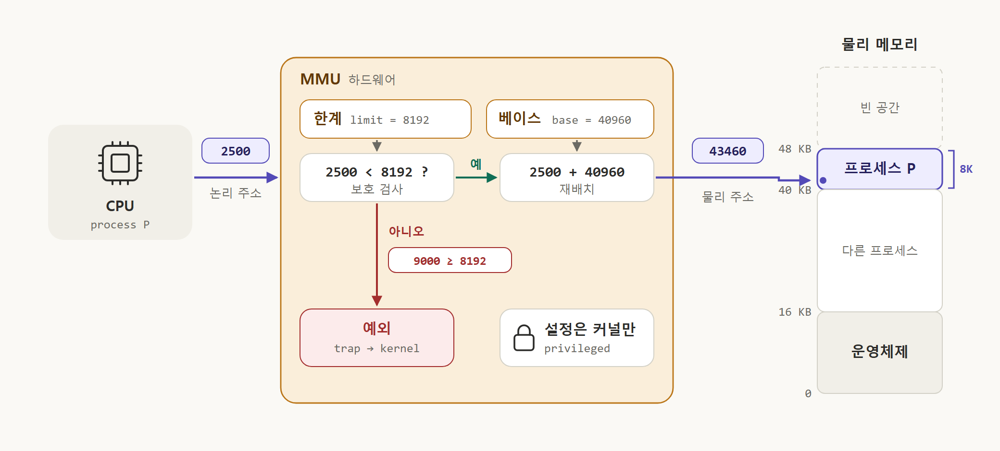
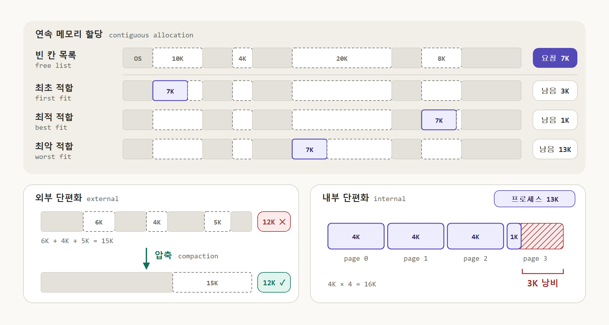
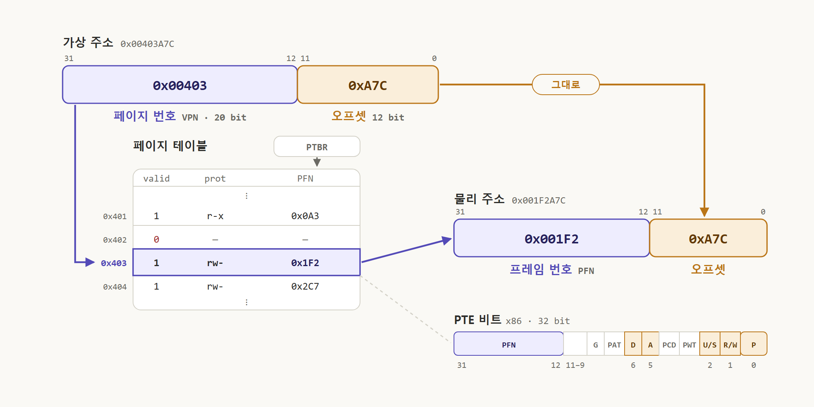
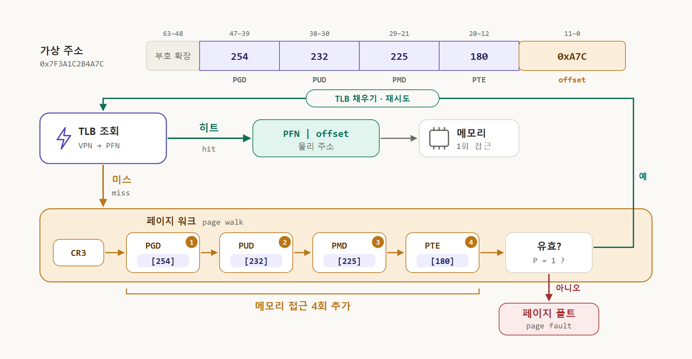

# 메모리 관리: 주소 변환, 연속 할당, 페이징, 그리고 TLB

> OS 학습 8단원. 프로그램이 쓰는 주소와 메모리 칩이 받는 주소가 왜 다른지, 그 사이에서 MMU가 무엇을 하는지 정리한다. 베이스·한계 레지스터로 시작해 연속 할당과 단편화를 거쳐 페이징까지 간다. 실제 주소 하나를 손으로 변환해 보고, TLB와 x86-64의 4단계 페이지 테이블로 마무리한다.

---

## 1. 논리 주소, 물리 주소, 그리고 MMU



그림 왼쪽의 CPU가 내는 주소와 오른쪽 메모리가 받는 주소는 서로 다르다.

- **논리 주소**(logical address): CPU가 만들어 내는 주소. 프로그램은 이 주소만 본다. 실행 시간에 바인딩하는 시스템에서는 **가상 주소**(virtual address)라고도 부른다.
- **물리 주소**(physical address): 메모리 장치가 실제로 받는 주소.

둘 사이를 실행 중에 바꿔 주는 하드웨어가 **MMU**(memory-management unit)다. 사용자 프로그램은 물리 주소를 한 번도 보지 못한다. 주소가 메모리 칩으로 나가는 순간에야 물리 주소가 만들어진다.

### 주소 바인딩: 언제 물리 주소가 정해지나

소스 코드의 `count` 같은 이름은 결국 어떤 메모리 주소로 정해져야 한다. 이것을 **주소 바인딩**이라 하고, 정하는 시점은 세 가지다.

| 시점 | 무엇이 일어나나 | 적재 위치가 바뀌면 | 논리 = 물리? |
|---|---|---|---|
| 컴파일 시간 | 컴파일러가 실제 주소가 박힌 절대 코드를 만든다 (DOS의 `.COM`) | 다시 컴파일 | 같다 |
| 적재 시간 | 컴파일러는 재배치 가능 코드를, 로더가 시작 주소를 더해 주소를 확정한다 | 다시 적재 | 같다 |
| 실행 시간 | 주소를 쓸 때마다 하드웨어가 바꾼다. 실행 중에도 옮길 수 있다 | 그대로 실행 | 다르다 |

오늘날 대부분의 운영체제는 **실행 시간 바인딩**을 쓴다. 이때 필요한 "특별한 하드웨어"가 MMU다.

적재 시간 방식처럼 소프트웨어(로더)가 주소를 고쳐 쓰는 것을 OSTEP은 **정적 재배치**라고 부른다. `movl 1000, %eax`를 3000번지에 적재하면 로더가 `movl 4000, %eax`로 바꿔 쓰는 식이다. 이 방식에는 보호가 없다. 프로세스가 엉뚱한 주소를 만들어 남의 메모리를 건드려도 막을 장치가 없다. 한번 놓은 뒤에는 옮기기도 어렵다.

### 베이스·한계 레지스터: 가장 단순한 MMU

가장 단순한 MMU는 CPU마다 레지스터 두 개를 둔다. 그림 가운데의 주황색 상자가 MMU다.

- **베이스 레지스터**(base, 재배치 레지스터라고도 한다): 프로세스가 물리 메모리 어디서 시작하는지.
- **한계 레지스터**(limit, OSTEP은 bounds): 프로세스 주소 공간의 크기.

메모리를 참조할 때마다 하드웨어가 이렇게 한다.

1. 논리 주소가 한계보다 작은지 검사한다(**보호**). 그림에서 `2500 < 8192`이므로 통과.
2. 베이스를 더한다(**재배치**). `2500 + 40960 = 43460`.
3. 43460번지에 접근한다.
4. 논리 주소가 9000처럼 한계 이상이면 CPU가 **예외**를 일으킨다(1단원). 커널의 핸들러가 실행되고, 보통 그 프로세스를 끝낸다.

```c
/* 베이스·한계 MMU가 매 메모리 참조마다 하는 일 (개념 코드) */
unsigned translate(unsigned logical, unsigned base, unsigned limit) {
    if (logical >= limit)
        raise_exception(OUT_OF_BOUNDS);   /* 커널로 트랩 */
    return logical + base;                /* 물리 주소 */
}
/* translate(2500, 40960, 8192) == 43460
   translate(9000, 40960, 8192) → 예외 */
```

운영체제가 할 일도 생긴다.

- **레지스터 설정은 특권 명령이다**(그림 오른쪽 아래 자물쇠). 사용자 프로세스가 베이스 값을 마음대로 바꿀 수 있다면 다른 프로세스나 커널 메모리를 마음대로 읽고 쓸 수 있다. 그래서 커널 모드에서만 바꿀 수 있다.
- **문맥 교환 때 저장·복원한다.** 베이스·한계 쌍은 CPU에 하나뿐이다. 그래서 3단원의 문맥 교환 때 나가는 프로세스의 값을 PCB에 저장하고, 들어오는 프로세스의 값을 복원한다.
- **프로세스를 옮길 수 있다.** 멈춰 있는 프로세스의 메모리를 다른 곳으로 복사하고, PCB에 저장된 베이스 값만 고치면 된다. 프로세스는 다시 실행돼도 옮겨진 줄 모른다. 실행 중에 주소를 바꾸므로 이 기법을 **동적 재배치**(dynamic relocation)라 한다.

> 헷갈리기 쉬운 점: 한계 레지스터를 정의하는 방법은 두 가지다. 하나는 그림처럼 **크기**를 담고, 베이스를 더하기 *전에* 논리 주소와 비교한다. 다른 하나는 **끝 물리 주소**를 담고, 베이스를 더한 *뒤에* 비교한다. OSTEP은 둘이 논리적으로 같다고 설명한다.

> 비유: 아파트 호수와 실제 위치. 각 세대는 "우리 집 3번 방"이라고만 말한다(논리 주소). 관리실(MMU)은 그 세대가 몇 층부터 시작하는지(베이스)와 방이 몇 개인지(한계)를 알고 있어서, 실제 위치를 계산하고 남의 집 방 번호는 거절한다.

---

## 2. 연속 메모리 할당과 단편화



베이스·한계 방식에서는 프로세스 하나가 물리 메모리의 **연속된 한 덩어리**를 차지한다. 이것이 **연속 메모리 할당**이다. 프로세스가 생기고 끝나기를 반복하면 메모리 곳곳에 빈 칸(hole)이 생긴다. 운영체제는 빈 칸들을 **빈 칸 목록**(free list)으로 관리하고, 새 요청이 오면 들어갈 칸을 고른다.

### 어느 빈 칸에 넣을까: 적합 전략

그림 윗부분의 빈 칸 10K, 4K, 20K, 8K(주소 순서)에 7K를 요청한 결과다.

| 전략 | 고르는 칸 | 예제 결과 | 장점 | 단점 |
|---|---|---|---|---|
| 최초 적합 (first fit) | 앞에서부터 찾다가 처음 들어가는 칸 | 10K → 3K 남음 | 목록 전체를 보지 않아 빠르다 | 목록 앞쪽에 작은 조각이 쌓인다 |
| 최적 적합 (best fit) | 들어가는 칸 중 가장 작은 칸 | 8K → 1K 남음 | 큰 칸을 아껴 둔다 | 목록 전체를 뒤져야 하고, 쓸모없이 작은 조각이 남는다 |
| 최악 적합 (worst fit) | 가장 큰 칸 | 20K → 13K 남음 | 남는 조각이 커서 다시 쓸 수 있다는 발상 | 목록 전체를 뒤져야 하고, 실제로는 성적이 나쁘다 |

값은 파이썬으로 한 번 더 계산해 확인했다. 어느 전략이 나은지에 대해 실버샤츠 교재를 요약한 UIC 강의 노트는 시뮬레이션 결과를 이렇게 정리한다. 시간과 공간 이용률 모두 최초·최적 적합이 최악 적합보다 낫다. 최초와 최적은 공간 이용률이 비슷하지만 최초 적합이 더 빠르다. OSTEP도 대부분의 연구에서 최악 적합은 단편화가 심하고 비용도 크다고 쓴다.

### 외부 단편화와 압축

그림 왼쪽 아래를 보자. 빈 칸이 6K, 4K, 5K로 합치면 15K인데, 12K 요청이 실패한다. 한 덩어리로 이어진 빈 칸이 없기 때문이다. 이렇게 빈 공간의 합은 충분한데 잘게 흩어져 쓸 수 없는 상태가 **외부 단편화**다. 위의 세 전략 모두 외부 단편화를 피하지 못한다. 좋은 알고리즘은 줄일 뿐이다.

UIC 노트는 최초 적합에 대한 통계 분석으로, 할당된 블록이 N개이면 약 0.5N개 분량이 단편화로 사라진다는 결과를 소개한다. 이 규칙의 원래 출처와 조건은 아직 확인하지 못했다(아래 질문).

해결책 하나는 **압축**(compaction)이다. 사용 중인 덩어리를 한쪽으로 몰아 빈 칸을 하나로 합친다(그림의 15K). 압축에는 조건과 비용이 있다.

- **실행 시간 바인딩이어야** 한다. 옮긴 뒤 각 프로세스의 베이스 레지스터만 고치면 되기 때문이다. 컴파일·적재 시간 바인딩이면 주소가 코드에 박혀 있어 옮길 수 없다.
- **비싸다.** 메모리를 통째로 복사하므로 CPU 시간을 많이 쓰고, 그동안 프로세스를 멈춰야 한다.

다른 해결책은 프로세스가 **연속되지 않은** 물리 메모리를 쓰게 하는 것이다. 이것이 3절의 페이징이다.

### 내부 단편화

그림 오른쪽 아래는 메모리를 **고정 크기 블록**(여기서는 4K)으로만 나눠 주는 경우다. 13K가 필요한 프로세스는 블록 4개(16K)를 받고, 마지막 블록의 3K는 아무도 쓰지 못한다. 할당된 단위 *안에서* 낭비되므로 **내부 단편화**다. 요청 크기가 무작위라면 요청 하나당 평균 반 블록이 낭비된다. 블록이 클수록 내부 단편화가 커진다.

| | 외부 단편화 | 내부 단편화 |
|---|---|---|
| 낭비되는 곳 | 할당된 덩어리들 **사이**의 빈 칸 | 할당된 덩어리 **안**의 남는 부분 |
| 생기는 이유 | 크기가 제각각인 덩어리를 할당·해제 | 요청보다 큰 고정 단위로 할당 |
| 잘 생기는 방식 | 연속 할당, 세그멘테이션 | 페이징, 고정 크기 분할 |
| 대책 | 압축, 비연속 할당(페이징) | 작은 단위(대신 관리 비용 증가) |

> 비유: 외부 단편화는 주차장에 빈칸이 군데군데 있는데 버스 한 대 댈 연속된 자리가 없는 상황이다. 내부 단편화는 경차가 대형차 칸을 차지해 칸 안에 빈 공간이 남는 상황이다.

---

## 3. 페이징: 주소를 둘로 쪼갠다



**페이징**은 연속 할당을 포기한다.

- 물리 메모리를 같은 크기의 **프레임**(frame)으로 나눈다.
- 프로세스의 논리 주소 공간을 같은 크기의 **페이지**(page)로 나눈다.
- 어느 페이지든 아무 빈 프레임에나 넣는다. 어느 페이지가 어느 프레임에 있는지는 프로세스마다 하나씩 있는 **페이지 테이블**에 적는다.

크기가 모두 같으므로 "들어갈 칸 찾기" 문제가 사라지고, **외부 단편화가 없다**. 대신 마지막 페이지가 다 차지 않으면 **내부 단편화**가 생긴다. 프로세스당 평균 반 페이지다.

### 주소 분해: 페이지 번호와 오프셋

페이지 크기는 2의 거듭제곱이다. 논리 주소가 m비트이고 페이지 크기가 2ⁿ바이트이면, 위쪽 m−n비트가 **페이지 번호**(VPN), 아래쪽 n비트가 페이지 안의 **오프셋**이다. 나눗셈 없이 비트를 자르기만 하면 된다.

그림의 예는 32비트 주소, 4KB(2¹²) 페이지다. 그러면 위 20비트가 페이지 번호, 아래 12비트가 오프셋이다. 가상 주소 `0x00403A7C`를 직접 변환해 보자.

1. **쪼갠다.** `0x00403A7C`를 2진수로 쓰면 `0000 0000 0100 0000 0011 | 1010 0111 1100`이다.
   - 페이지 번호 = 위 20비트 = `0x00403` (10진수 1027)
   - 오프셋 = 아래 12비트 = `0xA7C` (10진수 2684)
2. **찾는다.** 페이지 테이블 시작 주소는 **PTBR**(page-table base register)에 있다. 그 표의 1027번(`0x403`) 항목을 읽는다. valid = 1, 권한 rw-, 프레임 번호(PFN) = `0x1F2`.
3. **검사한다.** valid가 0이거나 권한이 맞지 않으면 예외를 일으킨다. 이번에는 통과.
4. **붙인다.** 프레임 번호 뒤에 오프셋을 **그대로** 붙인다. 물리 주소 = `0x1F2 << 12 | 0xA7C` = `0x001F2A7C` (10진수 2042492).

오프셋은 "페이지 안에서 몇 번째 바이트인가"이므로 바뀌지 않는다. 바뀌는 것은 페이지 번호 → 프레임 번호뿐이다. 그래서 페이징은 "페이지마다 베이스 레지스터가 하나씩 있는 것"과 비슷하다.

```c
#include <stdint.h>

#define OFFSET_BITS 12                      /* 4KB 페이지 */
#define OFFSET_MASK ((1u << OFFSET_BITS) - 1)

typedef struct { unsigned valid : 1, write : 1; uint32_t pfn; } pte_t;

uint32_t translate(uint32_t va, const pte_t *page_table) {
    uint32_t vpn    = va >> OFFSET_BITS;     /* 0x00403A7C → 0x403 */
    uint32_t offset = va &  OFFSET_MASK;     /*            → 0xA7C */
    pte_t pte = page_table[vpn];             /* 메모리를 한 번 더 읽는다 */
    if (!pte.valid)
        raise_exception(SEGMENTATION_FAULT);
    return (pte.pfn << OFFSET_BITS) | offset;   /* → 0x001F2A7C */
}
```

같은 비트 연산을 파이썬으로 돌려 `0x1F2A7C`(2042492)가 나오는 것을 확인했다.

### 페이징의 두 가지 비용

OSTEP은 페이징의 문제를 두 가지로 정리한다.

- **표가 크다.** 32비트 주소와 4KB 페이지면 페이지 번호가 20비트이므로 항목이 2²⁰개(약 백만 개)다. 항목 하나가 4바이트면 프로세스 하나에 4MB, 프로세스 100개면 400MB가 페이지 테이블에만 든다.
- **느리다.** 페이지 테이블은 메모리에 있다. 그래서 메모리 참조 한 번마다 페이지 테이블 항목을 읽는 메모리 참조가 한 번 더 붙는다. 그대로 두면 메모리 접근이 두 배 이상 느려진다.

느린 문제는 4절의 TLB가, 큰 문제는 4절 뒷부분의 다단계 페이지 테이블이 푼다.

### 페이지 테이블 항목(PTE)

그림 오른쪽 아래가 x86 32비트 **페이지 테이블 항목**(PTE)의 비트 배치다. 위 20비트가 프레임 번호이고, 아래 비트들에 페이지의 상태와 권한이 들어간다.

| 비트 | 뜻 | 쓰임 |
|---|---|---|
| valid | 이 변환이 유효한가 | 안 쓰는 페이지를 invalid로 두면 프레임을 주지 않아도 된다. 접근하면 트랩 |
| protection (R/W, 실행 등) | 읽기·쓰기·실행 허용 여부 | 허용되지 않은 방식으로 접근하면 트랩 |
| present (x86의 P) | 페이지가 물리 메모리에 있나 | 디스크로 내보낸 페이지를 표시. 9단원의 `page-fault`와 이어진다 |
| dirty (D) | 메모리에 올라온 뒤 수정됐나 | 내보낼 때 디스크에 다시 써야 하는지 판단 |
| accessed (A, 참조 비트) | 최근 접근됐나 | 어떤 페이지를 메모리에 남길지 고를 때 사용 |
| user/supervisor (U/S) | 사용자 모드에서 접근 가능한가 | 커널 페이지를 사용자 프로세스로부터 보호 |

**valid 비트가 왜 중요한가?** 프로세스는 주소 공간의 아래쪽에 코드와 힙을, 위쪽에 스택을 둔다(3단원 프로세스 메모리 구조). 그 사이의 넓은 빈 공간은 invalid로 표시만 해 두면 된다. 이 빈 공간에는 물리 프레임을 하나도 쓰지 않는다.

> 헷갈리기 쉬운 점: x86에는 valid 비트가 따로 없고 **P(present) 비트 하나**뿐이다. P = 0이면 "메모리에 없음"일 수도, "애초에 유효하지 않음"일 수도 있다. 하드웨어는 일단 트랩을 일으키고, 운영체제가 자기 자료 구조를 보고 어느 쪽인지 판단한다. 유효한데 메모리에 없는 경우를 처리하는 것이 9단원의 `demand-paging`이다.

---

## 4. TLB와 다단계 페이지 테이블



### TLB: 변환 결과를 캐시한다

**TLB**(translation lookaside buffer)는 MMU 안에 있는 **주소 변환 전용 캐시**다. 최근에 쓴 "페이지 번호 → 프레임 번호" 짝을 보관한다. OSTEP에 따르면 보통 32·64·128개 항목이고, 완전 연관(fully associative) 방식이라 모든 항목을 **병렬로** 한 번에 찾는다.

그림의 흐름은 이렇다.

1. 가상 주소에서 페이지 번호를 뽑아 **TLB를 찾는다.**
2. **히트**(hit)면 TLB의 프레임 번호와 오프셋으로 물리 주소를 만들고 메모리에 한 번만 접근한다. 페이지 테이블은 읽지 않는다.
3. **미스**(miss)면 메모리에 있는 페이지 테이블을 따라가며 변환을 찾는다(**페이지 워크**).
4. 찾은 항목이 유효하면 **TLB에 넣고 명령을 다시 실행**한다. 이번에는 히트한다.
5. 유효하지 않으면 예외가 난다. 이것이 9단원에서 다룰 `page-fault`다.

TLB 미스를 누가 처리하는지는 아키텍처마다 다르다.

| | 하드웨어 관리 TLB | 소프트웨어 관리 TLB |
|---|---|---|
| 미스가 나면 | 하드웨어가 직접 페이지 테이블을 따라간다 | 하드웨어는 예외만 일으키고, 커널의 TLB 미스 핸들러가 찾아 넣는다 |
| 페이지 테이블 형식 | 하드웨어가 정한다 | 운영체제가 자유롭게 정한다 |
| 예 | x86 (현재 페이지 테이블은 CR3 레지스터가 가리킨다) | MIPS, SPARC v9 |

**왜 히트율이 높은가?** 프로그램에는 **지역성**이 있기 때문이다. 방금 쓴 주소를 곧 다시 쓰고(시간 지역성), 가까운 주소를 이어서 쓴다(공간 지역성). OSTEP의 예에서 정수 10개짜리 배열을 처음 훑을 때도, 같은 페이지에 붙어 있는 원소들 덕분에 10번 중 7번이 히트한다(70%). 페이지마다 첫 원소만 미스다.

### 유효 접근 시간 계산

TLB가 얼마나 도움이 되는지는 **유효 접근 시간**(EAT, effective access time)으로 잰다. 히트율이 h일 때 이렇다.

```
EAT = h × (히트일 때 시간) + (1 − h) × (미스일 때 시간)
```

UIC 노트의 예: 메모리 접근 100ns, TLB 검색 20ns, 1단계 페이지 테이블이라고 하자.

- 히트: 20 + 100 = 120ns
- 미스: 20 + 100(페이지 테이블) + 100(데이터) = 220ns
- 히트율 80%: 0.80 × 120 + 0.20 × 220 = **140ns**
- 히트율 98%: 0.98 × 120 + 0.02 × 220 = **122ns**

여기에 단계 수를 바꿔 직접 계산해 봤다. TLB 검색 10ns, 메모리 100ns로 두고, 미스 때 표를 읽는 횟수만 바꾼다.

| 히트율 | 1단계 표 (미스 210ns) | 4단계 표 (미스 510ns) |
|---|---|---|
| 99% | 0.99 × 110 + 0.01 × 210 = **111ns** | 0.99 × 110 + 0.01 × 510 = **114ns** |
| 80% | 0.80 × 110 + 0.20 × 210 = **130ns** | 0.80 × 110 + 0.20 × 510 = **190ns** |

히트율이 높으면 4단계 표의 비싼 미스도 평균에는 거의 보이지 않는다. 히트율이 떨어지면 표가 깊을수록 훨씬 아프다. 단, 이 계산은 단순화한 것이다. 실제 CPU에는 페이지 워크 캐시와 데이터 캐시가 있어서 표 읽기가 매번 메모리까지 가지 않는다. 위키백과는 실제 TLB의 전형적인 값으로 히트 0.5~1 사이클, 미스 비용 10~100 사이클, 미스율 0.01~1%를 든다.

### 문맥 교환과 TLB

TLB의 항목은 **지금 프로세스의** 변환이다. 다른 프로세스로 바꾸면 같은 페이지 번호가 다른 프레임을 가리킨다. 해결책은 두 가지다.

- **비우기**(flush): 문맥 교환 때 TLB의 valid 비트를 모두 0으로 만든다. 간단하지만 새 프로세스는 한동안 미스만 낸다. 3단원에서 본 문맥 교환의 간접 비용이 이것이다.
- **주소 공간 식별자**(ASID): TLB 항목마다 어느 주소 공간의 것인지 태그를 단다. 비우지 않고도 여러 프로세스의 항목이 섞여 있을 수 있다. 인텔 64 프로세서는 2010년 Westmere부터 12비트 **PCID**를 지원하고, 위키백과에 따르면 리눅스는 4.14부터 이 태그를 쓰기 시작했다.

> 헷갈리기 쉬운 점: **TLB의 valid 비트 ≠ PTE의 valid 비트**. PTE가 invalid면 "이 페이지는 할당되지 않았다"는 뜻이라 접근하면 트랩이 난다. TLB 항목이 invalid면 "이 칸에 캐시된 변환이 없다"는 뜻일 뿐이다. 보통 부팅 직후의 TLB 항목은 모두 invalid로 시작한다.

> 비유: TLB는 자주 거는 전화번호를 적어 둔 포스트잇이다. 포스트잇에 있으면 바로 걸고(히트), 없으면 두꺼운 전화번호부(페이지 테이블)를 뒤진 뒤 포스트잇에 옮겨 적는다(미스).

### 다단계 페이지 테이블

3절에서 본 1단계(선형) 페이지 테이블은 프로세스마다 4MB였다. 대부분 invalid인 항목인데도 자리를 차지한다. **다단계 페이지 테이블**은 이 낭비를 없앤다.

1. 페이지 테이블 자체를 페이지 크기 조각으로 자른다.
2. 조각 전체가 invalid면 그 조각은 **아예 만들지 않는다.**
3. 어느 조각이 있는지는 한 단계 위의 표(**페이지 디렉터리**)가 기록한다.

그래서 표의 크기가 실제로 쓰는 주소 공간에 비례한다. 각 조각이 한 페이지에 딱 맞으므로 아무 빈 프레임에나 넣을 수 있다는 장점도 있다. 대가는 시간이다. TLB 미스가 나면 단계 수만큼 메모리를 읽어야 한다. OSTEP은 이것을 시간과 공간의 맞교환이라고 부른다. TLB 히트일 때는 단계 수와 상관없이 성능이 같다.

### x86-64의 4단계 페이지 테이블

그림 맨 위가 x86-64의 가상 주소다.

- 64비트 주소 중 **아래 48비트만** 쓴다. 위 16비트는 47번 비트와 같은 값으로 채워야 한다(부호 확장). 주소 범위를 나중에 넓힐 여지를 남기려는 것이다.
- 4KB 페이지에서 48비트는 **9비트씩 네 단계 인덱스 + 12비트 오프셋**으로 나뉜다. 9비트이므로 표 하나에 항목이 2⁹ = 512개다. 항목이 8바이트이므로 512 × 8 = 4096바이트, 표 하나가 정확히 한 페이지다.
- 2MB 페이지를 쓰면 세 단계(오프셋 21비트), 1GB 페이지를 쓰면 두 단계(오프셋 30비트)로 줄어든다.
- 4단계로는 가상 주소 공간이 256TiB(2⁴⁸바이트), 물리 주소 공간이 64TiB로 제한된다. 그래서 일부 새 x86-64 프로세서는 57비트 주소를 쓰는 5단계를 켤 수 있다.

리눅스는 단계 이름을 위에서부터 PGD, P4D, PUD, PMD, PTE로 부른다. 하드웨어가 4단계만 쓰면 P4D 단계는 **접혀서**(folded) 건너뛴다. 각 프로세스는 자기 PGD를 `mm_struct`에 가지고 있다. 그림의 예 `0x7F3A1C2B4A7C`를 나누면 이렇다.

```c
#include <stdio.h>
#include <stdint.h>

int main(void) {
    uint64_t va = 0x7F3A1C2B4A7CULL;
    printf("PGD %llu, PUD %llu, PMD %llu, PTE %llu, offset 0x%llX\n",
           (va >> 39) & 0x1FF, (va >> 30) & 0x1FF,
           (va >> 21) & 0x1FF, (va >> 12) & 0x1FF, va & 0xFFF);
    return 0;
}
/* PGD 254, PUD 232, PMD 225, PTE 180, offset 0xA7C (파이썬으로 같은 계산을 확인) */
```

TLB 미스가 나면 MMU는 CR3가 가리키는 PGD에서 254번 항목을 읽고, 거기 적힌 PUD의 232번, PMD의 225번, PTE 표의 180번 항목을 차례로 읽는다. 그림의 ①~④, 메모리 접근 네 번이다. 마지막 항목의 프레임 번호에 오프셋 `0xA7C`를 붙이면 물리 주소가 된다.

---

## 5. 세그멘테이션과 페이징

1절의 베이스·한계 방식은 주소 공간 전체를 한 덩어리로 옮긴다. 그래서 힙과 스택 사이의 쓰지 않는 공간까지 물리 메모리를 차지한다. **세그멘테이션**은 베이스·한계 쌍을 **논리적 세그먼트마다** 하나씩 둔다. 코드, 힙, 스택을 물리 메모리의 서로 다른 곳에 따로 놓을 수 있다.

- 주소는 **세그먼트 번호 + 오프셋**이다. OSTEP의 예에서는 14비트 주소의 위 2비트가 세그먼트를 고른다. 가상 주소 4200은 2진수로 `01 0000 0110 1000`이라 세그먼트 01(힙), 오프셋 104다.
- 하드웨어는 **세그먼트 테이블**에서 그 세그먼트의 베이스와 한계를 꺼낸다. 오프셋이 한계 이상이면 예외를 일으킨다. C 프로그래머가 아는 **segmentation fault**라는 말이 여기서 나왔다.
- 세그먼트마다 보호 비트를 둘 수 있다. 코드 세그먼트를 읽기 전용으로 두면 여러 프로세스가 공유할 수 있다.
- 세그먼트의 크기가 제각각이라 **외부 단편화**가 다시 생긴다. 압축이나 적합 전략으로 줄일 수는 있지만 근본적으로 피할 수는 없다.

| | 세그멘테이션 | 페이징 |
|---|---|---|
| 나누는 단위 | 코드·힙·스택 같은 **논리적** 단위, 크기 제각각 | 같은 크기의 페이지, 내용과 무관 |
| 주소 | 세그먼트 번호 + 오프셋 | 페이지 번호 + 오프셋 |
| 표 | 세그먼트 테이블 (베이스, 한계, 보호) | 페이지 테이블 (프레임 번호, valid, 보호 등) |
| 단편화 | **외부** 단편화 | **내부** 단편화 (평균 반 페이지) |
| 드문드문한 주소 공간 | 세그먼트 단위로만. 큰 힙을 조금만 써도 힙 전체가 메모리에 있어야 함 | 페이지 단위로 invalid 처리 |
| 프로그래머의 관점 | 프로그램 구조와 잘 맞음 | 구조와 무관한 평평한 주소 |
| 오늘날 | x86-64 롱 모드에서는 FS·GS를 빼고 거의 쓰지 않음 | 주류 방식 |

둘을 섞는 방식도 있다. GE 645 같은 시스템은 세그먼트 테이블 항목에 물리 베이스 대신 **그 세그먼트의 페이지 테이블 주소**를 담았다. IA-32(32비트 x86)도 세그먼트로 선형 주소를 만든 뒤 그것을 페이징으로 다시 변환한다.

> 헷갈리기 쉬운 점: **segmentation fault는 세그멘테이션 시스템에서만 나는 것이 아니다.** 페이징을 쓰는 리눅스에서도 잘못된 주소에 접근하면 커널이 SIGSEGV를 보낸다. 이름만 세그멘테이션 시절에서 물려받았다.

---

## 정리

- 프로그램은 **논리 주소**만 쓰고, 메모리는 **물리 주소**를 받는다. 오늘날 운영체제는 둘을 **실행 시간**에 바인딩하고, 그 변환은 **MMU** 하드웨어가 한다.
- 가장 단순한 MMU는 **베이스·한계 레지스터**다. 한계로 **보호**하고 베이스로 **재배치**한다. 레지스터 설정은 커널만 할 수 있다.
- **연속 할당**은 빈 칸을 고르는 **최초·최적·최악 적합** 중 무엇을 써도 **외부 단편화**를 피하지 못한다. **압축**은 비싸다. 고정 크기로 나누면 **내부 단편화**가 생긴다.
- **페이징**은 주소를 페이지 번호와 오프셋으로 쪼개고, **페이지 테이블**로 페이지 번호만 프레임 번호로 바꾼다. 외부 단편화가 없다. **PTE**에는 valid, 보호, present, dirty, accessed 비트가 있다.
- 페이지 테이블 때문에 느려지는 문제는 **TLB**가, 커지는 문제는 **다단계 페이지 테이블**이 푼다. x86-64는 9비트씩 4단계(+12비트 오프셋)를 쓴다. 효과는 **유효 접근 시간**으로 계산한다.
- **세그멘테이션**은 논리 단위마다 베이스·한계를 두지만 외부 단편화가 남는다. 오늘날의 주류는 페이징이다.

## 아직 답을 못 찾은 질문

- 최초 적합에서 "할당 블록 N개당 약 0.5N개가 단편화로 사라진다"는 통계 결과는 원래 어떤 분석에서 나왔고, 어떤 가정(요청 크기 분포, 해제 순서)에서 성립하나?
- 페이지 워크 캐시가 있는 실제 x86-64 CPU에서 TLB 미스 한 번은 평균 몇 번의 메모리(또는 캐시) 접근으로 끝나나? 4번이라는 계산은 어디까지 맞나?
- 리눅스는 12비트 PCID(4096개)로 수많은 프로세스를 어떻게 나눠 쓰나? "최근에 쓴 주소 공간"을 고르는 기준은 무엇인가?

## 참고 자료

- Remzi & Andrea Arpaci-Dusseau, *Operating Systems: Three Easy Pieces*, [Ch.15 Mechanism: Address Translation](https://pages.cs.wisc.edu/~remzi/OSTEP/vm-mechanism.pdf)
- 같은 책, [Ch.16 Segmentation](https://pages.cs.wisc.edu/~remzi/OSTEP/vm-segmentation.pdf)
- 같은 책, [Ch.17 Free-Space Management](https://pages.cs.wisc.edu/~remzi/OSTEP/vm-freespace.pdf)
- 같은 책, [Ch.18 Paging: Introduction](https://pages.cs.wisc.edu/~remzi/OSTEP/vm-paging.pdf)
- 같은 책, [Ch.19 Paging: Faster Translations (TLBs)](https://pages.cs.wisc.edu/~remzi/OSTEP/vm-tlbs.pdf)
- 같은 책, [Ch.20 Paging: Smaller Tables](https://pages.cs.wisc.edu/~remzi/OSTEP/vm-smalltables.pdf)
- UIC CS 385 Course Notes, [Main Memory](https://www.cs.uic.edu/~jbell/CourseNotes/OperatingSystems/8_MainMemory.html)
- The Linux Kernel documentation, [Page Tables](https://docs.kernel.org/mm/page_tables.html)
- The Linux Kernel documentation, [5-level paging](https://docs.kernel.org/arch/x86/x86_64/5level-paging.html)
- Wikipedia, [Memory management unit](https://en.wikipedia.org/wiki/Memory_management_unit)
- Wikipedia, [Translation lookaside buffer](https://en.wikipedia.org/wiki/Translation_lookaside_buffer)
