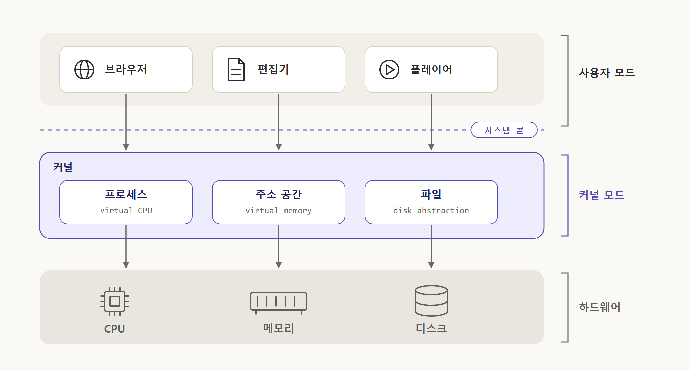
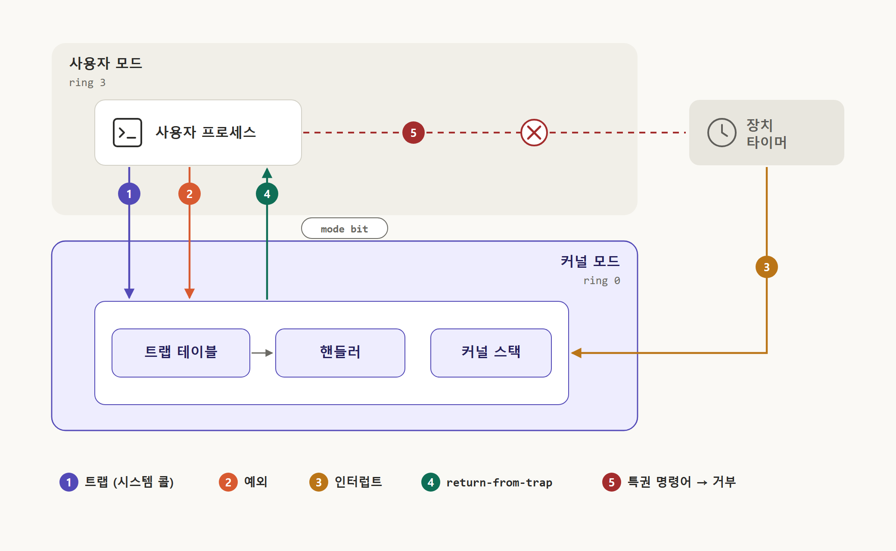
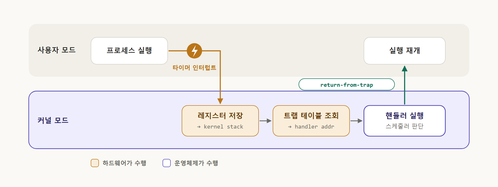

# 운영체제 개요: 커널 모드, 사용자 모드, 그리고 인터럽트

> OS 학습 1단원. 운영체제가 무슨 일을 하는지, 그리고 프로그램이 함부로 하드웨어를 건드리지 못하게 막는 장치(이중 모드)와 운영체제가 CPU를 되찾는 방법(인터럽트)을 정리한다.

---

## 1. 운영체제는 무엇을 하나



그림의 맨 위에는 우리가 쓰는 프로그램이, 맨 아래에는 실제 하드웨어가 있다. 운영체제의 핵심인 **커널**이 그 사이에서 세 가지 일을 한다.

- **가상화**: CPU, 메모리, 디스크라는 물리 자원을 프로그램이 쓰기 쉬운 모양으로 바꿔 준다.
  - CPU → **프로세스**: 각 프로그램은 CPU를 혼자 쓰는 것처럼 느낀다.
  - 메모리 → **주소 공간**: 각 프로그램은 자기만의 메모리를 가진 것처럼 느낀다.
  - 디스크 → **파일**: 섹터 번호 대신 이름으로 데이터를 다룬다.
- **표준 라이브러리 역할**: 프로그램은 파일 열기, 메모리 할당 같은 기능을 **시스템 콜**로 커널에 요청한다. 보통 운영체제는 수백 개의 시스템 콜을 제공한다.
- **자원 관리자 역할**: 여러 프로그램이 CPU·메모리·디스크를 나눠 쓰므로, 누가 언제 얼마나 쓸지를 효율적이고 공정하게 정한다.

오른쪽 괄호를 보면 프로그램은 **사용자 모드**에, 커널은 **커널 모드**에 있다. 이 구분이 다음 절의 주제다.

> 헷갈리기 쉬운 점: **운영체제 ≠ 커널**. 커널은 운영체제의 핵심 부분이고, 운영체제는 라이브러리와 시스템 프로그램까지 포함하는 더 넓은 말이다.

---

## 2. 이중 모드: 왜 프로그램은 하드웨어를 직접 못 만지나



CPU는 지금 실행 중인 코드가 **어느 모드인지** 하드웨어 수준에서 기억한다(그림 가운데의 mode bit).

| | 사용자 모드 | 커널 모드 |
|---|---|---|
| 누가 | 일반 프로그램 | 운영체제(커널) |
| 할 수 있는 일 | 제한됨. 입출력·특권 명령어 불가 | 기계의 모든 자원 사용 가능 |
| x86 보호 링 | ring 3 | ring 0 |

**특권 명령어**는 커널 모드에서만 실행되는 명령어다. 입출력, 타이머 설정, 트랩 테이블 등록, 인터럽트 끄기 같은 것들이 여기에 속한다. 그림의 ⑤처럼 사용자 프로세스가 이런 명령어를 직접 실행하면 하드웨어가 막고 **예외**를 일으킨다. 그러면 커널이 개입하고, 보통은 그 프로세스를 끝내 버린다.

```c
// x86-64 리눅스, 사용자 프로그램
int main(void) {
    __asm__ volatile("cli");  // 인터럽트 끄기 = 특권 명령어
    return 0;
}
// 실행 결과: general protection fault → Segmentation fault
```

> 비유: 은행 고객(사용자 모드)은 금고에 직접 들어갈 수 없고 창구(시스템 콜)에 요청한다. 금고 열쇠를 가진 직원(커널)만 금고(하드웨어)에 들어간다.

**보호 링과 이중 모드의 관계.** x86에는 ring 0부터 3까지 네 단계 권한이 있지만, 대부분의 운영체제는 0(커널)과 3(사용자) 두 단계만 쓴다. 즉 이중 모드는 *개념*이고, 보호 링은 x86에서 그 개념을 *구현*한 방식이다.

---

## 3. 커널로 들어가는 세 가지 길

사용자 모드에서 커널 모드로 넘어가는 길은 정해져 있다. 그림의 ①②③이다.

| | ① 트랩 | ② 예외 | ③ 하드웨어 인터럽트 |
|---|---|---|---|
| 누가 일으키나 | 프로그램이 **일부러** | 프로그램 실행 중 **오류** | **장치·타이머** |
| 타이밍 | 동기 (특정 명령어에서) | 동기 (특정 명령어에서) | 비동기 (언제든, 명령어 경계에서 처리) |
| 예 | 시스템 콜 (`syscall`) | 0으로 나누기, 잘못된 메모리 접근 | 키보드 입력, 디스크 완료, 타이머 |
| 끝나면 돌아가는 곳 | **다음** 명령어 | 폴트라면 **원인** 명령어 (고친 뒤 다시 실행) | 멈췄던 곳 |

```c
#include <unistd.h>
int main(void) {
    write(1, "hi\n", 3);  // libc가 syscall 명령어(트랩)로 커널에 진입
    return 0;
}
```

커널 일이 끝나면 ④ **return-from-trap** 명령어로 저장해 둔 레지스터를 복원하고 사용자 모드로 돌아간다.

> 용어 주의: "인터럽트·트랩·예외"를 부르는 방식은 아키텍처마다 다르다. x86은 하드웨어 인터럽트와 예외(폴트·트랩·어보트)를 나누고, ARM은 전부를 "예외"로, RISC-V는 전부를 "인터럽트"로 부른다. 이 글에서는 위 표의 뜻으로 쓴다.

---

## 4. 인터럽트는 어떻게 처리되나



타이머 인터럽트를 예로 들면 흐름은 이렇다. 주황색 단계는 **하드웨어가**, 보라색 단계는 **운영체제가** 한다.

1. 프로세스가 사용자 모드에서 실행 중이다.
2. 타이머가 인터럽트를 보낸다.
3. **하드웨어**가 지금 레지스터 값을 커널 스택에 저장하고 커널 모드로 바꾼다.
4. **하드웨어**가 트랩 테이블에서 이 인터럽트의 핸들러 주소를 찾아 그리로 점프한다.
5. **운영체제의 핸들러**가 실행된다. 타이머라면 스케줄러가 지금 프로세스를 계속 돌릴지, 다른 프로세스로 바꿀지 정한다.
6. **return-from-trap**으로 레지스터를 복원하고 사용자 모드로 돌아가 실행을 재개한다.

**트랩 테이블은 언제 생기나?** 컴퓨터는 커널 모드로 부팅한다. 커널은 이때 "어떤 이벤트가 오면 어느 코드를 실행할지"를 담은 트랩 테이블을 하드웨어에 등록한다. 트랩 테이블 등록은 특권 명령어다. 사용자 프로그램이 자기 트랩 테이블을 등록할 수 있다면 기계를 통째로 빼앗을 수 있기 때문이다.

**타이머가 왜 꼭 필요한가?** 운영체제가 프로그램이 스스로 CPU를 돌려주기만 기다린다고 해 보자(**협력적 방식**). 이때 무한 루프에 빠진 프로그램을 멈출 방법은 재부팅뿐이다. 그래서 운영체제는 부팅할 때 타이머를 켜 두고, 몇 밀리초마다 오는 **타이머 인터럽트**로 프로그램이 협조하지 않아도 CPU를 되찾는다. 타이머를 켜고 끄는 것도 물론 특권 명령어다.

> 비유: 시험 감독관이 학생이 답안을 스스로 낼 때까지 기다리면(협력적 방식) 시험이 끝나지 않는다. 그래서 종을 울려 시간이 되면 강제로 걷는다(타이머 인터럽트).

---

## 정리

- 운영체제는 자원을 **가상화**하고, **시스템 콜**이라는 표준 인터페이스를 주며, 자원을 **관리**한다.
- CPU는 **사용자 모드와 커널 모드**를 하드웨어로 구분한다. 특권 명령어는 커널 모드에서만 실행된다.
- 커널로 들어가는 길은 **트랩(일부러) · 예외(오류) · 인터럽트(장치)** 세 가지다. 돌아올 때는 **return-from-trap**을 쓴다.
- 커널은 부팅 때 **트랩 테이블**을 등록하고 **타이머**를 켜 둔다. 그래서 어떤 프로그램도 CPU를 독차지할 수 없다.

## 아직 답을 못 찾은 질문

- x86-64에서 `syscall` 명령어로 커널에 들어갈 때, 레지스터는 정확히 어디에, 누가(하드웨어/커널) 저장하나?
- x86의 ring 1, 2는 왜 대부분의 운영체제에서 쓰이지 않나?

## 참고 자료

- Remzi & Andrea Arpaci-Dusseau, *Operating Systems: Three Easy Pieces*, [Ch.2 Introduction to Operating Systems](https://pages.cs.wisc.edu/~remzi/OSTEP/intro.pdf)
- 같은 책, [Ch.6 Mechanism: Limited Direct Execution](https://pages.cs.wisc.edu/~remzi/OSTEP/cpu-mechanisms.pdf)
- Wikipedia, [Interrupt](https://en.wikipedia.org/wiki/Interrupt)
- Wikipedia, [Protection ring](https://en.wikipedia.org/wiki/Protection_ring)
- Wikipedia, [User space and kernel space](https://en.wikipedia.org/wiki/User_space_and_kernel_space)
