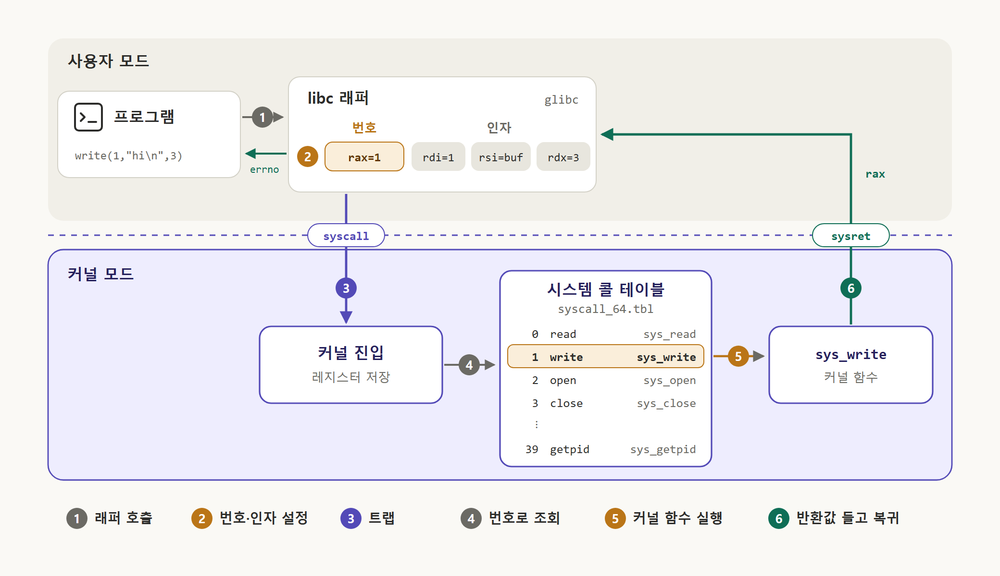
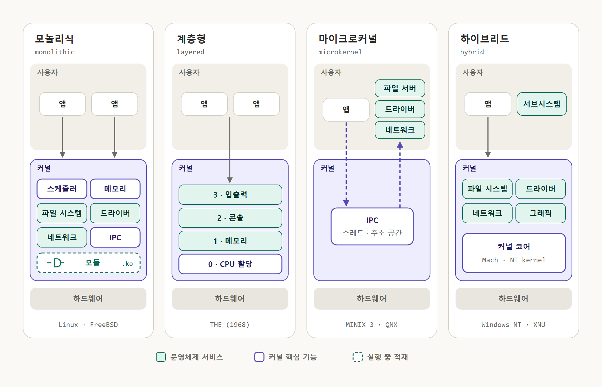
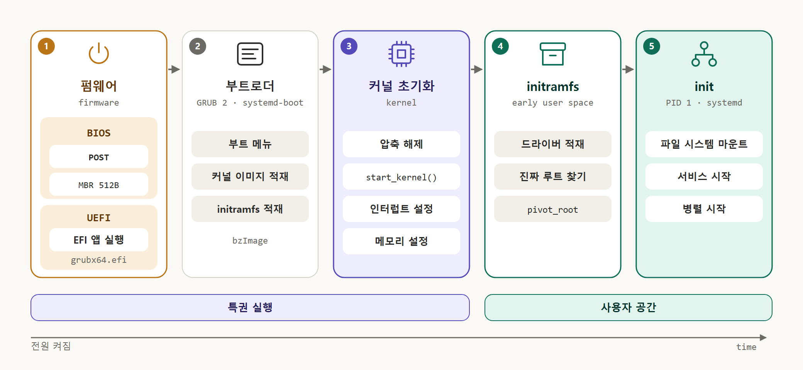

# 운영체제 구조: 시스템 콜, 커널 설계, 그리고 부팅

> OS 학습 2단원. 프로그램이 커널에 일을 시키는 통로(시스템 콜), 커널 안을 나누는 방식(모놀리식·계층형·마이크로커널·하이브리드), 그리고 전원을 켠 뒤 커널과 첫 프로세스가 올라오기까지의 과정(부팅)을 정리한다.

---

## 1. 시스템 콜: 커널에 일을 시키는 창구



1단원에서 사용자 프로그램은 하드웨어를 직접 만질 수 없다고 했다. 파일에 쓰거나, 프로세스를 만들거나, 시간을 읽으려면 커널에 부탁해야 한다. 그 부탁이 **시스템 콜**이다. 시스템 콜은 프로세스와 운영체제 사이의 기본 인터페이스다.

그림은 x86-64 리눅스에서 `write(1, "hi\n", 3)` 한 줄이 실행되는 과정이다.

1. 프로그램이 libc의 `write()` 함수를 부른다. 여기까지는 **평범한 함수 호출**이다.
2. libc 래퍼가 시스템 콜 **번호**(write는 1)를 `rax`에, 인자 세 개를 `rdi`·`rsi`·`rdx`에 넣는다.
3. 래퍼가 `syscall` 명령어를 실행한다. 이것이 1단원의 **트랩**이다. CPU가 커널 모드로 바뀐다.
4. 커널 진입 코드가 레지스터를 저장하고, `rax`의 번호로 **시스템 콜 테이블**을 찾는다.
5. 1번 칸에 적힌 커널 함수 `sys_write`가 실행된다.
6. 결과를 `rax`에 담아 사용자 모드로 돌아간다(`sysret`). 래퍼는 실패라면 `errno`를 설정하고 -1을 돌려준다.

> 비유: 시스템 콜은 관공서 민원 창구다. 민원인(프로그램)은 서류 번호(시스템 콜 번호)와 첨부 서류(인자)를 내고 기다린다. 창구 직원(커널)은 번호를 보고 담당 부서(커널 함수)로 넘기고, 처리 결과(반환값)를 돌려준다.

### 시스템 콜의 종류

시스템 콜은 하는 일에 따라 보통 여섯 가지로 나눈다. 오른쪽 열은 리눅스 x86-64 시스템 콜 테이블에 실제로 있는 이름이다.

| 종류 | 하는 일 | 리눅스 예 |
|---|---|---|
| 프로세스 제어 | 생성·종료, 프로그램 적재·실행, 기다리기, 메모리 할당 | `fork`, `execve`, `exit`, `wait4`, `brk` |
| 파일 관리 | 생성·삭제, 열기·닫기, 읽기·쓰기·위치 이동, 속성 | `openat`, `close`, `read`, `write`, `lseek` |
| 장치 관리 | 장치 요청·해제, 읽기·쓰기, 속성 | `ioctl`, `read`, `write` |
| 정보 유지 | 시간·날짜·시스템 정보, 프로세스·파일 속성 | `time`, `uname`, `getpid` |
| 통신 | 연결 생성·삭제, 메시지 주고받기 | `pipe`, `socket`, `sendto`, `recvfrom` |
| 보호 | 파일 권한 읽기·설정 | `chmod`, `chown`, `setuid` |

리눅스는 파일과 장치를 같은 `read`/`write`로 다루기 때문에 두 줄에 같은 이름이 나온다.

---

## 2. API, libc 래퍼, 그리고 시스템 콜

프로그래머는 시스템 콜을 직접 부르는 일이 거의 없다. 보통 **API**를 쓴다. API는 라이브러리가 함수 형태로 제공하는 인터페이스다. 유닉스 계열에서는 C 라이브러리(libc, 예: glibc)가 그 역할을 한다. Windows NT에서는 Windows API 아래에 문서화되지 않은 Native API(`ntdll.dll`)가 있고, 그것이 시스템 콜을 부른다.

libc의 `write()`, `getpid()` 같은 함수 상당수는 **시스템 콜 래퍼**다. 래퍼는 인자를 아키텍처에 맞는 레지스터에 옮기고, 번호를 정하고, 트랩 명령어를 실행한다. 래퍼가 없는 시스템 콜은 `syscall()` 함수로 번호를 직접 지정해 부를 수 있다.

```c
#define _GNU_SOURCE
#include <stdio.h>
#include <sys/syscall.h>   // SYS_getpid, SYS_gettid 같은 번호 상수
#include <unistd.h>

int main(void) {
    pid_t a = getpid();             // libc 래퍼 (함수 이름 = 시스템 콜 이름)
    long  b = syscall(SYS_getpid);  // 번호로 직접 호출 (x86-64에서 39번)
    long  t = syscall(SYS_gettid);  // 번호로 직접 호출
    printf("%d %ld %ld\n", a, b, t);   // a와 b는 같은 값
    return 0;
}
```

| | API (libc 함수) | 시스템 콜 |
|---|---|---|
| 어디에 있나 | 사용자 공간의 라이브러리 | 커널 |
| 부르는 방법 | 평범한 함수 호출 | 트랩 명령어 (`syscall`, `svc #0`, `int $0x80`) |
| 모드 전환 | 없음 (래퍼 안에서 트랩할 때만 일어남) | 사용자 모드 → 커널 모드 |
| 이식성 | POSIX 같은 표준으로 여러 OS에서 같음 | 번호·레지스터 규칙이 OS·아키텍처마다 다름 |
| 오류 표시 | -1을 돌려주고 `errno` 설정 | 아키텍처 규칙에 따른 반환값 |

> 헷갈리기 쉬운 점: **libc 함수 = 시스템 콜이 아니다.** `write()`를 부르는 순간은 함수 호출일 뿐이고, 커널 진입은 래퍼 안에서 트랩 명령어가 실행될 때 일어난다.

---

## 3. 시스템 콜 번호, 테이블, 매개변수 전달

### 번호와 테이블

커널은 시스템 콜을 **번호**로 구분한다. x86-64 리눅스에서 번호와 커널 함수의 대응은 소스의 `arch/x86/entry/syscalls/syscall_64.tbl` 파일에 표로 적혀 있다. 한 줄은 `번호 ABI 이름 진입점` 순서다.

```text
0    common  read     sys_read
1    common  write    sys_write
39   common  getpid   sys_getpid
57   common  fork     sys_fork
175  common  init_module    sys_init_module
```

- 커널 쪽 함수는 `SYSCALL_DEFINEn(이름, 타입, 인자, ...)` 매크로로 정의한다. `n`은 인자 개수다.
- 커널에 없는 번호를 부르면 `ENOSYS` 오류가 난다. 커널을 빌드할 때 빠진 시스템 콜은 `kernel/sys_ni.c`의 대체 함수가 `-ENOSYS`를 돌려준다.
- 번호표는 아키텍처마다 따로 있다. i386은 `syscall_32.tbl`을, arm64 같은 아키텍처는 공용 표(`scripts/syscall.tbl`, 리눅스 6.11부터)를 쓴다.

> 헷갈리기 쉬운 점: **트랩 테이블 ≠ 시스템 콜 테이블.** 트랩 테이블(1단원)은 하드웨어가 "어떤 이벤트가 오면 어느 핸들러로 갈지"를 찾는 표다. 시스템 콜 테이블은 그 핸들러 안에서 커널 소프트웨어가 "몇 번 시스템 콜이면 어느 함수를 부를지"를 찾는 표다. 시스템 콜은 트랩 테이블로 한 번, 시스템 콜 테이블로 또 한 번 찾아간다.

### 매개변수 전달

인자를 커널에 넘기는 방법은 세 가지가 있다.

| 방법 | 어떻게 | 예 |
|---|---|---|
| 레지스터 | 정해진 레지스터에 인자를 넣는다. 가장 흔하다 | x86-64: `rdi rsi rdx r10 r8 r9` (최대 6개) |
| 메모리 블록 | 인자를 구조체에 모으고 그 **주소**만 레지스터로 넘긴다 | 리눅스는 인자가 많으면 크기 필드를 둔 구조체 포인터를 권한다 |
| 스택 | 일부 인자를 사용자 스택에 올린다 | MIPS o32: 5~8번째 인자를 스택으로 |

아키텍처별 호출 규칙은 다음과 같다.

| 아키텍처 | 트랩 명령어 | 번호 | 반환값 | 인자 1~6 |
|---|---|---|---|---|
| x86-64 | `syscall` | `rax` | `rax` | `rdi rsi rdx r10 r8 r9` |
| i386 | `int $0x80` | `eax` | `eax` | `ebx ecx edx esi edi ebp` |
| arm64 | `svc #0` | `w8` | `x0` | `x0 x1 x2 x3 x4 x5` |

libc 없이 x86-64에서 `write`를 직접 부르면 이렇게 된다. 그림의 ②③을 손으로 한 것이다.

```c
#include <stddef.h>

long my_write(int fd, const void *buf, size_t n) {
    long ret;
    __asm__ volatile ("syscall"
        : "=a"(ret)                    // 반환값: rax
        : "a"(1L),                     // 번호: rax = 1 (write)
          "D"(fd), "S"(buf), "d"(n)    // 인자: rdi, rsi, rdx
        : "rcx", "r11", "memory");     // 표에 없는 레지스터도 바뀔 수 있다
    return ret;
}

int main(void) { my_write(1, "hi\n", 3); return 0; }
```

---

## 4. 커널 구조: 서비스를 어디에 둘 것인가



커널 구조를 가르는 질문은 하나다. **파일 시스템, 드라이버, 네트워크 같은 운영체제 서비스를 커널 공간에 둘까, 사용자 공간에 둘까?** 그림의 초록 상자가 서비스, 보라 상자가 커널 핵심 기능이다.

| | 모놀리식 | 계층형 | 마이크로커널 | 하이브리드 |
|---|---|---|---|---|
| 서비스 위치 | 모두 커널 공간 | 커널 공간, 층으로 나눔 | 사용자 공간 서버 | 대부분 커널 공간 |
| 커널이 직접 하는 일 | 전부 | 전부 (층별로) | 주소 공간, 스레드, IPC 정도 | 전부 + 일부 사용자 서버 |
| 서비스끼리 통신 | 함수 호출 (공유 메모리) | 아래층 호출 | 메시지 전달 (IPC) | 대부분 함수 호출 |
| 장점 | 빠르다 | 층별로 검증·시험하기 쉽다 | 서비스가 죽어도 커널은 산다, 작다 | 모놀리식 속도 + 구조 분리 |
| 단점 | 버그 하나가 커널 전체를 위험하게 | (이번 자료에서는 확인 못 함) | 시스템 콜·문맥 교환이 늘어 느려질 수 있다 | 사실상 모놀리식이라는 비판 |
| 예 | Linux, FreeBSD, Solaris | THE (Dijkstra, 1968) | MINIX 3, QNX | Windows NT, XNU(macOS) |

**모놀리식 커널.** 스케줄러, 메모리 관리, 파일 시스템, 드라이버, 네트워크 스택이 모두 커널 모드에서 하나의 주소 공간을 쓴다. 서비스끼리 함수 호출로 바로 통하니 빠르다. 대신 드라이버 하나의 버그가 커널 전체를 무너뜨릴 수 있다.

**적재 가능한 커널 모듈.** 리눅스, FreeBSD, Solaris 같은 모놀리식 커널은 실행 중에 **모듈**을 올리고 내릴 수 있다. 커널을 다시 컴파일하지 않고 드라이버나 파일 시스템을 더한다. 리눅스에서는 모듈을 올리고 내리는 일도 시스템 콜이다(`init_module`, `finit_module`, `delete_module`). 모듈은 커널 공간에 들어가 실행되므로, 모듈을 쓴다고 마이크로커널이 되지는 않는다.

> 비유: 모놀리식 커널은 큰 사무실 한 층에 모든 부서가 함께 있는 회사다. 옆자리에 말로 바로 부탁하니 빠르지만, 한 부서에 불이 나면 층 전체가 위험하다. 모듈은 필요할 때 그 층에 책상을 들여놓는 것이다.

**계층형 구조.** 1968년 Dijkstra 팀의 THE 시스템이 대표 예다. 0층(CPU 할당과 프로세스 전환), 1층(메모리), 2층(콘솔 통신), 3층(입출력), 4층(사용자 프로그램) 순서로 쌓았다. 위층은 아래층만 쓴다. 덕분에 아래층부터 하나씩 만들고 시험할 수 있었다.

**마이크로커널.** 커널에는 주소 공간 관리, 스레드(멀티태스킹), IPC 같은 최소 기능만 남긴다. 파일 시스템, 드라이버, 네트워크는 사용자 공간의 **서버** 프로세스가 맡는다. 그림처럼 앱이 파일을 읽으려면 IPC로 커널을 거쳐 파일 서버에 메시지를 보낸다. 서버가 죽어도 커널은 살아남는다. 대신 시스템 콜과 문맥 교환이 늘어난다. Mach가 가장 잘 알려진 범용 마이크로커널이고, L4 계열은 "마이크로커널이 꼭 느리지는 않다"는 것을 보이려고 만들어졌다.

> 비유: 마이크로커널은 본사(커널)에는 우편실만 두고, 각 부서는 다른 건물에 둔 회사다. 한 건물에 불이 나도 본사는 멀쩡하다. 대신 모든 부탁이 우편(IPC)으로 오가서 느리다.

**하이브리드 커널.** 마이크로커널처럼 구조를 나누지만, 서비스 대부분을 커널 공간에 둔다.

- **Windows NT**: 환경 서브시스템(`csrss.exe`) 같은 일부는 사용자 모드 서버로 돈다. 하지만 대부분의 구성 요소가 커널 주소 공간을 공유하므로 순수 마이크로커널은 아니다. NT 4.0부터는 성능을 위해 창 관리자와 그래픽도 커널 모드로 옮겼다.
- **XNU (macOS, iOS)**: NeXT에서 Mach 2.5와 4.3BSD를 합쳐 만든 커널이 뿌리다. 드라이버는 C++ I/O Kit API로 만든다.
- **리눅스**: 모놀리식 커널 + 적재 가능한 모듈이다.

> 헷갈리기 쉬운 점: **하이브리드 ≠ 마이크로커널.** 하이브리드 커널은 마이크로커널을 닮은 *구조*를 가졌지만, 서비스가 커널 공간에 있어서 마이크로커널의 안정성 이점은 얻지 못한다. Linus Torvalds는 이 용어를 마케팅이라고 깎아내렸다. 리눅스가 모놀리식 구조를 고른 일은 Tanenbaum–Torvalds 논쟁으로 유명하다.

---

## 5. 부팅: 전원 버튼에서 첫 프로세스까지



컴퓨터를 켜면 제어권이 릴레이처럼 넘어간다. 그림의 ①~⑤다.

1. **펌웨어.** CPU는 정해진 주소의 펌웨어(메인보드의 BIOS 또는 UEFI)부터 실행한다.
   - BIOS는 POST(전원 자가 진단)로 장치를 점검하고, 부팅 장치의 **MBR**(512바이트, 1단계 부트로더와 파티션 표)을 읽는다.
   - UEFI는 부트로더를 EFI 응용 프로그램(예: `grubx64.efi`)으로 바로 실행한다. 커널의 EFI 부트 스텁으로 커널을 직접 띄울 수도 있다.
2. **부트로더.** GRUB 2나 systemd-boot가 부트 메뉴를 보여 주고, 압축된 커널 이미지(`bzImage`)와 initramfs를 메모리에 올린 뒤 커널로 점프한다.
3. **커널 초기화.** 커널이 자기 압축을 풀고, `start_kernel()`에서 인터럽트 처리와 메모리를 설정한다. 1단원의 트랩 테이블 등록과 타이머 설정이 이 단계에서 일어난다.
4. **initramfs.** 진짜 루트 파일 시스템이 있는 디스크를 읽으려면 그 저장 장치의 드라이버가 필요하다. 그래서 임시 루트(initramfs, "early user space")를 먼저 올려 드라이버를 적재하고 진짜 루트를 찾는다. 그다음 `pivot_root`로 루트를 바꾸고 임시 루트의 메모리를 돌려준다.
5. **init (PID 1).** 커널이 첫 사용자 공간 프로세스 **init**을 PID 1로 실행한다. init은 파일 시스템을 점검·마운트하고 다른 프로세스와 서비스를 시작한다. 가장 먼저 시작해 가장 늦게 끝나는 프로세스다. 오늘날 많은 배포판은 init으로 **systemd**를 쓴다. 셸 스크립트 대신 선언형 설정 파일을 쓰고 서비스를 병렬로 시작한다. 예전 SysV init은 런레벨(0~6)과 `/etc/rc...` 스크립트를 썼다.

| | BIOS | UEFI |
|---|---|---|
| 부트로더를 찾는 곳 | MBR (디스크 첫 512바이트) | 부트로더를 EFI 응용 프로그램으로 실행 |
| 부트로더 단계 | 1단계(MBR) → 2단계 | 보통 한 개의 EFI 프로그램 |
| 커널 직접 실행 | (부트로더를 거침) | EFI 부트 스텁으로 가능 |
| 보안 부팅 | — | Secure Boot (shim이 먼저 실행될 수 있음) |

> 비유: 부팅은 릴레이 경주다. 펌웨어가 첫 주자로 바통(제어권)을 부트로더에 넘기고, 부트로더는 커널에, 커널은 init에 넘긴다. 앞 주자는 다음 주자를 트랙(메모리)에 세워 놓고 바통을 건넨다.

> 헷갈리기 쉬운 점: **부트로더 ≠ init.** 부트로더는 커널이 뜨기 *전에* 커널을 메모리에 올리는 프로그램이고, init은 커널이 뜬 *뒤에* 처음 실행되는 사용자 프로세스다.

---

## 정리

- **시스템 콜**은 프로그램이 커널에 서비스를 요청하는 인터페이스다. 번호를 레지스터에 넣고 트랩 명령어로 커널에 들어가면, 커널이 **시스템 콜 테이블**에서 함수를 찾아 실행한다.
- 프로그래머는 보통 **API**(libc 함수)를 쓴다. 상당수 libc 함수는 시스템 콜을 감싼 **래퍼**다. 함수 호출과 커널 진입은 다른 순간이다.
- 인자는 주로 **레지스터**로, 많으면 **구조체 주소**로, 일부 아키텍처에서는 **스택**으로 넘긴다.
- 커널 구조는 서비스를 어디에 두느냐로 갈린다. **모놀리식**(모두 커널, 리눅스는 + 모듈), **계층형**(층으로 쌓기), **마이크로커널**(최소 커널 + 사용자 서버), **하이브리드**(구조는 나누되 대부분 커널, Windows NT·XNU).
- 부팅은 **펌웨어(BIOS/UEFI) → 부트로더 → 커널 초기화 → initramfs → init(PID 1)** 순서로 제어권이 넘어간다.

## 아직 답을 못 찾은 질문

- 같은 리눅스인데 시스템 콜 번호표가 x86-64와 arm64에서 왜 다르게 만들어졌나? (x86-64는 `write`가 1번인데, 공용 표를 쓰는 아키텍처의 번호는 어떻게 정해졌나?)
- 마이크로커널의 IPC 비용은 실제로 얼마나 큰가? L4 이후 모놀리식 커널과의 성능 차이는 어느 정도까지 줄었나?

## 참고 자료

- Linux man-pages, [syscall(2)](https://man7.org/linux/man-pages/man2/syscall.2.html)
- Linux kernel documentation, [Adding a New System Call](https://docs.kernel.org/process/adding-syscalls.html)
- Linux 소스, [arch/x86/entry/syscalls/syscall_64.tbl](https://raw.githubusercontent.com/torvalds/linux/master/arch/x86/entry/syscalls/syscall_64.tbl)
- Wikipedia, [System call](https://en.wikipedia.org/wiki/System_call)
- Wikipedia, [Kernel (operating system)](https://en.wikipedia.org/wiki/Kernel_(operating_system))
- Wikipedia, [Hybrid kernel](https://en.wikipedia.org/wiki/Hybrid_kernel)
- Wikipedia, [THE multiprogramming system](https://en.wikipedia.org/wiki/THE_multiprogramming_system)
- Wikipedia, [Booting process of Linux](https://en.wikipedia.org/wiki/Booting_process_of_Linux)
