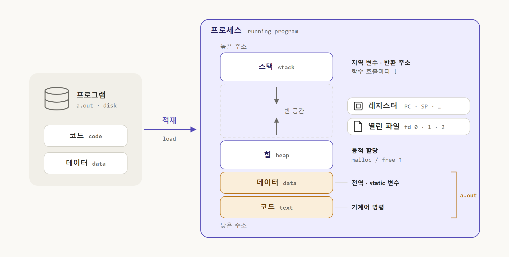
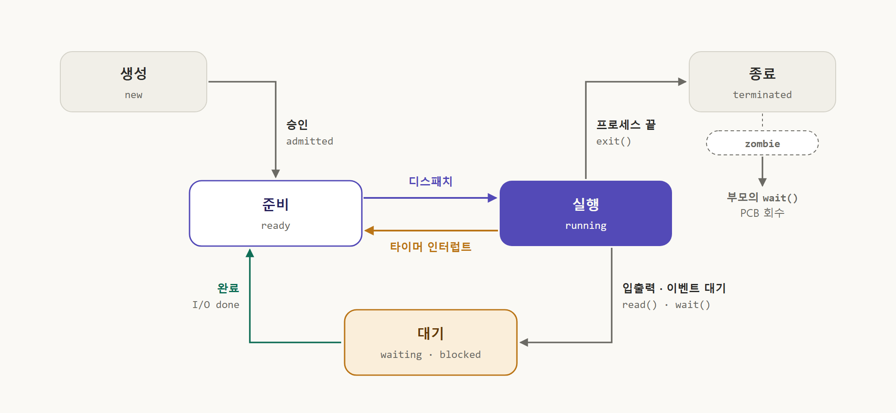
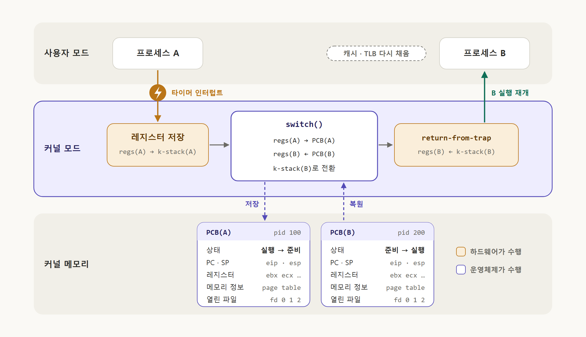
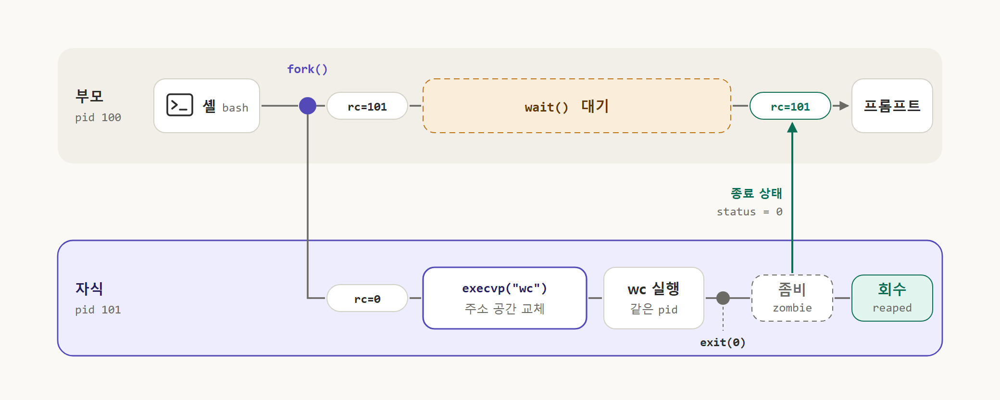

# 프로세스: 실행 중인 프로그램의 구조, 상태, 그리고 일생

> OS 학습 3단원. 프로그램이 어떻게 프로세스가 되는지, 프로세스가 어떤 상태를 오가는지, 운영체제가 프로세스를 어떻게 바꿔 끼우는지(문맥 교환), 그리고 유닉스에서 프로세스를 만들고 끝내고 서로 대화하게 하는 방법을 정리한다.

---

## 1. 프로그램과 프로세스



그림 왼쪽의 **프로그램**은 디스크에 있는 실행 파일이다. 명령어(코드)와 정적 데이터만 들어 있고, 스스로는 아무것도 하지 않는다. 운영체제가 이것을 메모리에 올리고 실행을 시작하면 오른쪽의 **프로세스**가 된다. 프로세스를 한 줄로 말하면 **실행 중인 프로그램**이다.

프로세스는 "지금 이 프로그램이 어디까지 실행됐는가"를 담은 기계 상태로 설명된다.

- **주소 공간**: 프로세스가 접근할 수 있는 메모리. 코드와 데이터가 여기에 있다.
- **레지스터**: 특히 다음에 실행할 명령어를 가리키는 PC(program counter)와 스택 위치를 가리키는 SP(stack pointer).
- **입출력 정보**: 열린 파일 목록. 유닉스 프로세스는 기본으로 표준 입력·출력·오류(fd 0, 1, 2)를 열고 시작한다.

**프로그램이 프로세스가 되는 과정.**

1. 코드와 정적 데이터를 디스크에서 읽어 주소 공간에 올린다. 예전 운영체제는 한꺼번에 올렸고, 현대 운영체제는 필요한 부분만 그때그때 올린다(게으른 적재).
2. **스택**을 할당하고 `main()`에 넘길 `argc`, `argv`를 채운다.
3. **힙**을 조금 할당한다. `malloc()`이 더 요청하면 운영체제가 늘려 준다.
4. 입출력 준비(fd 0, 1, 2)를 한다.
5. 진입점 `main()`으로 점프해 CPU를 프로세스에 넘긴다.

**메모리 구조.** 주소 공간은 보통 네 영역으로 나뉜다.

| 영역 | 담는 것 | 크기 |
|---|---|---|
| 코드 (text) | 컴파일된 기계어 명령 | 실행 중 고정 |
| 데이터 (data) | 전역 변수, `static` 변수 | 실행 중 고정 |
| 힙 (heap) | `malloc`/`free`, `new`/`delete`로 할당한 메모리 | 할당할수록 늘어난다 |
| 스택 (stack) | 지역 변수, 함수 인자, 반환 주소 | 함수 호출마다 늘고, 돌아오면 준다 |

힙과 스택은 빈 공간의 양 끝에서 서로를 향해 자란다. 그림처럼 스택을 높은 주소에 두고 아래로 키우는 배치가 흔하다. 둘이 만나면 스택 오버플로가 나거나 `malloc`이 실패한다.

```c
#include <stdlib.h>
int counter = 0;              // 데이터 영역
int main(void) {              // main의 기계어는 코드 영역
    int local = 1;            // 스택
    int *p = malloc(4);       // p 자체는 스택, p가 가리키는 4바이트는 힙
    free(p);
    return local + counter;
}
```

> 비유: 프로그램은 책장에 꽂힌 **요리 레시피**고, 프로세스는 그 레시피로 **지금 요리하는 중인 상황**이다. 같은 레시피로 두 사람이 동시에 요리할 수 있듯, 같은 프로그램으로 프로세스를 여러 개 만들 수 있다.

> 헷갈리기 쉬운 점: **프로그램 ≠ 프로세스**. 프로그램은 디스크의 정적인 파일이고, 프로세스는 메모리·레지스터·열린 파일을 가진 살아 있는 실행 단위다. 브라우저 창을 두 개 띄우면 프로그램은 하나, 프로세스는 둘이 될 수 있다.

각 프로세스에는 **PID**(process ID)라는 번호가 붙는다. 운영체제와 사용자는 이 번호로 프로세스를 가리킨다(예: `kill 29146`).

---

## 2. 프로세스 상태와 전이



프로세스는 일생 동안 여러 상태를 오간다. 가운데 세 상태(준비·실행·대기)가 핵심이고, 양 끝에 생성과 종료가 붙는다.

| 상태 | 뜻 |
|---|---|
| 생성 (new) | 만들어지는 중이다 |
| 준비 (ready) | 실행할 준비는 끝났지만 CPU를 아직 받지 못했다 |
| 실행 (running) | CPU에서 명령어를 실행하고 있다 |
| 대기 (waiting, blocked) | 입출력 완료 같은 사건을 기다리느라 실행할 수 없다 |
| 종료 (terminated) | 실행이 끝났다. 유닉스에서는 부모가 정리하기 전까지 **좀비** 상태로 남는다 |

**전이 규칙.**

- 준비 → 실행 (**디스패치**): 운영체제(스케줄러)가 이 프로세스를 골라 CPU를 준다.
- 실행 → 준비: 타이머 인터럽트로 운영체제가 CPU를 되찾고 다른 프로세스를 고른다.
- 실행 → 대기: 프로세스가 디스크 읽기처럼 오래 걸리는 입출력을 요청했다.
- 대기 → 준비: 기다리던 입출력이 끝났다. 바로 실행으로 가지 않고 **준비**로 간다.

준비 상태의 프로세스들은 **준비 큐**(ready queue)에 줄을 선다. 누구를 먼저 꺼낼지는 스케줄링 정책이 정한다(5단원).

**예시: 입출력이 끼어든 두 프로세스.**

| 시간 | 프로세스 0 | 프로세스 1 | 비고 |
|---|---|---|---|
| 1~3 | 실행 | 준비 | 3에서 P0이 입출력 요청 |
| 4~6 | 대기 | 실행 | CPU를 놀리지 않으려고 P1 실행 |
| 7~8 | 준비 | 실행 | 7에 입출력 완료, 8에 P1 끝 |
| 9~10 | 실행 | – | P0 끝 |

P0이 입출력을 기다리는 동안 P1이 CPU를 쓴다. 이렇게 하면 CPU가 노는 시간이 줄어든다.

실제 커널은 상태를 더 잘게 나눈다. 교육용 유닉스인 xv6의 상태 이름을 위 표와 맞춰 보면 이렇다.

| 일반 모델 | xv6 `enum proc_state` |
|---|---|
| (빈 슬롯) | `UNUSED` |
| 생성 | `EMBRYO` |
| 준비 | `RUNNABLE` |
| 실행 | `RUNNING` |
| 대기 | `SLEEPING` |
| 종료 | `ZOMBIE` |

> 헷갈리기 쉬운 점: **대기 ≠ 준비**. 둘 다 "지금 CPU에 없다"는 점은 같다. 하지만 준비는 CPU만 받으면 바로 달릴 수 있는 상태고, 대기는 CPU를 줘도 할 일이 없는 상태(사건을 기다리는 중)다.

---

## 3. PCB와 문맥 교환



### PCB: 프로세스의 신분증

운영체제는 프로세스마다 정보를 담은 자료 구조를 하나씩 둔다. 이것이 **PCB**(process control block, 프로세스 제어 블록)다. 이름은 거창하지만 실제로는 프로세스 하나에 대한 정보를 모은 C 구조체다. 커널은 모든 PCB를 **프로세스 목록**(process list, task list)으로 관리한다.

| PCB 항목 | 예 |
|---|---|
| 프로세스 상태 | 실행, 대기 … |
| 식별자 | PID, 부모 PID |
| CPU 레지스터와 PC | 멈췄다가 다시 실행할 때 복원할 값 |
| 스케줄링 정보 | 우선순위, 스케줄링 큐 포인터 |
| 메모리 관리 정보 | 페이지 테이블, 세그먼트 테이블 |
| 회계 정보 | 사용한 CPU 시간, 제한 |
| 입출력 정보 | 열린 파일, 할당된 장치 |

xv6의 PCB(`struct proc`)를 보면 위 항목이 그대로 보인다.

```c
// xv6 (OSTEP 그림 4.5를 줄임)
struct proc {
    char *mem;                   // 프로세스 메모리 시작
    uint sz;                     // 메모리 크기
    char *kstack;                // 이 프로세스의 커널 스택
    enum proc_state state;       // 프로세스 상태
    int pid;                     // PID
    struct proc *parent;         // 부모 프로세스
    struct file *ofile[NOFILE];  // 열린 파일
    struct context context;      // 레지스터 저장 공간 (eip, esp, ebx, ...)
    struct trapframe *tf;        // 현재 인터럽트의 트랩 프레임
};
```

### 문맥 교환: 무엇을 저장하나

**문맥 교환**(context switch)은 지금 프로세스의 상태를 저장하고, 다른 프로세스의 저장된 상태를 복원해서 CPU를 넘기는 저수준 코드다. 그림의 흐름은 이렇다.

1. 프로세스 A가 사용자 모드에서 실행 중이다.
2. **타이머 인터럽트**가 온다.
3. **하드웨어**가 A의 사용자 레지스터를 **A의 커널 스택**에 저장하고 커널 모드로 들어간다(1단원의 트랩 처리와 같다).
4. 운영체제의 인터럽트 핸들러에서 스케줄러가 B로 바꾸기로 정한다.
5. 운영체제의 `switch()` 루틴이 A의 커널 레지스터를 **PCB(A)** 에 저장하고, **PCB(B)** 에서 B의 레지스터를 복원하고, 스택 포인터를 **B의 커널 스택**으로 바꾼다.
6. **return-from-trap**이 B의 커널 스택에서 사용자 레지스터를 복원하고 사용자 모드로 돌아간다. 이제 B가 실행된다.

핵심은 **저장이 두 번** 일어난다는 점이다.

| | 첫 번째 저장 | 두 번째 저장 |
|---|---|---|
| 언제 | 인터럽트가 올 때 | 운영체제가 교체를 결정했을 때 |
| 누가 | 하드웨어 (암묵적) | 운영체제 소프트웨어 (명시적) |
| 무엇을 | 사용자 레지스터 | 커널 레지스터 |
| 어디에 | 그 프로세스의 커널 스택 | 그 프로세스의 PCB |

스택을 바꾸는 순간이 마법의 지점이다. 커널은 A의 문맥에서 `switch()`를 불렀는데, 돌아올 때는 B의 문맥으로 돌아온다. 그래서 return-from-trap은 A가 아니라 B로 복귀한다.

> 비유: 책을 여러 권 번갈아 읽는 사람이 책을 덮기 전에 **책갈피**(PCB)를 끼워 두는 것과 같다. 다음 책을 펼칠 때는 그 책의 책갈피 위치부터 읽는다.

### 문맥 교환은 왜 비싼가

문맥 교환 시간 동안 CPU는 어떤 프로세스의 일도 하지 않는다. 비용은 두 가지로 나눠 볼 수 있다.

- **직접 비용**: 레지스터 저장·복원, 메모리 맵(페이지 테이블) 교체, 커널 표와 큐 갱신, 스케줄러 실행. lmbench 측정으로는 1996년 200MHz CPU의 리눅스에서 시스템 콜이 약 4µs, 문맥 교환이 약 6µs 걸렸다. 지금 2~3GHz CPU에서는 1µs 아래로 내려왔다.
- **간접 비용**: 두 프로세스가 다른 메모리를 쓰면 주소 변환이 꼬이지 않도록 **TLB**(주소 변환 캐시, 8단원)를 비워야 한다. 그러면 새 프로세스의 메모리 접근은 한동안 TLB 미스를 겪는다. CPU 캐시도 여러 프로세스가 나눠 쓰므로 새 프로세스의 데이터는 처음에 캐시에 없다.

그래서 하드웨어도 돕는다. 레지스터 전체를 한 명령으로 저장·복원하는 CPU가 있고, 레지스터 묶음을 여러 개 두고 묶음만 바꾸는 CPU도 있었다. 같은 프로세스 안의 스레드끼리 바꿀 때는 메모리 맵을 공유하므로 TLB를 비울 필요가 없어 더 빠르다(4단원).

> 헷갈리기 쉬운 점: **모드 전환 ≠ 문맥 교환**. 시스템 콜로 사용자 모드에서 커널 모드로 들어가는 것(트랩)은 같은 프로세스 안에서 모드만 바뀌는 일이다. 문맥 교환은 CPU를 쓰는 **프로세스가 바뀌는** 일이다. 트랩 처리 도중에 문맥 교환이 일어날 수는 있지만, 트랩 자체가 문맥 교환은 아니다.

---

## 4. 프로세스 API: fork, exec, wait, exit



유닉스는 프로세스를 만들 때 시스템 콜 두 개를 짝으로 쓴다. 그림은 셸에 `wc p3.c`를 입력했을 때의 흐름이다.

| 시스템 콜 | 하는 일 | 돌아오는 값 |
|---|---|---|
| `fork()` | 호출한 프로세스를 거의 그대로 복제해 자식을 만든다 | 부모에게는 자식 PID, 자식에게는 0 |
| `exec()` 계열 | 지금 프로세스의 코드·데이터를 새 프로그램으로 덮어쓰고 힙·스택을 초기화한다 | 성공하면 **돌아오지 않는다** |
| `wait()` / `waitpid()` | 자식이 끝날 때까지 부모를 대기 상태로 둔다 | 끝난 자식의 PID |
| `exit()` | 프로세스를 끝내고 종료 상태 값을 남긴다 | 돌아오지 않는다 |

```c
#include <stdio.h>
#include <stdlib.h>
#include <unistd.h>
#include <sys/wait.h>

int main(void) {
    int rc = fork();
    if (rc < 0) {                  // 실패
        exit(1);
    } else if (rc == 0) {          // 자식: rc == 0
        char *args[] = {"wc", "p3.c", NULL};
        execvp(args[0], args);     // 성공하면 여기로 돌아오지 않는다
        printf("this shouldn't print out\n");
    } else {                       // 부모: rc == 자식 PID
        int done = wait(NULL);     // 자식이 끝날 때까지 대기
        printf("child %d finished\n", done);
    }
    return 0;
}
```

**fork의 특징.**

- 자식은 부모의 주소 공간을 **자기 몫으로 복사**해 가진다. 그 뒤로 한쪽이 메모리를 바꿔도 다른 쪽에는 영향이 없다.
- 자식은 `main()`부터 시작하지 않는다. 부모처럼 `fork()`에서 막 돌아온 것처럼 시작한다.
- 부모와 자식 중 누가 먼저 실행될지는 스케줄러가 정하므로 정해져 있지 않다. 부모가 `wait()`를 부르면 출력 순서가 결정적이 된다.
- 리눅스는 `fork()` 때 메모리를 바로 복사하지 않고 **copy-on-write**를 쓴다. 그래서 실제 비용은 페이지 테이블 복제와 자식용 커널 구조체 생성 정도다(9단원).

**exec의 특징.** 새 프로세스를 만들지 않는다. **같은 PID**의 프로세스가 다른 프로그램으로 바뀐다. 리눅스에는 `execl`, `execlp`, `execle`, `execv`, `execvp`, `execvpe` 여섯 가지 변형이 있다. 열린 파일 디스크립터는 `exec()` 뒤에도 열린 채로 남는다.

**왜 둘로 나눴나?** 셸이 `fork()`와 `exec()` 사이에 코드를 끼워 넣을 수 있기 때문이다. `wc p3.c > newfile.txt`를 실행하면 셸의 자식은 `exec()` 전에 표준 출력(fd 1)을 닫고 `newfile.txt`를 연다. 유닉스는 비어 있는 가장 작은 fd 번호를 주므로 파일이 fd 1이 된다. 그다음 `exec("wc")`를 하면 `wc`는 아무것도 모른 채 화면 대신 파일에 쓴다. 실행할 프로그램을 한 줄도 고치지 않고 리다이렉션이 된다.

> 헷갈리기 쉬운 점: **fork ≠ exec**. `fork()`는 **프로세스를 하나 더** 만들고(같은 프로그램), `exec()`는 프로세스 수는 그대로 두고 **프로그램을 바꾼다**. 새 프로그램을 새 프로세스로 돌리려면 둘을 차례로 부른다.

### 좀비와 고아

그림에서 자식은 `exit(0)` 뒤에 바로 사라지지 않고 **좀비**로 잠깐 남는다. 2절 상태 그림의 오른쪽 위(종료 → zombie → 부모의 `wait()`)와 같은 이야기다.

| | 좀비 프로세스 | 고아 프로세스 |
|---|---|---|
| 상황 | 자식은 **끝났는데** 부모가 아직 `wait()`하지 않았다 | 자식은 **살아 있는데** 부모가 먼저 끝났다 |
| 남는 것 | PID, 종료 상태, 자원 사용량 정도 (프로세스 표의 한 칸) | 정상 프로세스 그대로 |
| 정리 | 부모가 `wait()`로 종료 상태를 받아 가면 사라진다(회수, reap) | `init`이 새 부모가 된다 |

좀비가 남는 이유는 부모가 나중에라도 "자식이 성공했는지"(종료 상태)를 알 수 있게 하기 위해서다. 좀비는 메모리 대부분을 돌려줬지만 커널 프로세스 표의 한 칸을 계속 차지한다. 좀비가 쌓여 표가 가득 차면 새 프로세스를 만들 수 없다. 부모가 먼저 끝나면 그 좀비 자식들은 `init`(리눅스에서는 가장 가까운 subreaper가 있으면 그 프로세스)이 입양하고, `init`이 자동으로 `wait()`해서 치운다.

```c
// 좀비 만들기: 자식은 바로 끝나고, 부모는 wait 없이 30초 잔다
#include <stdlib.h>
#include <unistd.h>
int main(void) {
    if (fork() == 0)
        exit(0);       // 자식 종료 → 좀비
    sleep(30);         // 이 30초 동안 자식은 좀비로 남는다
    return 0;          // 부모가 끝나면 init이 좀비를 회수
}
```

> 비유: 좀비는 퇴실했는데 아무도 체크아웃 서류에 서명하지 않아 **객실 번호만 잡혀 있는 손님**이다. 고아는 보호자가 먼저 떠나서 **호텔 지배인(init)이 보호자가 되어 주는 손님**이다.

---

## 5. 프로세스 간 통신 (IPC)

프로세스는 주소 공간이 서로 분리되어 있다. 그래서 협력하려면 운영체제가 마련한 통로가 필요하다. 이것이 **IPC**(inter-process communication)다. 크게 두 모델이 있다.

| | 공유 메모리 | 메시지 전달 |
|---|---|---|
| 방식 | 메모리 영역 하나를 두 프로세스의 주소 공간에 함께 붙인다 | 커널을 거쳐 `send`/`receive`로 데이터를 주고받는다 |
| 커널 개입 | 처음 설정할 때만 시스템 콜 | 메시지마다 시스템 콜 |
| 속도 | 설정 후에는 일반 메모리 속도라 빠르다 | 상대적으로 느리다 |
| 설정·사용 | 복잡하다. 동시 접근을 직접 조율해야 한다 | 간단하다 |
| 여러 컴퓨터 | 어렵다 | 잘 된다 |
| 예 | POSIX `shm_open` + `mmap`, System V `shmget`/`shmat` | 파이프, 소켓, Mach의 포트 |

**파이프**는 가장 오래되고 단순한 유닉스 IPC다. `pipe(fd)`를 부르면 커널 안에 큐가 생기고, 읽기 끝 `fd[0]`과 쓰기 끝 `fd[1]` 두 파일 디스크립터가 돌아온다. 일반 파이프는 **한 방향**이고, 보통 부모가 파이프를 만든 뒤 `fork()`해서 자식이 열린 fd를 물려받는 식으로 쓴다. 셸의 `grep -o foo file | wc -l`이 바로 이것이다. `grep`의 출력이 파이프를 거쳐 `wc`의 입력이 된다.

```c
// 부모가 쓰고 자식이 읽는 파이프
#include <stdio.h>
#include <string.h>
#include <unistd.h>
#include <sys/wait.h>
int main(void) {
    int fd[2];
    pipe(fd);                         // fd[0] 읽기, fd[1] 쓰기
    if (fork() == 0) {                // 자식
        close(fd[1]);                 // 안 쓰는 쓰기 끝은 닫는다
        char buf[32] = {0};
        read(fd[0], buf, sizeof buf - 1);
        printf("child got: %s\n", buf);
        return 0;
    }
    close(fd[0]);                     // 부모: 안 쓰는 읽기 끝은 닫는다
    write(fd[1], "hello", strlen("hello"));
    close(fd[1]);
    wait(NULL);
    return 0;
}
```

`fork()` 뒤에는 부모와 자식 모두 양 끝을 다 가지고 있다. 그래서 각자 쓰지 않는 끝을 먼저 닫고 시작한다. 양방향으로 대화하려면 파이프가 두 개 필요하다.

> 헷갈리기 쉬운 점: **공유 메모리 vs 메시지 전달**. 공유 메모리가 빠른 이유는 데이터를 주고받을 때 커널을 거치지 않기 때문이다. 대신 두 프로세스가 같은 곳을 동시에 쓰지 않도록 직접 조율해야 한다(6단원 동기화). 메시지 전달은 커널이 매번 중개하므로 느리지만 그 조율을 커널이 대신 해 준다.

---

## 정리

- **프로세스는 실행 중인 프로그램**이다. 주소 공간(코드·데이터·힙·스택), 레지스터(PC·SP), 열린 파일로 이루어진다.
- 프로세스는 **생성 → 준비 ⇄ 실행 → 종료**를 거치고, 입출력을 기다리면 **대기**로 갔다가 **준비**로 돌아온다.
- 운영체제는 프로세스마다 **PCB**를 두고, **문맥 교환**으로 레지스터를 PCB에 저장·복원해 CPU를 바꿔 준다. 저장은 하드웨어(커널 스택)와 운영체제(PCB) 두 번 일어난다. 비용에는 직접 비용과 TLB·캐시를 다시 채우는 간접 비용이 있다.
- 유닉스는 **fork(복제) + exec(교체) + wait(기다림) + exit(종료)** 로 프로세스를 다룬다. 둘로 나뉜 덕분에 셸이 리다이렉션과 파이프를 쉽게 만든다.
- 끝났는데 회수되지 않은 자식은 **좀비**, 부모를 잃은 자식은 **고아**가 되어 `init`이 입양한다.
- **IPC**는 공유 메모리(빠름, 직접 조율)와 메시지 전달(느림, 간단) 두 모델이 있고, 파이프는 한 방향 바이트 통로다.

## 아직 답을 못 찾은 질문

- 현대 CPU는 TLB 항목에 주소 공간 번호(ASID, x86의 PCID)를 붙인다고 한다. 그렇다면 리눅스는 프로세스 문맥 교환 때 TLB를 정말 비우는가, 아니면 이 태그로 비우기를 피하는가?
- 공유 메모리가 메시지 전달보다 빠르다고 하지만, 락 같은 동기화 비용까지 더하면 어느 정도 데이터 크기·빈도에서 둘의 속도가 뒤집히는가?

## 참고 자료

- Remzi & Andrea Arpaci-Dusseau, *Operating Systems: Three Easy Pieces*, [Ch.4 The Abstraction: The Process](https://pages.cs.wisc.edu/~remzi/OSTEP/cpu-intro.pdf)
- 같은 책, [Ch.5 Interlude: Process API](https://pages.cs.wisc.edu/~remzi/OSTEP/cpu-api.pdf)
- 같은 책, [Ch.6 Mechanism: Limited Direct Execution](https://pages.cs.wisc.edu/~remzi/OSTEP/cpu-mechanisms.pdf)
- John T. Bell, UIC CS 385 강의 노트, [Processes](https://www.cs.uic.edu/~jbell/CourseNotes/OperatingSystems/3_Processes.html)
- Linux man-pages, [fork(2)](https://man7.org/linux/man-pages/man2/fork.2.html)
- Linux man-pages, [wait(2)](https://man7.org/linux/man-pages/man2/wait.2.html)
- Wikipedia, [Context switch](https://en.wikipedia.org/wiki/Context_switch)
