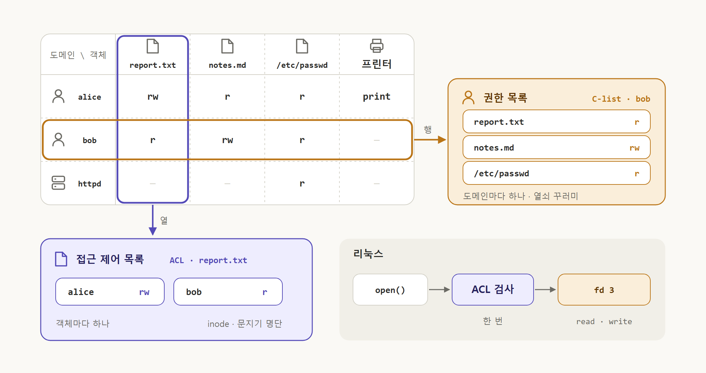
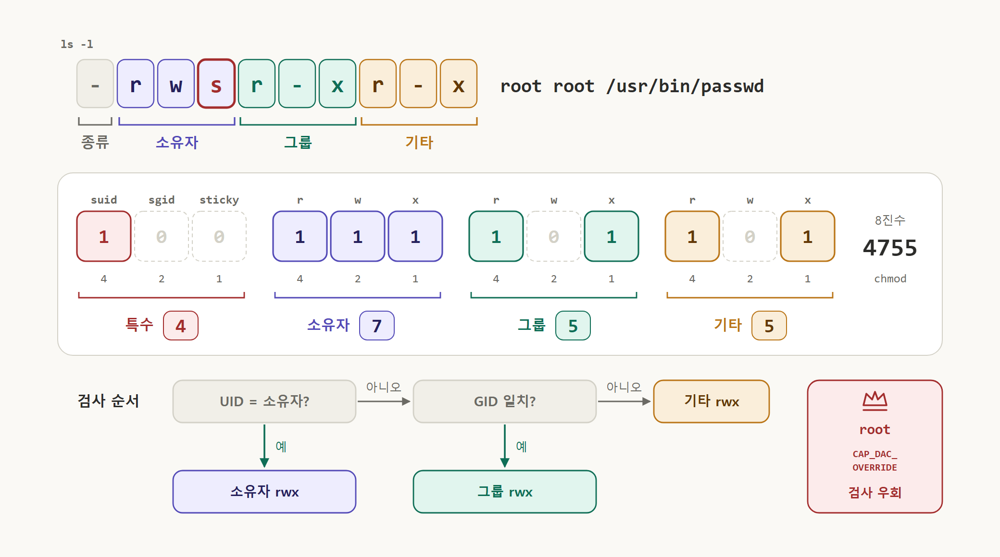
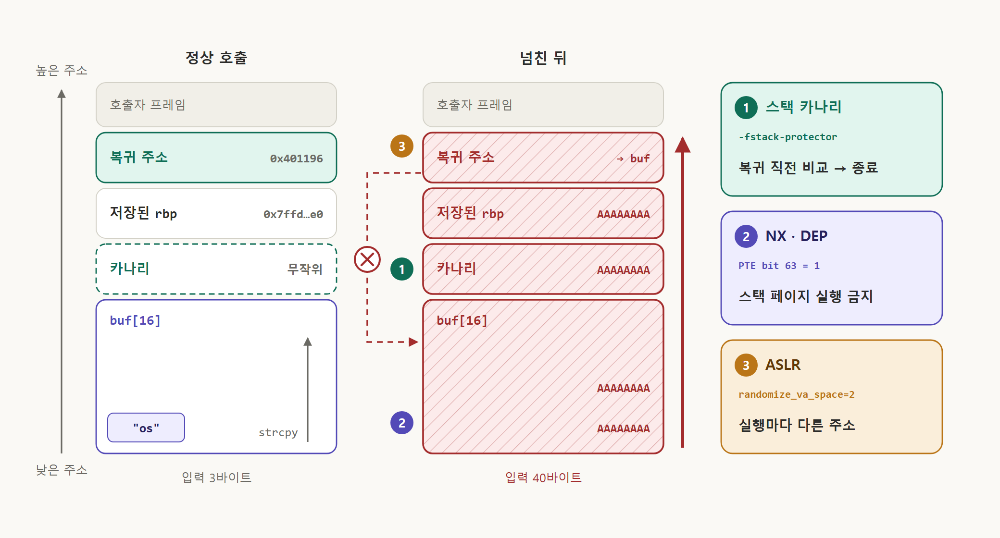
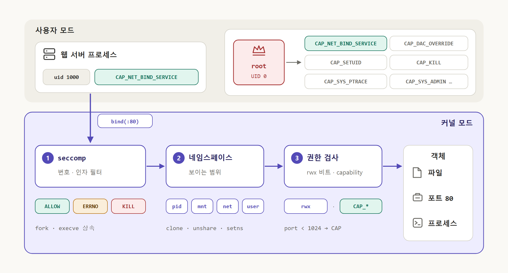

# 보호와 보안: 접근 행렬, 유닉스 권한, 그리고 버퍼 오버플로 완화

> OS 학습 13단원. 운영체제가 "누가 무엇을 어떻게 쓸 수 있는가"를 어떻게 표현하고 검사하는지(보호), 그리고 일부러 규칙을 깨려는 공격을 어떻게 막는지(보안)를 정리한다. 접근 행렬에서 출발해 ACL과 권한 목록을 비교하고, 유닉스 권한 비트와 setuid, 비밀번호 저장 방식을 본다. 마지막으로 버퍼 오버플로가 복귀 주소를 덮는 원리와 이를 막는 카나리·NX·ASLR, 그리고 root 권한을 쪼개고 가두는 capabilities·seccomp·네임스페이스를 다룬다.

---

## 1. 보호와 보안은 무엇이 다른가

두 말은 자주 섞여 쓰이지만 교재는 둘을 나눈다. 실버샤츠 교재를 요약한 UIC 강의 노트는 보호 장(14장)과 보안 장(15장)을 따로 두고 이렇게 구분한다.

| | 보호 (protection) | 보안 (security) |
|---|---|---|
| 질문 | 어떤 프로세스가 어떤 자원을 어떤 방식으로 쓸 수 있나 | 일부러 규칙을 깨려는 공격을 어떻게 막나 |
| 상대 | 실수하는 프로그램, 협조적인 사용자 | 안팎의 악의적인 공격자 |
| 무엇으로 | 운영체제 **내부 메커니즘** (모드 비트, 페이지 테이블, 접근 제어) | 보호 메커니즘 + 인증, 암호, 공격 완화 기법, 운영 정책 |
| 예 | 파일 권한, 메모리 보호, 접근 행렬 | 비밀번호 해시, 버퍼 오버플로 완화, 샌드박스 |

UIC 노트의 표현으로는 보호 시스템은 정책을 강제하는 **메커니즘만** 제공한다. 무엇을 허용할지(정책)는 관리자와 사용자가 정한다. OSTEP도 같은 말을 한다. 운영체제는 일반적인 메커니즘을 주고, 누군가 정확한 정책을 알려 줘야 그것을 강제할 수 있다. 그리고 OSTEP 접근 제어 장의 결론처럼, 메커니즘이 잘못돼서 생기는 보안 사고보다 정책을 잘못 정해서 생기는 사고가 훨씬 흔하다.

보안의 목표는 보통 세 가지로 말한다(OSTEP 53장).

- **기밀성**(confidentiality): 숨겨야 할 정보를 남이 알아내지 못하게 한다. 예: 다른 프로세스가 내 메모리를 읽지 못한다.
- **무결성**(integrity): 정해진 상태를 공격자가 바꾸지 못하게 한다. 예: 쓰기 권한이 없는 사용자가 내 파일을 고치지 못한다.
- **가용성**(availability): 써야 할 때 쓸 수 있게 한다. 예: 한 프로세스가 CPU를 독차지하지 못한다.

### 하드웨어가 깔아 둔 바닥 (앞 단원 복습)

보호는 하드웨어 위에 서 있다. 앞 단원에서 본 장치들이 모두 보호 장치다.

| 장치 | 무엇을 막나 | 단원 |
|---|---|---|
| 이중 모드, 특권 명령어 | 사용자 프로그램이 입출력·타이머·트랩 테이블을 직접 건드리지 못하게 | 1단원 |
| 타이머 인터럽트 | 한 프로그램이 CPU를 영영 돌려주지 않는 것 | 1단원 |
| 베이스·한계 레지스터 | 프로세스가 자기 영역 밖의 물리 메모리에 접근하는 것 | 8단원 |
| 페이지 테이블 항목의 보호 비트 | 읽기 전용 페이지에 쓰기, 커널 페이지에 사용자 모드로 접근 | 8단원 |
| 시스템 콜 | 커널 기능을 정해진 입구로만 쓰게 | 2단원 |

OSTEP은 특히 두 지점을 강조한다. 첫째, 가상 메모리 하드웨어 덕분에 프로세스는 자기 주소 공간에 매핑되지 않은 물리 주소를 **이름조차 붙일 수 없다**. 둘째, 모든 서비스 요청은 시스템 콜로 커널에 들어오므로, 커널은 그때 PCB에서 요청한 프로세스의 신원을 꺼내 정책상 허용되는지 검사할 수 있다. 이렇게 매번 접근을 판정하는 코드를 **참조 모니터**(reference monitor)라고 한다.

### 보안 설계 원칙

Saltzer와 Schroeder가 1975년 논문에서 정리한 원칙을 OSTEP이 8개로 소개한다. 보장해 주는 공식은 아니지만, 지키면 더 안전한 시스템이 나온다는 경험칙이다.

| 원칙 | 뜻 | 운영체제 속 예 |
|---|---|---|
| 메커니즘의 경제성 | 작고 단순하게 | 보안에 중요한 코드를 작게 유지 |
| **기본 거부** (fail-safe defaults) | 정해지지 않았으면 안전한 쪽(거부)으로 | 명시적으로 허용한 것만 통과시키는 allow-list |
| 완전한 중재 | 접근할 때마다 매번 검사 | 시스템 콜마다 권한 검사 |
| 공개 설계 | 공격자가 설계를 다 안다고 가정 | 비밀 알고리즘 대신 공개된 해시 함수 |
| **권한 분리** (separation of privilege) | 중요한 동작에는 둘 이상의 조건을 요구 | 2단계 인증 |
| **최소 권한** (least privilege) | 일에 꼭 필요한 권한만 | root 대신 capability 하나 |
| 공통 메커니즘 최소화 | 사용자·프로세스마다 따로 된 구조 | 프로세스마다 따로 있는 페이지 테이블 |
| 수용성 | 사용자가 실제로 쓸 수 있어야 | 너무 번거로운 보안은 꺼져 버린다 |

이 글 전체에서 가장 자주 나오는 원칙은 **최소 권한**이다. OSTEP은 권한을 받은 쪽이 정직해도 실수를 할 수 있고, 공격자는 그 실수를 발판 삼아 남는 권한을 악용한다고 설명한다. 권한이 적을수록 실수나 침입의 피해가 작다.

> 헷갈리기 쉬운 점: "권한 분리"는 프로그램을 특권 부분과 비특권 부분으로 쪼개는 설계를 가리키는 말로도 쓰인다. 하지만 Saltzer–Schroeder 원칙(OSTEP이 소개한 뜻)에서의 separation of privilege는 **중요한 동작에 열쇠를 둘 이상 요구하라**는 뜻이다. 비밀번호와 하드웨어 토큰을 함께 요구하는 2단계 인증이 OSTEP의 예다.

---

## 2. 보호 도메인과 접근 행렬



접근 제어는 세 낱말로 말한다(OSTEP 55장).

- **주체**(subject): 접근하려는 쪽. 사용자나 프로세스.
- **객체**(object): 접근당하는 쪽. 파일, 장치, 프로세스.
- **접근**(access): 읽기, 쓰기, 실행 같은 방식.

주체 쪽을 더 엄밀하게 묶은 것이 **보호 도메인**이다. UIC 노트(실버샤츠 14장)는 도메인을 `<객체, {권한 집합}>` 쌍의 집합으로 정의한다. 프로세스는 어떤 도메인 안에서 실행되고, 그 도메인이 가진 권한만 쓸 수 있다. 도메인은 사용자일 수도, 프로세스일 수도, 프로시저일 수도 있다. 유닉스에서는 도메인이 **사용자**에 묶여 있고, 3절의 setuid가 실행 중에 도메인을 바꾸는 장치다. 1단원의 보호 링도 도메인의 한 형태다. MULTICS는 링 0~7을 두고, 바깥 링이 안쪽 링 권한의 부분집합만 갖게 했다.

모든 도메인과 객체의 관계를 표 하나로 그리면 **접근 행렬**이다. 그림 왼쪽 위처럼 행은 도메인, 열은 객체, 칸은 그 도메인이 그 객체에 가진 권한이다. bob은 `notes.md`를 읽고 쓸 수 있고, `report.txt`는 읽기만 할 수 있다. 행렬에는 특별한 권한도 넣을 수 있다. 같은 열에 권한을 복사해 줄 수 있는 **copy**(`r*`처럼 별표로 표시), 열 전체를 고칠 수 있는 **owner**, 다른 도메인으로 옮겨 갈 수 있는 **switch** 같은 것이다.

### 행렬을 어떻게 저장하나: 열로 자르기 vs 행으로 자르기

실제 시스템은 행렬을 통째로 저장하지 않는다. 사용자와 파일이 수천·수백만 개라 거대하고, 칸 대부분이 비어 있기 때문이다. 대신 행렬을 자른다.

- **열로 자르면 접근 제어 목록**(ACL). 그림 왼쪽 아래처럼 객체마다 "누가 무엇을 할 수 있나" 목록을 붙인다. `report.txt`의 ACL은 `alice: rw, bob: r`이다. 주체가 요청하면 커널은 그 객체의 목록에서 주체를 찾는다.
- **행으로 자르면 권한 목록**(capability list). 그림 오른쪽처럼 도메인마다 "무엇을 할 수 있나" 목록을 준다. 목록의 각 항목이 **capability**다. 주체는 요청할 때 해당 capability를 내밀고, 커널은 그것이 진짜인지만 확인한다.

OSTEP의 비유가 기억하기 좋다. ACL은 **명단을 든 문지기**다. 손님이 신원을 밝히면 명단에서 찾는다. capability는 **열쇠**다. 열쇠를 가진 사람은 문을 연다. 영화표나 지하철 승차권도 capability다.

| | 접근 제어 목록 (ACL) | 권한 목록 (capability) |
|---|---|---|
| 행렬에서 | 열 (객체마다) | 행 (도메인마다) |
| 어디에 두나 | 객체 옆 (예: 파일의 inode) | 커널 메모리 속 프로세스별 목록(PCB가 가리킴), 또는 암호로 보호한 값 |
| 쉬운 질문 | 이 객체에 누가 접근할 수 있나? | 이 주체는 무엇에 접근할 수 있나? |
| 어려운 질문 | 이 주체가 접근할 수 있는 것 전부? (모든 ACL을 뒤져야 함) | 이 객체에 접근할 수 있는 주체 전부? (모든 목록을 뒤져야 함) |
| 권한 회수 | 쉽다. 목록에서 지우면 끝 | 어렵다. 복사본이 어디 있는지 알아야 함 |
| 권한 일부만 넘기기 | 어렵다. 자식은 부모 신원을 그대로 물려받음 | 쉽다. 자식에게 필요한 capability만 넘김 |
| 핵심 위험 | 목록 저장 공간과 검색 비용 | **위조**와 무단 복사 |

capability는 결국 비트 묶음이다. 비트는 누구나 만들고 복사할 수 있으므로 위조를 막아야 한다. OSTEP은 두 방법을 든다. 하나는 프로세스가 capability를 직접 만지지 못하게 커널 메모리에 두고, 넘길 때도 시스템 콜로 커널을 거치게 하는 것이다. 다른 하나는 길고 강한 암호로 만들어 추측할 수 없게 하는 것이다. UIC 노트는 하드웨어 태그나 접근 불가 세그먼트로 보호하는 방법도 소개한다. 순수한 capability 시스템의 예로는 Hydra, Cambridge CAP이 있다.

> 비유: ACL은 클럽 문 앞의 명단, capability는 회원이 들고 다니는 열쇠 꾸러미다. 명단은 지우기만 하면 출입 금지가 되지만, 이미 나눠 준 열쇠는 되찾기 어렵다.

### 리눅스는 둘을 섞는다

그림 오른쪽 아래처럼 리눅스는 사용자에게 보이는 접근 제어에 ACL을 쓰고, 그 뒤에서 capability 같은 구조를 쓴다. OSTEP의 설명은 이렇다. `open()` 때 한 번 파일의 권한(ACL)을 검사한다. 통과하면 커널은 "이 프로세스는 이 파일을 읽고 쓸 수 있다"는 자료구조를 PCB에 달고, 그 번호(파일 디스크립터)를 돌려준다. 이후의 `read()`·`write()`는 ACL을 다시 보지 않고 이 구조만 확인한다. 파일을 닫으면 구조가 사라진다.

WSL의 Ubuntu 24.04에서 직접 확인해 보았다. 파일을 연 뒤에 권한을 모두 빼앗아도 이미 받은 디스크립터로는 계속 읽힌다. 새로 열려고 하면 그제야 거부된다.

```python
import os
fd = os.open("fdtest.txt", os.O_RDONLY)   # 여기서 한 번 ACL 검사
os.chmod("fdtest.txt", 0)                  # 권한을 전부 뺏는다
print(os.read(fd, 100))                    # b'secret\n'  ← fd는 여전히 유효
os.open("fdtest.txt", os.O_RDONLY)         # PermissionError: [Errno 13]
```

이렇게 섞으면 두 방식의 약점을 피한다. 읽고 쓸 때마다 목록을 뒤지지 않아도 되고, 접근할 수 있는 모든 객체의 capability를 미리 관리하지 않아도 된다. 실제로 연 파일에 대해서만 capability가 생기기 때문이다. 대신 OSTEP의 회수 문제가 그대로 드러난다. 권한을 바꿔도 이미 열린 디스크립터는 바로 막히지 않는다.

**누가 권한을 정하나.** 파일 주인이 정하는 방식을 **임의 접근 제어**(DAC, discretionary)라고 한다. 군사 기밀처럼 주인도 풀 수 없게 기관이 정하는 방식은 **강제 접근 제어**(MAC, mandatory)다. OSTEP은 이 구분이 ACL이냐 capability냐와는 별개(직교)라고 설명한다. 유닉스의 기본 권한은 DAC다.

---

## 3. 유닉스 권한 모델: 9비트 ACL



OSTEP은 유닉스 권한을 **9비트로 줄인 ACL**로 설명한다. 초기 유닉스는 저장 공간이 비싸서 파일마다 긴 ACL을 둘 수 없었다. 그래서 ACL 항목을 딱 세 개로 고정했다.

- **소유자**: 파일 주인. 누구인지는 이미 inode에 있다(`st_uid`).
- **그룹**: 파일의 그룹에 속한 사용자. 그룹 번호도 inode에 있다(`st_gid`).
- **기타**: 나머지 전부. 따로 저장할 필요가 없다.

항목마다 읽기(r)·쓰기(w)·실행(x) 3비트씩, 모두 9비트다. ACL이 inode 안에 있으므로 파일을 열 때 어차피 읽는 inode에서 권한을 함께 얻는다. 긴 목록 검색 대신 비트 연산 몇 번이면 끝난다. 대신 "alice는 쓰기, bob은 읽기, carol은 금지" 같은 세밀한 정책은 표현하지 못한다. 그래서 Windows 같은 시스템은 더 일반적인 ACL을 따로 둔다.

### 비트 배치와 8진수

그림 가운데처럼 모드에는 9비트 앞에 특수 비트 3개가 더 있다. `inode(7)` 매뉴얼의 값이다.

| 비트 | 8진수 | 파일에서 | 디렉터리에서 |
|---|---|---|---|
| setuid (`S_ISUID`) | 4000 | 실행하면 유효 UID가 파일 소유자로 바뀜 | |
| setgid (`S_ISGID`) | 2000 | 실행하면 유효 GID가 파일 그룹으로 바뀜 | 안에 만든 파일이 디렉터리의 그룹을 물려받음 |
| sticky (`S_ISVTX`) | 1000 | | 파일 주인, 디렉터리 주인, 특권 프로세스만 파일을 지우거나 이름을 바꿀 수 있음 |
| 소유자 r·w·x | 400·200·100 | 읽기·쓰기·실행 | 목록 읽기·항목 추가/삭제·**탐색** |
| 그룹 r·w·x | 40·20·10 | | |
| 기타 r·w·x | 4·2·1 | | |

세 비트씩 더하면 8진수 한 자리가 된다. 그림의 `/usr/bin/passwd`는 특수 4(setuid), 소유자 7(rwx), 그룹 5(r-x), 기타 5(r-x)라서 **4755**다. `ls -l`은 setuid가 켜진 소유자 실행 칸에 `x` 대신 `s`를 찍는다. WSL의 Ubuntu에서 확인한 값이다.

```console
$ ls -l /usr/bin/passwd
-rwsr-xr-x 1 root root 64152 May 30  2024 /usr/bin/passwd
$ stat -c "%a %A %U %n" /usr/bin/passwd /tmp
4755 -rwsr-xr-x root /usr/bin/passwd
1777 drwxrwxrwt root /tmp
```

`/tmp`가 1777인 이유는 sticky 비트다. 모두가 쓸 수 있어야 하지만(777), 남의 파일을 지우면 안 되기 때문이다(1000).

### 검사 순서: 한 부류만 본다

`path_resolution(7)` 매뉴얼에 따르면 커널은 그림 아래처럼 검사한다.

1. 프로세스의 (파일시스템) UID가 파일 소유자와 같으면 **소유자 비트만** 본다.
2. 아니고, 파일의 그룹이 프로세스의 그룹이나 보조 그룹 중 하나와 같으면 **그룹 비트만** 본다.
3. 둘 다 아니면 **기타 비트**를 본다.

"한 부류만" 본다는 점이 중요하다. 소유자 비트가 기타 비트보다 약하면 주인이 오히려 못 읽는다. 직접 해 보면 이렇다.

```console
$ chmod 077 fdtest.txt
$ ls -l fdtest.txt
----rwxrwx 1 jomin44 jomin44 7 Nov 23 09:30 fdtest.txt
$ cat fdtest.txt
cat: fdtest.txt: Permission denied
```

경로의 디렉터리마다 **실행(탐색) 권한**도 있어야 한다. `/home/a/b/f`를 열려면 `/`, `/home`, `/home/a`, `/home/a/b` 모두에 x가 필요하다. 하나라도 없으면 `EACCES`다.

### setuid와 root

**root**(superuser, UID 0)는 시스템 관리용 특별 사용자다. 전통적으로 유효 UID가 0인 프로세스는 커널의 권한 검사를 모두 건너뛴다(`capabilities(7)`). 리눅스 용어로는 `CAP_DAC_OVERRIDE`가 파일 권한 검사를 우회하게 해 준다. 예외 하나는 실행이다. 세 실행 비트 중 하나라도 켜져 있어야 root도 실행할 수 있다(그림 오른쪽 아래).

일반 사용자가 자기 비밀번호를 바꾸려면 root만 쓸 수 있는 비밀번호 파일을 고쳐야 한다. 그래서 `passwd`는 root 소유의 setuid 프로그램이다. 프로세스의 UID는 여럿이다(`credentials(7)`).

| UID | 뜻 | setuid 프로그램을 실행하면 |
|---|---|---|
| 실제 UID (real) | 프로세스를 띄운 사람 | 그대로 (예: 1000) |
| 유효 UID (effective) | 권한 검사에 쓰는 신원 | 파일 소유자로 바뀜 (예: 0) |
| 저장된 set-user-ID | 유효 UID를 잠시 내렸다가 되찾을 때 쓰는 사본 | 바뀐 유효 UID를 저장 |
| 파일시스템 UID | 리눅스에서 파일 검사에 쓰는 신원 | 유효 UID를 따라감 |

OSTEP은 setuid를 **권한 상승**(privilege escalation) 기능이라고 부른다. 그 프로그램이 실행되는 동안에만, 그 프로그램이 정한 일에만 더 큰 권한을 빌려 주는 장치다. 그래서 위험하다. setuid 프로그램이 허술하게 짜여 있으면 공격자가 그 권한을 통째로 가져간다. OSTEP의 경고대로 시스템에 발을 들인 공격자의 첫 목표는 root가 되는 것이고, root가 되면 어떤 파일이든 읽고, 어떤 프로그램이든 바꾸고, 운영체제까지 갈아 끼울 수 있다. UIC 노트는 최소 권한의 예로 root 소유 setuid 프로그램보다 그룹 소유 setgid 프로그램을 쓰라고 권한다.

> 헷갈리기 쉬운 점: **setuid = root가 아니다.** setuid 비트는 "파일 **소유자**의 신원으로 실행"이라는 뜻이다. 소유자가 alice면 alice 권한으로 실행된다. 위험한 것이 root 소유 setuid 프로그램일 뿐이다.

---

## 4. 인증: 비밀번호는 저장하지 않는다

접근 제어는 "이 프로세스가 누구의 것인가"를 안다고 가정한다. 그 신원을 확인하는 일이 **인증**(authentication)이다. 확인된 신원으로 무엇을 허용할지 정하는 일은 **인가**(authorization)라고 하고, 2·3절의 접근 제어가 여기에 해당한다.

OSTEP 54장에 따르면 프로세스의 신원은 대부분 부모에게서 물려받는다(3단원의 `fork`). 맨 처음 신원을 붙이는 곳이 로그인이다. 리눅스의 로그인 과정은 이렇다.

1. 특권 신원으로 도는 `login` 프로세스가 사용자 이름을 받는다.
2. 비밀번호를 받는다. 화면에 찍지 않는다.
3. 비밀번호 파일에서 사용자를 찾아 UID, GID, 셸, 홈 디렉터리, 그리고 **솔트와 솔트를 섞은 해시**를 꺼낸다.
4. 입력한 비밀번호에 솔트를 붙여 해시하고, 저장된 값과 비교한다.
5. 같으면 `fork`하고, 자식의 UID·GID를 그 사용자로 바꾼 뒤, 홈으로 가서 셸을 `exec`한다.

사용자 이름이 없어서 실패했는지 비밀번호가 틀려서 실패했는지는 알려 주지 않는다. 알려 주면 공격자가 진짜 사용자 이름을 알아낼 수 있다. 인증 수단은 고전적으로 세 가지다. **아는 것**(비밀번호), **가진 것**(카드, 토큰), **나 자신**(생체). 둘 이상을 함께 쓰면 다중 인증이다.

### 해시와 솔트

시스템은 비밀번호를 **알 필요가 없다**. 사용자가 비밀번호를 *아는지*만 확인하면 된다. 그래서 비밀번호 대신 **암호학적 해시**를 저장하고, 입력값을 해시해서 비교한다. 해시는 거꾸로 풀 수 없으므로 저장된 값이 새도 비밀번호 자체는 새지 않는다. UIC 노트에 따르면 이 값은 root만 읽을 수 있는 `/etc/shadow`에 있다.

그래도 문제가 남는다. 모두가 같은 공개 해시 함수를 쓰면, 공격자는 흔한 비밀번호 사전을 **미리 한 번만** 해시해 두고 훔친 파일과 문자열 비교만 하면 된다. 해결책이 **솔트**다.

1. 비밀번호를 저장할 때 큰 난수(솔트)를 새로 뽑는다.
2. 비밀번호에 솔트를 붙여 해시한다.
3. 해시와 **솔트를 함께** 저장한다. 솔트는 비밀이 아니다.

비밀번호마다 솔트가 다르면 미리 만든 사전이 쓸모없다. OSTEP의 계산으로 32비트 솔트면 사전의 단어마다 2³²개 변환이 필요해 사전 계산이 불가능해진다. 공격자는 비밀번호 하나마다 처음부터 추측을 해시해야 한다. 같은 비밀번호를 쓴 두 사용자의 저장값도 달라진다. 솔트는 Morris와 Thompson의 초기 비밀번호 보안 논문에서 처음 나왔다.

```python
import hashlib, hmac, os

def hash_password(pw):
    salt = os.urandom(16)                                   # 비밀번호마다 새 솔트
    h = hashlib.scrypt(pw.encode(), salt=salt, n=2**14, r=8, p=1)
    return salt, h                                          # 둘 다 저장

def verify(pw, salt, stored):
    h = hashlib.scrypt(pw.encode(), salt=salt, n=2**14, r=8, p=1)
    return hmac.compare_digest(h, stored)                   # 같은 솔트로 다시 해시

s1, h1 = hash_password("hunter2")
s2, h2 = hash_password("hunter2")
print(h1 == h2)                   # False: 같은 비밀번호도 저장값이 다르다
print(verify("hunter2", s1, h1))  # True
print(verify("hunter3", s1, h1))  # False
```

(파이썬 3으로 실행해 출력을 확인했다.)

어떤 해시 함수를 쓸지는 자료끼리 결이 다르다. OSTEP은 집필 당시 미국 표준인 SHA-3를 좋은 선택으로 든다. OWASP의 비밀번호 저장 지침은 SHA-256 같은 **빠른** 해시를 피하라고 한다. 빠를수록 공격자가 초당 더 많이 추측할 수 있기 때문이다. 대신 일부러 느리고 메모리를 많이 쓰는 함수를 권하고, 우선순위는 Argon2id → scrypt → bcrypt → PBKDF2다. 느린 정도(work factor)는 조절할 수 있다.

> 헷갈리기 쉬운 점: **솔트는 비밀이 아니다.** 해시 옆에 그대로 저장한다. 솔트가 막는 것은 미리 계산한 표(사전, 레인보 테이블)이지, 비밀번호 하나를 집중해서 추측하는 공격이 아니다. 약한 비밀번호는 솔트가 있어도 뚫린다. OWASP가 말하는 **페퍼**(pepper)는 데이터베이스 밖에 따로 숨기는 비밀값으로, 솔트와 다른 개념이다.

---

## 5. 버퍼 오버플로와 세 가지 완화 기법



**버퍼 오버플로**는 고정 크기 버퍼에 길이 검사 없이 더 많이 써서 옆 메모리를 덮어쓰는 버그다. 스택에서 일어나면 **스택 스매싱**이라고 부른다. 공격 코드는 다루지 않고, 원리와 운영체제의 대응만 본다.

```c
#include <string.h>
void greet(const char *name) {
    char buf[16];
    strcpy(buf, name);      /* 길이 검사 없음: name이 16바이트를 넘으면 넘친다 */
}

/* 고친 버전: 버퍼 크기 안에서만 쓴다 */
#include <stdio.h>
void greet_safe(const char *name) {
    char buf[16];
    snprintf(buf, sizeof buf, "%s", name);   /* 넘치는 부분은 잘린다 */
}
```

그림 왼쪽이 `greet("os")`의 스택 프레임이다. 3단원의 프로세스 메모리 구조에서 스택은 높은 주소에서 낮은 주소로 자란다. 그래서 먼저 쌓인 **복귀 주소**(호출한 곳으로 돌아갈 주소)와 저장된 프레임 포인터(`rbp`)가 위(높은 주소)에, 나중에 잡힌 지역 변수 `buf`가 아래에 있다. 그런데 `strcpy`는 배열을 **낮은 주소에서 높은 주소 쪽으로** 채운다. 스택이 자라는 방향과 쓰는 방향이 반대다.

그림 오른쪽처럼 40바이트를 넣으면 `buf`를 넘친 바이트가 위로 올라가며 카나리, `rbp`, 복귀 주소까지 덮는다. 함수가 `ret`를 실행하면 CPU는 덮어쓴 값을 복귀 주소로 믿고 그리로 점프한다. 공격자가 그 값을 자기가 넣은 데이터(`buf` 안)의 주소로 맞추면, 데이터가 코드처럼 실행된다. UIC 노트의 설명이 이 고전적 시나리오다. 모리스 웜도 시스템 권한으로 돌던 finger 데몬의 버퍼 오버플로를 이용해 원격 기계에서 root 셸을 띄웠다.

이것이 3절의 **권한 상승**과 만나는 지점이다. 넘친 프로그램이 setuid root이거나 root 데몬이면 공격자는 그 권한을 그대로 얻는다.

운영체제와 컴파일러는 이 경로를 세 군데에서 끊는다. 그림 오른쪽 패널의 ①②③이다.

| | ① 스택 카나리 | ② NX / DEP | ③ ASLR |
|---|---|---|---|
| 하는 일 | 버퍼와 복귀 주소 사이에 값을 두고, **복귀 직전에** 바뀌었는지 비교 | 스택·힙 같은 데이터 페이지를 **실행 금지**로 표시 | 스택·힙·라이브러리·실행 파일 위치를 **실행마다 무작위로** |
| 누가 | 컴파일러 (`-fstack-protector` 계열) | CPU의 PTE 비트 + 커널 | 커널 (+ PIE로 빌드한 실행 파일) |
| 공격의 어느 단계를 | 복귀 주소 덮어쓰기를 **탐지** | 넣은 코드의 **실행**을 차단 | 어디로 뛸지 **모르게** |
| 실패하면 | 프로그램을 끝낸다 | 실행 시도가 예외를 일으킨다 | (막는다기보다 맞히기 어렵게 한다) |
| 약점 | 힙 오버플로는 못 막음, 카나리 값이 새면 우회 | 기존 코드를 이어 붙이는 ROP, return-to-libc | 32비트의 적은 무작위성, 주소 유출 |

**① 스택 카나리.** 탄광의 카나리아처럼 먼저 죽어서 위험을 알린다. 위키백과에 따르면 종류는 셋이다. 문자열 복사를 멈추게 하는 널·개행 문자로 만든 **종결자 카나리**, 프로그램 시작 때 뽑는 **무작위 카나리**, 제어 데이터와 XOR한 **무작위 XOR 카나리**다. GCC 옵션은 `-fstack-protector`(일부 함수), `-fstack-protector-strong`(더 많은 함수, GCC 4.9부터), `-fstack-protector-all`(모든 함수)이 있다. 1997년 StackGuard 패치에서 시작해 2005년 Red Hat이 GCC 4.1에 다시 구현했다.

**② NX 비트.** 8단원에서 본 페이지 테이블 항목에 비트 하나를 더 둔다. x86-64에서는 PTE의 맨 위 비트(63번)이고, 1이면 그 페이지에서 코드를 실행할 수 없다. AMD는 NX, 인텔은 XD(execute disable)라고 부르고, 32비트에서는 PAE 형식의 페이지 테이블에서만 쓸 수 있다. 리눅스는 커널 2.6.8(2004년 8월)부터, Windows는 XP SP2(2004년)부터 지원했고 Windows는 이것을 DEP라고 부른다. OpenBSD의 같은 정책 이름 W^X는 "쓰기 가능과 실행 가능을 동시에 허용하지 않는다"는 뜻이다. 이제 `buf`로 점프해도 실행되지 않는다(그림의 X 표시).

**③ ASLR.** 공격자는 점프할 주소를 정확히 알아야 한다. ASLR은 그 주소를 실행할 때마다 바꾼다. PaX 프로젝트가 2001년 리눅스 패치로 처음 구현했고, 리눅스 기본 커널은 2.6.12(2005년)부터 약한 형태를 기본으로 켰다. 커널 문서의 `randomize_va_space` 값은 이렇다.

| 값 | 무작위화하는 것 |
|---|---|
| 0 | 끔 |
| 1 | mmap 시작점, 스택, VDSO (공유 라이브러리 위치, PIE 실행 파일의 코드 시작점 포함) |
| 2 | 1 + **힙** |

WSL의 Ubuntu 24.04에서 `cat /proc/sys/kernel/randomize_va_space`는 2였다. 커널 자체의 위치를 바꾸는 KASLR은 리눅스 3.14(2014년)에 들어갔다.

> 헷갈리기 쉬운 점: **세 기법 모두 오버플로 자체를 막지는 못한다.** 버퍼는 여전히 넘친다. 카나리는 넘친 것을 *알아차리고*, NX는 넘친 데이터를 *실행하지 못하게* 하고, ASLR은 *어디로 갈지 모르게* 한다. 하나씩은 우회 방법이 있어서 함께 쓴다. 근본 대책은 길이를 검사하는 코드(`snprintf`, 경계 검사)다.

---

## 6. root를 쪼개고 가두기: capabilities와 샌드박스



5절의 공격이 성공해도 피해를 줄일 수 있다. 1절의 **최소 권한**을 운영체제가 강제하면 된다. 그림은 그 세 장치를 한 경로에 놓았다.

### 리눅스 capabilities: root를 조각낸다

전통적인 유닉스 권한은 둘 중 하나다. 유효 UID가 0이면 모든 검사를 건너뛰고, 아니면 모든 검사를 받는다. 포트 80을 열고 싶을 뿐인 웹 서버도 root로 실행해야 했다. 리눅스는 root의 힘을 그림 오른쪽 위처럼 **capability라는 조각**으로 나누고, 스레드마다 따로 켜고 끈다(`capabilities(7)`).

| capability | 허용하는 것 |
|---|---|
| `CAP_NET_BIND_SERVICE` | 1024 미만 포트에 소켓 바인딩 |
| `CAP_DAC_OVERRIDE` | 파일 읽기·쓰기·실행 권한 검사 우회 |
| `CAP_SETUID` | 프로세스 UID를 마음대로 바꾸기 |
| `CAP_KILL` | 시그널 보내기 권한 검사 우회 |
| `CAP_SYS_PTRACE` | 아무 프로세스나 `ptrace`로 추적 |
| `CAP_SYS_ADMIN` | mount, sethostname 등 온갖 관리 작업. 매뉴얼이 "과적재"라고 부르며 피하라고 함 |

스레드는 capability 집합을 다섯 개 가진다.

| 집합 | 역할 |
|---|---|
| permitted | 가질 수 있는 상한. effective는 이 안에서만 켤 수 있다 |
| effective | 커널이 권한 검사 때 실제로 보는 집합 |
| inheritable | `execve` 뒤에도 남아, 파일 쪽 설정과 맞으면 이어지는 집합 |
| bounding | `execve`로 얻을 수 있는 capability의 상한 |
| ambient | 특권 없는 프로그램을 `execve`해도 유지되는 집합 (리눅스 4.3부터) |

capability는 실행 파일에도 붙일 수 있다(파일 capability, 확장 속성 `security.capability`에 저장). 그러면 setuid root 없이 필요한 조각만 줄 수 있다.

```console
$ getcap /usr/bin/ping                         # WSL Ubuntu 24.04에서 확인
/usr/bin/ping cap_net_raw=ep
$ sudo setcap cap_net_bind_service=+ep ./server   # (예시) 80번 포트만 열 수 있게
$ getcap ./server
./server cap_net_bind_service=ep
```

`ping`은 raw 소켓을 열어야 하지만 root 전체가 필요하지는 않다. 그래서 setuid root 대신 `cap_net_raw` 하나만 받았다. 반대로 파일 capability가 없는 setuid root 프로그램을 실행하면 bounding 집합이 막은 것을 빼고 **모든** capability를 얻는다.

> 헷갈리기 쉬운 점: **리눅스 capabilities는 2절의 capability와 다르다.** 2절의 capability는 "이 객체에 이 권한"을 담은 위조 불가능한 표(접근 행렬의 행)다. 리눅스 capabilities는 root의 특권을 *작업 종류별로* 나눈 조각이고 특정 객체를 가리키지 않는다. OSTEP도 리눅스의 `open()`은 capability가 아니라 ACL로 판정한다고 짚는다.

### seccomp: 부를 수 있는 시스템 콜을 줄인다

그림의 ①. 모든 서비스 요청은 시스템 콜로 들어오므로, 시스템 콜 목록을 줄이면 공격 표면이 준다. `seccomp(2)`는 두 모드가 있다.

- **strict 모드**: `read`, `write`, `_exit`, `sigreturn`만 허용한다. 다른 시스템 콜을 부르면 그 스레드가 죽는다(유일한 스레드면 SIGKILL로 프로세스 전체).
- **filter 모드**: BPF 프로그램이 시스템 콜 번호, 아키텍처, 인자 6개를 보고 판정한다. 결과는 `KILL_PROCESS`, `KILL_THREAD`, `TRAP`, `ERRNO`(실행하지 않고 오류 반환), `USER_NOTIF`, `TRACE`, `LOG`, `ALLOW` 중 하나다.

```c
#include <linux/seccomp.h>
#include <sys/prctl.h>
#include <unistd.h>

int main(void) {
    prctl(PR_SET_SECCOMP, SECCOMP_MODE_STRICT);  /* 이제 read·write·_exit·sigreturn만 */
    write(1, "ok\n", 3);                          /* 허용 */
    getpid();                                     /* 금지된 시스템 콜 → SIGKILL */
    return 0;                                     /* 여기 오지 못한다 */
}
```

(이 코드는 매뉴얼 설명에 따라 쓴 것으로, 이번에는 C 컴파일러가 없어 실행해 보지 못했다.)

규칙도 몇 가지 있다. 필터를 걸려면 `CAP_SYS_ADMIN`이 있거나 먼저 `no_new_privs`를 켜야 한다. 필터는 `fork`·`clone`으로 만든 자식에게 상속되고 `execve` 뒤에도 남는다. 매뉴얼에는 필터를 더하는 방법만 있고 떼어 내는 방법은 없다. 그래서 한번 가둔 프로세스는 스스로 빠져나오지 못한다. 매뉴얼은 금지 목록보다 **허용 목록**(allow-list)을 권한다. 1절의 기본 거부 원칙 그대로다. 시스템 콜 번호가 아키텍처마다 다르므로 필터는 아키텍처 필드도 확인해야 한다.

### 네임스페이스: 보이는 범위를 줄인다

그림의 ②. seccomp가 "무엇을 부를 수 있나"를 줄인다면, 네임스페이스는 "무엇이 보이나"를 줄인다. `namespaces(7)`에 따르면 네임스페이스는 전역 자원을 감싸서, 안에 있는 프로세스에게 **자기만의 사본**이 있는 것처럼 보이게 한다.

| 네임스페이스 | 플래그 | 격리하는 것 |
|---|---|---|
| PID | `CLONE_NEWPID` | 프로세스 번호 |
| Mount | `CLONE_NEWNS` | 마운트 지점 (보이는 파일 트리) |
| Network | `CLONE_NEWNET` | 네트워크 장치, 스택, 포트 |
| User | `CLONE_NEWUSER` | 사용자·그룹 ID |
| IPC | `CLONE_NEWIPC` | System V IPC, POSIX 메시지 큐 |
| UTS | `CLONE_NEWUTS` | 호스트 이름 |
| Cgroup | `CLONE_NEWCGROUP` | cgroup 루트 디렉터리 |
| Time | `CLONE_NEWTIME` | 부팅·단조 시계 |

`clone(2)`에 `CLONE_NEW*` 플래그를 주면 새 네임스페이스에서 자식을 만들고, `unshare(2)`는 자기 자신을 새 네임스페이스로 옮기고, `setns(2)`는 기존 네임스페이스에 들어간다. 매뉴얼은 네임스페이스의 쓰임 하나로 **컨테이너**를 든다.

그림의 ③이 2·3절의 권한 검사다. 파일이면 rwx 비트를, 1024 미만 포트면 `CAP_NET_BIND_SERVICE`를 본다. 세 장치를 겹치면 **샌드박스**가 된다. 웹 서버가 뚫려도 공격자는 root가 아니고(capabilities), 쓸 수 있는 시스템 콜이 적고(seccomp), 보이는 프로세스와 파일도 일부뿐이다(네임스페이스).

> 비유: 은행 창구 직원(웹 서버)에게 금고 열쇠 꾸러미(root) 대신 현금 서랍 열쇠 하나(capability)만 주고, 할 수 있는 업무를 목록으로 정해 두고(seccomp), 창구 밖으로는 고객 대기실만 보이게 한다(네임스페이스).

---

## 정리

- **보호**는 누가 무엇을 어떻게 쓸지 강제하는 운영체제 내부 메커니즘, **보안**은 그 위에서 일부러 하는 공격까지 막는 일이다. 바닥에는 이중 모드, 베이스·한계 레지스터, PTE 보호 비트 같은 하드웨어가 있다.
- 설계 원칙 중 **최소 권한, 권한 분리, 기본 거부**가 이 단원 전체를 꿰뚫는다.
- **접근 행렬**을 열로 자르면 **ACL**, 행으로 자르면 **권한 목록(capability)**이다. ACL은 회수가 쉽고, capability는 위임과 최소 권한이 쉽다. 리눅스는 `open()` 때 ACL을 보고 이후엔 파일 디스크립터(capability 같은 구조)를 쓴다.
- **유닉스 권한**은 inode 안의 9비트 ACL(소유자·그룹·기타 × rwx)에 setuid·setgid·sticky를 더한 12비트다. 검사는 **한 부류만** 본다. **setuid**는 소유자 신원으로 실행하는 권한 상승 장치라 위험하다.
- **인증**은 비밀번호 대신 **솔트를 섞은 해시**를 저장한다. 솔트는 사전 계산 공격을 막고, 느린 해시 함수는 추측 속도를 늦춘다.
- **버퍼 오버플로**는 복귀 주소를 덮어 실행 흐름을 빼앗는다. **카나리**(탐지), **NX**(실행 금지), **ASLR**(주소 숨기기)을 함께 쓴다.
- **리눅스 capabilities**는 root를 조각내고, **seccomp**는 시스템 콜을, **네임스페이스**는 보이는 범위를 줄인다. 셋을 겹치면 샌드박스가 된다.

## 아직 답을 못 찾은 질문

- WSL의 Ubuntu 24.04에서 `/etc/pam.d/common-password`는 `pam_unix.so ... yescrypt`인데 `/etc/login.defs`의 `ENCRYPT_METHOD`는 `SHA512`였다. `passwd`로 바꾼 비밀번호는 실제로 어느 방식으로 저장되나? 그리고 OWASP 권장 목록에 없는 yescrypt는 Argon2id·scrypt와 비교해 어떤 위치인가?
- 64비트 리눅스에서 `randomize_va_space=2`일 때 스택·mmap·PIE 실행 파일 위치는 기본적으로 각각 몇 비트씩 무작위인가? 주소 유출이 없다면 무차별 대입에 얼마나 걸리나?
- 사용자 네임스페이스 안에서 UID 0(root)이 된 프로세스는 네임스페이스 밖의 자원에 대해 어떤 capability를 갖고, 어떤 것은 갖지 못하나?

## 참고 자료

- Remzi & Andrea Arpaci-Dusseau, Peter Reiher, *Operating Systems: Three Easy Pieces*, [Ch.53 Introduction to Operating System Security](https://pages.cs.wisc.edu/~remzi/OSTEP/security-intro.pdf)
- 같은 책, [Ch.54 Authentication](https://pages.cs.wisc.edu/~remzi/OSTEP/security-authentication.pdf)
- 같은 책, [Ch.55 Access Control](https://pages.cs.wisc.edu/~remzi/OSTEP/security-access.pdf)
- UIC CS 385 Course Notes, [Protection](https://www.cs.uic.edu/~jbell/CourseNotes/OperatingSystems/14_Protection.html)
- UIC CS 385 Course Notes, [Security](https://www.cs.uic.edu/~jbell/CourseNotes/OperatingSystems/15_Security.html)
- Linux man-pages, [capabilities(7)](https://man7.org/linux/man-pages/man7/capabilities.7.html)
- Linux man-pages, [credentials(7)](https://man7.org/linux/man-pages/man7/credentials.7.html)
- Linux man-pages, [inode(7)](https://man7.org/linux/man-pages/man7/inode.7.html)
- Linux man-pages, [path_resolution(7)](https://man7.org/linux/man-pages/man7/path_resolution.7.html)
- Linux man-pages, [seccomp(2)](https://man7.org/linux/man-pages/man2/seccomp.2.html)
- Linux man-pages, [namespaces(7)](https://man7.org/linux/man-pages/man7/namespaces.7.html)
- The Linux Kernel documentation, [Documentation for /proc/sys/kernel/](https://docs.kernel.org/admin-guide/sysctl/kernel.html) (`randomize_va_space`)
- OWASP Cheat Sheet Series, [Password Storage Cheat Sheet](https://cheatsheetseries.owasp.org/cheatsheets/Password_Storage_Cheat_Sheet.html)
- Wikipedia, [Buffer overflow protection](https://en.wikipedia.org/wiki/Buffer_overflow_protection)
- Wikipedia, [Executable-space protection](https://en.wikipedia.org/wiki/Executable-space_protection)
- Wikipedia, [NX bit](https://en.wikipedia.org/wiki/NX_bit)
- Wikipedia, [Address space layout randomization](https://en.wikipedia.org/wiki/Address_space_layout_randomization)
