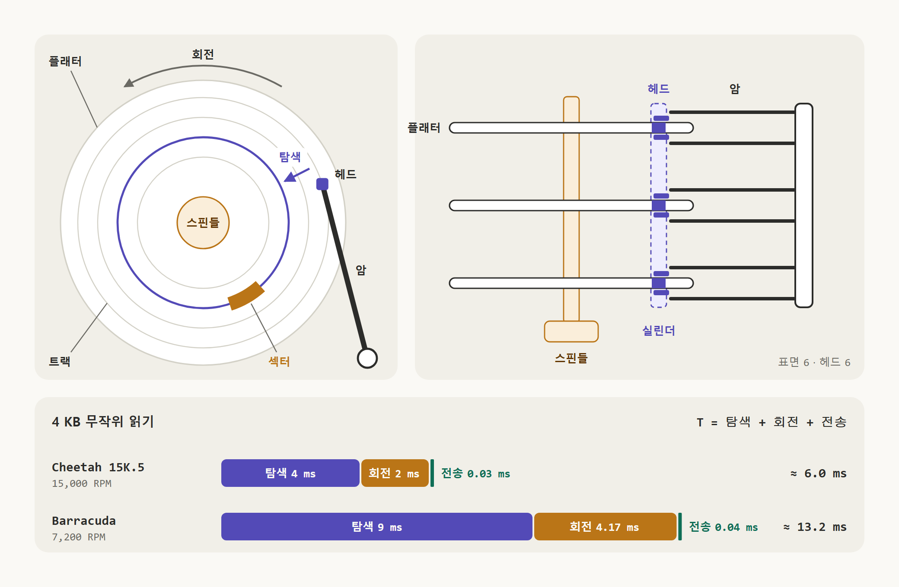
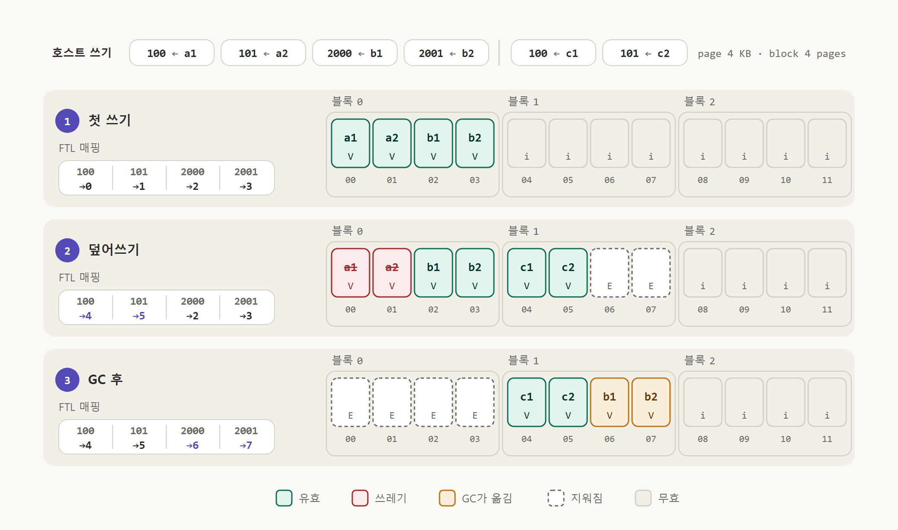
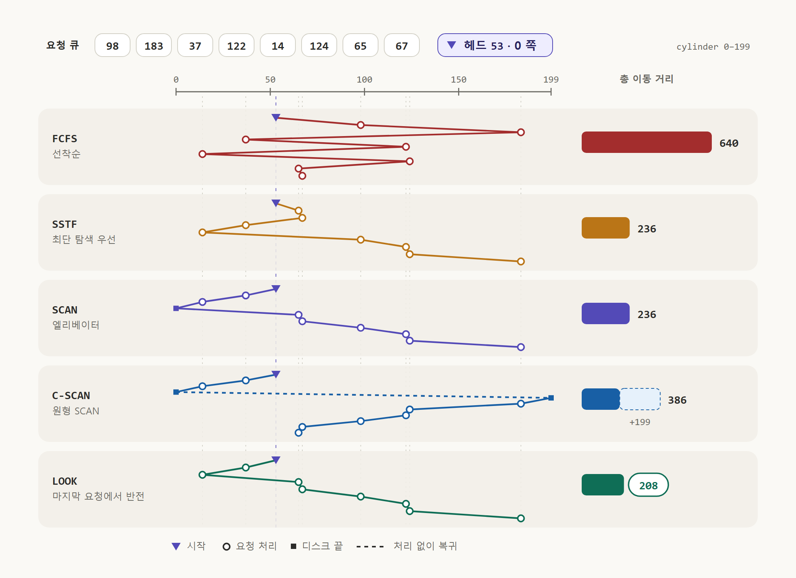
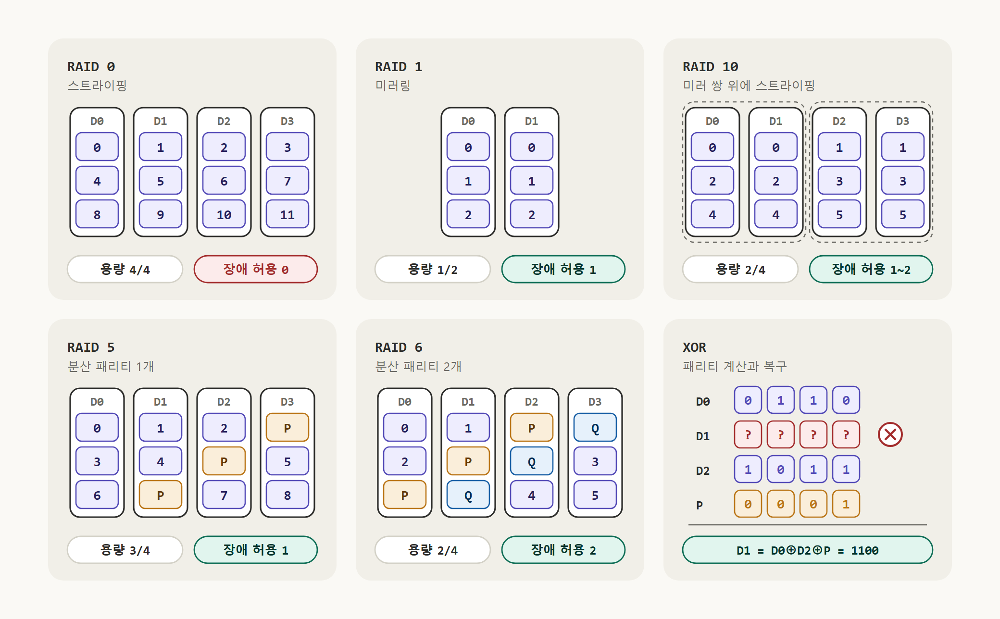

# 대용량 저장장치: HDD, SSD, 디스크 스케줄링, 그리고 RAID

> OS 학습 10단원. 전원을 꺼도 데이터가 남는 장치가 어떻게 생겼고 왜 느린지 정리한다. 하드 디스크의 접근 시간을 실제 수치로 계산해 보고, SSD가 덮어쓰기를 못 하는 문제를 FTL로 어떻게 감추는지 본다. 같은 요청 큐로 디스크 스케줄링 알고리즘 다섯 개의 헤드 이동 거리를 비교하고, 디스크 여러 개를 묶는 RAID로 마무리한다.

---

## 1. HDD의 구조와 접근 시간



### 부품

그림 왼쪽은 디스크를 위에서 본 모습, 오른쪽은 옆에서 본 모습이다.

| 부품 | 하는 일 |
|---|---|
| **플래터** (platter) | 자성 물질을 얇게 입힌 단단한 원판. 한 장에 면(surface)이 둘이다 |
| **스핀들** (spindle) | 플래터들을 꿰어 모터로 일정한 속도로 돌린다. 보통 7,200~15,000 RPM |
| **트랙** (track) | 한 면 위의 동심원 하나. 한 면에 수천 개가 넘게 촘촘히 있다 |
| **섹터** (sector) | 트랙을 나눈 조각. 읽고 쓰는 최소 단위로 전통적으로 512바이트 |
| **실린더** (cylinder) | 모든 플래터에서 같은 반지름의 트랙을 세로로 묶은 것. 그림 오른쪽 점선 띠 |
| **헤드·암** (head, arm) | 면마다 헤드가 하나씩 있다. 헤드들은 암 하나에 달려 함께 움직인다 |

그림 오른쪽처럼 플래터 3장이면 면이 6개, 헤드도 6개다. 헤드들은 같이 움직이므로 늘 같은 실린더 위에 있다.

### 운영체제가 보는 디스크: 섹터 배열

운영체제는 플래터나 실린더를 보지 않는다. 디스크는 **0번부터 n−1번까지 섹터가 늘어선 배열**로 보인다. 이 번호가 **LBA**(logical block addressing)다.

예전에는 (실린더, 헤드, 섹터) 세 숫자로 위치를 불렀다(**CHS**). 헤드 수가 H, 트랙당 섹터 수가 S이면 LBA로 이렇게 바꾼다. 섹터 번호만 1부터 센다.

```
LBA = (c × H + h) × S + (s − 1)
예) 기하 구조 1020/16/63에서 CHS 3/2/1 → (3×16 + 2)×63 + 0 = 3150
```

지금 디스크는 바깥 트랙에 섹터를 더 많이 담는다(**다중 영역**, zoned). 트랙마다 섹터 수가 다르니 고정된 CHS 구조와 맞지 않는다. 그래서 1990년대 중반부터 인터페이스가 LBA로 바뀌었고, 디스크 컨트롤러가 LBA를 실제 위치로 바꾼다. 2010년부터는 4096바이트 섹터(**Advanced Format**)도 쓰이는데, 상당수는 바깥에 512바이트 섹터인 척한다(512e).

알아 둘 "말하지 않은 약속"도 있다. 제조사가 보장하는 것은 **512바이트 한 섹터 쓰기가 원자적**이라는 것뿐이다. 4KB를 쓰다 전원이 나가면 일부만 써질 수 있다(torn write). 대신 번호가 가까운 블록끼리는 빨리 접근되고, 연속된 블록을 순서대로 읽는 것이 가장 빠르다고 기대해도 된다.

> 헷갈리기 쉬운 점: OSTEP도 고백하듯 "블록"과 "섹터"는 섞어 쓴다. 디스크의 섹터는 512B(또는 4KB) 하드웨어 단위이고, 파일 시스템의 블록은 보통 4KB 같은 더 큰 소프트웨어 단위다(11단원 `file-allocation`).

### 접근 시간 = 탐색 + 회전 지연 + 전송

요청 하나는 세 단계를 거친다.

1. **탐색**(seek): 암을 움직여 헤드를 원하는 트랙에 올린다. 가속, 등속, 감속, **안착**(settling) 단계가 있다. 안착만 0.5~2ms 걸린다. 그림 왼쪽의 보라색 화살표다.
2. **회전 지연**(rotational delay): 원하는 섹터가 헤드 밑으로 돌아올 때까지 기다린다. 평균은 반 바퀴다. 그림의 회전 화살표다.
3. **전송**(transfer): 섹터가 헤드 밑을 지나가는 동안 실제로 읽거나 쓴다.

```
T_I/O = T_seek + T_rotation + T_transfer
R_I/O = 전송 크기 / T_I/O
```

제조사가 말하는 **평균 탐색 시간**은 보통 전체 탐색(맨 안쪽 ↔ 맨 바깥쪽)의 약 1/3이다. 트랙 0~N에서 임의의 두 트랙 사이 거리 |x − y|를 모두 평균 내면 N/3이 나오기 때문이다(OSTEP의 적분 계산).

### 직접 계산해 보기

OSTEP이 쓰는 두 디스크의 사양으로 **4KB 무작위 읽기** 시간을 계산한다.

| | Cheetah 15K.5 (성능형) | Barracuda (용량형) |
|---|---|---|
| 회전 속도 | 15,000 RPM | 7,200 RPM |
| 평균 탐색 | 4 ms | 9 ms |
| 최대 전송률 | 125 MB/s | 105 MB/s |

Barracuda를 단계별로 따라가면 이렇다.

1. 한 바퀴 = 60,000ms ÷ 7,200 = 8.33ms. 평균 회전 지연은 반 바퀴라 **4.17ms**.
2. 전송 = 4KB ÷ 105MB/s ≈ **0.04ms**.
3. T = 9 + 4.17 + 0.04 ≈ **13.2ms**. 처리율 = 4KB ÷ 13.2ms ≈ **0.30MB/s**.

```python
# 4KB 무작위 읽기 접근 시간 (1MB = 1024KB로 계산)
for name, rpm, seek_ms, mbps in [("Cheetah", 15000, 4, 125), ("Barracuda", 7200, 9, 105)]:
    rot_ms = 60_000 / rpm / 2
    xfer_ms = 4 / 1024 / mbps * 1000
    t = seek_ms + rot_ms + xfer_ms
    print(f"{name}: T = {t:.2f} ms, {4/1024/(t/1000):.2f} MB/s")
# Cheetah: T = 6.03 ms, 0.65 MB/s
# Barracuda: T = 13.20 ms, 0.30 MB/s
```

그림 아래쪽 막대가 이 결과다. 초록색 **전송은 막대에서 거의 보이지 않는다.** 작은 무작위 읽기 시간의 99% 이상이 헤드 위치를 잡는 데(탐색 + 회전) 쓰인다.

같은 디스크로 100MB를 **순차로** 읽으면 탐색과 회전은 처음 한 번뿐이다.

| | 무작위 4KB | 순차 100MB | 차이 |
|---|---|---|---|
| Cheetah | 6.03ms → 0.65MB/s | 806ms → 124MB/s | 약 190배 |
| Barracuda | 13.2ms → 0.30MB/s | 965ms → 104MB/s | 약 350배 |

내 계산은 OSTEP의 표(0.66 / 0.31MB/s, 약 800 / 950ms)와 반올림 정도만 다르다. 교훈은 OSTEP의 팁 그대로다. **디스크는 가능하면 순차로, 안 되면 큰 덩어리로 쓴다.** 파일 시스템이 파일 블록을 연속으로 배치하려 애쓰는 이유다(11단원).

몇 가지 세부 사항도 있다.

- **트랙 스큐**: 다음 트랙으로 헤드를 옮기는 동안 플래터가 돌아가므로, 이웃 트랙의 0번 섹터를 조금 비껴 놓는다. 그래야 트랙 경계를 넘는 순차 읽기가 한 바퀴를 통째로 기다리지 않는다.
- **디스크 캐시**(트랙 버퍼): 8~16MB 정도의 메모리. 읽을 때 트랙 전체를 미리 읽어 두기도 한다. 쓰기를 캐시에 넣자마자 완료라고 답하면 **write-back**, 플래터에 쓴 뒤 답하면 **write-through**다. write-back은 빨라 보이지만 쓰기 순서가 중요한 파일 시스템(저널링, 11단원)에는 위험할 수 있다.
- 섹터 데이터를 메모리로 옮기는 방법(DMA)과 장치를 다루는 드라이버는 12단원에서 다룬다.

---

## 2. SSD: 덮어쓸 수 없는 저장장치



### NAND 플래시: 페이지로 쓰고 블록으로 지운다

SSD에는 움직이는 부품이 없다. 트랜지스터에 갇힌 전하의 양으로 비트를 저장하는 **NAND 플래시** 칩으로 만든다. 셀 하나에 1비트면 SLC, 2비트면 MLC, 3비트면 TLC다. 비트를 적게 담을수록 빠르고 비싸다.

플래시 칩에는 크기가 다른 단위가 둘 있다.

- **페이지**: 수 KB(예: 4KB). 읽기와 쓰기(프로그램) 단위.
- **블록**: 128KB나 256KB. 페이지를 여러 개 담는다. 지우기 단위.

명령도 세 가지다.

| 명령 | 단위 | 하는 일 | SLC / MLC / TLC 지연 (µs) |
|---|---|---|---|
| 읽기 (read) | 페이지 | 어느 위치든 거의 같은 시간에 읽는다 | 25 / 50 / ~75 |
| 프로그램 (program) | 페이지 | 지워진 페이지의 1을 0으로 바꿔 내용을 쓴다 | 200~300 / 600~900 / ~900~1350 |
| 지우기 (erase) | 블록 | 블록 전체의 비트를 1로 만든다 | 1500~2000 / ~3000 / ~4500 |

결정적인 제약이 있다. **한 번 프로그램한 페이지는 그 블록 전체를 지우기 전에는 다시 쓸 수 없다.** 페이지 하나를 고치려고 블록을 지우면 같은 블록의 다른 페이지 내용도 모두 사라진다. 그래서 지우기 전에 살릴 데이터를 다른 곳으로 옮겨야 한다.

플래시는 닳기도 한다. 지우기와 프로그램을 반복할수록 전하가 조금씩 쌓여 0과 1을 구분하기 어려워진다. 제조사는 MLC 블록의 수명을 P/E(program/erase) 10,000회, SLC는 100,000회로 잡는다. OSTEP은 실제 수명이 이보다 길다는 연구도 함께 소개한다.

### FTL: 덮어쓰기를 감추는 번역기

파일 시스템은 HDD처럼 "LBA 2000번에 4KB를 써라"라고 요청한다. 이 요청을 플래시의 읽기·지우기·프로그램으로 바꾸는 SSD 펌웨어가 **FTL**(flash translation layer)이다.

가장 단순한 방법은 논리 페이지 N을 물리 페이지 N에 그대로 두는 것(**직접 매핑**)이다. 그러면 쓰기마다 블록 전체를 읽고, 지우고, 다시 프로그램해야 한다. 느리고, 자주 고치는 블록만 빨리 닳는다. 그래서 오늘날 FTL은 대부분 **로그 구조**다. 쓰기가 오면 지금 쓰고 있는 블록의 **다음 빈 페이지에 덧붙이고**, **매핑 테이블**에 "논리 블록 → 물리 페이지"를 기록한다.

그림은 OSTEP의 예제다(블록당 4페이지, 페이지 4KB).

1. **첫 쓰기**: 100, 101, 2000, 2001에 a1, a2, b1, b2를 쓴다. 블록 0을 지우고 페이지 0~3에 차례로 프로그램한다. 매핑은 100→0, 101→1, 2000→2, 2001→3.
2. **덮어쓰기**: 100, 101에 c1, c2를 쓴다. 제자리에 쓰지 않는다. 블록 1을 지우고 페이지 4, 5에 쓴 뒤 매핑만 100→4, 101→5로 바꾼다. 페이지 0, 1은 아직 V(유효) 상태지만 아무도 가리키지 않는 **쓰레기**(빨간색)가 됐다.
3. **가비지 컬렉션(GC)**: 블록 0을 회수한다. 살아 있는 페이지 2, 3(b1, b2)을 읽어 로그 끝인 페이지 6, 7에 다시 쓰고(주황색), 매핑을 2000→6, 2001→7로 고친 뒤 블록 0을 지운다.

GC는 페이지마다 "나는 논리 블록 몇 번"이라는 정보를 같이 저장해 두고, 매핑 테이블이 아직 그 페이지를 가리키는지로 살았는지 죽었는지 판단한다. 가장 좋은 회수 대상은 **전부 쓰레기인 블록**이다. 복사 없이 바로 지우면 된다.

> 비유: 칸마다 한 번만 쓸 수 있는 공책. 고치려면 몇 쪽 묶음을 통째로 지워야 하니, 고친 내용은 빈 칸에 새로 쓰고 앞쪽 목차(매핑 테이블)의 쪽 번호만 바꾼다. 옛 칸은 나중에 묶음째 정리한다.

### 쓰기 증폭

GC가 데이터를 복사하는 만큼 플래시에는 호스트가 요청한 것보다 더 많이 써진다. 그 비율이 **쓰기 증폭**(write amplification)이다.

```
쓰기 증폭 = FTL이 플래시에 쓴 양 ÷ 호스트가 SSD에 쓴 양
그림의 예: 플래시 프로그램 4 + 2 + 2(GC 복사) = 8페이지, 호스트 쓰기 6페이지 → 8/6 ≈ 1.33
```

직접 매핑 FTL이라면 쓰기 증폭이 블록당 페이지 수에 비례해 커진다. 쓰기 증폭을 줄이는 방법으로 OSTEP은 **과잉 프로비저닝**(overprovisioning)을 든다. 용량보다 플래시를 더 넣어 두면 GC를 미루고 한가할 때 뒤에서 할 수 있다.

매핑 테이블 크기도 문제다. 1TB SSD에서 4KB 페이지마다 4바이트 항목을 두면 표만 1GB다. 그래서 블록 단위 매핑, 둘을 섞은 **하이브리드 매핑**, 자주 쓰는 항목만 SSD 메모리에 두는 캐싱 같은 방법을 쓴다. 매핑 정보는 전원이 나가도 잃으면 안 되므로 페이지의 여분 영역(OOB)에 함께 기록해 두고, 재시작할 때 다시 모은다.

### 웨어 레벨링

로그 구조는 쓰기를 여러 블록에 자연스럽게 퍼뜨린다. 하지만 한 번 쓰고 안 바뀌는 데이터가 든 블록은 GC가 회수하지 않으니 쓰기를 나눠 받지 못한다. 그래서 FTL은 가끔 이런 블록의 데이터를 다른 곳으로 옮겨, 모든 블록이 비슷한 속도로 닳게 한다. 이것이 **웨어 레벨링**이다. 이 복사도 쓰기 증폭을 키운다.

### TRIM: "이 블록은 이제 안 쓴다"

파일을 지우면 파일 시스템은 자기 장부에서만 그 블록을 빈 칸으로 표시한다. SSD는 이 사실을 모른다. 그래서 GC 때 이미 지운 파일의 페이지까지 살아 있는 데이터로 여기고 열심히 복사한다.

**TRIM**은 호스트가 주소 범위를 주며 "여기는 삭제됐다"고 알리는 명령이다. SSD는 그 매핑을 지우고, 나중에 GC 때 그 페이지를 복사하지 않는다. HDD에는 별 쓸모가 없다. LBA와 플래터 위치가 고정돼 있기 때문이다. 매핑이 바뀌는 장치에서만 의미가 있다. 이렇게 구현이 인터페이스를 바꾼 예다.

```bash
# 마운트된 파일 시스템의 쓰지 않는 블록을 장치에 알린다 (man fstrim)
$ sudo fstrim -v /      # 루트 파일 시스템, 버린 바이트 수 출력
$ sudo fstrim -a        # discard를 지원하는 모든 마운트 지점
```

fstrim 매뉴얼은 대부분의 데스크톱·서버에서는 **일주일에 한 번** 정도면 충분하다고 한다. 너무 자주 하거나 `mount -o discard`로 매번 보내면 품질이 낮은 SSD의 수명을 줄일 수 있다는 경고도 있다.

> 헷갈리기 쉬운 점: **GC와 TRIM은 다른 것이다.** GC는 SSD 안에서 쓰레기 페이지를 회수하는 작업이고, TRIM은 호스트가 SSD에 주는 정보다. TRIM은 GC가 덜 복사하도록 돕는다.

> 헷갈리기 쉬운 점: 플래시의 **페이지·블록**은 8·9단원 가상 메모리의 페이지나 파일 시스템의 블록과 이름만 같다. 플래시에서는 블록이 페이지 여러 개를 담는 **더 큰** 지우기 단위다.

### HDD와 SSD 비교

OSTEP이 정리한 실측 수치다(MB/s).

| 장치 | 무작위 읽기 | 무작위 쓰기 | 순차 읽기 | 순차 쓰기 |
|---|---|---|---|---|
| Samsung 840 Pro SSD | 103 | 287 | 421 | 384 |
| Seagate 600 SSD | 84 | 252 | 424 | 374 |
| Intel SSD 335 | 39 | 222 | 344 | 354 |
| Seagate Savvio 15K.3 HDD | 2 | 2 | 223 | 223 |

- 차이가 가장 큰 곳은 **무작위 I/O**다. 고성능 HDD도 2MB/s 남짓이다.
- 순차 성능 차이는 훨씬 작다. 순차만 필요하다면 HDD도 쓸 만하다.
- SSD는 무작위 **쓰기**가 무작위 읽기보다 빠르다. 로그 구조 FTL이 무작위 쓰기를 순차 쓰기로 바꾸기 때문이다.
- HDD가 아직 남아 있는 이유는 **용량당 가격**이다. OSTEP의 2015년 무렵 예로 SSD는 GB당 약 60센트, HDD는 약 5센트로 10배 넘게 차이 났다.

---

## 3. 디스크 스케줄링: 같은 요청 큐로 비교하기



### 왜 순서를 정하나

1절에서 봤듯 HDD 요청 시간은 대부분 탐색과 회전이다. 요청이 여러 개 쌓여 있으면 **처리 순서**만 바꿔도 헤드가 덜 움직인다. 이 순서를 정하는 것이 **디스크 스케줄링**이다.

5단원의 CPU 스케줄링과 다른 점이 있다. CPU 작업은 얼마나 걸릴지 모르지만, 디스크 요청은 헤드 위치로 탐색 거리를 어림할 수 있다. 그래서 디스크 스케줄러는 가장 빨리 끝날 요청부터 고르는 **SJF**에 가깝게 동작하려 한다.

### 실험 조건

실린더 0~199, 헤드는 53에 있고 **0 쪽으로 움직이는 중**이다. 요청 큐는 도착 순서대로 `98, 183, 37, 122, 14, 124, 65, 67`이다(실버샤츠 교재의 고전 예제, UIC 강의 노트). 성능 지표는 **총 헤드 이동 거리**(실린더 수)다.

| 알고리즘 | 처리 순서 (53부터) | 총 이동 |
|---|---|---|
| **FCFS** | 98 → 183 → 37 → 122 → 14 → 124 → 65 → 67 | **640** |
| **SSTF** | 65 → 67 → 37 → 14 → 98 → 122 → 124 → 183 | **236** |
| **SCAN** | 37 → 14 → (0) → 65 → 67 → 98 → 122 → 124 → 183 | **236** |
| **C-SCAN** | 37 → 14 → (0) ⇢ (199) → 183 → 124 → 122 → 98 → 67 → 65 | **386** (복귀 199 포함, 빼면 187) |
| **LOOK** | 37 → 14 → 65 → 67 → 98 → 122 → 124 → 183 | **208** |
| C-LOOK (참고) | 37 → 14 ⇢ 183 → 124 → 122 → 98 → 67 → 65 | 326 (점프 169 포함, 빼면 157) |

```python
Q, H, MAX = [98, 183, 37, 122, 14, 124, 65, 67], 53, 199
lo = sorted([x for x in Q if x < H], reverse=True)   # 0 쪽 요청: 37, 14
hi = sorted([x for x in Q if x > H])                 # 반대쪽: 65 ... 183
def total(p): return sum(abs(a - b) for a, b in zip(p, p[1:]))
def sstf():
    p, rest = [H], Q[:]
    while rest:
        n = min(rest, key=lambda x: abs(x - p[-1])); rest.remove(n); p.append(n)
    return p
paths = {"FCFS": [H] + Q, "SSTF": sstf(), "SCAN": [H] + lo + [0] + hi,
         "C-SCAN": [H] + lo + [0, MAX] + hi[::-1], "LOOK": [H] + lo + hi}
for k, p in paths.items(): print(k, total(p))
# FCFS 640 / SSTF 236 / SCAN 236 / C-SCAN 386 / LOOK 208
```

파이썬으로 계산한 FCFS 640, SSTF 236은 UIC 노트의 값과 같다.

### 알고리즘별로 보기

- **FCFS**(선착순, 5단원 `fcfs`): 그림 맨 위의 빨간 지그재그다. 122 → 14 → 124처럼 디스크를 가로질러 왔다 갔다 한다. 공평하지만 가장 많이 움직인다(640).
- **SSTF**(shortest seek time first): 지금 위치에서 **가장 가까운** 요청부터 고른다. 236으로 FCFS의 3분의 1 남짓이다. 그런데 헤드 근처에 요청이 계속 들어오면 먼 요청은 끝없이 밀린다. 5단원의 **기아**(`starvation`)가 디스크에서도 생기는 것이다. 또 운영체제는 실제 트랙 위치를 모르므로, 실제로는 블록 번호가 가장 가까운 요청을 고르는 NBF(nearest block first)로 구현한다.
- **SCAN**(엘리베이터): 한 방향으로 **디스크 끝까지** 쓸며 지나가는 요청을 처리하고, 끝(0)에 닿으면 돌아선다. 이미 지나간 트랙에 새 요청이 오면 다음 쓸기 때까지 기다린다. 헤드가 가까운 요청에 붙잡히지 않고 늘 끝까지 갔다 돌아오므로 어떤 요청도 무한정 기다리지 않는다. 기아가 없다.
- **C-SCAN**(circular SCAN): 한 방향으로만 처리한다. 끝에 닿으면 **요청을 처리하지 않고** 반대쪽 끝으로 돌아가 같은 방향으로 다시 쓴다(그림의 점선). SCAN은 가운데 트랙을 왕복 때마다 두 번 지나가므로 가운데가 유리하다. C-SCAN은 안쪽과 바깥쪽을 더 공평하게 대한다. 복귀 거리를 세면 총 이동은 386으로 늘어난다.
- **LOOK**: SCAN과 같지만 디스크 끝까지 가지 않고 **그 방향의 마지막 요청(14)에서 바로 돌아선다.** 쓸데없이 0까지 갔다 오는 28실린더를 아껴 208이다. C-SCAN을 같은 식으로 고친 것이 C-LOOK이다.

> 비유: 엘리베이터가 10층에서 1층으로 내려가는 중에 3층에서 탄 사람이 4층을 눌러도, "더 가깝다"고 4층으로 올라가지 않는다. 1층까지 가고 나서 방향을 바꾼다. 그래서 엘리베이터에서 싸움이 안 난다(OSTEP의 농담).

> 헷갈리기 쉬운 점: **총 이동 거리가 짧다고 늘 좋은 알고리즘은 아니다.** 이 예에서 C-SCAN이 SSTF보다 많이 움직이지만, SSTF는 기아가 생길 수 있고 C-SCAN은 대기 시간이 고르다. 또 결과는 처음 방향에 따라 달라진다. 헤드가 199 쪽으로 움직이고 있었다면 SCAN은 331, LOOK은 299가 된다. 교재에 따라 SCAN을 LOOK처럼(끝까지 가지 않게) 설명하기도 한다.

### 회전, 그리고 디스크 안의 스케줄러

SSTF와 SCAN은 **회전을 무시한다.** 현대 디스크에서는 탐색과 회전이 비슷한 크기라서, 가까운 트랙이라도 섹터가 막 지나갔다면 먼 트랙이 더 빠를 수 있다. 탐색과 회전을 함께 따지는 방식이 **SPTF**(shortest positioning time first)다. 하지만 운영체제는 트랙 경계도, 헤드의 회전 위치도 모른다. 그래서 요즘은 운영체제가 괜찮아 보이는 요청 여러 개(예: 16개)를 한꺼번에 디스크에 넘기고, 모든 것을 아는 **디스크 내부 스케줄러**가 SPTF로 순서를 정한다.

운영체제 스케줄러가 여전히 하는 중요한 일도 있다.

- **병합**(merging): 33번, 8번, 34번 블록 요청이 오면 33과 34를 두 블록짜리 요청 하나로 합친다. 장치로 가는 요청 수가 줄어든다.
- **기다릴지 정하기**: 요청이 하나라도 있으면 바로 보내는 방식(work-conserving)이 늘 최선은 아니다. 조금 기다리면 더 좋은 요청이 올 수 있다(anticipatory scheduling, non-work-conserving).

UIC 노트의 정리도 비슷하다. 부하가 아주 낮으면 어느 알고리즘이든 비슷하고, 중간 부하에서는 SSTF가 FCFS보다 낫지만 부하가 높으면 기아가 생길 수 있으며, 바쁜 시스템에는 SCAN·LOOK이 낫다.

### SSD에서는 왜 의미가 줄어드나

위 알고리즘들은 모두 **헤드가 움직이는 거리**를 줄이려는 것이다. SSD에는 헤드도 회전도 없다. 플래시 읽기는 위치와 상관없이 거의 같은 시간이 걸린다. 리눅스 blk-mq 문서도 SSD와 NVM에서는 무작위 접근의 응답 시간이 순차 접근과 같다고 쓴다. 그래서 위키백과는 엘리베이터 알고리즘이 저장장치에서는 대부분 쓸모를 잃었다고 하고, UIC 노트는 SSD에는 디스크 접근 스케줄링이 맞지 않는다고 정리한다.

다만 할 일이 완전히 사라지지는 않는다. 같은 blk-mq 문서는 연속 요청을 묶으면 요청 개수가 줄어든다는 점은 여전히 유효하다고 덧붙인다. 공정성이나 지연 시간 보장 같은 목표도 남는다.

### 리눅스의 I/O 스케줄러: mq-deadline과 none

예전 리눅스 블록 계층은 **큐 하나에 락 하나**였다. 디스크가 느릴 때는 문제가 없었지만, SSD·NVMe가 빨라지자 여러 CPU가 그 락에서 줄을 서는 운영체제 쪽이 병목이 됐다. 그래서 나온 것이 **blk-mq**(multi-queue)다.

- **소프트웨어 큐**: CPU(또는 NUMA 노드)마다 하나. 락을 나눠 쓰고, 여기서 이웃 요청을 병합한다.
- **하드웨어 디스패치 큐**: 드라이버(12단원 `device-driver`)로 넘기기 직전의 큐. 여기서는 재배열하지 않는다. 장치가 더 받지 못하면 요청은 대기 목록에서 기다렸다가 다음 차례에 먼저 나간다.
- **I/O 스케줄러**: 그 사이에 끼우는 교체 가능한 모듈. 공정성이나 성능을 위해 요청을 재배열한다.

장치마다 스케줄러를 실행 중에 바꿀 수 있다.

```bash
$ cat /sys/block/sda/queue/scheduler
[mq-deadline] kyber bfq none        # 대괄호가 지금 쓰는 스케줄러
# echo none > /sys/block/sda/queue/scheduler
# cat /sys/block/sda/queue/scheduler
[none] mq-deadline kyber bfq
```

- **none**: 재배열하지 않는다. 요청은 프로세스가 돌던 CPU의 소프트웨어 큐에 들어가 순서대로 하드웨어 큐로 빠진다. 탐색 비용이 없는 장치라면 재배열에 드는 CPU 시간을 아낄 수 있다.
- **mq-deadline**: 커널 문서의 deadline 스케줄러 설명을 따르면 이렇게 동작한다.
  1. 요청마다 **마감 시각**(지금 + `read_expire` 또는 `write_expire`)을 붙인다.
  2. 같은 방향(읽기/쓰기)의 요청을 **섹터 순서**로 묶어 한 묶음(`fifo_batch`개까지)씩 보낸다. SCAN과 비슷하게 헤드를 한 방향으로 움직이게 하는 셈이다.
  3. 묶음 사이마다 마감이 지난 요청이 있는지 본다. 있으면 그것부터 처리한다.
  4. 읽기를 우선하되, 쓰기가 계속 밀리지 않도록 `writes_starved`번 읽기를 고른 뒤에는 쓰기도 보낸다. SSTF의 기아 문제를 마감 시각과 횟수 제한으로 막는 것이다.
  5. `fifo_batch=1`이면 사실상 FCFS가 된다.

> 헷갈리기 쉬운 점: mq-deadline이라는 이름은 전환 문서에 나오고, 동작 설명은 "deadline IO scheduler" 문서에 있다. 나는 mq-deadline을 deadline의 blk-mq판으로 이해했지만, 두 문서가 이 관계를 직접 말하지는 않는다.

---

## 4. RAID: 디스크 여러 개를 하나처럼



### RAID가 하는 일

**RAID**(Redundant Array of Inexpensive Disks)는 1980년대 말 버클리의 패터슨, 깁슨, 카츠가 이름 붙였다. 디스크 여러 개를 묶어 바깥에는 **블록 배열 하나**로 보이게 한다. 파일 시스템과 운영체제를 한 줄도 고치지 않고 디스크 자리에 RAID를 끼울 수 있었다. 이 **투명성** 덕분에 널리 퍼졌다.

RAID는 세 가지 축으로 평가한다(디스크 N개, 각 B블록).

- **용량**: 쓸 수 있는 블록 수.
- **신뢰성**: 디스크가 몇 개까지 고장 나도 되나. OSTEP은 디스크가 "정상" 아니면 "통째로 고장"이고 고장은 바로 알 수 있다고 가정한다(**fail-stop** 모델).
- **성능**: 요청 하나의 지연, 그리고 많은 요청을 처리할 때의 처리율(순차 S, 무작위 R MB/s).

### 레벨별 배치

그림의 다섯 패널이 디스크 4개(RAID 1만 2개) 기준 배치다.

- **RAID 0 (스트라이핑)**: 블록을 디스크에 돌아가며 놓는다. 블록 A는 `디스크 = A % N`, `오프셋 = A / N`에 있다. 예를 들어 블록 10은 10 % 4 = 2번 디스크의 10 / 4 = 2번째 줄이다. 중복이 없어 용량은 N·B로 최대지만, 디스크 하나만 고장 나도 전부 잃는다.
- **RAID 1 (미러링)**: 같은 블록을 두 디스크에 둔다. 읽을 때는 아무 쪽이나 읽고, 쓸 때는 둘 다 쓴다. 용량은 절반이다.
- **RAID 10 (1+0)**: 미러 쌍(D0·D1, D2·D3)을 만들고 그 위에 스트라이핑한다. 1개 고장은 반드시 견디고, 서로 다른 쌍에서 하나씩이면 2개까지 견딘다. 순서를 바꾼 RAID 01(스트라이프 둘을 미러링)은 디스크 하나가 고장 나면 그쪽 스트라이프 전체가 빠지므로, 다른 쪽에서 하나만 더 고장 나도 끝이다.
- **RAID 5 (분산 패리티)**: 스트라이프마다 패리티 블록 P를 하나 두고, P의 위치를 디스크마다 돌린다. 용량은 (N−1)·B, 고장 1개를 견딘다.
- **RAID 6 (이중 패리티)**: 패리티를 두 개(P, Q) 둔다. P는 RAID 5와 같은 XOR이고, Q는 다른 부호(전통적으로 리드-솔로몬)로 계산한다. 리눅스는 GF(2⁸)에서 덧셈과 2 곱하기만으로 계산하는 방식을 써서 SIMD로 빠르게 처리한다. 용량은 (N−2)·B, 고장 2개를 견디며 최소 4개가 필요하다.

### 비교

OSTEP 그림 38.8의 단순화한 분석에 RAID 6·10을 덧붙였다. T는 디스크 한 개에 요청 하나를 처리하는 시간이다.

| | RAID 0 | RAID 1 | RAID 5 | RAID 6 | RAID 10 |
|---|---|---|---|---|---|
| 최소 디스크 | 2 | 2 | 3 | 4 | 4 |
| 용량 | N·B | N·B/2 | (N−1)·B | (N−2)·B | N·B/2 |
| 견디는 고장 | 0 | 1 (운 좋으면 N/2) | 1 | 2 | 1 (운 좋으면 N/2) |
| 순차 읽기·쓰기 | N·S | N/2·S | (N−1)·S | — | — |
| 무작위 읽기 | N·R | N·R | N·R | — | — |
| 무작위 쓰기 | N·R | N/2·R | N/4·R | RAID 5보다 느림 | — |
| 쓰기 지연 | T | T | 2T | — | — |

빈칸(—)은 내가 읽은 자료에 같은 방식의 수치가 없는 곳이다. OSTEP의 RAID 1 분석은 사실 RAID 10 배치(그림 38.3)로 한 것이라 RAID 10도 RAID 1 열과 비슷하다고 볼 수 있다. 위키백과는 실측 기준으로 RAID 10이 처리율과 지연에서 RAID 0을 빼면 가장 좋다고 쓴다.

OSTEP의 결론을 줄이면 이렇다. 성능만 원하면 RAID 0, 무작위 I/O 성능과 신뢰성을 원하면 미러링(대가는 용량), 용량과 신뢰성을 원하면 RAID 5(대가는 작은 쓰기 성능)다.

### 패리티 XOR: 계산과 복구

그림 오른쪽 아래 패널이다. XOR은 1의 개수가 짝수면 0, 홀수면 1이다. 패리티를 포함한 한 줄에서 **1의 개수가 늘 짝수**가 되도록 P를 정한다.

```
D0 = 0110
D1 = 1100
D2 = 1011
P  = D0 ⊕ D1 ⊕ D2 = 0001
D1을 잃으면: D0 ⊕ D2 ⊕ P = 0110 ⊕ 1011 ⊕ 0001 = 1100  ← 복구
```

실제로는 4KB 블록의 모든 비트에 같은 계산을 한다.

```c
#include <stdio.h>
#include <stddef.h>

/* 패리티 = 모든 데이터 블록의 XOR. 잃은 블록 = 나머지 블록과 패리티의 XOR */
void xor_into(unsigned char *dst, const unsigned char *src, size_t n) {
    for (size_t i = 0; i < n; i++) dst[i] ^= src[i];
}

int main(void) {
    unsigned char d0[1] = {0x6}, d1[1] = {0xC}, d2[1] = {0xB}; /* 0110 1100 1011 */
    unsigned char p[1] = {0};
    xor_into(p, d0, 1); xor_into(p, d1, 1); xor_into(p, d2, 1);  /* p = 0001 */
    unsigned char rec[1] = {0};                                    /* d1을 잃었다고 가정 */
    xor_into(rec, d0, 1); xor_into(rec, d2, 1); xor_into(rec, p, 1);
    printf("parity=%X recovered=%X\n", p[0], rec[0]);              /* parity=1 recovered=C */
    return 0;
}
```

### 작은 쓰기 문제

블록 하나만 고칠 때 패리티는 어떻게 고칠까? 스트라이프의 나머지 블록을 다 읽어 다시 XOR하는 방법(additive)은 디스크가 많을수록 읽기가 늘어난다. 그래서 보통은 **옛 값과의 차이만** 반영한다(subtractive).

```
P_new = (D_old ⊕ D_new) ⊕ P_old
```

1. 옛 데이터 D_old와 옛 패리티 P_old를 읽는다 (읽기 2번).
2. 새 패리티를 계산한다.
3. 새 데이터와 새 패리티를 쓴다 (쓰기 2번).

작은 쓰기 하나에 **I/O 4번**이다. 패리티를 한 디스크에 몰아 둔 **RAID 4**에서는 모든 쓰기가 그 패리티 디스크를 거치므로 작은 쓰기가 줄을 선다. 디스크를 아무리 늘려도 처리율이 R/2에 머문다. RAID 5가 패리티 위치를 돌리는 이유가 이것이다. 쓰기들이 서로 다른 디스크로 흩어져 처리율이 N/4·R까지 오른다. 같은 방식으로 세면 RAID 6의 작은 쓰기는 D, P, Q를 각각 읽고 써야 하니 6번이 된다(내 계산이며, 위키백과는 두 번째 패리티 계산의 부담만 언급한다).

**일관된 갱신 문제**도 있다. 미러의 한쪽만 쓰고 전원이 나가면 두 사본이 달라진다. RAID는 무엇을 쓸지 먼저 로그에 남기고(write-ahead log) 쓰는 방식으로 이를 막는다. 매번 디스크에 로그를 쓰면 비싸므로, 하드웨어 RAID는 배터리로 지키는 작은 비휘발성 RAM에 로그를 둔다.

> 헷갈리기 쉬운 점: RAID가 견디는 것은 **디스크 고장**이다. 실수로 지운 파일은 미러의 양쪽에서, 패리티와 함께 똑같이 지워진다. 그래서 RAID는 백업을 대신하지 못한다.

---

## 정리

- HDD는 **플래터·트랙·섹터·실린더**로 데이터를 담고, 운영체제는 이를 **LBA 섹터 배열**로 본다.
- 접근 시간은 **탐색 + 회전 지연 + 전송**이다. 4KB 무작위 읽기는 Barracuda에서 약 13.2ms(0.30MB/s)로, 순차 읽기보다 300배 넘게 느리다. 시간 대부분이 위치 잡기다.
- SSD의 **NAND 플래시**는 페이지로 쓰고 블록으로 지우며 덮어쓸 수 없다. **FTL**이 로그 구조로 새 위치에 쓰고 매핑 테이블을 고친다. 그 대가로 **가비지 컬렉션**과 **쓰기 증폭**이 생기고, **웨어 레벨링**과 **TRIM**이 수명과 성능을 지킨다.
- 같은 요청 큐에서 **FCFS 640, SSTF 236, SCAN 236, C-SCAN 386, LOOK 208** 실린더였다. SSTF는 짧지만 기아가 있고, SCAN 계열은 기아를 막는다.
- SSD에는 탐색이 없어 디스크 스케줄링의 의미가 줄어든다. 리눅스 blk-mq에서는 장치마다 **mq-deadline**(마감 시각 + 섹터 순서 묶음)이나 **none**(재배열 없음) 같은 스케줄러를 고른다.
- **RAID**는 0(스트라이핑), 1(미러링), 5(분산 패리티), 6(이중 패리티), 10(미러 위 스트라이핑)이 용량·내결함성·성능을 서로 다르게 맞바꾼다. 패리티는 **XOR**로 계산·복구하고, 작은 쓰기는 I/O 4번이 든다.

## 아직 답을 못 찾은 질문

- 리눅스는 장치마다 기본 I/O 스케줄러를 어떤 기준으로 정하나? NVMe SSD와 SATA HDD의 기본값은 각각 무엇인가?
- 용량이 큰 HDD로 만든 RAID 5에서 디스크 하나를 재구축하는 동안 다른 디스크의 읽기 오류(URE) 때문에 실패할 위험은 실제로 얼마나 큰가?

## 참고 자료

- Remzi & Andrea Arpaci-Dusseau, *Operating Systems: Three Easy Pieces*, [Ch.37 Hard Disk Drives](https://pages.cs.wisc.edu/~remzi/OSTEP/file-disks.pdf)
- 같은 책, [Ch.38 Redundant Arrays of Inexpensive Disks (RAIDs)](https://pages.cs.wisc.edu/~remzi/OSTEP/file-raid.pdf)
- 같은 책, [Ch.44 Flash-based SSDs](https://pages.cs.wisc.edu/~remzi/OSTEP/file-ssd.pdf)
- UIC CS 385 Course Notes, [Mass-Storage Structure](https://www.cs.uic.edu/~jbell/CourseNotes/OperatingSystems/10_MassStorage.html)
- The Linux Kernel documentation, [Multi-Queue Block IO Queueing Mechanism (blk-mq)](https://docs.kernel.org/block/blk-mq.html)
- The Linux Kernel documentation, [Switching Scheduler](https://docs.kernel.org/block/switching-sched.html)
- The Linux Kernel documentation, [Deadline IO scheduler tunables](https://docs.kernel.org/block/deadline-iosched.html)
- Linux manual page, [fstrim(8)](https://man7.org/linux/man-pages/man8/fstrim.8.html)
- Wikipedia, [Cylinder-head-sector](https://en.wikipedia.org/wiki/Cylinder-head-sector)
- Wikipedia, [Elevator algorithm](https://en.wikipedia.org/wiki/Elevator_algorithm)
- Wikipedia, [Standard RAID levels](https://en.wikipedia.org/wiki/Standard_RAID_levels)
- Wikipedia, [Nested RAID levels](https://en.wikipedia.org/wiki/Nested_RAID_levels)
