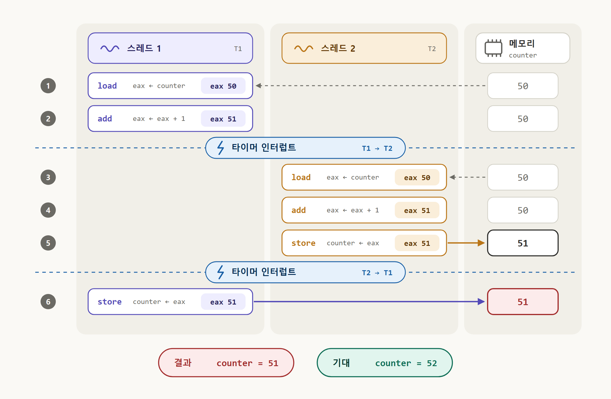
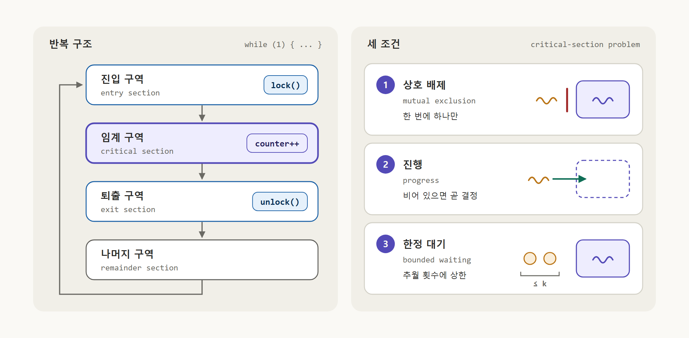
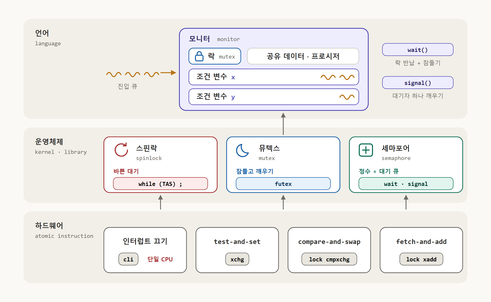
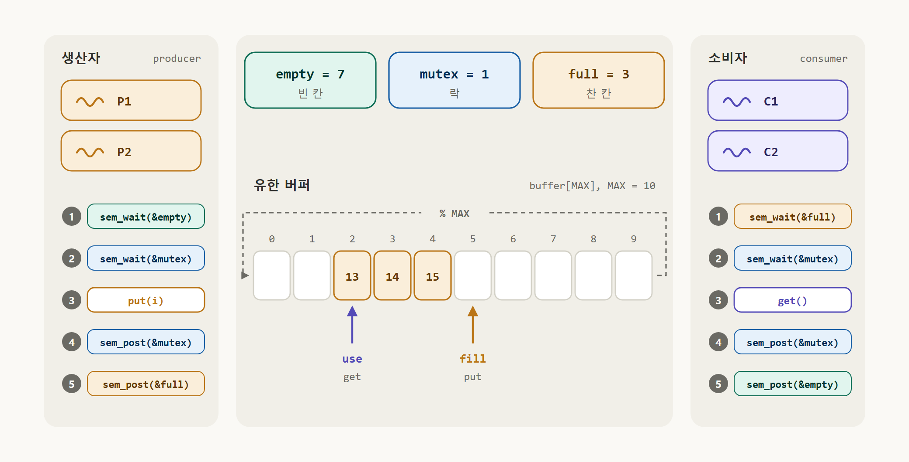

# 프로세스 동기화: 경쟁 조건에서 락, 세마포어, 모니터까지

> OS 학습 6단원. 스레드 여러 개가 같은 변수를 고치면 결과가 실행 순서에 따라 달라진다. 이 문제를 기계어 수준에서 직접 재현해 보고, 임계 구역 문제의 세 조건, 피터슨 알고리즘, 하드웨어 원자적 명령어, 스핀락·뮤텍스·세마포어·모니터를 차례로 쌓아 올린다. 마지막으로 유한 버퍼 같은 고전 문제와 우선순위 역전을 본다.

---

## 1. 경쟁 조건: `counter++` 한 줄이 왜 틀리나



4단원에서 본 것처럼 같은 프로세스의 **스레드**들은 주소 공간을 공유한다. 그래서 전역 변수 `counter`를 두 스레드가 함께 고칠 수 있다. 문제는 `counter = counter + 1`이 CPU에게는 한 동작이 아니라는 점이다. OSTEP의 예에서 컴파일러는 이 한 줄을 세 명령어로 바꾼다.

1. **load**: 메모리의 `counter`를 레지스터 `eax`로 읽는다.
2. **add**: `eax`에 1을 더한다.
3. **store**: `eax`를 다시 `counter`에 쓴다.

그림은 `counter`가 50일 때 두 스레드가 한 번씩 1을 더하는 상황이다.

1. T1이 load와 add를 마쳐 T1의 `eax`는 51이 된다. 메모리는 아직 50이다.
2. 이때 **타이머 인터럽트**가 와서 운영체제가 T1의 레지스터를 TCB에 저장하고 T2로 바꾼다(1단원 인터럽트, 3단원 문맥 교환).
3. T2도 load를 한다. 메모리가 아직 50이므로 T2의 `eax`도 50에서 시작한다. T2는 add와 store까지 마쳐 `counter`를 51로 만든다.
4. 다시 T1으로 돌아온다. T1은 멈췄던 store를 실행해 자기 `eax` 값 51을 쓴다.

두 번 더했는데 결과는 52가 아니라 51이다. T2의 갱신 하나가 사라졌다. 레지스터는 문맥 교환 때 스레드마다 따로 저장·복원되므로, 두 스레드가 같은 옛 값 50에서 출발한 것이 원인이다.

이렇게 **결과가 코드 실행의 타이밍에 따라 달라지는 상황**을 **경쟁 조건**(race condition)이라 한다. 공유 데이터를 두고 일어나면 더 구체적으로 데이터 경쟁(data race)이라 부른다. 실행할 때마다 결과가 달라질 수 있어서 OSTEP은 이런 결과를 **비결정적**(indeterminate)이라고 표현한다.

### 직접 재현해 보기

두 스레드가 각각 1000만 번씩 더하는 프로그램을 만들어 6코어 리눅스(WSL)에서 돌렸다. `zig cc`로 리눅스용으로 컴파일했다.

```c
#include <pthread.h>
#include <stdio.h>

#define N 10000000
static volatile int counter = 0;       /* 공유 변수 */

static void *worker(void *arg) {
    for (int i = 0; i < N; i++)
        counter = counter + 1;         /* 임계 구역인데 보호가 없다 */
    return NULL;
}

int main(void) {
    pthread_t a, b;
    pthread_create(&a, NULL, worker, NULL);
    pthread_create(&b, NULL, worker, NULL);
    pthread_join(a, NULL);
    pthread_join(b, NULL);
    printf("counter = %d (expected %d)\n", counter, 2 * N);
    return 0;
}
// 실행 결과 (세 번): 11952084, 12173106, 12214238 — 기대값은 20000000
```

세 번 모두 2000만에 한참 못 미쳤고 값도 매번 달랐다. 갱신의 약 40%가 사라졌다.

흥미로운 점이 하나 있다. 이 컴파일러는 `counter = counter + 1`을 세 명령어가 아니라 x86 명령어 **하나** `add dword ptr [counter], 1`로 만들었다. 그런데도 값이 사라졌다. 명령어가 하나여도 그 안에서 메모리를 읽고 더하고 다시 쓰는 일이 따로 일어나고, 여러 코어가 동시에 그렇게 하면 서로의 쓰기를 덮어쓴다. 원자적으로 만들려면 `lock` 접두사가 붙은 `lock add` 같은 명령어가 필요하다(3절). 그림의 load/add/store는 이 내부 단계를 풀어서 보여 준 것이다.

> 헷갈리기 쉬운 점: "기계어 한 줄 = 원자적"이 아니다. 단일 CPU에서는 인터럽트가 명령어 경계에서만 처리되므로 한 명령어 안에서 끼어들 수 없다. 하지만 멀티코어에서는 다른 코어가 같은 순간에 같은 메모리를 건드린다. 4단원의 말로 하면, 동시성(번갈아 실행)만으로도 경쟁 조건이 생기고 병렬성(동시에 실행)이 더해지면 한 명령어 안에서도 생긴다.

---

## 2. 임계 구역 문제와 피터슨 알고리즘



공유 변수에 접근해서, 둘 이상의 스레드가 동시에 실행하면 안 되는 코드 조각을 **임계 구역**(critical section)이라 한다. 위 예의 `counter = counter + 1`이 임계 구역이다. 우리가 원하는 성질은 **상호 배제**(mutual exclusion), 즉 한 스레드가 임계 구역 안에 있으면 다른 스레드는 들어오지 못하게 막는 것이다. OSTEP에 따르면 이 용어들은 거의 모두 Dijkstra가 만들었다.

그림 왼쪽처럼 스레드의 코드를 네 구역으로 나눠 보면 문제가 분명해진다.

| 구역 | 하는 일 | 예 |
|---|---|---|
| 진입 구역 (entry section) | 들어가도 되는지 확인하고 표시한다 | `lock()` |
| 임계 구역 (critical section) | 공유 데이터를 읽고 쓴다 | `counter++` |
| 퇴출 구역 (exit section) | 나왔다고 알린다 | `unlock()` |
| 나머지 구역 (remainder section) | 공유 데이터와 상관없는 일 | 계산, 입출력 |

**임계 구역 문제**(critical-section problem)는 진입 구역과 퇴출 구역을 어떻게 짜야 하는가의 문제다. Silberschatz 교재를 따른 UIC 강의 노트는 해결책이 세 조건을 모두 지켜야 한다고 정리한다(그림 오른쪽).

1. **상호 배제**: 한 번에 하나만 임계 구역에서 실행한다.
2. **진행**(progress): 임계 구역이 비어 있고 들어가려는 스레드가 있으면, 나머지 구역에 있지 않은 스레드들만 다음 진입자 결정에 참여하고, 그 결정을 무한히 미룰 수 없다.
3. **한정 대기**(bounded waiting): 한 스레드가 진입을 요청한 뒤 다른 스레드들이 먼저 들어가는 횟수에 상한이 있다. 즉 언젠가는 차례가 온다. 5단원의 **기아**를 막는 조건이다.

이때 각 스레드는 0이 아닌 속도로 실행된다고만 가정하고, 서로의 상대 속도는 가정하지 않는다.

> 비유: 열쇠가 하나뿐인 화장실. 열쇠를 가진 사람만 들어간다(상호 배제). 화장실이 비었는데 줄 선 사람이 서로 양보만 하며 아무도 안 들어가면 안 된다(진행). 새치기가 끝없이 이어져 한 사람이 영영 못 들어가도 안 된다(한정 대기).

### 피터슨 알고리즘

하드웨어의 특별한 도움 없이 읽기와 쓰기만으로 두 스레드의 임계 구역 문제를 푸는 고전적인 방법이 **피터슨 알고리즘**이다. 1981년 Gary Peterson이 발표했고, Dekker의 해법을 다듬은 것이다. 공유 변수는 두 개다.

- `flag[i]`: 스레드 i가 들어가고 싶다는 표시.
- `turn`: 둘 다 들어가고 싶을 때 누구 차례인지.

```c
int flag[2] = {0, 0};
int turn;

void lock(int self) {
    flag[self] = 1;          /* 나도 들어가고 싶다 */
    turn = 1 - self;         /* 하지만 상대에게 먼저 양보한다 */
    while (flag[1 - self] && turn == 1 - self)
        ;                    /* 상대가 원하고 상대 차례면 기다린다 */
}

void unlock(int self) {
    flag[self] = 0;
}
```

세 조건을 확인하면 이렇다.

- **상호 배제**: 둘이 동시에 들어가려면 `turn`이 0이면서 1이어야 한다. 둘이 거의 동시에 오면 `turn`을 *나중에* 쓴 쪽이 기다린다.
- **진행**: 기다리는 조건은 "상대가 원하고(`flag`) 상대 차례(`turn`)"일 때뿐이다. 상대가 나가며 `flag`를 내리면 바로 들어간다.
- **한정 대기**: 들어갈 때마다 `turn`을 상대에게 넘기므로, 상대에게 먼저 양보하는 횟수는 최대 한 번이다.

**그런데 지금의 컴퓨터에서는 그대로는 동작하지 않는다.** OSTEP과 위키백과 모두 현대 하드웨어가 메모리 접근 순서를 바꾸기 때문에(완화된 메모리 일관성 모델) 이 코드가 상호 배제를 보장하지 못한다고 적는다. 직접 확인해 봤다. 두 스레드가 위 `lock()`으로 감싼 `counter++`를 500만 번씩 실행했다.

| 버전 | 결과 (기대값 10,000,000) |
|---|---|
| 위 코드 그대로 (`volatile` 변수) | 9,999,694 · 9,999,850 · 9,999,949 |
| `turn = 1 - self;` 뒤에 전체 메모리 배리어 추가 | 10,000,000 · 10,000,000 · 10,000,000 |

드물지만 확실히 두 스레드가 동시에 임계 구역에 들어갔다. 배리어는 C11의 `atomic_thread_fence(memory_order_seq_cst)`로 넣었고, 컴파일러는 이것을 `lock or` 명령어로 만들었다. 위키백과의 설명대로, 순서를 바꾸는 CPU에서 이런 알고리즘을 쓰려면 **메모리 배리어**로 순서를 강제해야 한다. 그래서 실제로는 다음 절의 하드웨어 명령어를 쓴다.

---

## 3. 동기화 도구: 하드웨어 명령어에서 모니터까지



그림은 이 절에서 볼 도구들을 아래에서 위로 쌓은 것이다. 아래층일수록 하드웨어에 가깝고, 위층은 아래층을 이용해 만든다.

### 인터럽트 끄기: 단일 CPU에서만 통하는 방법

단일 CPU에서 경쟁 조건은 인터럽트로 문맥 교환이 일어나서 생긴다. 그렇다면 임계 구역 동안 **인터럽트를 끄면** 아무도 끼어들지 못한다. 가장 오래된 방법이다. OSTEP은 단점을 세 가지 든다.

- 인터럽트 끄기는 1단원의 **특권 명령어**다. 일반 프로그램에 허락하면 락을 잡고 무한 루프에 빠져 CPU를 독차지할 수 있다.
- **멀티프로세서에서는 소용없다.** 다른 CPU의 스레드는 그대로 임계 구역에 들어온다.
- 오래 끄면 디스크 완료 같은 인터럽트를 놓칠 수 있다.

그래서 이 방법은 커널이 자기 자료 구조를 잠깐 보호할 때처럼 제한된 곳에서만 쓴다.

### 하드웨어 원자적 명령어

결국 하드웨어가 "읽고 고치고 쓰기"를 **한 번에, 쪼갤 수 없게** 해 주는 명령어를 제공한다. 1960년대 초 Burroughs B5000부터 있었고, 지금은 모든 시스템에 있다(OSTEP).

```c
/* 아래 함수 전체가 하드웨어에서 원자적으로 실행된다고 생각한다 (OSTEP의 의사 코드) */
int TestAndSet(int *ptr, int new) {
    int old = *ptr;
    *ptr = new;
    return old;              /* 옛 값을 돌려주면서 새 값을 쓴다 */
}

int CompareAndSwap(int *ptr, int expected, int new) {
    int original = *ptr;
    if (original == expected)
        *ptr = new;          /* 기대한 값일 때만 바꾼다 */
    return original;
}

int FetchAndAdd(int *ptr) {
    int old = *ptr;
    *ptr = old + 1;
    return old;
}
```

C11의 `<stdatomic.h>` 함수를 x86-64용으로 컴파일해서 실제로 어떤 명령어가 나오는지 확인했다.

| 원자적 연산 | C11 함수 | x86-64 명령어 |
|---|---|---|
| test-and-set | `atomic_flag_test_and_set` | `xchg` |
| compare-and-swap | `atomic_compare_exchange_strong` | `lock cmpxchg` |
| fetch-and-add | `atomic_fetch_add` | `lock xadd` (결과를 안 쓰면 `lock add`) |

OSTEP에 따르면 x86은 test-and-set을 잠긴(locked) `xchg`로, SPARC은 `ldstub`로 제공하고, compare-and-swap을 x86은 compare-and-exchange라고 부른다. MIPS·ARM 같은 곳에는 비슷한 일을 하는 load-linked/store-conditional 짝이 있다.

1절의 카운터를 이 도구들로 고쳐서 같은 조건으로 다시 돌렸다(시간은 한 번 잰 값).

| 방법 | 결과 | 걸린 시간 |
|---|---|---|
| 보호 없음 | 11,952,084 (틀림) | 83 ms |
| `pthread_mutex_lock` | 20,000,000 | 724 ms |
| test-and-set 스핀락 | 20,000,000 | 604 ms |
| `atomic_fetch_add` (`lock add`) | 20,000,000 | 145 ms |

락은 정답을 주지만 비싸다. 변수 하나를 올리는 정도라면 원자적 명령어 하나로 끝내는 편이 훨씬 빠르다.

### 스핀락: 될 때까지 계속 묻기

test-and-set 하나로 락을 만들 수 있다.

```c
#include <stdatomic.h>

atomic_flag lock = ATOMIC_FLAG_INIT;   /* 0이면 비어 있음 */

void acquire(void) {
    while (atomic_flag_test_and_set(&lock))   /* 옛 값이 1이면 누가 쥐고 있다 */
        ;                                      /* 바쁜 대기 (spin) */
}

void release(void) {
    atomic_flag_clear(&lock);
}
```

옛 값이 0이면 그 순간 1로 바꾸면서 락을 얻는다. 옛 값이 1이면 다른 스레드가 쥐고 있으므로 계속 돈다. 읽기와 쓰기가 한 명령어라서 1절처럼 둘이 동시에 "비어 있다"고 볼 수 없다. 이렇게 CPU를 쓰며 계속 확인하는 방식을 **바쁜 대기**(busy waiting), 이런 락을 **스핀락**(spinlock)이라 한다. OSTEP의 평가는 이렇다.

- **정확성**: 상호 배제를 보장한다.
- **공정성**: 보장하지 않는다. 운이 나쁜 스레드는 계속 돌기만 하다 굶을 수 있다. fetch-and-add로 번호표를 나눠 주는 **티켓 락**은 모든 스레드가 언젠가 차례를 받게 한다.
- **성능**: 단일 CPU에서는 나쁘다. 락을 쥔 스레드가 선점되면 나머지 스레드들이 각자 타임 슬라이스를 통째로 돌며 버린다. 또 단일 CPU에서 스핀락이 동작하려면 5단원의 **선점형 스케줄러**가 있어야 한다. 그렇지 않으면 도는 스레드가 CPU를 놓지 않는다. 반대로 CPU가 여럿이고 임계 구역이 짧으면 꽤 잘 동작한다.

### 뮤텍스: 기다릴 땐 잠든다

스핀의 낭비를 없애려면 운영체제의 도움이 필요하다. 락을 못 얻으면 **대기 큐에 들어가 잠들고**, 락을 놓는 쪽이 하나를 깨운다. POSIX는 이런 락을 **뮤텍스**(mutex, mutual exclusion에서 온 이름)라 부른다.

```c
#include <pthread.h>

pthread_mutex_t m = PTHREAD_MUTEX_INITIALIZER;

void *worker(void *arg) {
    for (int i = 0; i < N; i++) {
        pthread_mutex_lock(&m);      /* 진입 구역 */
        counter = counter + 1;       /* 임계 구역 */
        pthread_mutex_unlock(&m);    /* 퇴출 구역 */
    }
    return NULL;
}
```

OSTEP은 Solaris의 `park()`·`unpark()`와 리눅스의 **futex**를 예로 든다. futex는 메모리 주소 하나와 커널 안의 대기 큐를 짝지은 것이다.

- `futex_wait(addr, expected)`: `*addr`이 아직 `expected`이면 호출한 스레드를 잠재운다. 값이 바뀌었으면 바로 돌아온다.
- `futex_wake(addr)`: 그 주소에서 기다리는 스레드 하나를 깨운다.

리눅스 NPTL의 뮤텍스는 먼저 원자적 명령어로 락을 시도하고(빠른 경로), 실패할 때만 futex 시스템 콜로 잠든다. 아무도 경쟁하지 않으면 커널에 들어가지 않는다. 이렇게 "잠깐 돌아 보고, 안 되면 잠드는" 락을 **2단계 락**(two-phase lock)이라 한다. UIC 노트에 따르면 Solaris의 **적응형 뮤텍스**도 비슷하다. 락을 쥔 스레드가 다른 CPU에서 실행 중이면 곧 풀릴 것으로 보고 돌고, 그렇지 않으면 잠든다.

> 헷갈리기 쉬운 점: **스핀락 vs 뮤텍스**. 둘 다 상호 배제를 주지만 기다리는 방법이 다르다. 스핀락은 CPU를 쓰며 계속 확인하고(문맥 교환 비용이 없다), 뮤텍스는 잠들었다 깨어난다(문맥 교환 비용이 든다). 임계 구역이 짧고 CPU가 여럿이면 스핀락, 길거나 CPU가 하나면 뮤텍스가 유리하다.

### 세마포어: 정수 하나와 대기 큐

**세마포어**(semaphore)는 Dijkstra가 동기화의 모든 일을 하나로 처리하려고 만든 도구다. 정수 값 하나를 두 연산으로만 다룬다.

| 연산 | Dijkstra | POSIX | 하는 일 |
|---|---|---|---|
| wait | `P()` | `sem_wait()` | 값을 1 줄인다. 쓸 수 있는 것이 없으면 기다린다 |
| signal | `V()` | `sem_post()` | 값을 1 늘리고, 기다리는 스레드가 있으면 하나 깨운다 |

P와 V는 네덜란드어에서 왔는데, 어떤 단어에서 왔는지는 시기마다 설명이 달랐다고 OSTEP은 적는다. 세마포어의 성격은 **초깃값**이 정한다. OSTEP은 "초기화 직후 바로 내줄 수 있는 자원의 수"로 생각하라고 권한다.

- **초깃값 1 → 이진 세마포어**: 값이 0과 1만 오가므로 락처럼 쓴다.
- **초깃값 N → 카운팅 세마포어**: 같은 자원 N개(예: 버퍼 칸 N개)를 나눠 쓴다.
- **초깃값 0 → 순서 맞추기**: 한 스레드가 다른 스레드의 일이 끝나기를 기다린다.

```c
#include <semaphore.h>

sem_t done;                      /* sem_init(&done, 0, 0); 0 = 아직 아무것도 없다 */

void *child(void *arg) {
    puts("child");
    sem_post(&done);             /* 끝났다고 알린다 */
    return NULL;
}

/* main: pthread_create(..., child, ...); sem_wait(&done); puts("parent: end"); */
```

자식이 먼저 끝나면 값이 1이 되어 부모의 `sem_wait`은 기다리지 않고 지나간다. 부모가 먼저 오면 자식이 `sem_post`할 때까지 잠든다. 어느 순서로 실행돼도 "child"가 먼저 찍힌다. `sem_init`의 두 번째 인자 0은 이 세마포어를 같은 프로세스의 스레드끼리 쓴다는 뜻이다.

> 헷갈리기 쉬운 점: **세마포어 값은 음수가 될 수 있나?** 자료마다 다르다. OSTEP과 Silberschatz식 구현은 먼저 값을 줄이고 나서 검사하므로 값이 음수가 될 수 있고, 그 절댓값이 기다리는 스레드 수다. 반면 리눅스 `sem_overview(7)`은 POSIX 세마포어를 "0 아래로 내려가지 않는 정수"로 정의하고, 값이 0이면 `sem_wait`이 막힌다. 겉으로 보이는 동작은 같고, 내부 표현만 다르다.

> 헷갈리기 쉬운 점: **이진 세마포어 vs 뮤텍스**. 이진 세마포어를 락처럼 쓸 수 있지만 같은 것은 아니다. 위 부모-자식 예처럼 세마포어는 값을 올리는 스레드와 내리는 스레드가 달라도 된다. 그래서 순서 맞추기에도 쓴다. 뮤텍스는 상호 배제 하나만을 위한 도구다.

### 모니터와 조건 변수

세마포어는 강력하지만 실수하기 쉽다. `wait`과 `signal`의 순서를 하나만 바꿔도 교착 상태나 상호 배제 위반이 생긴다(4절에서 실제로 본다). 그래서 언어 차원에서 실수를 줄이는 **모니터**(monitor)가 나왔다. UIC 노트의 정의로는 모니터는 데이터가 모두 감춰진 클래스 같은 것이고, **한 번에 한 메서드만** 실행될 수 있다. 즉 상호 배제를 프로그래머 대신 언어가 지켜 준다. 그림 맨 위층처럼 모니터는 락 하나와 하나 이상의 **조건 변수**로 이루어진다. UIC 노트는 Concurrent Pascal, Mesa, C#, Java가 모니터를 구현한다고 적는다.

**조건 변수**(condition variable)는 "어떤 조건이 참이 될 때까지" 잠들어 기다리는 대기 큐다. OSTEP에 따르면 이름은 Hoare가 모니터 연구에서 붙였다. POSIX의 두 연산은 이렇다.

- `pthread_cond_wait(&c, &m)`: 쥐고 있던 락 `m`을 놓고 잠드는 일을 **원자적으로** 한다. 깨어나면 락을 다시 잡은 뒤에 돌아온다.
- `pthread_cond_signal(&c)`: `c`에서 기다리는 스레드 하나를 깨운다. 기다리는 스레드가 없으면 아무 일도 하지 않는다.

```c
int done = 0;
pthread_mutex_t m = PTHREAD_MUTEX_INITIALIZER;
pthread_cond_t c = PTHREAD_COND_INITIALIZER;

void thr_exit(void) {                 /* 자식이 끝날 때 */
    pthread_mutex_lock(&m);
    done = 1;                         /* 상태를 바꾸고 */
    pthread_cond_signal(&c);          /* 알린다 */
    pthread_mutex_unlock(&m);
}

void thr_join(void) {                 /* 부모가 기다릴 때 */
    pthread_mutex_lock(&m);
    while (done == 0)                 /* if가 아니라 while */
        pthread_cond_wait(&c, &m);
    pthread_mutex_unlock(&m);
}
```

**왜 `if`가 아니라 `while`인가?** signal은 "상태가 바뀌었을지도 모른다"는 힌트일 뿐이다. 깨어난 스레드가 실제로 실행되기 전에 다른 스레드가 끼어들어 상태를 다시 바꿀 수 있다. 이런 의미를 처음 구현한 연구(Lampson과 Redell의 Mesa)의 이름을 따 **Mesa 의미론**이라 한다. 깨어난 스레드가 즉시 실행된다고 보장하는 쪽은 **Hoare 의미론**인데, OSTEP은 사실상 모든 시스템이 Mesa 의미론을 쓴다고 적는다. 일부 구현에서는 signal 하나에 두 스레드가 깨는 가짜 깨어남(spurious wakeup)도 있다. 그러니 깨어나면 조건을 다시 확인해야 하고, 그래서 항상 `while`을 쓴다.

UIC 노트는 모니터 안에서 P가 Q를 깨웠을 때의 두 선택을 이렇게 부른다. **signal-and-wait**는 P가 기다리고 Q가 먼저 실행된다(Hoare 쪽). **signal-and-continue**는 P가 계속 실행되고 Q는 P가 나갈 때까지 기다린다(Mesa 쪽).

> 헷갈리기 쉬운 점: **세마포어의 signal vs 조건 변수의 signal**. 세마포어의 `sem_post`는 기다리는 스레드가 없어도 값을 올려 "기억"한다. 조건 변수의 signal은 기다리는 스레드가 없으면 그냥 사라진다. 그래서 조건 변수는 항상 `done` 같은 상태 변수와 함께 쓰고, 그 상태를 락으로 보호한다.

### 우선순위 역전

5단원의 **우선순위 스케줄링**과 락이 만나면 이상한 일이 생긴다. 우선순위가 높음(H), 중간(M), 낮음(L)인 세 스레드가 있다고 하자.

1. L이 락을 잡고 임계 구역에 들어간다.
2. H가 깨어나 L을 선점하고 같은 락을 요청한다. L이 쥐고 있으니 H는 기다린다.
3. 이때 M이 실행 가능해진다. M은 L보다 우선순위가 높으므로 L을 선점한다.
4. L이 실행되지 못하니 락이 풀리지 않고, H는 M이 끝날 때까지 기다린다.

결국 가장 높은 H가 그보다 낮은 M에게 밀린다. 이것이 **우선순위 역전**(priority inversion)이다. OSTEP과 UIC 노트는 1997년 화성 탐사선 Mars Pathfinder에서 이 문제가 실제로 일어났다고 소개한다. OSTEP은 스핀락이면 두 스레드만으로도 생긴다고 덧붙인다. H가 L이 쥔 스핀락을 돌며 기다리면, 스케줄러가 늘 H를 고르므로 L은 영영 실행되지 못하고 시스템이 멈춘다.

| 해결책 | 방법 | 출처 |
|---|---|---|
| 우선순위 상속 | 높은 스레드가 기다리는 동안 락을 쥔 낮은 스레드가 그 우선순위를 잠시 물려받는다. M이 L을 선점하지 못한다 | OSTEP, UIC, 위키백과 |
| 우선순위 상한 | 락 자체에 높은 우선순위를 붙여, 락을 잡은 스레드가 그 우선순위로 실행된다 | 위키백과 |
| 모두 같은 우선순위 | 역전이 생길 수 없게 한다 | OSTEP |

UIC 노트에 따르면 Solaris는 락을 기다리는 스레드들의 큐(turnstile)를 두고, 락을 쥔 스레드가 그 큐에서 가장 높은 우선순위를 잠시 물려받게 한다.

---

## 4. 고전 문제: 유한 버퍼, 읽기-쓰기, 식사하는 철학자



새 동기화 기법은 보통 몇 가지 고전 문제로 시험한다(UIC 노트). 그중 가장 자주 쓰이는 것이 **생산자-소비자 문제**, 다른 이름으로 **유한 버퍼 문제**(bounded-buffer problem)다.

### 유한 버퍼

생산자는 칸이 MAX개인 버퍼에 데이터를 넣고, 소비자는 꺼낸다. 지켜야 할 것은 세 가지다.

- 버퍼가 **가득 차면** 생산자가 기다린다.
- 버퍼가 **비면** 소비자가 기다린다.
- `fill`과 `use` 위치를 고치는 `put()`·`get()`은 **임계 구역**이다. 생산자 둘이 동시에 같은 칸에 쓰면 데이터 하나가 덮여 사라진다.

그림처럼 세마포어 세 개로 푼다. 칸 10개 중 3개가 차 있으므로 `empty`는 7, `full`은 3이다.

| 세마포어 | 초깃값 | 뜻 |
|---|---|---|
| `empty` | MAX | 빈 칸 수. 생산자가 줄이고 소비자가 늘린다 |
| `full` | 0 | 찬 칸 수. 소비자가 줄이고 생산자가 늘린다 |
| `mutex` | 1 | `put()`·`get()`을 보호하는 이진 세마포어 |

```c
#include <pthread.h>
#include <semaphore.h>

#define MAX 10
int buffer[MAX], fill = 0, use = 0;
sem_t empty, full, mutex;        /* sem_init: MAX, 0, 1 */

void put(int v) { buffer[fill] = v; fill = (fill + 1) % MAX; }
int  get(void)  { int t = buffer[use]; use = (use + 1) % MAX; return t; }

void *producer(void *arg) {
    for (int i = 1; i <= LOOPS; i++) {
        sem_wait(&empty);        /* 1. 빈 칸 하나 확보 */
        sem_wait(&mutex);        /* 2. 락 */
        put(i);                  /* 3. 임계 구역 */
        sem_post(&mutex);        /* 4. 락 해제 */
        sem_post(&full);         /* 5. 찬 칸 하나 알림 */
    }
    return NULL;
}

void *consumer(void *arg) {
    for (int i = 0; i < LOOPS; i++) {
        sem_wait(&full);
        sem_wait(&mutex);
        int v = get();
        sem_post(&mutex);
        sem_post(&empty);
        /* v 사용 */
    }
    return NULL;
}
```

생산자 2개가 각각 1부터 100만까지 넣고 소비자 2개가 꺼내는 프로그램으로 확인했다. 넣은 값의 합과 꺼낸 값의 합이 둘 다 1,000,001,000,000으로 같았다.

**순서가 중요하다.** `mutex`를 `empty`·`full`보다 먼저 잡으면 교착 상태가 생긴다(OSTEP).

1. 소비자가 먼저 `mutex`를 잡고 `sem_wait(&full)`에서 잠든다. 버퍼가 비었기 때문이다. 락은 여전히 쥐고 있다.
2. 생산자가 와서 `sem_wait(&mutex)`에서 막힌다.
3. 소비자는 생산자를, 생산자는 소비자가 쥔 락을 기다린다. 아무도 진행하지 못한다.

그래서 락의 범위를 `put()`·`get()` 주변으로만 좁힌다. 이렇게 서로를 기다리며 멈추는 상황은 7단원 **교착 상태**의 주제다.

조건 변수로 풀 수도 있다. 이때는 OSTEP의 결론처럼 조건 변수를 두 개(`empty`, `fill`) 쓰고 `while`로 조건을 검사해야 한다. 조건 변수가 하나뿐이면 소비자가 다른 소비자를 깨우는 바람에 모두 잠드는 경우가 생긴다.

> 비유: 세마포어 `empty`는 주차장 입구의 "빈자리 7" 전광판이다. 차가 들어갈 때마다 하나 줄고, 0이 되면 입구에서 기다린다. 차가 나가면 하나 늘고 기다리던 차 하나가 들어간다.

### 읽기-쓰기 문제

여러 스레드가 같은 데이터를 **읽기만** 한다면 동시에 해도 안전하다. 쓰는 스레드만 혼자여야 한다. 이것을 허용하는 것이 **읽기-쓰기 락**이다. OSTEP의 구현은 세마포어 두 개와 읽는 스레드 수(`readers`)를 쓴다.

- 쓰기 락: `writelock` 세마포어 하나로 쓰는 스레드 하나만 들어간다.
- 읽기 락: **처음** 들어오는 읽는 스레드가 `writelock`을 잡고, **마지막**으로 나가는 읽는 스레드가 놓는다. 그 사이의 읽는 스레드들은 자유롭게 드나든다.

UIC 노트는 이 방식을 읽는 쪽을 우선하는 "첫 번째 읽기-쓰기 문제"라고 부른다. 단점은 읽는 스레드가 계속 들어오면 **쓰는 스레드가 기아**에 빠질 수 있다는 것이다. 쓰는 쪽을 우선하는 "두 번째 문제"도 있다. OSTEP은 읽기-쓰기 락이 오버헤드를 더하기 때문에 단순하고 빠른 락보다 성능이 나아지지 않는 경우가 많다고 경고한다.

### 식사하는 철학자

Dijkstra가 낸 문제다. 철학자 다섯이 둥근 식탁에 앉아 있고, 사이마다 포크가 하나씩, 모두 다섯 개 있다. 먹으려면 왼쪽과 오른쪽 포크가 둘 다 필요하다.

포크마다 세마포어를 두고 "왼쪽 먼저, 그다음 오른쪽"을 잡게 하면, 다섯 명이 동시에 왼쪽 포크를 잡는 순간 모두가 오른쪽을 영원히 기다린다. **교착 상태**다. 해결책은 여러 가지다.

- **한 명만 순서를 바꾼다**: 철학자 4만 오른쪽 먼저 잡는다. 기다림의 원이 끊긴다. OSTEP에 따르면 Dijkstra 자신이 이렇게 풀었다.
- **동시에 앉는 수를 4명으로 제한**한다(UIC).
- **두 포크를 한꺼번에** 잡을 수 있을 때만 잡는다(UIC). 모니터로 푸는 해법이 이 방식이다.

UIC 노트는 교착 상태가 없다고 해서 **기아**가 없는 것은 아니라고 강조한다. 운 나쁜 철학자 한 명은 계속 포크 둘을 동시에 얻지 못할 수 있다.

---

## 정리

- **경쟁 조건**은 결과가 실행 타이밍에 따라 달라지는 상황이다. `counter++`도 내부적으로 읽기·더하기·쓰기로 나뉘어 갱신을 잃는다. 실험에서는 갱신의 약 40%가 사라졌다.
- 공유 데이터를 고치는 코드가 **임계 구역**이고, 해결책은 **상호 배제·진행·한정 대기**를 지켜야 한다.
- **피터슨 알고리즘**은 읽기·쓰기만으로 두 스레드 문제를 풀지만, 메모리 순서를 바꾸는 현대 CPU에서는 배리어 없이는 실패한다. 실제로 재현했다.
- **인터럽트 끄기**는 단일 CPU에서만 통한다. 그래서 하드웨어가 **test-and-set**, **compare-and-swap** 같은 **원자적 명령어**를 준다.
- **스핀락**은 바쁜 대기로, **뮤텍스**는 잠들기로 기다린다. 리눅스 뮤텍스는 **futex**로 경쟁이 있을 때만 커널에 들어간다.
- **세마포어**는 정수와 대기 큐다. 초깃값 1이면 **이진 세마포어**(락), N이면 자원 세기, 0이면 순서 맞추기다.
- **모니터**는 락과 **조건 변수**를 묶어 상호 배제를 언어가 지켜 준다. Mesa 의미론 때문에 조건은 항상 `while`로 다시 확인한다.
- **유한 버퍼**는 `empty`·`full`·`mutex` 세 세마포어로 풀고, 락의 범위를 잘못 잡으면 교착 상태가 된다. **읽기-쓰기**와 **식사하는 철학자**에서는 교착과 기아를 함께 따져야 한다.
- **우선순위 역전**은 높은 스레드가 낮은 스레드의 락을 기다릴 때 생기고, **우선순위 상속**으로 막는다.

## 아직 답을 못 찾은 질문

- 리눅스 glibc의 `pthread_mutex_lock`은 futex로 잠들기 전에 실제로 얼마나 스핀하나? 2단계 락의 첫 단계 길이는 어떻게 정하나?
- 리눅스 커널 안의 스핀락은 락을 쥔 동안 선점과 인터럽트를 어떻게 다루나? (`spin_lock`과 `spin_lock_irqsave`는 언제 나눠 쓰나?)

## 참고 자료

- Remzi & Andrea Arpaci-Dusseau, *Operating Systems: Three Easy Pieces*, [Ch.26 Concurrency: An Introduction](https://pages.cs.wisc.edu/~remzi/OSTEP/threads-intro.pdf)
- 같은 책, [Ch.28 Locks](https://pages.cs.wisc.edu/~remzi/OSTEP/threads-locks.pdf)
- 같은 책, [Ch.30 Condition Variables](https://pages.cs.wisc.edu/~remzi/OSTEP/threads-cv.pdf)
- 같은 책, [Ch.31 Semaphores](https://pages.cs.wisc.edu/~remzi/OSTEP/threads-sema.pdf)
- University of Illinois Chicago 운영체제 강의 노트, [Process Synchronization](https://www.cs.uic.edu/~jbell/CourseNotes/OperatingSystems/5_Synchronization.html)
- Wikipedia, [Peterson's algorithm](https://en.wikipedia.org/wiki/Peterson%27s_algorithm)
- Wikipedia, [Priority inversion](https://en.wikipedia.org/wiki/Priority_inversion)
- Linux manual page, [sem_overview(7)](https://man7.org/linux/man-pages/man7/sem_overview.7.html)
