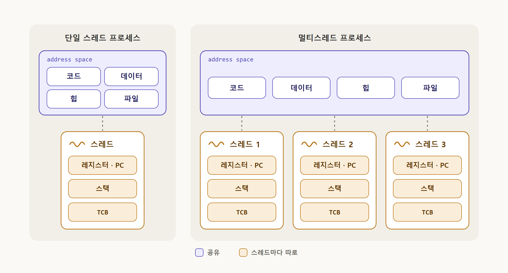
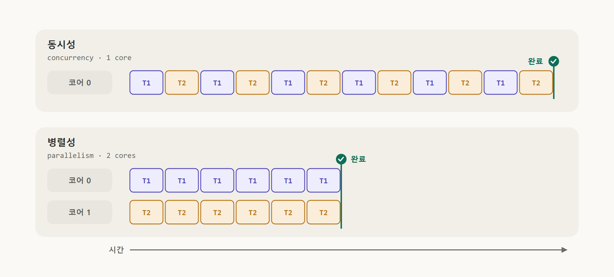
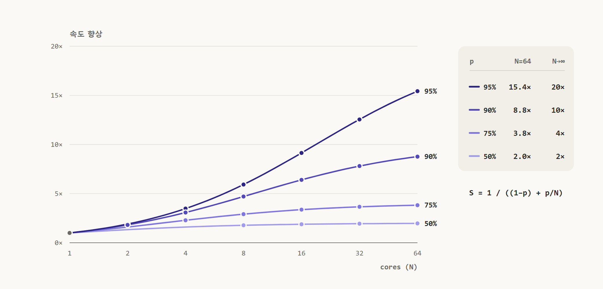
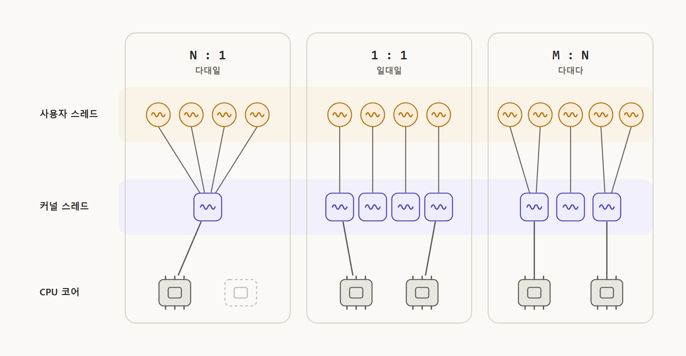

# 스레드와 동시성: 한 프로세스 안의 여러 실행 흐름

> OS 학습 4단원. 프로세스 하나 안에 실행 흐름을 여러 개 두는 스레드를 정리한다. 스레드가 프로세스와 무엇을 나누고 무엇을 따로 갖는지, 동시성과 병렬성은 어떻게 다른지, 코어를 늘리면 얼마나 빨라지는지(암달의 법칙), 그리고 리눅스가 스레드를 실제로 어떻게 만드는지(`pthread_create`, `clone`)를 본다.

---

## 1. 스레드는 무엇이고 프로세스와 무엇이 다른가



3단원에서 본 **프로세스**는 실행 지점이 하나다. PC(프로그램 카운터) 하나가 명령어를 하나씩 가리키며 나아간다. **스레드**는 이 실행 지점을 여러 개로 늘린 것이다. 멀티스레드 프로세스에는 PC가 여러 개 있고, 각 PC가 따로 명령어를 가져와 실행한다.

스레드 하나는 프로세스와 아주 비슷하다. 차이는 딱 하나다. **같은 프로세스의 스레드들은 주소 공간을 공유한다.** 그래서 같은 데이터에 바로 접근할 수 있다. 그림의 보라색이 함께 쓰는 것, 주황색이 스레드마다 따로 갖는 것이다.

| | 스레드끼리 공유 | 스레드마다 따로 |
|---|---|---|
| 메모리 | 코드, 전역 데이터, 힙 (주소 공간 전체) | **스택** (지역 변수, 인자, 반환 값) |
| CPU 상태 | | **레지스터와 PC** |
| 커널 자원 | 열린 파일 디스크립터, 시그널 처리 방식, 현재 디렉터리, 사용자 ID | 스레드 ID, 시그널 마스크, `errno` |
| 상태 저장 | | **TCB** (스레드 제어 블록) |

**TCB(thread control block).** 프로세스 상태를 PCB에 저장했듯이, 스레드 상태는 TCB에 저장한다. 한 프로세스에 스레드가 여럿이면 TCB도 여럿이다.

**스레드 사이의 문맥 교환.** 코어 하나에서 스레드 T1을 돌리다 T2로 바꾸려면 프로세스 때처럼 문맥 교환을 한다. T1의 레지스터를 TCB에 저장하고 T2의 레지스터를 복원한다. 다른 점은 **주소 공간이 그대로라는 것**이다. 같은 프로세스 안이므로 페이지 테이블을 바꿀 필요가 없다.

**스택이 여러 개.** 단일 스레드 프로세스는 주소 공간에 스택이 하나다. 스레드가 둘이면 스택도 둘이 주소 공간 안에 흩어져 놓인다. 각 스레드가 따로 함수를 호출하기 때문이다. 지역 변수는 그 스레드의 스택에만 있다.

> 비유: 한 주방(주소 공간)을 여러 요리사(스레드)가 함께 쓴다. 냉장고와 재료(힙, 전역 데이터)는 같이 쓰지만, 각자 레시피의 어디까지 했는지(PC)와 자기 도마(스택)는 따로 있다.

> 헷갈리기 쉬운 점: 리눅스 man 페이지는 nice 값 같은 몇몇 속성이 NPTL에서도 스레드끼리 공유되지 않는다고 적어 두었다. 위 표는 POSIX가 정한 일반적인 구분이다.

---

## 2. 왜 멀티스레딩을 쓰나

OSTEP은 스레드를 쓰는 이유를 두 가지로 든다.

1. **병렬성.** 큰 배열에 같은 연산을 하는 프로그램을 생각해 보자. CPU가 여러 개라면 배열을 나눠 CPU마다 한 부분씩 맡길 수 있다. CPU 하나당 스레드 하나를 두는 것이 흔한 방법이다. 이렇게 단일 스레드 프로그램을 여러 CPU에서 나눠 일하게 바꾸는 작업을 **병렬화**라고 한다.
2. **느린 I/O 때문에 멈추지 않기.** 한 스레드가 디스크나 네트워크를 기다리며 막혀 있어도, 스케줄러는 같은 프로그램의 다른 스레드를 돌릴 수 있다. 웹 서버나 데이터베이스 같은 서버 프로그램이 스레드를 많이 쓰는 이유다.

둘 다 프로세스 여러 개로도 할 수 있다. 하지만 스레드는 주소 공간을 공유하므로 데이터를 나누기 쉽다. 반대로 서로 공유할 데이터가 거의 없는, 논리적으로 분리된 작업이라면 프로세스가 더 낫다.

| | 프로세스 여러 개 | 스레드 여러 개 |
|---|---|---|
| 주소 공간 | 각자 따로 | 하나를 공유 |
| 데이터 공유 | IPC가 필요 | 같은 변수를 바로 읽고 씀 |
| 문맥 교환 | 페이지 테이블까지 교체 | 레지스터만 교체 |
| 어울리는 일 | 서로 독립된 작업 | 데이터를 많이 나누는 작업 |

데이터를 바로 공유한다는 장점은 그대로 위험이기도 하다. 두 스레드가 같은 변수를 동시에 고치면 결과가 실행 순서에 따라 달라진다(`race-condition`). 이 문제와 해결책(락)은 6단원에서 다룬다.

---

## 3. 동시성과 병렬성



위 그림은 같은 일을 하는 스레드 T1, T2를 두 가지 방식으로 실행한 시간 흐름이다.

- **동시성(concurrency)**: 여러 작업의 실행 기간이 **겹친다**. 코어가 하나여도 된다. 그림 위쪽처럼 운영체제가 시간을 잘게 나눠 T1과 T2를 번갈아 돌린다. 어느 한 순간에는 하나만 실행되지만, 둘 다 "진행 중"이다.
- **병렬성(parallelism)**: 여러 작업이 **같은 순간에** 실행된다. 코어가 여러 개 있어야 한다. 그림 아래쪽처럼 T1은 코어 0에서, T2는 코어 1에서 동시에 돈다. 그래서 일이 더 빨리 끝난다.

| | 동시성 | 병렬성 |
|---|---|---|
| 핵심 | 실행 기간이 겹침 | 같은 순간에 실행 |
| 코어 수 | 1개여도 됨 | 2개 이상 필요 |
| 방법 | 시분할로 번갈아 실행 | 코어마다 하나씩 실행 |
| 얻는 것 | 응답성, I/O 대기 숨기기 | 계산 속도 |

> 비유: 요리사 한 명이 국을 끓이다 잠깐 찌개를 젓고 다시 국으로 돌아온다(동시성). 요리사 두 명이 국과 찌개를 하나씩 맡는다(병렬성).

> 헷갈리기 쉬운 점: "멀티스레드 프로그램 = 병렬 실행"이 아니다. 코어가 하나면 스레드가 몇 개든 동시성일 뿐이다. 병렬성은 코어가 여럿일 때 생긴다.

---

## 4. 멀티코어와 암달의 법칙



**멀티코어** 칩은 CPU 코어 여러 개를 한 칩에 넣은 것이다. 코어가 늘면 병렬로 돌릴 수 있는 스레드도 는다. 그런데 코어를 두 배로 늘리면 프로그램도 두 배로 빨라질까?

**암달의 법칙**은 그 한계를 계산한다. 프로그램에서 병렬로 나눌 수 있는 부분의 비율을 `p`, 코어 수를 `N`이라고 하면 속도 향상은 이렇다.

```text
S(N) = 1 / ((1 - p) + p / N)
```

`N`을 아무리 키워도 `p / N`만 0에 가까워지고 `(1 - p)`는 남는다. 그래서 속도 향상은 `1 / (1 - p)`를 넘지 못한다. 그림에서 곡선들이 위로 갈수록 눕는 이유다.

- `p = 95%`: 64코어에서 약 15.4배, 코어가 무한히 많아도 **최대 20배**
- `p = 50%`: 64코어에서도 약 2배, **최대 2배**

직접 계산해 보면 감이 온다. 95%가 병렬화된 프로그램을 8코어에서 돌리면 다음과 같다.

```text
S(8) = 1 / (0.05 + 0.95 / 8) = 1 / 0.16875 ≈ 5.9배
```

코어는 8배인데 속도는 6배가 안 된다. 남은 5%의 순차 부분이 전체 시간을 붙잡기 때문이다.

> 헷갈리기 쉬운 점: 암달의 법칙은 "병렬 부분은 코어 수만큼 완벽하게 빨라진다"고 가정한 **최선의 경우**다. 실제로는 스레드 생성, 동기화, 문맥 교환 비용이 더해지므로 이보다 느리다.

---

## 5. 사용자 스레드, 커널 스레드, 멀티스레딩 모델



스레드는 누가 관리하느냐에 따라 두 가지로 나뉜다.

- **사용자 스레드**: 사용자 공간의 라이브러리가 만들고 스케줄링한다. 커널은 이 스레드들이 있는지 모른다. 스레드 전환에 커널이 끼지 않아 매우 빠르고, 프로그램에 맞는 스케줄링 정책을 쓸 수 있다.
- **커널 스레드**: 운영체제가 직접 스케줄링하는 단위다. 프로세스마다 적어도 하나 있다. 같은 프로세스의 커널 스레드끼리 전환할 때는 가상 메모리를 바꾸지 않으므로 TLB도 그대로 쓸 수 있다.

**멀티스레딩 모델**은 사용자 스레드를 커널 스레드에 어떻게 대응시키는지를 말한다. 그림의 주황 원이 사용자 스레드, 보라 상자가 커널 스레드, 맨 아래가 CPU 코어다.

| | N:1 (다대일) | 1:1 (일대일) | M:N (다대다) |
|---|---|---|---|
| 대응 | 사용자 스레드 전부 → 커널 스레드 1개 | 사용자 스레드 1개 → 커널 스레드 1개 | 사용자 스레드 M개 → 커널 스레드 N개 |
| 스레드 전환 | 아주 빠름 (커널 진입 없음) | 커널을 거쳐 상대적으로 비쌈 | 시스템 콜 없이 가능 |
| 멀티코어 활용 | **불가** (한 번에 하나만 실행) | 가능 | 가능 |
| 블로킹 시스템 콜 | **프로세스 전체가 멈춤** | 그 스레드만 멈춤 | 그 스레드만 멈춤 |
| 단점 | 병렬성 없음 | 커널 연산에 의존 | 구현 복잡, 두 스케줄러 협조 필요 |
| 예 | GNU Portable Threads | 리눅스(NPTL), Win32, macOS, FreeBSD | 옛 Solaris(SunOS 5.2~5.8), 옛 NetBSD, GHC(Haskell) |

N:1 그림에서 코어 하나가 점선(유휴)인 것을 보자. 커널이 보기에는 스레드가 하나뿐이니 코어 하나에만 올릴 수 있다. 또 그 커널 스레드가 블로킹 시스템 콜로 멈추면, 그 위의 사용자 스레드 전부가 함께 멈춘다.

M:N은 두 장점을 모두 노렸지만 구현이 복잡했다. Solaris와 NetBSD, FreeBSD는 한때 M:N을 썼다가 결국 1:1로 돌아갔다. 오늘날 주요 운영체제는 대부분 1:1이다.

> 헷갈리기 쉬운 점: 사용자 스레드와 커널 스레드는 **누가 관리하고 스케줄링하느냐**의 구분이다. 1단원의 사용자 모드·커널 모드(어느 권한으로 실행되느냐)와는 다른 축이다. 예를 들어 1:1 모델에서 `pthread_create`로 만든 스레드는 평소 사용자 모드에서 프로그램 코드를 실행하지만, 스케줄링은 커널이 한다.

---

## 6. POSIX 스레드: `pthread_create`와 `pthread_join`

**POSIX 스레드(pthreads)** 는 유닉스 계열에서 스레드를 다루는 표준 API다. 핵심은 두 함수다.

```c
int pthread_create(pthread_t *thread, const pthread_attr_t *attr,
                   void *(*start_routine)(void *), void *arg);
int pthread_join(pthread_t thread, void **value_ptr);
```

- `pthread_create`: 새 스레드를 만들고, 그 스레드가 `start_routine(arg)`부터 실행하게 한다. `attr`로 스택 크기나 스케줄링 우선순위를 정할 수 있고, 보통은 `NULL`(기본값)을 넘긴다. 인자와 반환 값이 `void *`라서 어떤 타입이든 넘길 수 있다.
- `pthread_join`: 지정한 스레드가 끝날 때까지 기다리고, 그 스레드의 반환 값을 받는다.

```c
#include <pthread.h>
#include <stdio.h>

void *worker(void *arg) {
    printf("%s\n", (char *) arg);   // 각 스레드는 자기 스택에서 이 함수를 실행
    return NULL;
}

int main(void) {
    pthread_t t1, t2;
    printf("main: begin\n");
    pthread_create(&t1, NULL, worker, "A");   // 새 스레드 생성, worker("A") 실행
    pthread_create(&t2, NULL, worker, "B");
    pthread_join(t1, NULL);                   // t1이 끝날 때까지 기다림
    pthread_join(t2, NULL);
    printf("main: end\n");
    return 0;
}
// 컴파일: gcc -Wall -pthread -o t0 t0.c
```

이 프로그램에는 스레드가 세 개 있다. `main` 스레드, T1, T2다. 실행할 때마다 결과가 달라질 수 있다.

1. `main: begin` → `A` → `B` → `main: end`
2. `main: begin` → `B` → `A` → `main: end`

먼저 만든 스레드가 먼저 실행된다는 보장이 없다. 누가 언제 실행될지는 스케줄러가 정한다. 다만 `pthread_join` 두 번이 있으므로 `main: end`는 항상 마지막이다.

> 헷갈리기 쉬운 점: 스레드 함수가 **자기 스택에 있는 지역 변수의 주소**를 반환하면 안 된다. 스레드가 끝나면 그 스택은 사라지므로, `pthread_join`으로 받은 포인터는 이미 없는 메모리를 가리킨다. 결과를 돌려줄 때는 힙(`malloc`)에 담는다.

---

## 7. 리눅스는 스레드를 어떻게 만드나: `clone`

3단원의 `fork()`는 부모를 **복사**해 자식 프로세스를 만든다. 리눅스의 `clone()`은 한 걸음 더 나간다. 새 실행 흐름이 부모와 **무엇을 공유할지**를 플래그로 고르게 한다. 다 복사하면 프로세스에 가깝고, 다 공유하면 스레드가 된다.

| 플래그 | 켜면 부모와 공유하는 것 |
|---|---|
| `CLONE_VM` | 메모리 공간 전체 |
| `CLONE_FS` | 루트·현재 디렉터리, umask |
| `CLONE_FILES` | 파일 디스크립터 테이블 |
| `CLONE_SIGHAND` | 시그널 핸들러 테이블 (시그널 마스크는 따로) |
| `CLONE_THREAD` | 같은 **스레드 그룹**에 들어감 |

`CLONE_THREAD`는 `CLONE_SIGHAND`가, `CLONE_SIGHAND`는 `CLONE_VM`이 함께 있어야 한다. 같은 스레드 그룹에 들어가려면 메모리와 시그널 핸들러도 공유해야 한다는 뜻이다.

**스레드 그룹과 ID 두 개.** 리눅스에서 스레드는 각자 고유한 **TID**를 갖는다. 같은 스레드 그룹은 **TGID**를 공유하고, `getpid()`는 이 TGID를 돌려준다. 그래서 한 프로세스의 스레드들은 `getpid()` 값이 모두 같고, `gettid()` 값만 다르다.

```c
#define _GNU_SOURCE
#include <sched.h>
#include <stdio.h>
#include <stdlib.h>
#include <unistd.h>
#include <sys/syscall.h>

static int counter = 0;
static long child_pid, child_tid;

static int child_fn(void *arg) {
    counter++;                          // CLONE_VM: 부모와 같은 메모리를 고친다
    child_pid = syscall(SYS_getpid);    // 스레드 그룹 ID(TGID)
    child_tid = syscall(SYS_gettid);    // 이 실행 흐름만의 ID
    return 0;
}

int main(void) {
    const size_t SZ = 1024 * 1024;
    char *stack = malloc(SZ);           // 새 실행 흐름의 스택은 호출자가 준비한다
    int flags = CLONE_VM | CLONE_FS | CLONE_FILES | CLONE_SIGHAND | CLONE_THREAD;
    clone(child_fn, stack + SZ, flags, NULL);   // 스택은 아래로 자라므로 끝 주소를 넘긴다
    sleep(1);                           // CLONE_THREAD로 만든 것은 wait()로 기다릴 수 없다
    printf("child : pid=%ld tid=%ld\n", child_pid, child_tid);
    printf("parent: pid=%ld tid=%ld counter=%d\n",
           (long) syscall(SYS_getpid), (long) syscall(SYS_gettid), counter);
    return 0;
}
```

예상 결과는 이렇다. `pid`는 두 줄이 같고(같은 스레드 그룹), `tid`만 다르다. 자식이 올린 `counter`가 부모에게 `1`로 보인다(같은 메모리). `CLONE_VM`을 빼면 자식은 복사본을 고치므로 부모의 `counter`는 `0`으로 남는다.

> 주의: 이 코드는 원리를 보이기 위한 것이다. `clone`을 직접 쓰면 스레드 지역 저장소(TLS) 설정 같은 일을 직접 해야 한다. man 페이지도 `CLONE_SETTLS` 같은 플래그는 스레드 라이브러리에서만 쓰라고 한다. 실제 프로그램에서는 `pthread_create`를 쓴다.

**NPTL.** 리눅스의 glibc는 pthreads를 **NPTL(Native POSIX Thread Library)** 로 구현한다. NPTL은 1:1 구현이다. `pthread_create`로 만든 스레드 하나가 커널 스케줄링 단위 하나가 된다. 그 단위를 만드는 시스템 콜이 `clone`이다(clone(2) man 페이지도 스레드 구현을 `clone`의 대표 용도로 꼽는다). NPTL에서는 모든 스레드가 한 스레드 그룹에 들어가 PID를 공유하고, 관리용 스레드도 따로 두지 않는다. NPTL 이전의 LinuxThreads는 스레드마다 PID가 달라 POSIX와 어긋나는 점이 많았고, glibc 2.4부터 지원이 끊겼다.

---

## 정리

- **스레드**는 프로세스 안의 실행 흐름이다. 주소 공간(코드·데이터·힙)과 파일은 공유하고, **레지스터·PC·스택**은 각자 갖는다. 상태는 **TCB**에 저장한다.
- 스레드 사이 문맥 교환은 주소 공간을 바꾸지 않아서 프로세스 사이 교환보다 가볍다.
- **동시성**은 실행 기간이 겹치는 것(코어 1개로도 가능), **병렬성**은 같은 순간에 실행되는 것(코어 여러 개 필요)이다.
- **암달의 법칙**: 순차 부분 `1 - p`가 속도 향상의 상한 `1 / (1 - p)`를 정한다.
- 사용자 스레드를 커널 스레드에 대응시키는 방식은 **N:1, 1:1, M:N**이 있고, 리눅스(NPTL)를 포함한 오늘날의 주요 운영체제는 1:1이다.
- 리눅스는 `clone`의 공유 플래그로 스레드를 만든다. 같은 스레드 그룹의 스레드는 `getpid()`(TGID)가 같고 `gettid()`가 다르다.

## 아직 답을 못 찾은 질문

- Go의 고루틴처럼 언어 런타임이 M:N 방식으로 스레드를 돌릴 때, 블로킹 시스템 콜 때문에 다른 고루틴이 멈추는 문제를 어떻게 피하나?
- 리눅스에서 `pthread_create`로 만든 스레드의 기본 스택 크기는 무엇으로 정해지나?

## 참고 자료

- Remzi & Andrea Arpaci-Dusseau, *Operating Systems: Three Easy Pieces*, [Ch.26 Concurrency: An Introduction](https://pages.cs.wisc.edu/~remzi/OSTEP/threads-intro.pdf)
- 같은 책, [Ch.27 Interlude: Thread API](https://pages.cs.wisc.edu/~remzi/OSTEP/threads-api.pdf)
- Linux man-pages, [clone(2)](https://man7.org/linux/man-pages/man2/clone.2.html)
- Linux man-pages, [pthreads(7)](https://man7.org/linux/man-pages/man7/pthreads.7.html)
- Wikipedia, [Thread (computing)](https://en.wikipedia.org/wiki/Thread_(computing))
- Wikipedia, [Concurrent computing](https://en.wikipedia.org/wiki/Concurrent_computing)
- Wikipedia, [Amdahl's law](https://en.wikipedia.org/wiki/Amdahl%27s_law)
