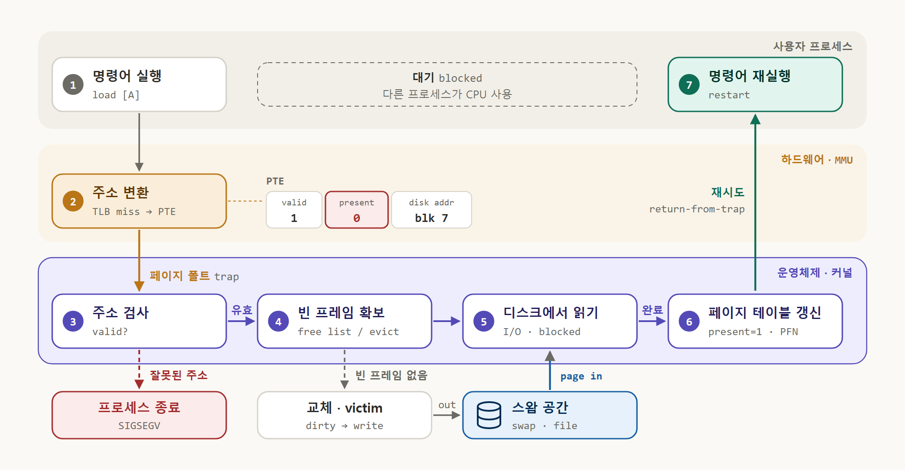
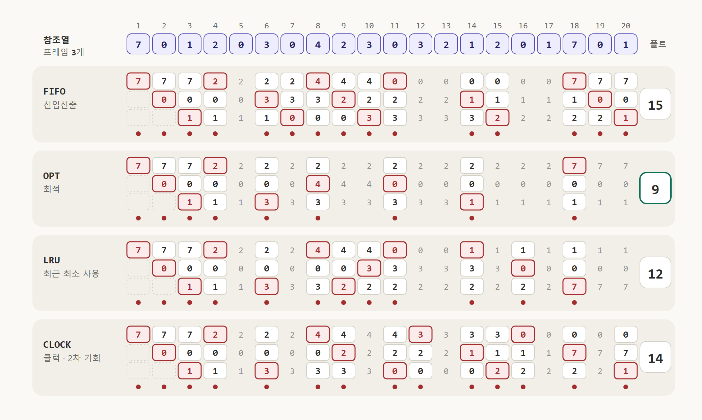
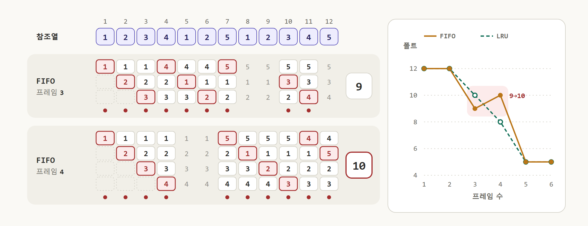
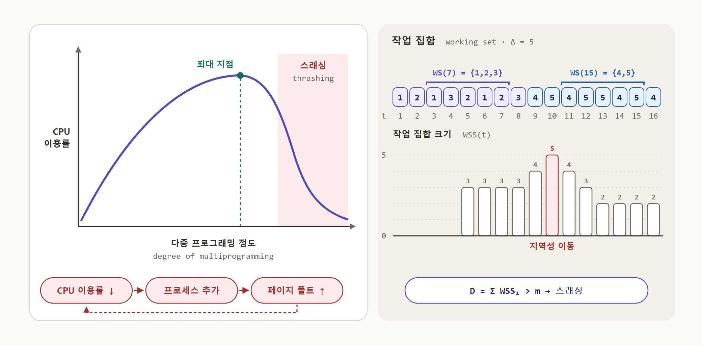

# 가상 메모리: 페이지 폴트, 페이지 교체, 그리고 스래싱

> OS 학습 9단원. 물리 메모리보다 큰 주소 공간을 만드는 방법을 정리한다. 페이지 폴트가 처리되는 일곱 단계, fork를 빠르게 만드는 쓰기 시 복사, 같은 참조열로 직접 계산한 네 가지 페이지 교체 알고리즘, FIFO의 이상한 성질, 그리고 메모리가 모자랄 때 시스템이 멈춰 버리는 스래싱까지 이어 간다.

---

## 1. 가상 메모리는 왜 필요한가

8단원의 **페이징**은 주소 공간을 같은 크기의 페이지로 나누고, **페이지 테이블**로 각 페이지를 물리 프레임에 대응시켰다. 하지만 거기서는 프로세스의 주소 공간 전체가 물리 메모리 어딘가에 들어 있다고 가정했다. 가상 메모리는 이 가정을 버린다.

OSTEP은 메모리 가상화의 목표를 세 가지로 든다.

| 목표 | 뜻 |
|---|---|
| 투명성 (transparency) | 프로그램은 메모리가 가상화되었다는 사실을 모른다. 자기만의 큰 메모리가 있는 것처럼 동작한다 |
| 효율 (efficiency) | 시간(느려지지 않게)과 공간(변환용 자료 구조가 너무 크지 않게) 모두 효율적이어야 한다. TLB 같은 하드웨어 지원이 필요하다 |
| 보호 (protection) | 한 프로세스가 다른 프로세스나 운영체제의 메모리를 읽거나 바꾸지 못한다. 그래서 프로세스끼리 **격리**된다 |

여기에 하나가 더 붙는다. **물리 메모리보다 큰 주소 공간**이다. 큰 주소 공간이 있으면 프로그래머는 메모리가 충분한지 신경 쓰지 않고 필요한 만큼 할당하면 된다. 옛 시스템의 오버레이(overlay)처럼 코드와 데이터를 직접 메모리에 넣고 빼는 수고가 사라진다. 여러 프로그램을 동시에 올려 두는 다중 프로그래밍도 이것을 요구했다. 모든 프로세스의 모든 페이지를 한꺼번에 담을 수는 없기 때문이다.

실제로 프로세스는 자기 페이지를 한꺼번에 다 쓰지 않는다. 드물게만 도는 오류 처리 코드, 최악의 경우에 맞춰 크게 잡은 배열, 거의 안 쓰는 기능이 그렇다. 필요한 페이지만 메모리에 두면 각 프로세스가 차지하는 메모리가 줄어 더 많은 프로세스를 올릴 수 있고, CPU 이용률과 처리량이 올라간다.

### 스왑 공간과 present 비트

메모리에 두지 않은 페이지는 디스크의 **스왑 공간**에 둔다. 운영체제는 스왑 공간에 페이지 단위로 읽고 쓰며, 각 페이지의 디스크 주소를 기억한다. 스왑 공간의 크기가 시스템이 한 번에 쓸 수 있는 페이지 수의 상한이 된다. 단, `ls` 같은 실행 파일의 코드 페이지는 원래 파일에서 다시 읽으면 되므로 내보낼 때 스왑에 쓸 필요가 없다.

그럼 하드웨어는 어떤 페이지가 메모리에 없는지 어떻게 알까? 페이지 테이블 항목(PTE)에 **present 비트**를 둔다. 1이면 물리 메모리에 있고, 0이면 디스크에 있다. 0일 때는 PTE에서 원래 물리 프레임 번호(PFN)를 담던 자리에 디스크 주소를 적어 둘 수 있다.

> 헷갈리기 쉬운 점: **valid 비트 ≠ present 비트**. valid가 0이면 그 주소는 애초에 주소 공간에 속하지 않는다(버그). present가 0이면 정당한 페이지지만 지금 디스크에 있을 뿐이다. 그리고 **가상 메모리 ≠ 스왑 공간**이다. 스왑 공간은 가상 메모리를 만드는 재료 중 하나다.

이렇게 보면 물리 메모리는 가상 메모리 페이지를 담는 **캐시**다. 캐시가 늘 그렇듯, 핵심은 미스(디스크까지 가는 일)를 얼마나 줄이느냐다.

---

## 2. 요구 페이징과 페이지 폴트



**요구 페이징**(demand paging)은 페이지를 미리 올리지 않고, 실제로 접근될 때 메모리로 가져오는 방식이다. 처음에 아무 페이지도 올리지 않고 시작하면 **순수 요구 페이징**이다. 반대로 곧 쓸 것 같은 페이지를 미리 가져오는 것은 **선반입**(prefetching)이다. 예를 들어 코드 페이지 P를 가져올 때 P+1도 같이 가져온다.

메모리에 없는 페이지에 접근하면 **페이지 폴트**가 난다. 그림의 순서대로 따라가 보자. 회색·주황색 단계는 프로세스와 하드웨어가, 보라색 단계는 운영체제가 한다.

1. 프로세스가 명령어를 실행한다. 예를 들어 주소 A에서 값을 읽는다.
2. **MMU**가 주소를 변환한다. TLB에 없으면 페이지 테이블에서 PTE를 찾는데, present 비트가 0이다. 하드웨어는 **페이지 폴트 예외**를 일으켜 커널로 들어간다(1단원의 예외).
3. 커널의 페이지 폴트 핸들러가 주소가 유효한지 검사한다. 주소 공간 밖의 잘못된 주소라면 프로세스를 끝낸다. 리눅스에서 매핑되지 않은 주소를 건드리면 `SIGSEGV` 시그널을 받는다.
4. 유효하면 빈 물리 프레임을 찾는다. 없으면 **페이지 교체 정책**으로 내보낼 페이지(victim)를 고른다. victim이 수정된 페이지라면 디스크에 먼저 써야 한다(4절).
5. PTE에 적힌 디스크 주소에서 페이지를 읽어 그 프레임에 넣는다. 디스크 입출력 동안 이 프로세스는 **대기**(blocked) 상태가 되고, 운영체제는 그동안 다른 준비 상태 프로세스를 실행한다(3단원의 프로세스 상태, 5단원의 스케줄러).
6. 읽기가 끝나면 PTE를 갱신한다. present를 1로 바꾸고 PFN을 기록한다.
7. 폴트를 낸 명령어를 **처음부터 다시 실행**한다. 첫 재시도는 TLB 미스가 나서 TLB를 채우고, 다음 재시도에서 TLB 적중으로 값을 읽는다.

**왜 하드웨어가 아니라 운영체제가 처리할까?** OSTEP의 설명은 두 가지다. 첫째, 디스크가 워낙 느려서 소프트웨어로 처리하는 추가 비용은 거의 티가 안 난다. 둘째, 하드웨어가 처리하려면 스왑 공간이 어디 있는지, 디스크에 입출력을 어떻게 내는지까지 알아야 한다.

**왜 "폴트"라고 부를까?** 정당한 페이지에 정당하게 접근했을 뿐이니 사실은 "페이지 미스"라고 부르는 게 맞다. 하지만 처리 방식이 잘못된 접근과 똑같다. 하드웨어가 예외를 일으키고 운영체제가 넘겨받는다. 그래서 폴트라는 이름이 붙었다. 1단원에서 본 것처럼 폴트는 처리 후 **원인 명령어로** 돌아가 다시 실행한다.

> 헷갈리기 쉬운 점: **TLB 미스 ≠ 페이지 폴트**. TLB 미스는 변환 정보가 TLB에 없을 뿐이다. 페이지 테이블에서 찾아 TLB를 채우면 끝난다. 페이지 폴트는 페이지 자체가 물리 메모리에 없어서 디스크 입출력이 필요하다. 메모리 접근과 디스크 접근의 차이만큼 비용이 다르다.

### 페이지 폴트는 얼마나 비싼가

8단원에서 TLB로 계산한 실효 접근 시간을 페이지 폴트까지 넓혀 보자. 메모리 접근이 200ns, 페이지 폴트 처리가 8ms(메모리 접근의 4만 배)라고 하자. 폴트 확률을 p라 하면 실효 접근 시간은 다음과 같다.

```
실효 접근 시간 = (1 − p) × 200ns + p × 8,000,000ns
              = 200ns + 7,999,800ns × p
```

| 폴트 확률 p | 실효 접근 시간 | 느려지는 정도 |
|---|---|---|
| 0 | 200ns | 기준 |
| 1/1,000 | 약 8.2µs | 약 40배 |
| 0.0000025 (약 40만 번에 1번) | 약 220ns | 10% |

천 번에 한 번만 폴트가 나도 40배 느려진다. 10% 이내로 버티려면 약 40만 번에 한 번보다 드물어야 한다. 교체 정책이 조금만 나아져도 성능 차이가 큰 이유다.

### 명령어 재실행의 함정

7단계의 "처음부터 다시 실행"은 단순한 명령어에서는 문제가 없다. 하지만 한 명령어가 페이지 경계를 넘는 큰 메모리 블록을 옮기는 아키텍처라면, 데이터 일부를 이미 바꾼 뒤에 폴트가 날 수 있다. 그러면 다시 실행할 때 결과가 달라진다. 한 가지 해법은 명령어를 시작하기 전에 블록의 양 끝을 먼저 건드려, 필요한 페이지를 모두 올려 두는 것이다.

### 실제 운영체제는 미리 비워 둔다

위 흐름은 메모리가 꽉 찬 다음에야 교체한다고 가정했다. 실제 운영체제는 빈 프레임을 조금 남겨 둔다. 빈 페이지가 하한(low watermark)보다 적어지면 백그라운드 스레드(**스왑 데몬**, 페이지 데몬)가 깨어나 상한(high watermark)까지 페이지를 내보낸다. 여러 페이지를 한꺼번에 묶어 쓰면 디스크 효율도 좋아진다.

---

## 3. 쓰기 시 복사: fork가 빠른 이유

3단원에서 `fork()`는 부모의 주소 공간을 그대로 복제한다고 했다. 주소 공간이 크면 이 복사는 느리다. 게다가 자식은 대개 곧바로 `exec()`를 불러 주소 공간을 통째로 덮어쓴다. 애써 복사한 페이지를 바로 버리는 셈이다.

**쓰기 시 복사**(copy-on-write, COW)는 복사를 미룬다.

| 시점 | 부모·자식의 페이지 |
|---|---|
| `fork()` 직후 | 복사하지 않는다. 같은 물리 페이지를 양쪽 주소 공간에 매핑하고 **둘 다 읽기 전용**으로 표시한다 |
| 둘 다 읽기만 할 때 | 아무 일도 없다. 데이터를 옮기지 않고 복사가 끝난 셈이다 |
| 한쪽이 페이지 C에 쓸 때 | 쓰기 보호 위반으로 커널에 트랩된다. 커널은 COW 페이지임을 확인하고 새 프레임을 할당해 C의 내용을 복사한 뒤, 쓴 쪽 주소 공간에 새 페이지를 매핑한다 |
| 자식이 `exec()`할 때 | 공유하던 페이지를 버린다. 대부분의 페이지는 끝내 복사되지 않는다 |

```c
#include <stdio.h>
#include <stdlib.h>
#include <string.h>
#include <sys/wait.h>
#include <unistd.h>
int main(void) {
    size_t n = 256UL << 20;          // 256MB
    char *buf = malloc(n);
    memset(buf, 'A', n);             // 부모가 페이지를 실제로 채운다
    if (fork() == 0) {               // 페이지는 복사되지 않고 읽기 전용으로 공유
        buf[0] = 'B';                // 쓰기 → 폴트 → 이 페이지 하나만 복사
        printf("child:  %c\n", buf[0]);   // B
        _exit(0);
    }
    wait(NULL);
    printf("parent: %c\n", buf[0]);       // A, 부모 쪽은 그대로
    return 0;
}
```

256MB를 복사하는 대신, 자식이 쓴 페이지 하나만 복사된다. 리눅스도 `fork()`에서 이렇게 게으른 복사를 한다. 바뀔 수 없는 코드 페이지는 COW 표시도 필요 없이 그냥 공유한다. 공유 라이브러리도 여러 프로세스에 COW로 매핑해 메모리를 아낀다.

비슷한 게으름이 하나 더 있다. **요구 시 0 채우기**(demand zeroing)다. 힙에 페이지를 추가할 때 바로 물리 페이지를 찾아 0으로 지우는 대신(이전 사용자의 데이터가 보이면 안 되므로 지우기는 필수다), 페이지 테이블에 접근 불가로만 표시해 둔다. 실제로 접근하는 순간 트랩이 나면 그때 페이지를 찾아 지우고 매핑한다. 끝내 안 쓰면 그 일을 아예 하지 않는다.

`vfork()`는 다른 길을 택했다. 자식이 부모의 페이지를 복사 없이 그대로 쓰고, 그동안 부모는 멈춘다. 매우 빠르지만 자식은 `exec()` 전까지 공유 페이지를 바꾸면 안 된다.

> 헷갈리기 쉬운 점: **쓰기 시 복사 ≠ 공유 메모리**(3단원). COW는 쓰기 전까지만 공유하고, 누가 쓰는 순간 그 페이지를 갈라 서로의 변경이 보이지 않는다. 공유 메모리는 계속 같은 페이지를 공유해서 한쪽이 쓰면 다른 쪽에 바로 보인다.

---

## 4. 페이지 교체: 같은 참조열, 네 알고리즘



빈 프레임이 없으면 누군가를 내보내야 한다. 이때 victim이 수정된 페이지면 디스크에 한 번 더 써야 하므로 폴트 처리 시간이 거의 두 배가 된다. 그래서 PTE에는 **더티 비트**(modify bit)가 있다. 페이지에 쓰기가 일어나면 하드웨어가 1로 만든다. 더티 비트가 0인 깨끗한 페이지는 쓰기 없이 프레임을 바로 재사용할 수 있다.

알고리즘은 **참조열**(reference string)로 비교한다. 참조열에는 페이지 번호만 남긴다. 페이지 안의 오프셋은 교체와 상관없고, 같은 페이지를 연달아 접근하면 두 번째부터는 무조건 적중이므로 하나로 합친다.

그림은 교과서에 자주 나오는 참조열 `7 0 1 2 0 3 0 4 2 3 0 3 2 1 2 0 1 7 0 1`을 프레임 3개로 돌린 결과다. 빨간 칸이 폴트로 새로 들어온 페이지, 아래 점이 폴트, 흐린 숫자는 적중한 시점의 프레임 상태다. 손으로 계산한 값을 작은 시뮬레이터로 한 번 더 확인했다.

| 알고리즘 | 내보내는 페이지 | 폴트 수 | 구현 |
|---|---|---|---|
| FIFO | 가장 먼저 **들어온** 페이지 | 15 | 큐 하나. 매우 쉽다 |
| OPT (MIN) | 앞으로 가장 오래 **안 쓰일** 페이지 | **9** | 미래를 알아야 해서 불가능 |
| LRU | 가장 오래 **안 쓰인** 페이지 | 12 | 접근마다 기록 갱신. 비싸다 |
| 클럭 (2차 기회) | 참조 비트가 0인 페이지 | 14 | 참조 비트 하나. 싸다 |

참조열에 나오는 서로 다른 페이지는 7, 0, 1, 2, 3, 4의 6개다. 처음 한 번씩은 어떤 알고리즘이든 폴트가 나야 하므로(강제 미스, cold-start miss) 6번은 피할 수 없다. OPT는 그 위로 3번만 더 냈다.

**결정이 갈리는 지점을 보자.** 6번째 참조(페이지 3)에서 프레임에는 2, 0, 1이 있다.

- FIFO는 가장 먼저 들어온 **0**을 내보낸다. 그런데 바로 다음 참조가 0이라 또 폴트가 난다. 0이 방금 쓰였다는 사실을 모르기 때문이다.
- OPT는 앞을 본다. 2는 9번째, 0은 7번째, 1은 14번째에 다시 쓰인다. 가장 먼 **1**을 내보낸다.
- LRU는 뒤를 본다. 2는 4번째, 0은 5번째, 1은 3번째에 마지막으로 쓰였다. 가장 오래된 **1**을 내보낸다. 여기서는 과거가 미래를 잘 맞혔다.

> 헷갈리기 쉬운 점: **FIFO ≠ LRU**. FIFO는 *적재* 시각이, LRU는 *사용* 시각이 가장 오래된 페이지를 고른다. 아무리 자주 쓰는 페이지도 FIFO에서는 오래됐다는 이유로 쫓겨난다.

### LRU는 왜 그대로 못 쓰나

LRU가 통하는 이유는 **참조 지역성** 덕분이다. 프로그램은 최근에 쓴 페이지(시간 지역성)와 그 근처 페이지(공간 지역성)를 다시 쓰는 경향이 있다. 다만 법칙이 아니라 경향이다. 무작위로 접근하는 프로그램에는 통하지 않는다.

문제는 구현이다. 정확한 LRU는 **모든 메모리 접근마다** 기록을 갱신해야 한다. 접근마다 카운터 값을 PTE에 적거나, 접근한 페이지를 이중 연결 리스트의 맨 위로 옮기는 식이다. 어느 쪽이든 하드웨어 지원이 필요하다. 시각을 적어 두고 교체 때 가장 오래된 것을 찾는 방법도 있지만, 4GB 메모리를 4KB 페이지로 나누면 100만 개를 뒤져야 한다.

### 클럭: 참조 비트로 LRU 흉내 내기

그래서 많은 시스템은 **참조 비트**(use bit)로 LRU를 근사한다. 페이지가 읽히거나 쓰이면 하드웨어가 참조 비트를 1로 만든다. 0으로 지우는 일은 운영체제가 한다.

**클럭 알고리즘**은 프레임들을 원형으로 늘어놓고 시곗바늘을 돌린다. 교체가 필요하면 바늘이 가리키는 페이지를 본다.

1. 참조 비트가 1이면 최근에 쓰였다는 뜻이다. 비트를 0으로 지우고(두 번째 기회) 바늘을 다음으로 옮긴다.
2. 참조 비트가 0인 페이지를 만나면 그 페이지를 내보내고, 새 페이지를 넣은 뒤 바늘을 한 칸 옮긴다.

모든 비트가 1이면 한 바퀴 돌며 다 지운 뒤 처음 페이지를 내보내므로 FIFO와 같아진다. 2차 기회(second-chance) 알고리즘과 하는 일이 같고, 페이지를 큐 뒤로 옮기는 대신 바늘만 움직여 더 효율적이다.

그림의 클럭은 "새로 들어온 페이지와 적중한 페이지는 참조 비트 1, 바늘은 교체한 칸의 다음으로"라는 규칙으로 계산했다. 4번째 참조(페이지 2)에서 7, 0, 1의 비트가 모두 1이라 바늘이 한 바퀴 돌며 다 지우고 7을 내보낸다. FIFO와 같은 선택이다. 결과는 14번으로 FIFO(15)와 LRU(12) 사이에 왔다. 참조 비트를 언제 1로 두는지 같은 세부 규칙이 바뀌면 횟수도 달라질 수 있다.

**더티 비트까지 보는 클럭**(enhanced second chance)은 (참조, 더티) 쌍으로 페이지를 네 부류로 나누고, 낮은 부류부터 내보낸다.

| (참조, 더티) | 뜻 | 내보내는 순서 |
|---|---|---|
| (0, 0) | 최근에 안 쓰였고 깨끗함 | 1순위 |
| (0, 1) | 최근에 안 쓰였지만 수정됨 | 2순위 |
| (1, 0) | 최근에 쓰였고 깨끗함 | 3순위 |
| (1, 1) | 최근에 쓰였고 수정됨 | 4순위 |

### 워크로드가 바뀌면 순위도 바뀐다

OSTEP은 100개 페이지에 1만 번 접근하는 워크로드로 정책들을 비교했다.

- **지역성이 없는** 무작위 접근: 현실적인 정책(LRU, FIFO, 무작위)은 모두 같고, 적중률은 캐시 크기로만 정해진다.
- **80-20** 워크로드(80%의 접근이 20%의 페이지에 몰림): LRU가 FIFO와 무작위보다 낫다. 자주 쓰는 페이지를 붙잡고 있기 때문이다.
- **순차 반복**(페이지 0~49를 계속 반복): LRU와 FIFO 모두 최악이다. 캐시가 49칸이어도 적중률이 0%다. 곧 다시 쓸 가장 오래된 페이지를 내보내기 때문이다. 오히려 무작위가 낫다.

리눅스의 페이지 캐시는 LRU의 이런 약점을 피하려고 2Q를 변형한 두 리스트(inactive, active)를 쓴다고 OSTEP은 설명한다. 처음 접근한 페이지는 inactive 리스트에, 다시 접근하면 active 리스트로 올리고, 교체는 inactive 리스트에서 한다.

---

## 5. 벨레이디의 이상 현상: 프레임을 늘렸는데 폴트가 늘었다



보통은 프레임을 늘리면 폴트가 줄거나 그대로일 거라고 기대한다. 그런데 1969년 벨레이디(Bélády)와 동료들이 FIFO에서 그렇지 않은 참조열을 찾았다. 그림의 참조열 `1 2 3 4 1 2 5 1 2 3 4 5`다.

- **프레임 3개**: 5를 넣을 때 4를 내보낸 덕에 바로 뒤의 1, 2가 적중한다. 폴트 **9번**.
- **프레임 4개**: 1, 2가 처음에는 적중하지만, 5가 들어오며 가장 오래된 1을 내보낸다. 그 뒤 1 → 2 → 3 → 4 → 5가 줄줄이 직전에 쫓겨난 페이지를 찾는다. 폴트 **10번**.

오른쪽 그래프는 프레임 수 1~6에 대해 직접 계산한 폴트 수다.

| 프레임 수 | 1 | 2 | 3 | 4 | 5 | 6 |
|---|---|---|---|---|---|---|
| FIFO | 12 | 12 | 9 | **10** | 5 | 5 |
| LRU | 12 | 12 | 10 | 8 | 5 | 5 |

FIFO만 3에서 4로 갈 때 폴트가 늘어난다. 5개부터는 다섯 페이지가 다 들어가므로 강제 미스 5번뿐이다.

**LRU와 OPT는 왜 괜찮을까?** 둘 다 **스택 알고리즘**이기 때문이다. 프레임 N개일 때 메모리에 있는 페이지 집합이 언제나 프레임 N+1개일 때 집합의 부분집합이다. LRU라면 "가장 최근에 쓴 N개"는 항상 "가장 최근에 쓴 N+1개"에 들어 있다. 그러니 프레임을 늘려서 적중하던 것이 미스로 바뀔 수 없다. FIFO와 무작위는 이 성질이 없다. 위 표의 프레임 4개 FIFO를 보면 7번째 참조 직후 메모리는 {5, 2, 3, 4}인데, 프레임 3개일 때는 {5, 1, 2}다. 1이 3개짜리에는 있고 4개짜리에는 없다.

덧붙여, 위 규칙으로 계산한 클럭도 이 참조열에서 프레임 3개 9번, 4개 10번이 나왔다. 참조 비트가 모두 1로 차면 FIFO처럼 동작하기 때문으로 보인다.

---

## 6. 프레임 할당: 누구에게 몇 개를 줄까

교체 정책이 "무엇을 내보낼까"라면, **프레임 할당**은 "프로세스마다 프레임을 몇 개 줄까"다. 요구 페이징을 구현하려면 두 알고리즘이 모두 필요하다.

**최소 개수**는 아키텍처가 정한다. 명령어 하나가 동시에 건드릴 수 있는 페이지 수만큼은 있어야 그 명령어를 끝낼 수 있다. 명령어 자체가 페이지 경계에 걸치거나, 피연산자가 여러 페이지에 걸치거나, 간접 주소 지정을 여러 단계 거치면 그 수가 늘어난다. 그래서 아키텍처는 간접 단계 수에 제한을 둔다.

**나누는 방법**은 두 가지다. 프레임 60개를 크기 20페이지인 프로세스 A와 100페이지인 B에 나눈다고 하자.

| 방법 | 규칙 | A | B |
|---|---|---|---|
| 균등 할당 | m개를 n개 프로세스에 m/n씩 | 30 | 30 |
| 비례 할당 | 크기에 비례: aᵢ = m × sᵢ / Σs | 60 × 20/120 = 10 | 60 × 100/120 = 50 |

균등 할당에서 A는 20페이지짜리인데 30프레임을 받아 10개를 낭비한다. 비례 할당은 크기 대신 우선순위를 섞어 쓰기도 한다.

**교체 범위**도 정해야 한다.

| | 지역 교체 (local) | 전역 교체 (global) |
|---|---|---|
| victim 후보 | 자기 프레임만 | 모든 프레임 (다른 프로세스 것도) |
| 프로세스별 프레임 수 | 고정 | 변한다 |
| 장점 | 자기 폴트율을 스스로 통제. 부하가 달라도 성능이 일정 | 전체적으로 효율적. 더 흔히 쓰인다 |

---

## 7. 스래싱과 작업 집합



실행 중인 프로세스들이 요구하는 메모리가 물리 메모리를 넘으면 시스템은 쉬지 않고 페이지를 들이고 내보낸다. 곧 다시 쓸 페이지를 내보내고, 바로 다시 가져온다. 실행보다 페이징에 시간을 더 쓰는 이 상태가 **스래싱**(thrashing)이다.

### 왜 생기나: 악순환

왼쪽 그래프가 다중 프로그래밍 정도(메모리에 올린 프로세스 수)에 따른 CPU 이용률이다. 그래프의 모양은 개념을 보여 주는 그림이고 실제 측정값은 아니다.

옛 스케줄러는 CPU 이용률이 낮으면 프로세스를 더 넣었다. 처음에는 이게 맞다. 한 프로세스가 입출력을 기다리는 동안 다른 프로세스가 CPU를 쓰니 이용률이 오른다. 하지만 메모리가 차기 시작하면 아래쪽 악순환이 돈다.

1. 프로세스들이 페이지를 기다리느라 대기 상태가 되고, **CPU 이용률이 떨어진다**.
2. 스케줄러는 이용률이 낮으니 **프로세스를 더 넣는다**.
3. 프로세스마다 프레임이 더 줄어 **페이지 폴트가 늘어난다**. 다시 1로.

결국 시스템이 거의 멈춘다. 지역 교체를 쓰면 스래싱하는 프로세스가 남의 프레임을 빼앗지는 못한다. 그래도 디스크 입출력 큐를 막아서 조금이라도 페이징하는 다른 프로세스까지 느려진다.

### 작업 집합 모델

막으려면 각 프로세스에 "지금 필요한 만큼"의 프레임을 줘야 한다. 그게 얼마인지는 **지역성 모델**이 알려 준다. 프로세스는 한동안 특정 구역(함수 하나와 그 데이터)을 집중적으로 쓰다가 다른 구역으로 옮겨 간다. 지금 구역의 페이지만 메모리에 있으면 폴트는 구역을 옮길 때 주로 생긴다.

**작업 집합**(working set)은 이것을 숫자로 만든다. 최근 Δ번의 참조(작업 집합 창)에 나타난 페이지들의 집합이다. 오른쪽 그림은 Δ = 5인 예다.

| 시각 t | 창 안의 참조 | 작업 집합 | 크기 |
|---|---|---|---|
| 7 | 1 3 2 1 2 | {1, 2, 3} | 3 |
| 10 | 1 2 3 4 5 | {1, 2, 3, 4, 5} | 5 |
| 15 | 4 5 5 4 5 | {4, 5} | 2 |

1·2·3 구역에서 4·5 구역으로 옮겨 가는 시각 10 근처에서 작업 집합이 잠깐 커진다. 구역이 바뀔 때 폴트가 몰리는 것과 같은 모습이다.

Δ를 고르는 게 중요하다. 너무 작으면 지금 구역을 다 담지 못하고, 너무 크면 이미 안 쓰는 페이지까지 담는다.

모든 프로세스의 작업 집합 크기를 더한 값을 D라 하고 프레임 수를 m이라 하자. **D > m이면 적어도 한 프로세스는 스래싱한다.** 이때는 프로세스 하나를 통째로 내보내(일시 정지) 남은 프로세스들이 작업 집합을 담을 수 있게 한다. 반대로 D가 m보다 충분히 작으면 프로세스를 더 넣어도 된다. 이렇게 스래싱을 막으면서도 다중 프로그래밍 정도를 가능한 높게 유지한다.

작업 집합을 정확히 추적하려면 참조마다 창을 밀어야 하니 비싸다. 참조 비트와 타이머로 근사한다. 예를 들어 5,000번 참조마다 타이머가 울리면, 지금 참조 비트를 이력 비트 두 개 중 하나로 옮기고 지운다. 세 비트 중 하나라도 1이면 최근 15,000번 안에 쓰인 페이지로 보고 작업 집합에 넣는다.

### 페이지 폴트 빈도

더 직접적인 방법도 있다. 우리가 정말 통제하고 싶은 것은 폴트율이니, 그것을 바로 잰다. **페이지 폴트 빈도**(PFF) 방식은 프로세스별 폴트율에 상한과 하한을 둔다.

| 폴트율 | 뜻 | 조치 |
|---|---|---|
| 상한보다 높음 | 프레임이 모자람 | 프레임을 더 준다 |
| 상한과 하한 사이 | 적당함 | 그대로 |
| 하한보다 낮음 | 프레임이 남음 | 프레임을 거둬 다른 프로세스에 준다 |

### 실제 시스템의 선택

일부 옛 운영체제는 일부 프로세스를 아예 실행하지 않는 **승인 제어**(admission control)로 대응했다. 남은 프로세스들의 작업 집합이 메모리에 들어가서 일을 진척시킬 수 있게 하려는 것이다. 모든 일을 어설프게 하느니 적은 일을 제대로 하는 편이 낫다는 생각이다. 일부 리눅스는 더 과격하게 메모리가 넘치면 **OOM killer**(out-of-memory killer)가 메모리를 많이 쓰는 프로세스를 골라 죽인다. 효과는 있지만 화면 서버 같은 중요한 프로세스를 죽이면 곤란해진다.

> 비유: 좁은 책상에서 다섯 과목을 동시에 공부하는 학생을 떠올려 보자. 과목마다 책 세 권이 필요한데 책상에는 여섯 권만 놓인다. 한 과목을 펴면 다른 과목 책을 치워야 하고, 곧 그 과목으로 돌아와 다시 꺼낸다. 공부보다 책 정리에 시간을 다 쓴다. 과목을 두 개로 줄이면 오히려 더 많이 끝낸다.

> 헷갈리기 쉬운 점: **스래싱 ≠ 벨레이디의 이상 현상**. 둘 다 "늘렸는데 나빠지는" 현상이다. 하지만 스래싱은 *프로세스*를 늘려 메모리가 모자라 시스템 전체가 느려지는 것이다. 벨레이디의 이상 현상은 한 참조열에서 FIFO에 *프레임*을 늘렸는데 폴트가 늘어나는, 알고리즘 자체의 성질이다.

---

## 8. 메모리 맵 파일: mmap

요구 페이징은 파일에도 쓸 수 있다. `mmap()`은 호출한 프로세스의 가상 주소 공간에 새 매핑을 만든다. 이미 연 파일 디스크립터를 넘기면, 파일 내용이 놓인 것처럼 보이는 메모리 구간의 시작 주소를 돌려준다. 그다음부터는 포인터로 파일의 어느 부분이든 읽는다.

```c
#include <fcntl.h>
#include <stdio.h>
#include <sys/mman.h>
#include <sys/stat.h>
#include <unistd.h>
int main(int argc, char *argv[]) {
    int fd = open(argv[1], O_RDONLY);
    struct stat st;
    fstat(fd, &st);
    char *p = mmap(NULL, st.st_size, PROT_READ, MAP_PRIVATE, fd, 0);
    // 여기까지는 파일 내용을 하나도 읽지 않았다
    long lines = 0;
    for (off_t i = 0; i < st.st_size; i++)  // 처음 닿는 페이지마다 페이지 폴트 → 요구 페이징
        if (p[i] == '\n') lines++;
    printf("%ld lines\n", lines);
    munmap(p, st.st_size);
    close(fd);
    return 0;
}
```

아직 메모리에 없는 부분에 처음 닿으면 페이지 폴트가 나고, 운영체제가 그 부분을 읽어 페이지 테이블을 갱신한다. 2절의 흐름 그대로다. 매핑 방식은 두 가지다.

| 플래그 | 쓰기의 결과 |
|---|---|
| `MAP_SHARED` | 같은 구간을 매핑한 다른 프로세스에 보이고, 파일에도 반영된다. 반영 시점을 정확히 정하려면 `msync()`를 쓴다 |
| `MAP_PRIVATE` | **쓰기 시 복사** 사본이 생긴다. 다른 프로세스에도, 파일에도 반영되지 않는다 |

여러 프로세스가 같은 파일을 `MAP_SHARED`로 매핑하면 파일을 공유할 수 있다. 이때는 6단원에서 볼 동기화가 필요할 수 있다.

`main()`에서 `mmap()`을 직접 부르지 않아도 모든 리눅스 프로세스는 메모리 맵 파일을 쓴다. 리눅스가 실행 파일의 코드와 공유 라이브러리를 메모리 매핑으로 적재하기 때문이다. `pmap` 명령으로 프로세스의 매핑을 보면 실행 파일, `libc` 같은 라이브러리, 익명(anon) 영역이 줄지어 나온다.

---

## 정리

- **가상 메모리**는 주소 공간 일부를 **스왑 공간**에 두어 물리 메모리보다 큰 주소 공간을 주고, 프로세스끼리 메모리를 **격리**한다. PTE의 **present 비트**가 페이지가 메모리에 있는지 알려 준다.
- **요구 페이징**은 접근할 때 페이지를 가져온다. **페이지 폴트**는 트랩 → 주소 검사 → 프레임 확보(필요하면 교체) → 디스크에서 읽기(그동안 대기) → 페이지 테이블 갱신 → 명령어 재실행 순서로 처리된다.
- **쓰기 시 복사**는 fork의 복사를 첫 쓰기까지 미뤄, 곧 exec할 자식을 위한 쓸모없는 복사를 없앤다.
- 같은 참조열에서 폴트 수는 **OPT 9 < LRU 12 < 클럭 14 < FIFO 15**였다. OPT는 기준선, LRU는 지역성 덕분에 좋지만 비싸고, **클럭**은 참조 비트 하나로 LRU를 근사한다. **더티 비트**가 있으면 깨끗한 페이지를 먼저 내보낸다.
- FIFO는 프레임을 늘렸는데 폴트가 느는 **벨레이디의 이상 현상**(9 → 10)을 보인다. LRU와 OPT는 **스택 알고리즘**이라 그렇지 않다.
- 프로세스들의 작업 집합 합이 프레임 수를 넘으면 **스래싱**이 생긴다. **작업 집합** 모델이나 **페이지 폴트 빈도**로 프레임을 조절하고, 필요하면 프로세스를 내보내 막는다.
- **mmap**은 파일을 주소 공간에 매핑해 요구 페이징으로 읽는다. `MAP_PRIVATE`는 쓰기 시 복사다.

## 아직 답을 못 찾은 질문

- 지금의 리눅스 커널은 페이지 교체에 정확히 어떤 알고리즘을 기본으로 쓰나? OSTEP이 설명한 active/inactive 두 리스트(2Q 변형)가 여전히 기본인가, 다른 방식으로 바뀌었나?
- x86의 `rep movs`처럼 한 명령어가 페이지 경계를 넘나들며 많은 데이터를 옮기다가 중간에 페이지 폴트가 나면, 명령어 재실행이 올바르게 되도록 하드웨어와 커널은 무엇을 보장하나?

## 참고 자료

- Remzi & Andrea Arpaci-Dusseau, *Operating Systems: Three Easy Pieces*, [Ch.13 The Abstraction: Address Spaces](https://pages.cs.wisc.edu/~remzi/OSTEP/vm-intro.pdf)
- 같은 책, [Ch.21 Beyond Physical Memory: Mechanisms](https://pages.cs.wisc.edu/~remzi/OSTEP/vm-beyondphys.pdf)
- 같은 책, [Ch.22 Beyond Physical Memory: Policies](https://pages.cs.wisc.edu/~remzi/OSTEP/vm-beyondphys-policy.pdf)
- 같은 책, [Ch.23 Complete Virtual Memory Systems](https://pages.cs.wisc.edu/~remzi/OSTEP/vm-complete.pdf)
- UIC CS 385 Course Notes, [Virtual Memory](https://www.cs.uic.edu/~jbell/CourseNotes/OperatingSystems/9_VirtualMemory.html) (Silberschatz 외, *Operating System Concepts* 9판 9장 기반)
- Linux manual page, [mmap(2)](https://man7.org/linux/man-pages/man2/mmap.2.html)
