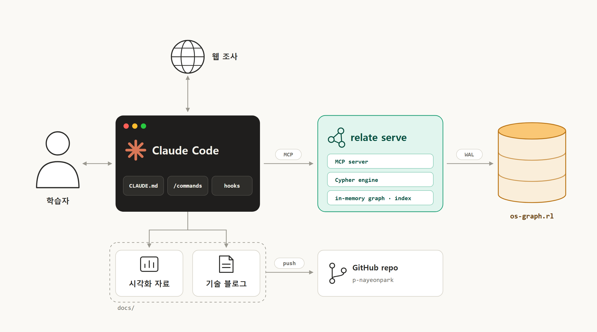
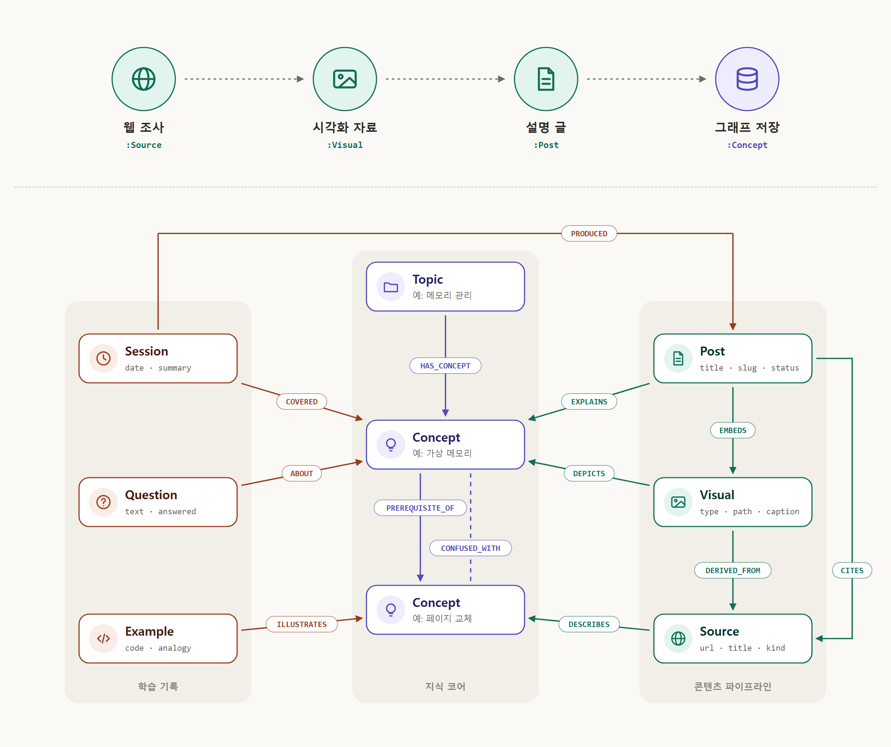

# relate-os-graph

Claude Code 세션에서 운영체제(OS)를 공부하며 나온 개념·질문·예제를
[relate](https://relatedb.ai/) 임베디드 그래프 DB에 지식 그래프로 쌓는 프로젝트.
학습 결과물은 **웹 조사 → 시각화 자료 → 설명 글** 흐름의 기술 블로그 형태로 남긴다.

## 아키텍처



> 원본: [docs/architecture.html](docs/architecture.html)

## 그래프 설계



> 원본: [docs/graph-schema.html](docs/graph-schema.html)

| 영역 | 노드 | 관계 |
|---|---|---|
| 지식 코어 | `Topic`, `Concept` | `HAS_CONCEPT`, `PREREQUISITE_OF`, `CONFUSED_WITH` |
| 학습 기록 | `Session`, `Question`, `Example` | `COVERED`, `ABOUT`, `ILLUSTRATES`, `PRODUCED` |
| 콘텐츠 파이프라인 | `Source`, `Visual`, `Post` | `DESCRIBES`, `DEPICTS`, `EXPLAINS`, `EMBEDS`, `DERIVED_FROM`, `CITES` |

## 설치와 연결

relate v1.2.0 기준.

```powershell
# 1. relate CLI 설치 (%LOCALAPPDATA%\Programs\relate, 사용자 PATH에 추가됨)
irm https://relatedb.ai/install.ps1 | iex

# 2. 동작 확인 (그래프 파일이 없으면 새로 만든다)
relate query --database ./relate-os-graph/data/os-graph.rl --read-only -c "MATCH (n) RETURN count(n) AS nodes"
```

Claude Code는 레포 루트의 [`.mcp.json`](../.mcp.json)을 읽어
`relate serve --mcp stdio`를 띄운다. 처음 열 때 프로젝트 MCP 서버 사용을 승인하면 아래 도구가 생긴다.

| MCP 도구 | 역할 |
|---|---|
| `mcp__relate__write_cypher` | CREATE · MERGE · SET · DELETE |
| `mcp__relate__read_cypher` | 조회 전용 Cypher |
| `mcp__relate__get_schema` | 라벨·관계·속성 요약 |

> MCP 서버가 그래프 파일을 열고 있는 동안에는 CLI로 쓰기를 할 수 없다(단일 writer).

## 폴더 구조

```
relate-os-graph/
├── data/        # os-graph.rl (그래프 DB 파일, git 제외)
├── docs/        # 아키텍처·설계 문서, 시각화 자료, 블로그 글
│   └── images/
├── schema/      # 노드·관계 정의, 초기 Cypher
└── scripts/     # 시드, 내보내기, 시각화
```
